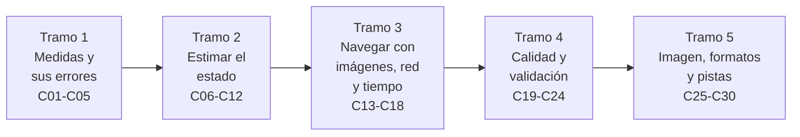

# B74 — Estimación de órbitas y navegación espacial

> **Bloque ampliado.** Tiene las 20 clases de la línea base (`B74-C01` a `B74-C20`) y 10 clases programadas por la ampliación (`B74-C21` a `B74-C30`), ahora redactadas. Ver el [programa completo](../../PROGRAMA_ACADEMICO_COMPLETO.md).

**Programa:** Programa Integral de Astronomía, Astrofísica, Ciencias Espaciales e Ingeniería Aeroespacial
**Área:** A06 — Mecánica orbital, navegación y vuelo espacial
**Nivel:** N3 (fundamentos disciplinares) · **Clases:** 30 · **Carga:** por calibrar con el uso
**Estado:** guía pedagógica del bloque (resumen de qué se aprende en cada clase). Las clases enlazadas en las tablas ya están redactadas; todas conservan el estado E0 en el catálogo hasta registrar revisión disciplinar.

## 🎯 Propósito del bloque

Enseña **cómo se pasa de medidas ruidosas (ángulos, tiempo de ida y vuelta de una señal, desplazamiento Doppler, imágenes) a un estado orbital con su incertidumbre**, y cómo se comprueba que esa estimación es honesta. Recorre los modelos de observación y los tres tipos clásicos de dato radiométrico y angular, los sesgos de las estaciones, la determinación inicial de órbita, el ajuste por mínimos cuadrados, los filtros recursivos (Kalman extendido y no lineal), las covarianzas y su propagación, la navegación óptica y con cámaras estelares, la geometría de la red de seguimiento, el tiempo, la navegación en espacio profundo y a bordo, las métricas, la validación contra efemérides de referencia, el uso de kernels SPICE, el informe verificable, las pruebas de consistencia, las medidas retardadas, la visión por computador para navegación, los pulsares de rayos X como técnica de investigación, los formatos TLE/OMM y la asociación de pistas. Cada clase cierra con un laboratorio en Python (NumPy) con semilla fija que usa **datos sintéticos rotulados**; nada de lo simulado se presenta como observado.

## 📚 Al terminar el bloque podrás

1. Escribir un modelo de observación `y = h(x) + ruido`, calcular su jacobiano y comprobarlo numéricamente.
2. Construir y leer medidas de ángulo, alcance y Doppler, con sus unidades, sus sesgos y su incertidumbre.
3. Obtener una órbita inicial a partir de pocas observaciones y refinarla por mínimos cuadrados con su covarianza.
4. Implementar un filtro de Kalman extendido y uno de puntos sigma (UKF) y compararlos.
5. Propagar una covarianza (lineal, Monte Carlo y puntos sigma) y juzgar si el filtro es consistente con NEES y NIS.
6. Evaluar la geometría de una red de seguimiento y el efecto del tiempo en la medida.
7. Validar una solución contra una efeméride de referencia y entregar un informe de navegación verificable.
8. Rotular qué es observado, qué es modelo consultado y qué es sintético en cada resultado.

## 🧭 Secuencia del bloque

**Descripción textual.** Cinco tramos encadenados: primero las medidas y sus errores (C01–C05), luego los métodos de estimación (C06–C12), después la navegación con imágenes, red de estaciones y tiempo (C13–C18), a continuación la calidad, la validación y el informe (C19–C24) y por último la visión por computador, los formatos de intercambio y la asociación de pistas (C25–C30). El hilo común es la incertidumbre: cada estado se entrega con su covarianza.

## 🗂️ Las 30 clases en resumen

**Navegación:** cada clase enlaza a la anterior, a la siguiente y a este bloque.

La columna «Evidencia» indica el producto que demostrará el aprendizaje. Los laboratorios usan datos **sintéticos** (rotulados) o valores publicados con fuente y fecha.

### Tramo 1 · Medidas y sus errores

| ID | Clase | Qué se aprende | Evidencia |
|---|---|---|---|
| [B74-C01](../clases/B74/B74-C01-modelos-de-observacion/CLASE.md) | Modelos de observación | La función `h(x)`, los residuos y el jacobiano analítico frente al numérico. | Ficha del modelo de observación de una estación |
| [B74-C02](../clases/B74/B74-C02-observacion-angular-y-astrometria/CLASE.md) | Observación angular y astrometría | Conversión de píxeles a ángulo, incertidumbre del centroide y aberración. | Presupuesto de error de una medida angular |
| [B74-C03](../clases/B74/B74-C03-medicion-de-alcance-por-radio/CLASE.md) | Medición de alcance por radio | Tiempo de ida y vuelta, resolución del código y corrección del retardo. | Ficha de una medida de alcance con su presupuesto |
| [B74-C04](../clases/B74/B74-C04-doppler-de-navegacion/CLASE.md) | Doppler de navegación | Doppler de dos sentidos, velocidad radial y ruido de la cuenta integrada. | Ficha de una medida Doppler de dos sentidos |
| [B74-C05](../clases/B74/B74-C05-sesgos-de-estaciones-terrestres/CLASE.md) | Sesgos de estaciones terrestres | Error de posición de la estación y sesgo de alcance, y su efecto en el ajuste. | Tabla de sensibilidad a sesgos |

### Tramo 2 · Estimar el estado

| ID | Clase | Qué se aprende | Evidencia |
|---|---|---|---|
| [B74-C06](../clases/B74/B74-C06-determinacion-inicial-de-orbita/CLASE.md) | Determinación inicial de órbita | Método de Gibbs y de Lambert a partir de posiciones sintéticas. | Órbita inicial con el error frente a la verdad sintética |
| [B74-C07](../clases/B74/B74-C07-ajuste-por-minimos-cuadrados/CLASE.md) | Ajuste por mínimos cuadrados | Gauss–Newton ponderado, matriz de información y covarianza. | Solución por lotes con su covarianza |
| [B74-C08](../clases/B74/B74-C08-filtrado-recursivo-de-estados/CLASE.md) | Filtrado recursivo de estados | Bayes recursivo y equivalencia entre mínimos cuadrados recursivos y por lotes. | Comparación recursivo frente a lotes |
| [B74-C09](../clases/B74/B74-C09-filtro-de-kalman-extendido/CLASE.md) | Filtro de Kalman extendido | Predicción, actualización y linealización sobre una órbita. | Filtro extendido de una órbita sintética |
| [B74-C10](../clases/B74/B74-C10-filtro-de-kalman-no-lineal/CLASE.md) | Filtro de Kalman no lineal | Transformada unscented (puntos sigma) frente a linealización. | Comparación EKF frente a UKF |
| [B74-C11](../clases/B74/B74-C11-matrices-de-covarianza-estimacion-de-orbitas-y-navegacion-espacial/CLASE.md) | Matrices de covarianza | Correlación, elipses, autovalores y cambio de coordenadas. | Ficha de interpretación de una covarianza |
| [B74-C12](../clases/B74/B74-C12-propagacion-de-incertidumbre-estimacion-de-orbitas-y-navegacion-espacial/CLASE.md) | Propagación de incertidumbre | Matriz de transición, Monte Carlo y puntos sigma sobre una órbita. | Comparación de tres propagaciones |

### Tramo 3 · Navegar con imágenes, red y tiempo

| ID | Clase | Qué se aprende | Evidencia |
|---|---|---|---|
| [B74-C13](../clases/B74/B74-C13-navegacion-optica/CLASE.md) | Navegación óptica | Posición de la nave a partir de líneas de visión a cuerpos conocidos. | Ajuste de posición por triangulación |
| [B74-C14](../clases/B74/B74-C14-navegacion-con-camaras-estelares/CLASE.md) | Navegación con cámaras estelares | Actitud a partir de vectores de estrellas (TRIAD y Wahba). | Estimación de actitud con su error |
| [B74-C15](../clases/B74/B74-C15-geometria-de-la-red-de-seguimiento/CLASE.md) | Geometría de la red de seguimiento | Matriz de información y dilución de la precisión según estaciones. | Mapa de dilución de la precisión |
| [B74-C16](../clases/B74/B74-C16-sincronizacion-temporal/CLASE.md) | Sincronización temporal | Modelo de reloj, deriva y efecto de un error de tiempo en la medida. | Presupuesto de error por tiempo |
| [B74-C17](../clases/B74/B74-C17-navegacion-en-espacio-profundo/CLASE.md) | Navegación en espacio profundo | Combinación de Doppler, alcance y DDOR; ambigüedad de declinación. | Ficha de observabilidad en espacio profundo |
| [B74-C18](../clases/B74/B74-C18-estimacion-autonoma-a-bordo/CLASE.md) | Estimación autónoma a bordo | Filtro con coste fijo, cómputo y consistencia a bordo. | Presupuesto de cómputo y de error a bordo |

### Tramo 4 · Calidad, validación e informe

| ID | Clase | Qué se aprende | Evidencia |
|---|---|---|---|
| [B74-C19](../clases/B74/B74-C19-metricas-de-precision-de-navegacion/CLASE.md) | Métricas de precisión de navegación | RMS, percentiles, CEP y límites de confianza. | Tabla de métricas con su incertidumbre |
| [B74-C20](../clases/B74/B74-C20-validacion-frente-a-efemerides-de-referencia/CLASE.md) | Validación frente a efemérides de referencia | Diferencias RTN y comparación contra una referencia. | Informe de comparación con una efeméride |
| [B74-C21](../clases/B74/B74-C21-kernels-spice-y-su-uso-en-navegacion/CLASE.md) | Kernels SPICE y su uso en navegación | Tipos de kernel, meta-kernels y prioridad de carga. | Meta-kernel validado y auditado |
| [B74-C22](../clases/B74/B74-C22-informe-de-navegacion-verificable/CLASE.md) | Informe de navegación verificable | Procedencia, versiones, huellas y comprobaciones de completitud. | Informe de navegación con manifiesto |
| [B74-C23](../clases/B74/B74-C23-consistencia-de-filtros-innovaciones-y-pruebas-nees-nis/CLASE.md) | Consistencia de filtros: innovaciones y pruebas NEES/NIS | Pruebas χ² del error y de la innovación. | Informe de consistencia de un filtro |
| [B74-C24](../clases/B74/B74-C24-medidas-retardadas-y-fuera-de-secuencia-en-filtros-de-estimacion/CLASE.md) | Medidas retardadas y fuera de secuencia en filtros de estimación | Retrodicción frente a descartar una medida tardía. | Comparación de tratamientos de una medida tardía |

### Tramo 5 · Imagen, formatos y pistas

| ID | Clase | Qué se aprende | Evidencia |
|---|---|---|---|
| [B74-C25](../clases/B74/B74-C25-deteccion-de-limbo-y-bordes-planetarios-en-imagenes-de-navegacion/CLASE.md) | Detección de limbo y bordes planetarios en imágenes de navegación | Borde subpíxel y ajuste de círculo por mínimos cuadrados. | Ficha de extracción de limbo |
| [B74-C26](../clases/B74/B74-C26-navegacion-por-hitos-y-correlacion-de-terreno/CLASE.md) | Navegación por hitos y correlación de terreno | Correlación cruzada normalizada y desplazamiento subpíxel. | Ficha de correlación de un hito |
| [B74-C27](../clases/B74/B74-C27-navegacion-por-pulsares-de-rayos-x-como-tecnica-de-investigacion/CLASE.md) | Navegación por púlsares de rayos X como técnica de investigación | Retardo de llegada y error de posición; estado de investigación. | Presupuesto de un fijado por púlsares (simulado) |
| [B74-C28](../clases/B74/B74-C28-medidas-de-rango-y-doppler-para-determinar-la-orbita/CLASE.md) | Medidas de rango y Doppler para determinar la órbita | Qué aporta cada observable a la observabilidad de la órbita. | Comparación de la información por observable |
| [B74-C29](../clases/B74/B74-C29-formatos-tle-y-omm-de-elementos-orbitales/CLASE.md) | Formatos TLE y OMM de elementos orbitales | Lectura de un TLE, suma de verificación y conversión a OMM. | TLE sintético validado y convertido |
| [B74-C30](../clases/B74/B74-C30-asociacion-de-observaciones-y-correlacion-de-pistas/CLASE.md) | Asociación de observaciones y correlación de pistas | Compuerta de Mahalanobis y asignación óptima. | Matriz de asociación de pistas sintéticas |

## 🧵 Hilos que atraviesan el bloque

- **Modelo, medida, residuo:** de C01 a C09 el residuo `y − h(x)` es el objeto central.
- **La incertidumbre viaja con el estado:** C07 y C11–C12 la calculan, C19 y C23 la comprueban.
- **Geometría y tiempo:** C05, C15 y C16 muestran que la red y el reloj limitan la precisión.
- **Datos sintéticos rotulados:** todo laboratorio parte de una verdad conocida por construcción; nunca se presenta como medición.
- **Procedencia:** C21, C22, C29 y C20 llevan la versión, el sistema de referencia y la huella de cada dato.

## 📝 Evaluación del bloque (propuesta, por calibrar)

- Fichas y ejercicios por clase, con retroalimentación y recuperación con evidencia distinta.
- Portafolio: la solución por lotes con covarianza (C07) y el informe de navegación verificable (C22).
- Las condiciones críticas (rotular lo sintético, no presentar un modelo como observación y citar solo lo consultado) no se compensan con promedio.
