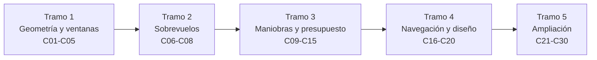

# B75 — Trayectorias y misiones interplanetarias

> **Bloque ampliado.** Sus 20 clases de la línea base y sus 10 clases programadas (`B75-C21` a `B75-C30`) están redactadas. Ver el [programa completo](../../PROGRAMA_ACADEMICO_COMPLETO.md).

**Programa:** Programa Integral de Astronomía, Astrofísica, Ciencias Espaciales e Ingeniería Aeroespacial
**Área:** A06 — Mecánica orbital, navegación y vuelo espacial
**Nivel:** N3 (fundamentos disciplinares) · **Clases:** 30 · **Carga:** por calibrar con el uso
**Estado:** guía pedagógica del bloque (resumen de qué se aprende en cada clase). Las clases enlazadas en las tablas están redactadas; todas conservan el estado E0 en el catálogo hasta registrar revisión disciplinar.

## 🎯 Propósito del bloque

Enseña **cómo se diseña, con cónicas y con números, el viaje de una nave de un planeta a otro** y cómo se decide entre trayectorias por su costo en velocidad, tiempo y riesgo. Parte de la transferencia de Hohmann y de las ventanas de lanzamiento, resuelve el problema de Lambert, compara transferencias bi-elípticas, usa sobrevuelos para ganar energía, cuenta el delta-v de cada fase (salida, corrección, captura, aerofrenado) y termina diseñando una misión a una luna helada. Cada clase cierra con un laboratorio en Python que se ejecuta y se contrasta con un caso analítico o con otra vía de cálculo.

## 📚 Al terminar el bloque podrás

1. Calcular una transferencia de Hohmann entre planetas con su tiempo de vuelo, su ángulo de fase y su ventana, y estimar las ventanas sucesivas con el periodo sinódico.
2. Resolver el problema de Lambert y usarlo para construir mapas de fecha de lanzamiento contra fecha de llegada (*pork-chop*).
3. Decidir cuándo conviene una transferencia bi-elíptica, un cambio de plano combinado o una captura en órbita elíptica.
4. Calcular el giro y la ganancia de energía de un sobrevuelo, expresar el sobrevuelo en el plano B y encadenar sobrevuelos con el criterio de Tisserand y con resonancias.
5. Elaborar un presupuesto de delta-v con márgenes y comparar maniobras impulsivas, empuje finito, bajo empuje y aerofrenado.
6. Estimar la dispersión de llegada, el retardo de luz y las restricciones de radiación, y reunirlo todo en el diseño preliminar de una misión a una luna helada.
7. Rotular qué es dato consultado, qué es modelo y qué es ilustración en cada resultado de trayectoria.

## 🧭 Secuencia del bloque

**Descripción textual.** Cinco tramos encadenados: la geometría de las transferencias y las ventanas (C01–C05); los sobrevuelos como fuente de energía (C06–C08); las maniobras, el presupuesto de delta-v y la captura (C09–C15); la navegación, la dispersión y el diseño de una misión (C16–C20); y la ampliación con intersección de cónicas, C3, plano B, resonancias, tours de lunas, restricciones y *pork-chop* (C21–C30).

## 🗂️ Las 30 clases en resumen

**Navegación:** cada clase enlaza a la anterior, a la siguiente y a este bloque.

La columna «Evidencia» indica el producto que demostrará el aprendizaje. Los laboratorios usan datos **sintéticos** o **ilustrativos** (rotulados) o valores publicados con fuente y fecha; los resultados son del modelo de órbitas circulares y coplanares salvo que la clase diga otra cosa, y ninguno es una medición.

### Tramo 1 · Geometría de las transferencias y ventanas

| ID | Clase | Qué se aprende | Evidencia |
|---|---|---|---|
| [B75-C01](../clases/B75/B75-C01-geometria-de-transferencias-heliocentricas/CLASE.md) | Geometría de transferencias heliocéntricas | Elipse de Hohmann Tierra–Marte: semieje, tiempo de vuelo y delta-v. | Ficha de una transferencia de Hohmann |
| [B75-C02](../clases/B75/B75-C02-angulos-de-fase-planetaria/CLASE.md) | Ángulos de fase planetaria | Ángulo de adelanto del destino a la salida y periodo sinódico. | Tabla de ángulos de fase y periodos sinódicos |
| [B75-C03](../clases/B75/B75-C03-ventanas-de-lanzamiento/CLASE.md) | Ventanas de lanzamiento | Sucesión de ventanas Tierra–Marte y Tierra–Venus desde las longitudes medias. | Calendario de ventanas del modelo |
| [B75-C04](../clases/B75/B75-C04-ecuacion-de-lambert/CLASE.md) | Ecuación de Lambert | Solución de Lambert por variables universales, verificada contra una órbita propagada. | Ficha de un arco de Lambert verificado |
| [B75-C05](../clases/B75/B75-C05-transferencias-bi-elipticas/CLASE.md) | Transferencias bi-elípticas | Cruces de Δv frente a Hohmann según el cociente de radios. | Gráfica y tabla de Δv bi-elíptico frente a Hohmann |

### Tramo 2 · Sobrevuelos y asistencias gravitacionales

| ID | Clase | Qué se aprende | Evidencia |
|---|---|---|---|
| [B75-C06](../clases/B75/B75-C06-asistencias-gravitacionales/CLASE.md) | Asistencias gravitacionales | Giro de la velocidad relativa y ganancia heliocéntrica en un sobrevuelo. | Triángulo de velocidades de un sobrevuelo |
| [B75-C07](../clases/B75/B75-C07-sobrevuelos-planetarios/CLASE.md) | Sobrevuelos planetarios | Hipérbola de aproximación, periapsis y tiempo en la esfera de influencia. | Ficha geométrica de un sobrevuelo |
| [B75-C08](../clases/B75/B75-C08-secuencias-multiples-de-sobrevuelos/CLASE.md) | Secuencias múltiples de sobrevuelos | Criterio de Tisserand y órbitas alcanzables en cadena. | Mapa de Tisserand de una secuencia |

### Tramo 3 · Maniobras, presupuesto y captura

| ID | Clase | Qué se aprende | Evidencia |
|---|---|---|---|
| [B75-C09](../clases/B75/B75-C09-presupuestos-de-delta-v/CLASE.md) | Presupuestos de delta-v | Suma de fases, márgenes y masa de propulsante con Tsiolkovski. | Presupuesto de delta-v con margen |
| [B75-C10](../clases/B75/B75-C10-maniobras-impulsivas/CLASE.md) | Maniobras impulsivas | Pérdida por empuje finito frente al modelo impulsivo. | Curva de pérdida frente a empuje/peso |
| [B75-C11](../clases/B75/B75-C11-propulsion-de-bajo-empuje/CLASE.md) | Propulsión de bajo empuje | Espiral tangencial y delta-v de Edelbaum entre órbitas circulares. | Comparación de impulsiva y de bajo empuje |
| [B75-C12](../clases/B75/B75-C12-optimizacion-de-trayectoria/CLASE.md) | Optimización de trayectoria | Búsqueda del tiempo de vuelo de mínimo Δv con Lambert. | Curva Δv(tiempo de vuelo) con su mínimo |
| [B75-C13](../clases/B75/B75-C13-cambios-de-plano-interplanetarios/CLASE.md) | Cambios de plano interplanetarios | Δv de cambio de plano, mejor punto y reparto en dos impulsos. | Ficha de un cambio de plano |
| [B75-C14](../clases/B75/B75-C14-captura-en-destino/CLASE.md) | Captura en destino | Δv de captura en Marte según la excentricidad y el periapsis. | Tabla de captura circular frente a elíptica |
| [B75-C15](../clases/B75/B75-C15-aerofrenado-conceptual/CLASE.md) | Aerofrenado conceptual | Reducción del apoapsis por pasadas atmosféricas y su energía. | Serie de apoapsis por pasada |

### Tramo 4 · Navegación y diseño de misión

| ID | Clase | Qué se aprende | Evidencia |
|---|---|---|---|
| [B75-C16](../clases/B75/B75-C16-navegacion-relativa-a-lunas/CLASE.md) | Navegación relativa a lunas | Esfera de Hill de las lunas galileanas y velocidades relativas. | Ficha de escalas de un sistema lunar |
| [B75-C17](../clases/B75/B75-C17-oportunidades-cientificas-de-sobrevuelo/CLASE.md) | Oportunidades científicas de sobrevuelo | Velocidad sobre el suelo, duración y resolución en un sobrevuelo. | Perfil de observación de un sobrevuelo |
| [B75-C18](../clases/B75/B75-C18-propagacion-de-dispersion-inicial/CLASE.md) | Propagación de dispersión inicial | Dispersión de llegada por error de salida, lineal frente a Monte Carlo. | Elipse de dispersión de llegada |
| [B75-C19](../clases/B75/B75-C19-restricciones-de-navegacion-autonoma/CLASE.md) | Restricciones de navegación autónoma | Retardo de luz, ciclo de comando y eventos que exigen autonomía. | Tabla de eventos y retardos |
| [B75-C20](../clases/B75/B75-C20-diseno-de-una-mision-a-luna-helada/CLASE.md) | Diseño de una misión a luna helada | Presupuesto preliminar Tierra–Júpiter–luna con captura y tour. | Esbozo de misión a Europa en el modelo |

### Tramo 5 · Ampliación (clases programadas en la estructura vigente)

| ID | Clase | Qué se aprende | Evidencia |
|---|---|---|---|
| [B75-C21](../clases/B75/B75-C21-interseccion-de-conicas-en-transferencias/CLASE.md) | Intersección de cónicas en transferencias | Cruce de dos elipses con foco común como transferencia. | Ficha de una transferencia por intersección |
| [B75-C22](../clases/B75/B75-C22-modelos-de-primer-impulso/CLASE.md) | Modelos de primer impulso | Primer impulso mínimo y tiempo de vuelo para alcanzar un radio. | Curva de Δv₁ frente al apoapsis |
| [B75-C23](../clases/B75/B75-C23-energia-caracteristica-c3-y-exceso-hiperbolico/CLASE.md) | Energía característica C3 y exceso hiperbólico | C3, V∞ y Δv de salida desde una órbita baja. | Tabla de C3 por destino |
| [B75-C24](../clases/B75/B75-C24-plano-b-y-parametro-de-impacto/CLASE.md) | Plano B y parámetro de impacto | Vector B, componentes y apuntado de un sobrevuelo. | Ficha del plano B de una hipérbola |
| [B75-C25](../clases/B75/B75-C25-resonancias-para-sobrevuelos/CLASE.md) | Resonancias para sobrevuelos | Retornos resonantes k:m y su semieje. | Tabla de resonancias de retorno |
| [B75-C26](../clases/B75/B75-C26-sobrevuelos-de-lunas-y-tours-de-sistemas-planetarios/CLASE.md) | Sobrevuelos de lunas y tours de sistemas planetarios | Tisserand de las lunas galileanas y Δv apalancado. | Esbozo de tour por Tisserand |
| [B75-C27](../clases/B75/B75-C27-duracion-de-mision-y-tiempo-de-vuelo-como-restriccion/CLASE.md) | Duración de misión y tiempo de vuelo como restricción | Costo total frente a tiempo de vuelo con un costo temporal ilustrativo. | Curva de costo total |
| [B75-C28](../clases/B75/B75-C28-restricciones-de-radiacion-en-trayectorias/CLASE.md) | Restricciones de radiación en trayectorias | Dosis acumulada de un perfil sintético y blindaje. | Presupuesto de dosis sintético |
| [B75-C29](../clases/B75/B75-C29-analisis-de-calendario-con-graficos-pork-chop/CLASE.md) | Análisis de calendario con gráficos pork-chop | Malla fecha de salida–fecha de llegada con Lambert. | Gráfico *pork-chop* del modelo |
| [B75-C30](../clases/B75/B75-C30-validacion-de-maniobras-por-reintegracion/CLASE.md) | Validación de maniobras por reintegración | Propagación antes y después de un impulso y cierre de errores. | Informe de reintegración de una maniobra |

## 🧵 Hilos que atraviesan el bloque

- **Costo de una trayectoria:** el delta-v y el tiempo de vuelo se calculan en C01, C05, C09, C12 y C27 y se comparan siempre con una cota o con otra vía.
- **Energía hiperbólica:** C3 y V∞ (C23) enlazan la salida, el sobrevuelo (C06, C24) y la captura (C14).
- **Sobrevuelos:** de la geometría (C07) a la cadena (C08, C25, C26).
- **Observado frente a modelado:** todo número es un modelo de órbitas circulares y coplanares o una integración propia; ninguno es una efeméride ni una medición de misión.
- **Verificación independiente:** cada laboratorio detiene la ejecución si falla una comprobación analítica o una reintegración.

## 📝 Evaluación del bloque (propuesta, por calibrar)

- Fichas y ejercicios por clase, con retroalimentación y recuperación con evidencia distinta.
- Portafolio: el esbozo de misión a Europa (C20) con su presupuesto, su sensibilidad y su lista de supuestos.
- Las condiciones críticas (rotular lo ilustrativo y lo sintético, no presentar un modelo como efeméride y citar solo lo consultado) no se compensan con promedio.

## ⚠️ Seguridad y límites

El bloque es educativo. Los modelos son de dos cuerpos con órbitas planetarias circulares y coplanares (cónicas empalmadas); no sustituyen a una efeméride (JPL Horizons, SPICE) ni al diseño real de una misión. Los radios, los periodos, las masas y los parámetros GM proceden de las fichas citadas con su fecha; las densidades atmosféricas, las dosis de radiación, los costos y las incertidumbres son ilustrativos. Las fechas y los hechos de misión se limitan a lo leído en las páginas de la NASA y de la ESA indicadas; el resto no se consultó.

## 📖 Fuentes consultadas en el bloque (resumen)

Consultadas el 2026-11-10: las fichas planetarias de la NASA/NSSDC (Tierra, Venus, Marte, Júpiter), la tabla de parámetros físicos de satélites del JPL (GM y radios medios de Ío, Europa, Ganimedes, Calisto, Titán y Encélado), la tabla de elementos medios de satélites del JPL (semiejes y periodos), la tabla de posiciones aproximadas de planetas del JPL (elementos a J2000, vigente 1800–2050), la página de parámetros físicos de planetas del JPL (radios y constante G), el capítulo 4 de «Basics of Space Flight» de la NASA, las páginas de las misiones Europa Clipper y Cassini (NASA) y la ficha de Juice (ESA), y el resumen de la Resolución B3 de la IAU 2015 (arXiv:1510.07674). Del resumen de la IAU no se leyó el valor numérico de `GM☉`: el valor usado es el valor estándar y se rotula como no consultado en la página. Las ecuaciones (Hohmann, Lambert, Tisserand, Tsiolkovski, hipérbola) son relaciones estándar que verifica cada laboratorio con una segunda vía; no se consultaron en una fuente concreta.

## Fuentes de orientación preliminar

- **[JPL-HORIZONS]** [JPL Solar System Dynamics Horizons](https://ssd.jpl.nasa.gov/horizons/) — Efemérides y geometría del sistema solar.
- **[JPL-SPICE]** [NASA NAIF SPICE](https://naif.jpl.nasa.gov/naif/) — Geometría de observación, referencias espaciales y tiempos.
- **[NASA-NTRS]** [NASA Technical Reports Server](https://ntrs.nasa.gov/) — Informes técnicos e investigación histórica y actual.
- **[IERS]** [International Earth Rotation and Reference Systems Service](https://www.iers.org/) — Rotación terrestre y sistemas de referencia.

> La asociación de estas fuentes es orientativa por bloque. Las fuentes realmente consultadas para cada afirmación se registran en la sección 11 de cada clase.
