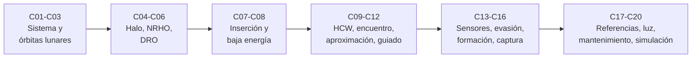

# B76 — Dinámica cislunar y operaciones de proximidad

**Programa:** Programa Integral de Astronomía, Astrofísica, Ciencias Espaciales e Ingeniería Aeroespacial
**Área:** A06 — Mecánica orbital, navegación y vuelo espacial
**Nivel:** N3 (fundamentos disciplinares) · **Clases:** 20 · **Carga:** por calibrar con el uso
**Estado:** guía pedagógica del bloque (resumen de qué se aprende en cada clase). Las clases enlazadas en la tabla ya están redactadas; todas conservan el estado E0 en el catálogo hasta registrar revisión disciplinar.

## 🎯 Propósito del bloque

Enseña **cómo se mueve una nave en el sistema Tierra-Luna y cómo se maniobra cerca de otra nave**. La primera mitad trata el problema restringido de tres cuerpos: el sistema Tierra-Luna y sus escalas sinódicas, las órbitas lunares, las familias halo, NRHO y DRO, la inserción y las transferencias de baja energía. La segunda mitad trata la proximidad: la dinámica relativa de Hill-Clohessy-Wiltshire, el encuentro, la aproximación, el guiado relativo, los sensores, la evasión de colisión, la formación, el acoplamiento, los sistemas de referencia, la iluminación y el mantenimiento orbital. Cada clase cierra con un laboratorio en Python (biblioteca estándar) con salida real, tolerancias y datos sintéticos rotulados.

## 📚 Al terminar el bloque podrás

1. Calcular las escalas del sistema Tierra-Luna (baricentro, puntos de Lagrange, esfera de Hill, unidades adimensionales y periodo sinódico).
2. Distinguir los regímenes de órbitas lunares y reconocer una familia halo, una NRHO y una DRO con su periodo y su estabilidad.
3. Estimar el `Δv` de inserción lunar y razonar una transferencia de baja energía con la constante de Jacobi.
4. Resolver la dinámica relativa HCW y diseñar un encuentro, una aproximación y un guiado de dos impulsos.
5. Dimensionar un sensor de proximidad, una probabilidad de colisión y una maniobra de evasión.
6. Planificar una formación, una captura, un cambio de referencia, una restricción de iluminación y una campaña de mantenimiento orbital.
7. Simular un encuentro con dispersiones y comprobar su seguridad pasiva, rotulando siempre lo simulado como simulado.

## 🧭 Secuencia del bloque

**Descripción textual.** Seis tramos encadenados: el sistema Tierra-Luna y las órbitas alrededor de la Luna (C01–C03), las familias periódicas cislunares (C04–C06), las transferencias (C07–C08), la dinámica relativa y el encuentro (C09–C12), las operaciones de proximidad (C13–C16) y los marcos, la luz, el mantenimiento y la simulación integradora (C17–C20).

## 🗂️ Las 20 clases en resumen

**Navegación:** cada clase enlaza a la anterior, a la siguiente y a este bloque.

La columna «Evidencia» indica el producto que demostrará el aprendizaje. Los laboratorios usan datos **sintéticos** o **ilustrativos** (rotulados) o valores publicados con fuente y fecha.

### Tramo 1 · El sistema Tierra-Luna

| ID | Clase | Qué se aprende | Evidencia |
|---|---|---|---|
| [B76-C01](../clases/B76/B76-C01-sistema-tierra-luna/CLASE.md) | Sistema Tierra-Luna | Baricentro, esfera de Hill, parámetro `μ` y puntos colineales. | Ficha del sistema Tierra-Luna |
| [B76-C02](../clases/B76/B76-C02-escalas-sinodicas-de-referencia/CLASE.md) | Escalas sinódicas de referencia | Periodo sinódico, unidades adimensionales y resonancia 9:2. | Tabla de escalas y conversión de unidades |
| [B76-C03](../clases/B76/B76-C03-orbitas-alrededor-de-la-luna/CLASE.md) | Órbitas alrededor de la Luna | Velocidad, periodo y estabilidad prógrada y retrógrada en el sistema de tres cuerpos. | Ficha de una órbita lunar baja |

### Tramo 2 · Familias periódicas cislunares

| ID | Clase | Qué se aprende | Evidencia |
|---|---|---|---|
| [B76-C04](../clases/B76/B76-C04-orbitas-halo/CLASE.md) | Órbitas halo | Modos lineales en `L2` y bifurcación de la familia halo. | Ficha lineal de `L2` |
| [B76-C05](../clases/B76/B76-C05-orbitas-nrho/CLASE.md) | Órbitas NRHO | Corrección diferencial de una NRHO y comparación con la referencia publicada. | Ficha de una NRHO en el modelo CR3BP |
| [B76-C06](../clases/B76/B76-C06-orbitas-dro-dinamica-cislunar-y-operaciones-de-proximidad/CLASE.md) | Órbitas DRO — Dinámica cislunar y operaciones de proximidad | Órbita retrógrada distante, periodo y estabilidad. | Ficha de una DRO |

### Tramo 3 · Inserción y transferencias

| ID | Clase | Qué se aprende | Evidencia |
|---|---|---|---|
| [B76-C07](../clases/B76/B76-C07-maniobras-de-insercion-cislunar/CLASE.md) | Maniobras de inserción cislunar | `Δv` de inyección translunar y de inserción lunar con cónicas empalmadas. | Presupuesto de `Δv` de una inserción |
| [B76-C08](../clases/B76/B76-C08-transferencias-de-baja-energia/CLASE.md) | Transferencias de baja energía | Constante de Jacobi y energía mínima para abrir los cuellos de `L1` y `L2`. | Ficha energética de una transferencia |

### Tramo 4 · Dinámica relativa y encuentro

| ID | Clase | Qué se aprende | Evidencia |
|---|---|---|---|
| [B76-C09](../clases/B76/B76-C09-dinamica-relativa-de-hill-clohessy-wiltshire/CLASE.md) | Dinámica relativa de Hill-Clohessy-Wiltshire | Solución cerrada, condición de acotamiento y error frente al modelo no lineal. | Ficha de validez de HCW |
| [B76-C10](../clases/B76/B76-C10-encuentro-orbital/CLASE.md) | Encuentro orbital | Ángulo de fase, tiempo de alcance y transferencia de Hohmann. | Plan de fases de un encuentro |
| [B76-C11](../clases/B76/B76-C11-operaciones-de-aproximacion/CLASE.md) | Operaciones de aproximación | Salto a lo largo de la trayectoria, aproximación radial y seguridad pasiva. | Plan de aproximación por tramos |
| [B76-C12](../clases/B76/B76-C12-guiado-relativo/CLASE.md) | Guiado relativo | Guiado de dos impulsos con la matriz de transición de HCW. | Tabla de `Δv` frente a duración |

### Tramo 5 · Operaciones de proximidad

| ID | Clase | Qué se aprende | Evidencia |
|---|---|---|---|
| [B76-C13](../clases/B76/B76-C13-sensores-de-proximidad/CLASE.md) | Sensores de proximidad | Incertidumbre de telémetro láser y de cámara con datos sintéticos. | Presupuesto de error de un sensor |
| [B76-C14](../clases/B76/B76-C14-evasion-de-colision/CLASE.md) | Evasión de colisión | Probabilidad de colisión 2D y maniobra de evasión. | Ficha de un encuentro con probabilidad de colisión |
| [B76-C15](../clases/B76/B76-C15-control-de-formacion-satelital/CLASE.md) | Control de formación satelital | Elipse relativa, deriva por diferencia de semieje y corrección. | Diseño de una formación |
| [B76-C16](../clases/B76/B76-C16-acoplamiento-y-captura/CLASE.md) | Acoplamiento y captura | Captura blanda con resorte y amortiguador y conservación de momento. | Ficha de captura de un acoplamiento |

### Tramo 6 · Marcos, luz, mantenimiento e integración

| ID | Clase | Qué se aprende | Evidencia |
|---|---|---|---|
| [B76-C17](../clases/B76/B76-C17-sistemas-de-referencia-relativos/CLASE.md) | Sistemas de referencia relativos | Transformación inercial–LVLH–sinódico con ida y vuelta. | Tabla de transformaciones verificada |
| [B76-C18](../clases/B76/B76-C18-restricciones-de-iluminacion/CLASE.md) | Restricciones de iluminación | Eclipse cilíndrico, ángulo `β` y fase solar en la aproximación. | Calendario sintético de luz |
| [B76-C19](../clases/B76/B76-C19-orbitas-de-mantenimiento/CLASE.md) | Órbitas de mantenimiento | Crecimiento de errores en una NRHO y maniobras de mantenimiento. | Ficha de una campaña de mantenimiento |
| [B76-C20](../clases/B76/B76-C20-simulacion-de-encuentro-seguro/CLASE.md) | Simulación de encuentro seguro | Encuentro completo con dispersiones, fallo de maniobra y seguridad pasiva. | Informe de simulación de un encuentro |

## 🧵 Hilos que atraviesan el bloque

- **Dos escalas de la misma física:** el problema de tres cuerpos (C01–C08) y el relativo linealizado (C09–C20) usan las mismas ecuaciones con distinto marco.
- **Energía como mapa de lo posible:** la constante de Jacobi (C04, C08) y el `Δv` (C07, C10–C12) limitan qué trayectorias existen.
- **Incertidumbre y seguridad:** sensores (C13), colisión (C14), mantenimiento (C19) y simulación (C20).
- **Verificación independiente:** cada laboratorio contrasta con un caso analítico, una integración numérica o una conservación.
- **Simulado frente a observado:** todo número del bloque es un modelo con datos publicados o sintéticos; ninguno es una telemetría.

## 📝 Evaluación del bloque (propuesta, por calibrar)

- Fichas y ejercicios por clase, con retroalimentación y recuperación con evidencia distinta.
- Portafolio: el informe de simulación (C20) con sus supuestos y su sensibilidad.
- Las condiciones críticas (rotular lo sintético, no presentar un modelo como observación y citar solo lo consultado) no se compensan con promedio.

## ⚠️ Seguridad y límites

El bloque es educativo. Los modelos son simplificados (tres cuerpos circular y plano para los parámetros, dinámica relativa linealizada, perturbaciones ignoradas) y no sustituyen a una herramienta de diseño de misión validada ni a la literatura primaria. Ningún resultado es una efeméride, una predicción de misión ni una recomendación operativa. Las constantes proceden de las fichas citadas; los datos de sensores, encuentros y dispersiones son sintéticos.

## 📖 Fuentes consultadas en el bloque (resumen)

Consultadas el 2026-11-10: la ficha de la Luna y la de la Tierra de la NASA/NSSDC, la tabla de parámetros físicos de satélites del JPL (GM y radio medio de la Luna), la página de parámetros astronómicos del JPL (GM de la Tierra y de la Luna, DE440, unidad astronómica) y el artículo de Davis, Khoury, Howell y Sweeney sobre control de fase y evitación de eclipses en NRHO (NASA NTRS 20200000733, leído con PyMuPDF; su fecha de publicación no se consultó). Las ecuaciones estándar (problema restringido de tres cuerpos, HCW, Hohmann, probabilidad de colisión) son relaciones clásicas que verifica cada laboratorio y no se consultaron en una fuente concreta. Los documentos de los estándares de acoplamiento, de las incertidumbres de sensores reales y de las operaciones de misión no se consultaron.

## Fuentes de orientación preliminar

- **[JPL-HORIZONS]** [JPL Solar System Dynamics Horizons](https://ssd.jpl.nasa.gov/horizons/) — Efemérides y geometría del sistema solar.
- **[JPL-SPICE]** [NASA NAIF SPICE](https://naif.jpl.nasa.gov/naif/) — Geometría de observación, referencias espaciales y tiempos.
- **[NASA-NTRS]** [NASA Technical Reports Server](https://ntrs.nasa.gov/) — Informes técnicos e investigación histórica y actual.
- **[IERS]** [International Earth Rotation and Reference Systems Service](https://www.iers.org/) — Rotación terrestre y sistemas de referencia.

> La asociación de estas fuentes es orientativa por bloque. Las fuentes realmente consultadas para cada afirmación se registran en la sección 11 de cada clase.

## Roles que lo usan

- [Astrodinámica interplanetaria](../../rutas/astrodinamica-interplanetaria.md)
- [Astronáutica tripulada y entrenamiento de astronautas](../../rutas/astronautica-tripulada-y-entrenamiento-de-astronautas.md)
- [Navegación, guiado y autonomía espacial](../../rutas/navegacion-guiado-y-autonomia-espacial.md)
- [Robótica espacial y sistemas autónomos](../../rutas/robotica-espacial-y-sistemas-autonomos.md)
- [Seguridad, defensa y resiliencia de infraestructuras espaciales](../../rutas/seguridad-defensa-y-resiliencia-de-infraestructuras-espaciales.md)

[🏠 Volver al programa](../../README.md) · [⬅️ B75 — Trayectorias y misiones interplanetarias](./B75-trayectorias-y-misiones-interplanetarias.md) · [➡️ B77 — Dinámica de lanzamiento y reentrada](./B77-dinamica-de-lanzamiento-y-reentrada.md)
