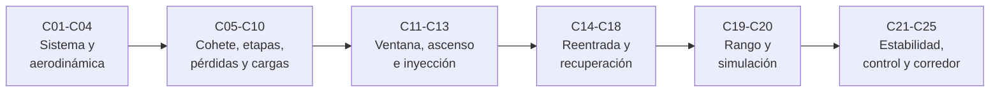

# B77 — Dinámica de lanzamiento y reentrada

> **Bloque ampliado.** Además de las 20 clases de la línea base, el bloque incorpora 5 clases programadas (`B77-C21` a `B77-C25`), ya redactadas. Ver el [programa completo](../../PROGRAMA_ACADEMICO_COMPLETO.md).

**Programa:** Programa Integral de Astronomía, Astrofísica, Ciencias Espaciales e Ingeniería Aeroespacial
**Área:** A06 — Mecánica orbital, navegación y vuelo espacial
**Nivel:** N3 (fundamentos disciplinares) · **Clases:** 25 · **Carga:** por calibrar con el uso
**Estado:** guía pedagógica del bloque (resumen de qué se aprende en cada clase). Las clases enlazadas en la tabla ya están redactadas; todas conservan el estado E0 en el catálogo hasta registrar revisión disciplinar.

## 🎯 Propósito del bloque

Enseña **cómo se modela el movimiento de un vehículo desde la plataforma hasta la órbita y de vuelta**, y qué decide cada número del camino. Empieza por el dimensionamiento de un lanzador y el movimiento en la atmósfera (arrastre, sustentación, presión dinámica), sigue con la ecuación de cohete, las etapas y las tres pérdidas (gravedad, aire, estructura), recorre las ventanas, el ascenso, la inyección y su dispersión, y cierra con la reentrada: calentamiento, protección térmica, estabilidad, recuperación, seguridad de rango, simulación completa y las cinco clases de estabilidad y control del lanzador (centro de presión, centro de masa, estabilidad en ascenso, TVC) y de corredor de entrada. Cada clase termina con un laboratorio en Python que usa datos **sintéticos** o **ilustrativos** (rotulados) y se contrasta con una segunda vía.

## 📚 Al terminar el bloque podrás

1. Dimensionar un lanzador de dos etapas y el reparto de `Δv` que minimiza su masa de despegue.
2. Calcular presión dinámica, arrastre, sustentación y max-q, y ajustar coeficientes a datos sintéticos.
3. Aplicar la ecuación de cohete ideal y descomponer el `Δv` en pérdidas por gravedad y por aire.
4. Calcular ventanas y acimut de lanzamiento, un ascenso con giro de gravedad y la dispersión de la órbita de inyección.
5. Modelar una reentrada balística: desaceleración máxima, calentamiento de punto de remanso y respuesta térmica de un escudo.
6. Analizar estabilidad estática y dinámica, control de vector de empuje, corredor de entrada y riesgo de rango.
7. Rotular qué es observado, qué es ley consultada y qué es ilustrativo en cada inferencia.

## 🧭 Secuencia del bloque

**Descripción textual.** Seis tramos encadenados: el sistema y la aerodinámica (C01–C04), la ecuación de cohete con las etapas y las pérdidas (C05–C10), el camino a la órbita (C11–C13), la reentrada y la recuperación (C14–C18), la seguridad de rango y la simulación integrada (C19–C20) y la estabilidad y el control de lanzadores con el corredor de entrada (C21–C25). El hilo común es el balance: lo que el motor da menos lo que el aire y la gravedad quitan.

## 🗂️ Las 25 clases en resumen

**Navegación:** cada clase enlaza a la anterior, a la siguiente y a este bloque.

La columna «Evidencia» indica el producto que demostrará el aprendizaje. Los laboratorios usan datos **sintéticos** o **ilustrativos** (rotulados) o valores publicados con fuente y fecha.

### Tramo 1 · Sistema y aerodinámica

| ID | Clase | Qué se aprende | Evidencia |
|---|---|---|---|
| [B77-C01](../clases/B77/B77-C01-sistemas-de-lanzamiento/CLASE.md) | Sistemas de lanzamiento | Masa de despegue de un lanzador de dos etapas y reparto óptimo de `Δv`. | Ficha de dimensionamiento de un lanzador de dos etapas |
| [B77-C02](../clases/B77/B77-C02-movimiento-en-atmosfera/CLASE.md) | Movimiento en atmósfera | Movimiento vertical con arrastre en una atmósfera exponencial, con RK4. | Ficha de movimiento con arrastre |
| [B77-C03](../clases/B77/B77-C03-fuerzas-aerodinamicas/CLASE.md) | Fuerzas aerodinámicas | Presión dinámica, arrastre, sustentación y max-q. | Ficha de cargas aerodinámicas en max-q |
| [B77-C04](../clases/B77/B77-C04-coeficientes-de-arrastre-y-sustentacion/CLASE.md) | Coeficientes de arrastre y sustentación | Ajuste de `CL_α` y de la polar a datos sintéticos; área de referencia. | Ficha de coeficientes aerodinámicos |

### Tramo 2 · Cohete, etapas, pérdidas y cargas

| ID | Clase | Qué se aprende | Evidencia |
|---|---|---|---|
| [B77-C05](../clases/B77/B77-C05-ecuacion-de-cohete-ideal/CLASE.md) | Ecuación de cohete ideal | `Δv = V_eq ln MR`, con y sin gravedad, e integración numérica. | Ficha de la ecuación de cohete |
| [B77-C06](../clases/B77/B77-C06-relacion-masa-impulso/CLASE.md) | Relación masa-impulso | Empuje, gasto, impulso total, `T/W` y `Δv` máximo por estructura. | Ficha masa–impulso de un motor |
| [B77-C07](../clases/B77/B77-C07-separacion-de-etapas-conceptual/CLASE.md) | Separación de etapas conceptual | Número de etapas y conservación en una separación 1D. | Ficha de escalonamiento y separación |
| [B77-C08](../clases/B77/B77-C08-perdidas-gravitacionales/CLASE.md) | Pérdidas gravitacionales | `∫ g sin γ dt` en vertical y con programa de cabeceo. | Ficha de pérdidas gravitacionales |
| [B77-C09](../clases/B77/B77-C09-perdidas-aerodinamicas/CLASE.md) | Pérdidas aerodinámicas | Balance `Δv` ideal = velocidad final + pérdidas, para tres `Cd`. | Ficha de pérdidas de ascenso |
| [B77-C10](../clases/B77/B77-C10-restricciones-de-cargas-estructurales/CLASE.md) | Restricciones de cargas estructurales | Carga axial, `q·α` y estrangulamiento por límite. | Ficha de cargas de ascenso |

### Tramo 3 · El camino a la órbita

| ID | Clase | Qué se aprende | Evidencia |
|---|---|---|---|
| [B77-C11](../clases/B77/B77-C11-ventanas-de-lanzamiento-dinamica-de-lanzamiento-y-reentrada/CLASE.md) | Ventanas de lanzamiento — Dinámica de lanzamiento y reentrada | Tiempo sideral y acimut de las dos ventanas, desfase diario y error de nodo. | Ficha de ventanas de lanzamiento |
| [B77-C12](../clases/B77/B77-C12-perfil-de-ascenso-orbital/CLASE.md) | Perfil de ascenso orbital | Giro de gravedad de dos etapas y órbita de agotamiento. | Ficha de ascenso orbital |
| [B77-C13](../clases/B77/B77-C13-inyeccion-y-dispersion-orbital/CLASE.md) | Inyección y dispersión orbital | Monte Carlo de errores de inyección frente a propagación lineal. | Ficha de dispersión de inyección |

### Tramo 4 · Reentrada y recuperación

| ID | Clase | Qué se aprende | Evidencia |
|---|---|---|---|
| [B77-C14](../clases/B77/B77-C14-dinamica-de-reentrada/CLASE.md) | Dinámica de reentrada | Solución de Allen–Eggers y desaceleración máxima independiente del coeficiente balístico. | Ficha de reentrada balística |
| [B77-C15](../clases/B77/B77-C15-calentamiento-aerodinamico/CLASE.md) | Calentamiento aerodinámico | Flujo de Sutton–Graves, temperatura de equilibrio radiativo y carga térmica. | Ficha de calentamiento de remanso |
| [B77-C16](../clases/B77/B77-C16-proteccion-termica/CLASE.md) | Protección térmica | Conducción transitoria en un escudo, re-radiación y recesión conceptual. | Ficha de respuesta térmica de un escudo |
| [B77-C17](../clases/B77/B77-C17-estabilidad-durante-descenso/CLASE.md) | Estabilidad durante descenso | Momento de cabeceo, equilibrio y frecuencia de oscilación de una cápsula. | Ficha de estabilidad de una cápsula |
| [B77-C18](../clases/B77/B77-C18-aterrizaje-y-recuperacion/CLASE.md) | Aterrizaje y recuperación | Descenso bajo paracaídas, velocidad terminal, deriva y quema de aterrizaje. | Ficha de descenso y aterrizaje |

### Tramo 5 · Seguridad de rango y simulación

| ID | Clase | Qué se aprende | Evidencia |
|---|---|---|---|
| [B77-C19](../clases/B77/B77-C19-seguridad-de-rango-a-nivel-conceptual/CLASE.md) | Seguridad de rango a nivel conceptual | Víctimas esperadas por integración y Monte Carlo frente a criterios de 14 CFR 450.101. | Ficha conceptual de riesgo de rango |
| [B77-C20](../clases/B77/B77-C20-simulacion-academica-de-una-trayectoria-de-vuelo/CLASE.md) | Simulación académica de una trayectoria de vuelo | Trayectoria completa con rotación, Mach, convergencia y presupuesto de pérdidas. | Informe de simulación de vuelo |

### Tramo 6 · Estabilidad, control y corredor (clases ampliadas)

| ID | Clase | Qué se aprende | Evidencia |
|---|---|---|---|
| [B77-C21](../clases/B77/B77-C21-centro-de-presion-y-margen-estatico/CLASE.md) | Centro de presión y margen estático | Centro de presión por componentes y margen estático en calibres. | Ficha de margen estático |
| [B77-C22](../clases/B77/B77-C22-centro-de-masa-y-su-variacion-con-el-consumo-de-propelente/CLASE.md) | Centro de masa y su variación con el consumo de propelente | Centro de masa e inercia durante el quemado. | Ficha de masa y centro de masa en el quemado |
| [B77-C23](../clases/B77/B77-C23-estabilidad-de-vuelo-de-lanzadores-en-ascenso/CLASE.md) | Estabilidad de vuelo de lanzadores en ascenso | Divergencia aerodinámica, tiempo de duplicación y control mínimo. | Ficha de estabilidad en ascenso |
| [B77-C24](../clases/B77/B77-C24-guiado-y-control-de-actitud-de-lanzadores-tvc/CLASE.md) | Guiado y control de actitud de lanzadores (TVC) | Ganancias PD de TVC, sobreimpulso y saturación. | Ficha de diseño de control TVC |
| [B77-C25](../clases/B77/B77-C25-corredores-de-entrada-y-limites-de-trayectoria/CLASE.md) | Corredores de entrada y límites de trayectoria | Ángulos de entrada límite por captura y por carga. | Ficha de corredor de entrada |

## 🧵 Hilos que atraviesan el bloque

- **Balance del `Δv`:** C05, C08 y C09 muestran que `Δv` ideal = velocidad final + pérdidas.
- **Atmósfera exponencial:** C02, C03, C09, C10, C12 y C14 comparten `ρ₀` y `H` de la ficha de la NASA/NSSDC.
- **Cargas y estabilidad:** C10, C21–C24 conectan las cargas con el centro de presión, el centro de masa y el control.
- **Observado frente a modelado:** todo número del bloque es un modelo con datos sintéticos o ilustrativos; ninguno es una medición ni un dato de vuelo.
- **Verificación independiente:** cada laboratorio contrasta con una solución analítica, una identidad o una segunda vía de cálculo.

## 📝 Evaluación del bloque (propuesta, por calibrar)

- Fichas y ejercicios por clase, con retroalimentación y recuperación con evidencia distinta.
- Portafolio: el informe de simulación de vuelo (C20) con sus supuestos y su análisis de convergencia.
- Las condiciones críticas (rotular lo ilustrativo y sintético, no presentar un modelo como vuelo real y citar solo lo consultado) no se compensan con promedio.

## ⚠️ Seguridad y límites

El bloque es educativo. Los modelos son simplificados (Tierra plana o esférica, atmósfera exponencial, coeficientes constantes) y no sustituyen a la certificación, al análisis de seguridad de rango ni a los documentos de un operador. Los criterios de 14 CFR 450.101 se citan solo como orden de magnitud; no constituyen una evaluación de riesgo. No se describen mecanismos de separación, pirotecnia ni procedimientos operativos.

## 📖 Fuentes consultadas en el bloque (resumen)

Consultadas el 2026-11-10: las páginas de la NASA Glenn sobre la ecuación de cohete ideal, el coeficiente de arrastre y la estabilidad de cohetes; la ficha de la Tierra de la NASA/NSSDC; el valor de `gₙ` del NIST (CODATA 2022); el resumen de 14 CFR §450.101 (Legal Information Institute); las diapositivas de aerotermodinámica de TFAWS 2012 (leídas con PyMuPDF: ecuación de Sutton–Graves y su ejemplo resuelto); y los registros NTRS de Allen y Eggers (NACA Report 1381, solo el resumen), de Sutton y Graves (NASA TR R-376, solo el registro) y de la U.S. Standard Atmosphere 1976 (solo el registro; las tablas no se leyeron). El parámetro gravitacional `μ`, el modelo de Barrowman y las normas de cargas estructurales y de rango no se consultaron. Las leyes de escala son relaciones estándar que verifica cada laboratorio.

## Fuentes de orientación preliminar

- **[JPL-HORIZONS]** [JPL Solar System Dynamics Horizons](https://ssd.jpl.nasa.gov/horizons/) — Efemérides y geometría del sistema solar.
- **[JPL-SPICE]** [NASA NAIF SPICE](https://naif.jpl.nasa.gov/naif/) — Geometría de observación, referencias espaciales y tiempos.
- **[NASA-NTRS]** [NASA Technical Reports Server](https://ntrs.nasa.gov/) — Informes técnicos e investigación histórica y actual.
- **[IERS]** [International Earth Rotation and Reference Systems Service](https://www.iers.org/) — Rotación terrestre y sistemas de referencia.

> La asociación de estas fuentes es orientativa por bloque. Las fuentes realmente consultadas para cada afirmación se registran en la sección 11 de cada clase.

## Roles que lo usan

- [Ingeniería de lanzadores y propulsión](../../rutas/ingenieria-de-lanzadores-y-propulsion.md)
- [Astronáutica tripulada y entrenamiento de astronautas](../../rutas/astronautica-tripulada-y-entrenamiento-de-astronautas.md)

[🏠 Volver al programa](../../README.md) · [⬅️ B76 — Dinámica cislunar y operaciones de proximidad](./B76-dinamica-cislunar-y-operaciones-de-proximidad.md) · [➡️ B78 — Tecnologías de propulsión espacial](./B78-tecnologias-de-propulsion-espacial.md)
