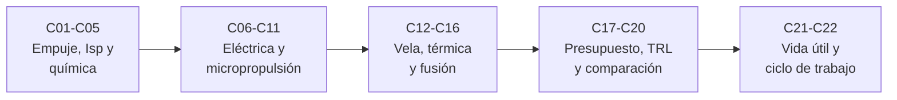

# B78 — Tecnologías de propulsión espacial

> **Bloque ampliado.** Sus 20 clases de la línea base y las 2 programadas por la ampliación (`B78-C21` y `B78-C22`) están redactadas. Ver el [programa completo](../../PROGRAMA_ACADEMICO_COMPLETO.md).

**Programa:** Programa Integral de Astronomía, Astrofísica, Ciencias Espaciales e Ingeniería Aeroespacial
**Área:** A06 — Mecánica orbital, navegación y vuelo espacial
**Nivel:** N3 (fundamentos disciplinares) · **Clases:** 22 · **Carga:** por calibrar con el uso
**Estado:** guía pedagógica del bloque (resumen de qué se aprende en cada clase). Las 22 clases enlazadas ya están redactadas; todas conservan el estado E0 en el catálogo hasta registrar revisión disciplinar.

## 🎯 Propósito del bloque

Enseña **cómo se compara y se presupuesta un sistema de propulsión espacial con unas pocas relaciones físicas**: el empuje y el impulso específico, la termodinámica de la cámara y la tobera, la propulsión química, la eléctrica (iónica, Hall, plasma), el gas frío y la micropropulsión de CubeSat, la vela solar, los conceptos térmicos y de fusión, y el presupuesto de masa, la energía específica, la madurez tecnológica y la erosión y el ciclo de trabajo. El hilo es una pregunta de ingeniería: **¿qué Δv entrega cada arquitectura con una masa y una potencia dadas, y con qué madurez?** Cada clase cierra con un laboratorio en Python con valores publicados con fuente y fecha o datos ilustrativos rotulados.

## 📚 Al terminar el bloque podrás

1. Calcular el empuje, el impulso específico y la velocidad de escape, y pasar de una a otra.
2. Obtener la velocidad de escape de una tobera isentrópica y ver el efecto de la temperatura y de la masa molar.
3. Distinguir propulsión química, eléctrica, térmica y de radiación por su fuente de energía y por su límite.
4. Presupuestar el propelente y la planta de potencia para un Δv dado.
5. Acotar lo que cada arquitectura puede dar con la energía específica y la potencia disponibles.
6. Clasificar la madurez con la escala TRL y comparar arquitecturas sin presentar una como recomendación operativa.
7. Rotular qué es consultado, qué es calculado y qué es ilustrativo en cada resultado.

## 🧭 Secuencia del bloque

**Descripción textual.** Cinco etapas: las relaciones básicas y la propulsión química (C01–C05), la propulsión eléctrica y la micropropulsión (C06–C11), la vela solar, los conceptos térmicos y la fusión (C12–C16), el presupuesto, la energía específica, el TRL y la comparación (C17–C20), y la erosión y el ciclo de trabajo de los propulsores eléctricos (C21–C22).

## 🗂️ Las 22 clases en resumen

**Navegación:** cada clase enlaza a la anterior, a la siguiente y a este bloque.

La columna «Evidencia» indica el producto que demostrará el aprendizaje. Los laboratorios usan datos **sintéticos** o **ilustrativos** (rotulados) o valores publicados con fuente y fecha.

### Tramo 1 · Fundamentos y propulsión química

| ID | Clase | Qué se aprende | Evidencia |
|---|---|---|---|
| [B78-C01](../clases/B78/B78-C01-empuje-e-impulso-especifico/CLASE.md) | Empuje e impulso específico | Empuje como flujo de cantidad de movimiento más término de presión; `Isp = F/(ṁ g₀)`; velocidad de escape equivalente. | Ficha de empuje e Isp de un propulsor iónico |
| [B78-C02](../clases/B78/B78-C02-propulsion-quimica-como-sistema-fisico/CLASE.md) | Propulsión química como sistema físico | Ecuación del cohete, fracción de propelente y Δv de una etapa química; qué es sistema físico y qué es presupuesto. | Ficha de Δv de una etapa química |
| [B78-C03](../clases/B78/B78-C03-termodinamica-de-camaras/CLASE.md) | Termodinámica de cámaras | Velocidad de escape isentrópica desde la temperatura y la presión de cámara; efecto de la masa molar. | Tabla de escape según cámara y gas |
| [B78-C04](../clases/B78/B78-C04-propulsion-monopropelente-conceptual/CLASE.md) | Propulsión monopropelente conceptual | Descomposición catalítica de hidracina y fracción disociada de amoníaco; masa molar de los productos. | Curva de masa molar y escape frente a disociación |
| [B78-C05](../clases/B78/B78-C05-propulsion-bipropelente-conceptual/CLASE.md) | Propulsión bipropelente conceptual | Relación oxidante/combustible, estequiometría y compromiso entre temperatura y masa molar. | Curva de Isp relativo frente a O/F |

### Tramo 2 · Propulsión eléctrica y micropropulsión

| ID | Clase | Qué se aprende | Evidencia |
|---|---|---|---|
| [B78-C06](../clases/B78/B78-C06-propulsion-electrica-general/CLASE.md) | Propulsión eléctrica general | Potencia del chorro, eficiencia, razón empuje/potencia y su pérdida al subir el Isp. | Ficha empuje–potencia–Isp de un propulsor eléctrico |
| [B78-C07](../clases/B78/B78-C07-motores-ionicos/CLASE.md) | Motores iónicos | Aceleración electrostática de iones, ley de Child–Langmuir y corriente de haz. | Ficha de un motor iónico de xenón |
| [B78-C08](../clases/B78/B78-C08-propulsores-hall/CLASE.md) | Propulsores Hall | Campos cruzados `E×B`, parámetro de Hall y radios de giro de electrones e iones. | Ficha de magnetización de un propulsor Hall |
| [B78-C09](../clases/B78/B78-C09-propulsion-por-plasma/CLASE.md) | Propulsión por plasma | Longitud de Debye, frecuencia de plasma y conversión de energía térmica en directa en una tobera magnética. | Ficha de parámetros de un plasma de propulsión |
| [B78-C10](../clases/B78/B78-C10-propulsion-de-gas-frio/CLASE.md) | Propulsión de gas frío | Flujo estrangulado isentrópico, escape e Isp de gases fríos. | Tabla de Isp de gases fríos |
| [B78-C11](../clases/B78/B78-C11-micropropulsion-para-cubesat/CLASE.md) | Micropropulsión para CubeSat | Impulso total, Δv de un CubeSat y límite por potencia del empuje eléctrico. | Presupuesto de micropropulsión de un CubeSat |

### Tramo 3 · Propulsión sin propelente químico y conceptos avanzados

| ID | Clase | Qué se aprende | Evidencia |
|---|---|---|---|
| [B78-C12](../clases/B78/B78-C12-velas-solares/CLASE.md) | Velas solares | Presión de radiación, aceleración de una vela y Δv acumulado. | Ficha de empuje de una vela solar |
| [B78-C13](../clases/B78/B78-C13-propulsion-solar-termica/CLASE.md) | Propulsión solar térmica | Calentamiento de hidrógeno con luz concentrada; Isp, empuje y potencia captada. | Ficha de un propulsor solar térmico |
| [B78-C14](../clases/B78/B78-C14-propulsion-nuclear-termica-conceptual/CLASE.md) | Propulsión nuclear térmica conceptual | Isp según temperatura y masa molar del hidrógeno; empuje según potencia del reactor (solo conceptual). | Tabla de Isp térmico del hidrógeno |
| [B78-C15](../clases/B78/B78-C15-propulsion-nuclear-electrica-conceptual/CLASE.md) | Propulsión nuclear eléctrica conceptual | Masa de la planta de potencia, `α` específico y Isp óptimo de un sistema nuclear-eléctrico. | Curva de carga útil frente a velocidad de escape |
| [B78-C16](../clases/B78/B78-C16-propulsion-de-fusion-como-investigacion/CLASE.md) | Propulsión de fusión como investigación | Energía específica de la fusión frente a la química y fracción útil del chorro. | Comparación de energía específica de reacciones |

### Tramo 4 · Presupuesto, madurez y comparación

| ID | Clase | Qué se aprende | Evidencia |
|---|---|---|---|
| [B78-C17](../clases/B78/B78-C17-masa-de-propelente-y-presupuesto/CLASE.md) | Masa de propelente y presupuesto | Presupuesto de propelente con masa seca, márgenes y reservas, y presupuesto eléctrico con planta de potencia. | Hoja de presupuesto de masa de una misión |
| [B78-C18](../clases/B78/B78-C18-energia-especifica-y-limitaciones/CLASE.md) | Energía específica y limitaciones | Cota de velocidad de escape por energía específica y límite de potencia frente al de energía. | Ficha de límites energéticos |
| [B78-C19](../clases/B78/B78-C19-madurez-tecnologica-trl/CLASE.md) | Madurez tecnológica TRL | Escala TRL 1–9 de la NASA, clasificación por evidencia y eslabón más débil. | Matriz TRL de tecnologías con evidencia |
| [B78-C20](../clases/B78/B78-C20-comparacion-no-operativa-de-arquitecturas-de-propulsion/CLASE.md) | Comparación no operativa de arquitecturas de propulsión | Comparación no operativa de arquitecturas por Isp, empuje, potencia y TRL; frente de Pareto. | Tabla comparativa con frente de Pareto |
| [B78-C21](../clases/B78/B78-C21-erosion-y-vida-util-de-propulsores-electricos/CLASE.md) | Erosión y vida útil de propulsores eléctricos | Erosión por pulverización, vida útil y su dependencia con la tensión de descarga. | Ficha de vida útil frente a tensión |
| [B78-C22](../clases/B78/B78-C22-ciclos-de-trabajo-y-operacion-de-propulsion-electrica/CLASE.md) | Ciclos de trabajo y operación de propulsión eléctrica | Ciclo de trabajo, potencia disponible y Δv por día de un propulsor eléctrico en órbita baja. | Ficha de ciclo de trabajo y Δv por día |

## 🧵 Hilos que atraviesan el bloque

- **Energía frente a impulso:** `Isp` y velocidad de escape en C01, C03 y C18; potencia del chorro en C06 y C22.
- **Compromiso empuje–eficiencia:** subir el `Isp` baja el empuje por kilovatio (C06, C11, C13, C15, C20).
- **Presupuesto:** la ecuación del cohete (C02, C17) y la planta de potencia (C15, C17) cierran la comparación.
- **Madurez y vida útil:** TRL (C19), erosión (C21) y ciclo de trabajo (C22) acotan lo que un valor ideal promete.
- **Observado frente a modelado:** todo número del bloque es un modelo con datos consultados, calculados o ilustrativos; ninguno es una medición propia ni una especificación de hardware.

## 📝 Evaluación del bloque (propuesta, por calibrar)

- Fichas y ejercicios por clase, con retroalimentación y recuperación con evidencia distinta.
- Portafolio: la tabla comparativa de arquitecturas (C20) con sus supuestos y su sensibilidad.
- Las condiciones críticas (rotular lo ilustrativo, no presentar un modelo como diseño verificado y citar solo lo consultado) no se compensan con promedio.

## ⚠️ Seguridad y límites

El bloque es educativo y conceptual. Las relaciones son idealizaciones (gas ideal, flujo isentrópico unidimensional, plasma sin pérdidas, eficiencias constantes) y no sustituyen a los informes técnicos ni a la calificación de hardware. No contiene diseños operativos de propulsores, reactores ni dispositivos; la propulsión nuclear y la fusión se tratan solo como balances de energía y estados de madurez. Los datos de rendimiento de propulsores proceden de las fuentes citadas o están rotulados como ilustrativos.

## 📖 Fuentes consultadas en el bloque (resumen)

Consultadas el 2026-11-10: las constantes de NIST CODATA, las páginas de NASA Glenn sobre impulso específico y empuje de cohetes, la página de propulsión iónica de Dawn (NASA/JPL), la tabla 4-1 del estado del arte de propulsión en el espacio de la NASA para pequeñas naves (solo los primeros 100 000 de 289 063 caracteres), la escala TRL de la NASA, las fichas de la Tierra y del Sol de la NASA/NSSDC y el informe de Kirk (2004, NASA/MSFC, leído con PyMuPDF). La vela LightSail 2 y las cifras de NERVA se consultaron solo a través de resúmenes de resultados de búsqueda (la primera es de The Planetary Society, no de la NASA). Las relaciones estándar (Tsiolkovsky, flujo isentrópico, Child–Langmuir, presión de radiación) y las propiedades moleculares y de reacción no se consultaron en una fuente concreta y se rotulan como tales en cada clase.

## Fuentes de orientación preliminar

- **[JPL-HORIZONS]** [JPL Solar System Dynamics Horizons](https://ssd.jpl.nasa.gov/horizons/) — Efemérides y geometría del sistema solar.
- **[JPL-SPICE]** [NASA NAIF SPICE](https://naif.jpl.nasa.gov/naif/) — Geometría de observación, referencias espaciales y tiempos.
- **[NASA-NTRS]** [NASA Technical Reports Server](https://ntrs.nasa.gov/) — Informes técnicos e investigación histórica y actual.
- **[IERS]** [International Earth Rotation and Reference Systems Service](https://www.iers.org/) — Rotación terrestre y sistemas de referencia.

> La asociación de estas fuentes es orientativa por bloque. Las fuentes realmente consultadas para cada afirmación se registran en la sección 11 de cada clase.

## Roles que lo usan

- [Ingeniería de lanzadores y propulsión](../../rutas/ingenieria-de-lanzadores-y-propulsion.md)

[🏠 Volver al programa](../../README.md) · [➡️ B79 — Fluidos, termodinámica y aerotermodinámica de propulsión](./B79-fluidos-termodinamica-y-aerotermodinamica-de-propulsion.md)
