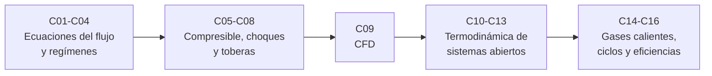

# B79 — Fluidos, termodinámica y aerotermodinámica de propulsión

> **Bloque nuevo de la estructura vigente.** Sus 16 clases estaban programadas por la ampliación y ahora están redactadas. Ver el [programa completo](../../PROGRAMA_ACADEMICO_COMPLETO.md).

**Programa:** Programa Integral de Astronomía, Astrofísica, Ciencias Espaciales e Ingeniería Aeroespacial
**Área:** A06 — Mecánica orbital, navegación y vuelo espacial
**Nivel:** N3 (fundamentos disciplinares) · **Clases:** 16 · **Carga:** por calibrar con el uso
**Estado:** guía pedagógica del bloque (resumen de qué se aprende en cada clase). Las clases enlazadas en la tabla ya están redactadas; todas conservan el estado E0 en el catálogo hasta registrar revisión disciplinar.

## 🎯 Propósito del bloque

Enseña **la física de fluidos y de termodinámica que hay detrás de una tobera, una cámara y un motor**: cómo se conservan masa, cantidad de movimiento y energía en un flujo, qué cambia cuando el flujo se vuelve compresible y supersónico, qué le cuesta a la corriente un choque y cómo se traduce todo eso en empuje y en eficiencia. Recorre desde la ecuación de continuidad hasta las eficiencias de un ciclo de Brayton, pasando por Euler, Navier–Stokes, los regímenes laminar y turbulento, los choques, la tobera convergente-divergente, los límites de la simulación numérica (CFD), las leyes de la termodinámica para volúmenes de control y las propiedades de los gases calientes. Cada clase cierra con un laboratorio en Python que se ejecuta de verdad y contrasta cada resultado con una segunda vía de cálculo.

## 📚 Al terminar el bloque podrás

1. Aplicar continuidad, Euler y Navier–Stokes a un flujo sencillo y decir qué término aporta la viscosidad.
2. Distinguir régimen laminar y turbulento con el número de Reynolds y estimar su efecto en el arrastre.
3. Calcular las propiedades de un flujo compresible y supersónico con las relaciones isentrópicas y el número de Mach.
4. Resolver choques normales y oblicuos y cuantificar la pérdida de presión total.
5. Dimensionar una tobera convergente-divergente: garganta, relación de áreas, Mach de salida y flujo másico.
6. Explicar qué puede y qué no puede garantizar una simulación CFD sencilla (convergencia en malla, error de truncamiento).
7. Aplicar la primera y la segunda ley a un volumen de control, con entalpía de flujo y entalpía total, y calcular entropía generada.
8. Usar propiedades de gases calientes con polinomios publicados y calcular el rendimiento de un ciclo de Brayton y las eficiencias térmica, propulsiva y global.

## 🧭 Secuencia del bloque

**Descripción textual.** Cinco tramos encadenados: las ecuaciones de conservación y los regímenes (C01–C04), el flujo compresible, los choques y la tobera (C05–C08), la simulación numérica que resuelve esas ecuaciones y sus límites (C09), la termodinámica de volumen de control (C10–C13) y su aplicación a gases calientes, ciclos y eficiencias de motor (C14–C16). El hilo común es el balance de masa, cantidad de movimiento y energía.

## 🗂️ Las 16 clases en resumen

**Navegación:** cada clase enlaza a la anterior, a la siguiente y a este bloque.

La columna «Evidencia» indica el producto que demostrará el aprendizaje. Los laboratorios usan datos **sintéticos** o **ilustrativos** (rotulados) o valores publicados con fuente y fecha.

### Tramo 1 · Ecuaciones del flujo y regímenes

| ID | Clase | Qué se aprende | Evidencia |
|---|---|---|---|
| [B79-C01](../clases/B79/B79-C01-conservacion-de-masa-en-fluidos/CLASE.md) | Conservación de masa en fluidos | Continuidad `ρ A u` constante, flujo másico y verificación por balance de volumen de control. | Ficha de balance de masa de un conducto |
| [B79-C02](../clases/B79/B79-C02-ecuaciones-de-euler-para-flujo-no-viscoso/CLASE.md) | Ecuaciones de Euler para flujo no viscoso | Euler 1D, Bernoulli y su límite; integración de la ecuación de momento en un conducto. | Ficha de presión a lo largo de un conducto |
| [B79-C03](../clases/B79/B79-C03-ecuaciones-de-navier-stokes/CLASE.md) | Ecuaciones de Navier-Stokes | Flujo de Couette y de Poiseuille: solución analítica frente a diferencias finitas. | Perfil de velocidad verificado |
| [B79-C04](../clases/B79/B79-C04-regimenes-laminar-y-turbulento/CLASE.md) | Regímenes laminar y turbulento | Reynolds, fricción laminar y turbulenta, arrastre de una placa plana. | Tabla de régimen y arrastre |

### Tramo 2 · Flujo compresible, choques y toberas

| ID | Clase | Qué se aprende | Evidencia |
|---|---|---|---|
| [B79-C05](../clases/B79/B79-C05-dinamica-de-fluidos-compresibles/CLASE.md) | Dinámica de fluidos compresibles | Mach, velocidad del sonido, propiedades totales y compresibilidad. | Tabla de propiedades estáticas y totales |
| [B79-C06](../clases/B79/B79-C06-flujos-supersonicos/CLASE.md) | Flujos supersónicos | Relación área-Mach, ángulo de Mach y expansión de Prandtl–Meyer. | Ficha de un flujo supersónico |
| [B79-C07](../clases/B79/B79-C07-ondas-de-choque-normales-y-oblicuas/CLASE.md) | Ondas de choque normales y oblicuas | Saltos de Rankine–Hugoniot, relación θ-β-M y pérdida de presión total. | Ficha de choque con pérdidas |
| [B79-C08](../clases/B79/B79-C08-flujo-en-toberas-convergente-divergentes/CLASE.md) | Flujo en toberas convergente-divergentes | Bloqueo, Mach de salida, flujo másico y empuje de una tobera. | Ficha de diseño de una tobera |
| [B79-C09](../clases/B79/B79-C09-cfd-academico-fundamentos-y-limites/CLASE.md) | CFD académico: fundamentos y límites | Volúmenes finitos 1D, orden de convergencia y qué no verifica una malla. | Estudio de convergencia en malla |

### Tramo 3 · Termodinámica de propulsión

| ID | Clase | Qué se aprende | Evidencia |
|---|---|---|---|
| [B79-C10](../clases/B79/B79-C10-primera-ley-de-la-termodinamica-en-sistemas-abiertos/CLASE.md) | Primera ley de la termodinámica en sistemas abiertos | Balance de energía de un volumen de control en régimen estacionario. | Balance de energía de una turbina |
| [B79-C11](../clases/B79/B79-C11-segunda-ley-y-entropia/CLASE.md) | Segunda ley y entropía | Entropía generada, irreversibilidad y rendimiento isentrópico. | Ficha de generación de entropía |
| [B79-C12](../clases/B79/B79-C12-procesos-adiabaticos-e-isentropicos/CLASE.md) | Procesos adiabáticos e isentrópicos | Relaciones `p v^γ`, trabajo de compresión y expansión isentrópicas. | Tabla de compresión y expansión |
| [B79-C13](../clases/B79/B79-C13-entalpia-de-flujo-y-entalpia-total/CLASE.md) | Entalpía de flujo y entalpía total | `h`, `h₀` y temperatura total; velocidad máxima de escape. | Ficha de entalpía total de un flujo |
| [B79-C14](../clases/B79/B79-C14-propiedades-de-gases-calientes/CLASE.md) | Propiedades de gases calientes | Polinomios de Shomate de NIST, `cp(T)`, `γ(T)` y mezcla de combustión. | Tabla de propiedades de una mezcla |
| [B79-C15](../clases/B79/B79-C15-ciclos-termodinamicos-de-propulsion/CLASE.md) | Ciclos termodinámicos de propulsión | Ciclo de Brayton ideal y con pérdidas; trabajo específico y rendimiento. | Ficha de un ciclo de Brayton |
| [B79-C16](../clases/B79/B79-C16-eficiencias-termodinamicas-de-motores/CLASE.md) | Eficiencias termodinámicas de motores | Eficiencia térmica, propulsiva y global; empuje específico. | Ficha de eficiencias de un turborreactor |

## 🧵 Hilos que atraviesan el bloque

- **Balance de masa, momento y energía:** C01–C03 los plantean y C08, C10 y C13 los usan en toberas y motores.
- **Del flujo ideal al real:** C02 (sin viscosidad), C03–C04 (con viscosidad), C07 y C11 (pérdidas por choque e irreversibilidad).
- **Entropía como contabilidad de pérdidas:** C07, C11, C15 y C16.
- **Observado frente a modelado:** todo número del bloque es un modelo con datos sintéticos o ilustrativos o con coeficientes publicados; ninguno es una medición de un motor.
- **Verificación independiente:** cada laboratorio contrasta con un caso analítico o con otra vía de cálculo.

## 📝 Evaluación del bloque (propuesta, por calibrar)

- Fichas y ejercicios por clase, con retroalimentación y recuperación con evidencia distinta.
- Portafolio: la ficha de diseño de una tobera (C08) y la ficha de eficiencias de un turborreactor (C16), con sus supuestos y sensibilidad.
- Las condiciones críticas (rotular lo ilustrativo y sintético, no presentar un modelo como medición de un motor y citar solo lo consultado) no se compensan con promedio.

## ⚠️ Seguridad y límites

El bloque es educativo. Los modelos son idealizados (gas ideal, flujo unidimensional, isentrópico, `γ` constante salvo en C14) y no sustituyen a la literatura primaria, a las normas ni al análisis de ingeniería de un motor real. Ningún cálculo describe un motor concreto: las temperaturas, presiones y geometrías son ilustrativas. La pérdida de presión total, las eficiencias de componentes y la mezcla de combustión son ilustraciones, no datos de fabricante.

## 📖 Fuentes consultadas en el bloque (resumen)

Consultadas el 2026-11-10: las páginas de la *Beginner's Guide to Aeronautics* del NASA Glenn Research Center sobre flujo másico, ecuaciones de Euler y Navier–Stokes, número de Reynolds, relaciones isentrópicas, choque normal, choques oblicuos, toberas, primera ley, segunda ley y entropía y ciclo de Brayton, y las fichas de dióxido de carbono, agua y nitrógeno del NIST Chemistry WebBook (coeficientes de Shomate). Cada clase recoge solo lo que respaldó en su sección 11. Las relaciones estándar que no figuraban en esas páginas (Darcy–Weisbach, Blasius, área–Mach, Prandtl–Meyer, θ-β-M, Rankine–Hugoniot generales, rendimientos del ciclo) son resultados de libro de texto que verifica cada laboratorio con una segunda vía; no se consultaron en una fuente concreta. La página de eficiencia térmica de NASA devolvió error 404 y no se consultó.

## Fuentes de orientación preliminar

- **[NASA-NTRS]** [NASA Technical Reports Server](https://ntrs.nasa.gov/) — Informes técnicos de la NASA.
- **[ESA-SCIENCE]** [European Space Agency Science](https://www.esa.int/Science_Exploration/Space_Science) — Misiones, descubrimientos y material científico institucional.
- **[NIST-WEBBOOK]** [NIST Chemistry WebBook](https://webbook.nist.gov/chemistry/) — Datos termoquímicos y de propiedades de gases.

> La asociación de estas fuentes es orientativa por bloque. Las fuentes realmente consultadas para cada afirmación se registran en la sección 11 de cada clase.

## Roles que lo usan

- [Ingeniería de lanzadores y propulsión](../../rutas/ingenieria-de-lanzadores-y-propulsion.md)

[🏠 Volver al programa](../../README.md) · [➡️ B80 — Navegación inercial y fusión multisensorial](./B80-navegacion-inercial-y-fusion-multisensorial.md)
