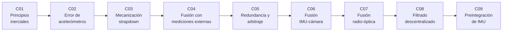

# B80 — Navegación inercial y fusión multisensorial

> **Bloque nuevo de la estructura `0.2.0`.** Sus 9 clases estaban programadas y ahora están redactadas. Ver el [programa completo](../../PROGRAMA_ACADEMICO_COMPLETO.md).

**Programa:** Programa Integral de Astronomía, Astrofísica, Ciencias Espaciales e Ingeniería Aeroespacial
**Área:** A06 — Mecánica orbital, navegación y vuelo espacial
**Nivel:** N3 (fundamentos disciplinares) · **Clases:** 9 · **Carga:** por calibrar con el uso
**Estado:** guía pedagógica del bloque (resumen de qué se aprende en cada clase). Las clases enlazadas en la tabla ya están redactadas; todas conservan el estado E0 en el catálogo hasta registrar revisión disciplinar.

## 🎯 Propósito del bloque

Enseña **cómo se obtiene la posición y la velocidad de un vehículo a partir de sensores inerciales y cómo se corrige y se protege esa solución combinándola con otras fuentes**. Recorre la propagación de la deriva de una IMU, el modelo de error de los acelerómetros, la mecanización con cuaterniones, la fusión con mediciones externas en sus dos niveles de acoplamiento, la redundancia y el arbitraje de sensores, la fusión visual-inercial, la fusión radio-óptica del espacio profundo, el filtrado repartido entre nodos y la preintegración de IMU. Cada clase cierra con un laboratorio en Python con semilla fija, sin dependencias externas, que se verifica contra una solución analítica o una segunda vía.

## 📚 Al terminar el bloque podrás

1. Calcular cómo crece el error de posición por sesgos de acelerómetro y giroscopio y obtener el período de Schuler.
2. Modelar sesgo, factor de escala y ruido de un acelerómetro y leer una curva de varianza de Allan.
3. Integrar actitud, velocidad y posición con cuaterniones y medir el orden del error del método.
4. Comparar un filtro de Kalman inercial con acoplamiento débil y fuerte frente a la deriva libre.
5. Construir el residuo de paridad de sensores redundantes, fijar un umbral y aislar una falla.
6. Estimar la escala de una cámara monocular con una IMU y reconocer cuándo no es observable.
7. Fusionar información radiométrica y óptica en el plano del cielo y en la línea de visión.
8. Distinguir una fusión descentralizada ingenua de una consistente y preintegrar una IMU entre fotogramas clave.
9. Rotular qué es observado, qué es consultado, qué es sintético y qué es un modelo en cada resultado de navegación.

## 🧭 Secuencia del bloque

**Descripción textual.** Nueve clases encadenadas: la deriva inercial (C01), el modelo de error del acelerómetro (C02), la mecanización que integra las mediciones (C03), la corrección con mediciones externas (C04), la protección contra fallas de sensor (C05), la fusión con una cámara (C06), con radio y óptica en el espacio profundo (C07), con varios nodos (C08) y la preintegración para un robot (C09).

## 🗂️ Las 9 clases en resumen

**Navegación:** cada clase enlaza a la anterior, a la siguiente y a este bloque.

La columna «Evidencia» indica el producto que demostrará el aprendizaje. Los laboratorios usan datos **sintéticos** o **ilustrativos** (rotulados) o valores publicados con fuente y fecha.

### Tramo 1 · La navegación inercial

| ID | Clase | Qué se aprende | Evidencia |
|---|---|---|---|
| [B80-C01](../clases/B80/B80-C01-principios-de-navegacion-inercial-espacial/CLASE.md) | Principios de navegación inercial espacial | Error de posición por sesgos, período de Schuler y tiempo de corrección. | Ficha de presupuesto de error inercial |
| [B80-C02](../clases/B80/B80-C02-modelo-de-error-de-acelerometros/CLASE.md) | Modelo de error de acelerómetros | Escala, sesgo y ruido; varianza de Allan y su mínimo. | Ficha de caracterización de un acelerómetro sintético |
| [B80-C03](../clases/B80/B80-C03-mecanizacion-strapdown-e-integracion-de-actitud-y-velocidad/CLASE.md) | Mecanización strapdown e integración de actitud y velocidad | Cuaterniones, actitud de punto medio y orden del método. | Ficha de verificación de una mecanización |

### Tramo 2 · Corregir y proteger la solución

| ID | Clase | Qué se aprende | Evidencia |
|---|---|---|---|
| [B80-C04](../clases/B80/B80-C04-fusion-inercial-con-mediciones-externas-acoplamiento-debil-y-fuerte/CLASE.md) | Fusión inercial con mediciones externas (acoplamiento débil y fuerte) | Kalman inercial con estimación del sesgo; posición frente a distancias brutas. | Ficha comparativa de acoplamiento |
| [B80-C05](../clases/B80/B80-C05-redundancia-de-sensores-y-arbitraje-de-mediciones/CLASE.md) | Redundancia de sensores y arbitraje de mediciones | Espacio de paridad, umbral chi-cuadrado y aislamiento. | Ficha de detección y aislamiento de fallas |

### Tramo 3 · Fusión con otros sensores

| ID | Clase | Qué se aprende | Evidencia |
|---|---|---|---|
| [B80-C06](../clases/B80/B80-C06-fusion-imu-camara/CLASE.md) | Fusión IMU-cámara | Escala de una cámara monocular y sesgo de la IMU; observabilidad. | Ficha de observabilidad visual-inercial |
| [B80-C07](../clases/B80/B80-C07-fusion-radio-optica-en-navegacion-de-espacio-profundo/CLASE.md) | Fusión radio-óptica en navegación de espacio profundo | Información en la línea de visión y en el plano del cielo. | Ficha de geometría radio-óptica |
| [B80-C08](../clases/B80/B80-C08-filtrado-distribuido-y-descentralizado/CLASE.md) | Filtrado distribuido y descentralizado | Errores correlacionados, intersección de covarianzas y NEES. | Ficha de consistencia de fusión descentralizada |
| [B80-C09](../clases/B80/B80-C09-odometria-inercial-y-preintegracion-de-imu/CLASE.md) | Odometría inercial y preintegración de IMU | Incrementos relativos, reutilización y corrección por sesgo. | Ficha de preintegración inercial |

## 🧵 Hilos que atraviesan el bloque

- **La deriva crece con el tiempo:** `½ b t²` en C01, la curva de Allan en C02 y las correcciones de C04 y C09.
- **Observabilidad:** qué hay que excitar para que un parámetro se pueda estimar (C06) y en qué eje aporta cada sensor (C07).
- **Consistencia:** la covarianza declarada debe cubrir el error real (C04, C05 y C08).
- **Observado frente a modelado:** todo número del bloque es sintético, ilustrativo o consultado y está rotulado; ninguno es una medición de un vehículo.
- **Verificación independiente:** cada laboratorio contrasta con un caso analítico, una cota o un Monte Carlo.

## 📝 Evaluación del bloque (propuesta, por calibrar)

- Fichas y ejercicios por clase, con retroalimentación y recuperación con evidencia distinta.
- Portafolio: la ficha comparativa de acoplamiento (C04) con su cota analítica y la ficha de consistencia descentralizada (C08).
- Las condiciones críticas (rotular lo sintético e ilustrativo, no presentar una simulación como observación y citar solo lo consultado) no se compensan con promedio.

## ⚠️ Seguridad y límites

El bloque es educativo. Los modelos son simplificados (uno o dos ejes, sin rotación terrestre, sin temperatura ni no linealidades) y no sustituyen a la verificación, la validación ni la certificación de un sistema de navegación de vuelo. Ningún sensor, vehículo ni misión descritos existe: los parámetros son sintéticos o ilustrativos.

## 📖 Fuentes consultadas en el bloque (resumen)

Consultadas el 2026-11-10: la ficha de datos terrestres de la NASA/NSSDC (gravedad media, radio ecuatorial y período de rotación), el valor de la aceleración estándar de la gravedad `gₙ` en la página de constantes del NIST (CODATA) y el resumen del artículo de Forster, Carlone, Dellaert y Scaramuzza sobre preintegración en variedades (arXiv:1512.02363), del que solo se consultó el resumen. Las relaciones de navegación inercial (error por sesgo, Schuler, mecanización, Kalman, paridad, intersección de covarianzas) son relaciones estándar que verifica cada laboratorio con una segunda vía y no se consultaron en una fuente concreta; tampoco se consultaron la norma IEEE 952 de giroscopios ni los documentos de navegación de espacio profundo de JPL y de las agencias.

## Fuentes de orientación preliminar

- **[NASA-NTRS]** [NASA Technical Reports Server](https://ntrs.nasa.gov/) — Informes técnicos de misiones y de sistemas de guiado y navegación.
- **[ESA-ESOC]** [ESA ESOC](https://www.esa.int/Enabling_Support/Operations) — Operaciones y dinámica de vuelo.
- **[CCSDS]** [Consultative Committee for Space Data Systems](https://public.ccsds.org/) — Estándares de datos y de navegación espacial.
- **[NIST]** [NIST Physical Measurement Laboratory](https://physics.nist.gov/cuu/Constants/) — Constantes físicas fundamentales.

> La asociación de estas fuentes es orientativa por bloque. Las fuentes realmente consultadas para cada afirmación se registran en la sección 11 de cada clase.

## Roles que lo usan

- [Navegación guiado y autonomía espacial](../../rutas/navegacion-guiado-y-autonomia-espacial.md)
- [Robótica espacial y sistemas autónomos](../../rutas/robotica-espacial-y-sistemas-autonomos.md)

[🏠 Volver al programa](../../README.md) · [➡️ B81 — Optimización de trayectorias y diseño robusto](./B81-optimizacion-de-trayectorias-y-diseno-robusto.md)
