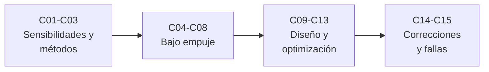

# B81 — Optimización de trayectorias y diseño robusto

> **Bloque nuevo de la estructura `0.2.0`.** Sus 15 clases estaban programadas y ahora están redactadas. Ver el [programa completo](../../PROGRAMA_ACADEMICO_COMPLETO.md).

**Programa:** Programa Integral de Astronomía, Astrofísica, Ciencias Espaciales e Ingeniería Aeroespacial
**Área:** A06 — Mecánica orbital, navegación y vuelo espacial
**Nivel:** N3 (fundamentos disciplinares) · **Clases:** 15 · **Carga:** por calibrar con el uso
**Estado:** guía pedagógica del bloque (resumen de qué se aprende en cada clase). Las clases enlazadas en la tabla están redactadas; todas conservan el estado E0 en el catálogo hasta registrar revisión disciplinar.

## 🎯 Propósito del bloque

Enseña **cómo se calcula, se valida y se hace robusta una trayectoria**: primero las sensibilidades (matriz de transición), luego los métodos que las usan (disparo y transcripción directa), después el bajo empuje (espirales, límites de potencia, orientación, modelos de aceleración y validación) y por último el diseño con varios criterios, restricciones y heurísticas, y el presupuesto de correcciones y la recuperación ante fallas. Cada clase cierra con un laboratorio en Python que se ejecuta y se contrasta con una solución analítica o con una segunda vía de cálculo.

## 📚 Al terminar el bloque podrás

1. Propagar sensibilidades con las ecuaciones variacionales y comprobarlas con diferencias finitas.
2. Resolver un problema de contorno por disparo simple o múltiple y explicar cuándo conviene cada uno.
3. Transcribir un problema de control a un problema de dimensión finita y medir su convergencia.
4. Estimar `Δv`, tiempo y limitación de potencia de una espiral de bajo empuje.
5. Construir un frente de Pareto, manejar restricciones y comparar métodos globales con arranque múltiple.
6. Dimensionar un presupuesto de correcciones al 99 % y una ventana de recuperación, rotulando qué es sintético.

## 🧭 Secuencia del bloque

**Descripción textual.** Cuatro tramos encadenados: las sensibilidades y los métodos de optimización (C01–C03), el bajo empuje (C04–C08), el diseño con objetivos, restricciones y heurísticas (C09–C13) y las correcciones y la recuperación (C14–C15). El hilo común es que una trayectoria óptima solo sirve si se valida y resiste errores.

## 🗂️ Las 15 clases en resumen

**Navegación:** cada clase enlaza a la anterior, a la siguiente y a este bloque.

La columna «Evidencia» indica el producto que demostrará el aprendizaje. Los laboratorios usan datos **sintéticos** o **ilustrativos** (rotulados) o constantes publicadas con fuente y fecha.

### Tramo 1 · Sensibilidades y métodos de optimización

| ID | Clase | Qué se aprende | Evidencia |
|---|---|---|---|
| [B81-C01](../clases/B81/B81-C01-ecuaciones-variacionales-y-matriz-de-transicion-de-estados/CLASE.md) | Ecuaciones variacionales y matriz de transición de estados | Integrar el estado y la matriz de transición `Φ(t,t0)` con las ecuaciones variacionales; comprobarla contra diferencias finitas y `det Φ = 1`. | Tabla de sensibilidades de una órbita heliocéntrica |
| [B81-C02](../clases/B81/B81-C02-metodo-de-disparo-para-control-optimo/CLASE.md) | Método de disparo para control óptimo | Disparo simple con Newton y `Φ`; disparo múltiple y mejora del condicionamiento. | Comparación de iteraciones y condicionamiento |
| [B81-C03](../clases/B81/B81-C03-metodos-directos-de-transcripcion/CLASE.md) | Métodos directos de transcripción | Transcripción por trapecios de un problema de mínimo esfuerzo y comparación con la solución analítica. | Ficha de convergencia de la colocación |

### Tramo 2 · Bajo empuje

| ID | Clase | Qué se aprende | Evidencia |
|---|---|---|---|
| [B81-C04](../clases/B81/B81-C04-trayectorias-espirales-de-bajo-empuje/CLASE.md) | Trayectorias espirales de bajo empuje | Espiral tangencial de órbita baja a geoestacionaria: Δv de Edelbaum, tiempo y comparación con la integración promediada. | Ficha de una espiral de escape/captura |
| [B81-C05](../clases/B81/B81-C05-limitaciones-de-potencia-en-propulsion-electrica/CLASE.md) | Limitaciones de potencia en propulsión eléctrica | Potencia solar `∝ 1/r²`, empuje `T = 2ηP/(g₀ Isp)` y saturación del propulsor. | Curva de empuje frente a distancia al Sol |
| [B81-C06](../clases/B81/B81-C06-restricciones-de-orientacion-del-empuje/CLASE.md) | Restricciones de orientación del empuje | Pérdida por coseno entre empuje, Sol y paneles; cono de orientación admisible. | Mapa de eficiencia de empuje frente a ángulos |
| [B81-C07](../clases/B81/B81-C07-modelos-de-aceleracion-para-bajo-empuje/CLASE.md) | Modelos de aceleración para bajo empuje | Aceleración constante, empuje constante con masa variable y aceleración `∝ 1/r²`; ecuación del cohete. | Tabla comparativa de tres modelos |
| [B81-C08](../clases/B81/B81-C08-validacion-de-trayectorias-de-empuje-continuo/CLASE.md) | Validación de trayectorias de empuje continuo | Reintegración con otro paso, balance de energía y chequeo de optimalidad. | Informe de validación de una trayectoria |

### Tramo 3 · Diseño robusto y objetivos

| ID | Clase | Qué se aprende | Evidencia |
|---|---|---|---|
| [B81-C09](../clases/B81/B81-C09-variables-de-diseno-orbital/CLASE.md) | Variables de diseño orbital | Elegir y normalizar variables de diseño; efecto de la escala en la convergencia. | Comparación con y sin escalado |
| [B81-C10](../clases/B81/B81-C10-funciones-objetivo-de-diseno-de-trayectorias/CLASE.md) | Funciones objetivo de diseño de trayectorias | Δv, tiempo, masa y costes ponderados; cómo cambia el óptimo con el objetivo. | Tabla de óptimos por objetivo |
| [B81-C11](../clases/B81/B81-C11-optimizacion-multicriterio-y-frentes-de-pareto/CLASE.md) | Optimización multicriterio y frentes de Pareto | Dominancia, frente de Pareto e hipervolumen para Δv frente a tiempo de vuelo. | Frente de Pareto y punto de compromiso |
| [B81-C12](../clases/B81/B81-C12-restricciones-dinamicas-en-optimizacion/CLASE.md) | Restricciones dinámicas en optimización | Cota de empuje en un problema de mínimo esfuerzo por conjunto activo; tiempo mínimo. | Ficha de restricciones activas |
| [B81-C13](../clases/B81/B81-C13-optimizacion-heuristica-algoritmos-geneticos-y-enjambres/CLASE.md) | Optimización heurística (algoritmos genéticos y enjambres) | Algoritmo genético y enjambre de partículas con semilla fija frente a multiarranque. | Tabla de evaluaciones y tasas de éxito |

### Tramo 4 · Correcciones y fallas

| ID | Clase | Qué se aprende | Evidencia |
|---|---|---|---|
| [B81-C14](../clases/B81/B81-C14-presupuestos-de-maniobras-de-correccion/CLASE.md) | Presupuestos de maniobras de corrección | Monte Carlo del `Δv` de corrección frente a la cuantila analítica; suma de maniobras. | Presupuesto de corrección al 99 % |
| [B81-C15](../clases/B81/B81-C15-robustez-de-trayectoria-ante-fallas/CLASE.md) | Robustez de trayectoria ante fallas | Retraso de una corrección fallida, `Δv` de recuperación y ventana admisible. | Ventana de recuperación |

## 🧵 Hilos que atraviesan el bloque

- **Sensibilidades:** la matriz de transición de C01 reaparece en el disparo (C02), la validación (C08) y la recuperación (C15).
- **Compromiso entre criterios:** `Δv`, tiempo, masa y robustez se enfrentan en C10, C11 y C14.
- **Observado frente a modelado:** todo número del bloque es un modelo con datos sintéticos o ilustrativos; ninguno es una medición de una misión.
- **Verificación independiente:** cada laboratorio contrasta con un caso analítico o con otra vía de cálculo.

## 📝 Evaluación del bloque (propuesta, por calibrar)

- Fichas y ejercicios por clase, con retroalimentación y recuperación con evidencia distinta.
- Portafolio: el informe de validación (C08) y el presupuesto de correcciones (C14) con sus supuestos.
- Las condiciones críticas (rotular lo ilustrativo y sintético, no presentar un modelo como observación y citar solo lo consultado) no se compensan con promedio.

## ⚠️ Seguridad y límites

El bloque es educativo. Los modelos son simplificados (dos cuerpos, sin perturbaciones, empuje ideal) y no sustituyen herramientas de diseño de misión ni su validación. Las constantes (`GM` del Sol, unidad astronómica, luminosidad) proceden de las fuentes citadas; las cifras de propulsores, masas, errores de navegación y fallas son ilustrativas.

## 📖 Fuentes consultadas en el bloque (resumen)

Consultadas el 2026-11-10: los parámetros astrodinámicos del JPL SSD (`GM` del Sol y unidad astronómica, DE440), la ficha del Sol de la NASA/NSSDC (luminosidad, `GM`) y el capítulo de propulsión del *State-of-the-Art of Small Spacecraft Technology* de la NASA (rangos de `Isp` y relación empuje–potencia). Los métodos (ecuaciones variacionales, disparo, colocación, Edelbaum, Pareto, algoritmos genéticos, estadística de correcciones) son relaciones estándar que verifica cada laboratorio y no se consultaron en una fuente concreta. Se intentó consultar la página de Dawn del JPL y artículos de revisión, sin obtener las cifras: no consultadas.

## Fuentes de orientación preliminar

- **[NASA-SSD]** [JPL Solar System Dynamics](https://ssd.jpl.nasa.gov/) — Constantes y efemérides.
- **[NTRS]** [NASA Technical Reports Server](https://ntrs.nasa.gov/) — Informes técnicos de la NASA.
- **[ESA-SCIENCE]** [European Space Agency Science](https://www.esa.int/Science_Exploration/Space_Science) — Misiones y material institucional.
- **[ADS]** [NASA Astrophysics Data System](https://ui.adsabs.harvard.edu/) — Índice bibliográfico.

> La asociación de estas fuentes es orientativa por bloque. Las fuentes realmente consultadas para cada afirmación se registran en la sección 11 de cada clase.

## Roles que lo usan

- [Astrodinámica interplanetaria](../../rutas/astrodinamica-interplanetaria.md)

[🏠 Volver al programa](../../README.md) · [➡️ B82 — Problema de Lambert y transferencias de dos puntos](./B82-problema-de-lambert-y-transferencias-de-dos-puntos.md)
