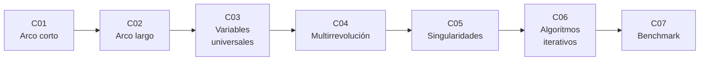

# B82 — Problema de Lambert y transferencias de dos puntos

> **Bloque nuevo de la estructura `0.2.0`.** Sus 7 clases estaban programadas y ahora están redactadas. Ver el [programa completo](../../PROGRAMA_ACADEMICO_COMPLETO.md).

**Programa:** Programa Integral de Astronomía, Astrofísica, Ciencias Espaciales e Ingeniería Aeroespacial
**Área:** A06 — Mecánica orbital, navegación y vuelo espacial
**Nivel:** N3 (fundamentos disciplinares) · **Clases:** 7 · **Carga:** por calibrar con el uso
**Estado:** guía pedagógica del bloque (resumen de qué se aprende en cada clase). Las clases enlazadas en la tabla ya están redactadas; todas conservan el estado E0 en el catálogo hasta registrar revisión disciplinar.

## 🎯 Propósito del bloque

Enseña a resolver el **problema de Lambert**: dadas dos posiciones y un tiempo de vuelo, encontrar la órbita kepleriana que las une y las velocidades en los extremos. Recorre el arco corto, el arco largo y la orientación del plano, la formulación unificada en variables universales (elipse, parábola, hipérbola), las soluciones con revoluciones completas, las singularidades en 0° y 180°, los algoritmos iterativos modernos (variable de Lancaster–Blanchard con iteración de Householder, al estilo de Izzo) y un banco de pruebas que compara precisión y costo. Cada clase cierra con un laboratorio en Python que verifica el resultado propagando la órbita con un integrador kepleriano independiente.

## 📚 Al terminar el bloque podrás

1. Resolver Lambert de arco corto con el teorema de Lambert (`a`, `s`, `c`) y obtener las velocidades con los coeficientes de Lagrange.
2. Tratar el arco largo (mayor de 180°) y fijar el sentido de giro y el plano de la transferencia.
3. Resolver con variables universales y las funciones de Stumpff cualquier tipo de cónica.
4. Contar y elegir soluciones con `M` revoluciones completas y detectar cuándo no existen.
5. Reconocer y tratar las singularidades de 0° y 180° y la pérdida de precisión cerca de la parábola.
6. Comparar solucionadores por residuo de propagación e iteraciones, rotulando datos sintéticos y lo medido en un equipo concreto.

## 🧭 Secuencia del bloque

**Descripción textual.** Siete clases encadenadas: el caso geométricamente más simple (C01), su extensión a arcos mayores de 180° (C02), la formulación que cubre todas las cónicas (C03), las soluciones con vueltas completas (C04), los casos donde el problema se degenera (C05), los algoritmos rápidos que se usan en la práctica (C06) y su comparación cuantitativa (C07).

## 🗂️ Las 7 clases en resumen

**Navegación:** cada clase enlaza a la anterior, a la siguiente y a este bloque.

La columna «Evidencia» indica el producto que demostrará el aprendizaje. Los laboratorios usan datos **sintéticos** (órbitas circulares coplanares de ejemplo, rotuladas) y constantes con fuente y fecha.

### Tramo 1 · Formulaciones básicas

| ID | Clase | Qué se aprende | Evidencia |
|---|---|---|---|
| [B82-C01](../clases/B82/B82-C01-lambert-de-arco-corto/CLASE.md) | Lambert de arco corto | Teorema de Lambert, semieje por bisección y velocidades con `f` y `g`. | Ficha de una transferencia de arco corto verificada por propagación |
| [B82-C02](../clases/B82/B82-C02-lambert-de-arco-largo/CLASE.md) | Lambert de arco largo | Ángulo mayor de 180°, sentido de giro y normal del plano. | Comparación prograda frente a retrógrada para un mismo par de posiciones |
| [B82-C03](../clases/B82/B82-C03-formulacion-de-variables-universales/CLASE.md) | Formulación de variables universales | Funciones de Stumpff, variable `z` y paso continuo elipse–parábola–hipérbola. | Barrido del tiempo de vuelo con el tipo de cónica |

### Tramo 2 · Casos difíciles

| ID | Clase | Qué se aprende | Evidencia |
|---|---|---|---|
| [B82-C04](../clases/B82/B82-C04-lambert-multirrevolucion/CLASE.md) | Lambert multirrevolución | Tiempo mínimo por `M`, dos ramas y número de soluciones. | Tabla de soluciones por `M` y rama |
| [B82-C05](../clases/B82/B82-C05-singularidades-del-problema-de-lambert/CLASE.md) | Singularidades del problema de Lambert | Plano indefinido en 180°, cuerda nula en 0° y precisión cerca de la parábola. | Mapa de sensibilidad del plano cerca de 180° |

### Tramo 3 · Algoritmos y comparación

| ID | Clase | Qué se aprende | Evidencia |
|---|---|---|---|
| [B82-C06](../clases/B82/B82-C06-algoritmos-iterativos-para-lambert-gooding-izzo/CLASE.md) | Algoritmos iterativos para Lambert (Gooding, Izzo) | Variable `x`, valor inicial, Newton, Halley y Householder. | Curva de convergencia por método |
| [B82-C07](../clases/B82/B82-C07-benchmark-entre-solucionadores-de-lambert/CLASE.md) | Benchmark entre solucionadores de Lambert | Banco de casos, residuo, iteraciones y tiempo. | Informe comparativo de solucionadores |

## 🧵 Hilos que atraviesan el bloque

- **Verificación por propagación:** toda solución se comprueba llevando `r1`, `v1` hasta `r2` con un propagador kepleriano independiente.
- **Unidades canónicas:** `μ = 1`, longitud en UA o en radio de la órbita de referencia, tiempo en la unidad que hace `μ = 1`.
- **Una sola física, varias variables:** `a`, `z` y `x` describen la misma ecuación de Lambert.
- **Sintético frente a observado:** ninguna transferencia del bloque corresponde a una misión ni a efemérides reales.

## 📝 Evaluación del bloque (propuesta, por calibrar)

- Fichas y ejercicios por clase, con retroalimentación y recuperación con evidencia distinta.
- Portafolio: el informe comparativo (C07) con su banco de casos, residuos y límites.
- Las condiciones críticas (rotular lo sintético, verificar por propagación y citar solo lo consultado) no se compensan con promedio.

## ⚠️ Seguridad y límites

El bloque es educativo. Los solucionadores son de dos cuerpos, sin perturbaciones, sin maniobras de corrección y sin restricciones de misión; no sirven para diseñar una trayectoria real sin una herramienta validada y revisión de especialistas. Gooding (1990) no se consultó: «estilo Gooding» en C06 se refiere solo a la familia de métodos descrita en el artículo de Izzo.

## 📖 Fuentes consultadas en el bloque (resumen)

Consultadas el 2026-11-10: la página de resumen de D. Izzo, «Revisiting Lambert's Problem» (arXiv:1403.2705, 2014; solo el resumen) y la página de parámetros astrodinámicos del JPL SSD (`GM` del Sol de DE440 y unidad astronómica). Las deducciones de Lambert, Lagrange, Stumpff y Lancaster–Blanchard que usan las clases son relaciones estándar que cada laboratorio verifica por propagación y no se consultaron en una fuente concreta. Gooding (1990) y los libros de texto de astrodinámica no se consultaron.

## Fuentes de orientación preliminar

- **[NASA-JPL-SSD]** [JPL Solar System Dynamics](https://ssd.jpl.nasa.gov/) — Constantes y datos de dinámica del sistema solar.
- **[ARXIV]** [arXiv](https://arxiv.org/) — Preimpresos de astrodinámica y mecánica celeste.
- **[ESA-ESOC]** [ESA Space Operations](https://www.esa.int/Enabling_Support/Operations) — Dinámica de vuelo y operaciones.
- **[ADS]** [NASA Astrophysics Data System](https://ui.adsabs.harvard.edu/) — Índice bibliográfico de literatura astronómica y física.

> La asociación de estas fuentes es orientativa por bloque. Las fuentes realmente consultadas para cada afirmación se registran en la sección 11 de cada clase.

## Roles que lo usan

- [Astrodinámica interplanetaria](../../rutas/astrodinamica-interplanetaria.md)

[🏠 Volver al programa](../../README.md)
