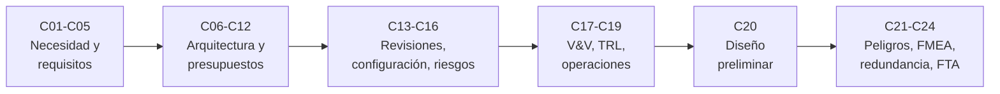

# B83 — Ingeniería de sistemas y diseño de misiones

> **Bloque ampliado.** Sus 20 clases de la línea base y sus 4 clases programadas (`B83-C21` a `B83-C24`) están redactadas. Ver el [programa completo](../../PROGRAMA_ACADEMICO_COMPLETO.md).

**Programa:** Programa Integral de Astronomía, Astrofísica, Ciencias Espaciales e Ingeniería Aeroespacial
**Área:** A07 — Ingeniería y construcción de sistemas espaciales
**Nivel:** N3 (fundamentos disciplinares) · **Clases:** 24 · **Carga:** por calibrar con el uso
**Estado:** guía pedagógica del bloque (resumen de qué se aprende en cada clase). Las clases enlazadas en la tabla ya están redactadas; todas conservan el estado E0 en el catálogo hasta registrar revisión disciplinar.

## 🎯 Propósito del bloque

Enseña **cómo se pasa de una necesidad científica a una misión diseñada, verificada y entregada a operaciones**, con números que cierran. Recorre la necesidad y el caso científico, las partes interesadas, el concepto de operaciones y los requisitos verificables con su trazabilidad; la descomposición funcional, la arquitectura, las interfaces y los tres presupuestos (masa, energía, datos); el modelo de sistema, las revisiones, la configuración y los riesgos; la verificación y la validación, la madurez tecnológica y la transferencia a operaciones; y, para terminar, un diseño preliminar completo. La ampliación añade el análisis de peligros de lanzamiento, el FMEA, la redundancia de misión y los árboles de fallos. Cada clase cierra con un laboratorio en Python con semilla fija sobre una **misión sintética de ejemplo** (ESTRELLA-S, un microsatélite de observación a 550 km) que no es una misión real.

## 📚 Al terminar el bloque podrás

1. Derivar un requisito de medición desde un objetivo científico y redactar requisitos verificables con su trazabilidad.
2. Descomponer funciones, asignarlas a subsistemas, comparar arquitecturas y verificar interfaces.
3. Construir los presupuestos de masa, energía y datos con reservas y márgenes explícitos.
4. Usar un modelo de sistema como fuente única de verdad y controlar la configuración y los cambios.
5. Evaluar la preparación para las revisiones SRR, PDR, CDR y TRR, y la madurez tecnológica (TRL).
6. Distinguir verificación de validación y preparar la aceptación y la transferencia a operaciones.
7. Analizar peligros, modos de fallo y árboles de fallos, y decidir la redundancia de misión.
8. Cerrar un diseño preliminar completo y rotular qué es consultado, qué es sintético y qué es un supuesto.

## 🧭 Secuencia del bloque

**Descripción textual.** Seis tramos encadenados: de la necesidad a los requisitos (C01–C05), de ahí a la arquitectura y los presupuestos (C06–C12), la gestión de revisiones, configuración y riesgos (C13–C16), la verificación, la madurez y la entrega a operaciones (C17–C19), el diseño preliminar que integra todo (C20) y, como ampliación, el análisis de seguridad y confiabilidad (C21–C24). El hilo común es la **trazabilidad con números**: cada decisión se apoya en un requisito y en un cálculo que se puede repetir.

## 🗂️ Las 24 clases en resumen

**Navegación:** cada clase enlaza a la anterior, a la siguiente y a este bloque.

La columna «Evidencia» indica el producto que demostrará el aprendizaje. Los laboratorios usan datos **sintéticos** o **ilustrativos** (rotulados) o valores publicados con fuente y fecha.

### Tramo 1 · De la necesidad a los requisitos

| ID | Clase | Qué se aprende | Evidencia |
|---|---|---|---|
| [B83-C01](../clases/B83/B83-C01-necesidad-de-mision-y-caso-cientifico/CLASE.md) | Necesidad de misión y caso científico | Convertir un objetivo científico en un requisito de medición (resolución → apertura) y priorizar objetivos con una matriz ponderada y su sensibilidad. | Ficha de necesidad de misión con requisito de medición derivado |
| [B83-C02](../clases/B83/B83-C02-partes-interesadas-y-usuarios/CLASE.md) | Partes interesadas y usuarios | Priorizar partes interesadas por poder e interés, ponderar sus necesidades y comprobar la estabilidad del orden ante cambios de pesos. | Matriz de partes interesadas y necesidades con orden estable |
| [B83-C03](../clases/B83/B83-C03-concepto-de-operaciones-conops/CLASE.md) | Concepto de operaciones CONOPS | Construir un concepto de operaciones con fases y calcular los contactos con una estación a partir de la geometría orbital y la rotación terrestre. | CONOPS con tabla de contactos y presupuesto de tiempo de enlace |
| [B83-C04](../clases/B83/B83-C04-requisitos-verificables/CLASE.md) | Requisitos verificables | Redactar y revisar requisitos con reglas verificables (verbo, valor con unidad, método de verificación, ausencia de ambigüedad). | Lista de requisitos revisada con reporte de calidad |
| [B83-C05](../clases/B83/B83-C05-trazabilidad-de-requisitos/CLASE.md) | Trazabilidad de requisitos | Armar el grafo necesidad→requisito→diseño→verificación, detectar huérfanos y calcular el alcance de un cambio. | Matriz de trazabilidad con análisis de impacto |

### Tramo 2 · Arquitectura, interfaces y presupuestos

| ID | Clase | Qué se aprende | Evidencia |
|---|---|---|---|
| [B83-C06](../clases/B83/B83-C06-descomposicion-funcional/CLASE.md) | Descomposición funcional | Descomponer funciones, asignarlas a subsistemas y hallar la ruta crítica del flujo funcional. | Árbol funcional con asignación y ruta crítica |
| [B83-C07](../clases/B83/B83-C07-arquitecturas-de-sistemas/CLASE.md) | Arquitecturas de sistemas | Comparar arquitecturas con pesos AHP, razón de consistencia y análisis de sensibilidad. | Estudio comparativo de arquitecturas con sensibilidad |
| [B83-C08](../clases/B83/B83-C08-interfaz-entre-subsistemas/CLASE.md) | Interfaz entre subsistemas | Definir y verificar interfaces eléctricas y de datos: compatibilidad de tensión, caída en el arnés y margen de tasa. | Tabla de control de interfaces verificada |
| [B83-C09](../clases/B83/B83-C09-presupuestos-de-masa/CLASE.md) | Presupuestos de masa | Construir un presupuesto de masa con reserva por madurez, margen frente al límite y propelente por la ecuación del cohete. | Presupuesto de masa con margen e incertidumbre |
| [B83-C10](../clases/B83/B83-C10-presupuestos-de-energia/CLASE.md) | Presupuestos de energía | Dimensionar la energía: eclipse, panel, batería y profundidad de descarga por modos de operación. | Presupuesto de energía orbital con margen |
| [B83-C11](../clases/B83/B83-C11-presupuestos-de-datos/CLASE.md) | Presupuestos de datos | Balancear datos generados y capacidad de enlace incluyendo la sobrecarga de codificación del estándar CCSDS 131.0-B-5. | Presupuesto de datos con ocupación del registrador |
| [B83-C12](../clases/B83/B83-C12-model-based-systems-engineering/CLASE.md) | Model-Based Systems Engineering | Construir un modelo paramétrico de sistema con una sola fuente de verdad y propagar un cambio. | Modelo de sistema ejecutable con trazas de cambio |

### Tramo 3 · Revisiones, configuración y riesgos

| ID | Clase | Qué se aprende | Evidencia |
|---|---|---|---|
| [B83-C13](../clases/B83/B83-C13-revisiones-srr-y-pdr/CLASE.md) | Revisiones SRR y PDR | Evaluar criterios de entrada y salida de SRR y PDR con umbrales explícitos y contar acciones abiertas. | Informe de preparación de SRR/PDR con veredicto |
| [B83-C14](../clases/B83/B83-C14-revisiones-cdr-y-trr/CLASE.md) | Revisiones CDR y TRR | Evaluar CDR y TRR: cobertura de verificación, preparación de ensayos y nivel de vibración (Grms) de un perfil. | Informe de preparación de CDR/TRR y nivel de ensayo |
| [B83-C15](../clases/B83/B83-C15-gestion-de-configuracion/CLASE.md) | Gestión de configuración | Gestionar elementos de configuración con líneas base con huella, detectar deriva y calcular impacto de un cambio. | Registro de línea base con huella y control de cambios |
| [B83-C16](../clases/B83/B83-C16-gestion-de-riesgos-tecnicos/CLASE.md) | Gestión de riesgos técnicos | Registrar riesgos con matriz 5×5, simular el consumo de reservas y ordenar por exposición esperada. | Registro de riesgos técnicos con exposición y simulación |

### Tramo 4 · Verificación, madurez y transferencia

| ID | Clase | Qué se aprende | Evidencia |
|---|---|---|---|
| [B83-C17](../clases/B83/B83-C17-verificacion-frente-a-validacion/CLASE.md) | Verificación frente a validación | Separar verificación (producto contra requisitos) de validación (producto contra necesidad) y mostrar un caso que verifica pero no valida. | Matriz V&V con un caso que verifica y no valida |
| [B83-C18](../clases/B83/B83-C18-niveles-de-madurez-tecnologica/CLASE.md) | Niveles de madurez tecnológica | Asignar TRL por componente, calcular el TRL del sistema (mínimo), degradar por herencia y priorizar madurización. | Evaluación de madurez tecnológica con plan de madurización |
| [B83-C19](../clases/B83/B83-C19-aceptacion-y-transferencia-a-operaciones/CLASE.md) | Aceptación y transferencia a operaciones | Comprobar la aceptación y la transferencia a operaciones: base de datos de telemetría, calibraciones, límites y criterios. | Lista de aceptación y transferencia con prueba de calibración |

### Tramo 5 · Diseño integrado

| ID | Clase | Qué se aprende | Evidencia |
|---|---|---|---|
| [B83-C20](../clases/B83/B83-C20-diseno-preliminar-completo-de-mision/CLASE.md) | Diseño preliminar completo de misión | Cerrar el diseño preliminar integrando masa, energía, datos y propelente en un lazo iterativo hasta converger. | Diseño preliminar integrado con presupuestos cerrados |

### Tramo 6 · Seguridad y confiabilidad (ampliación)

| ID | Clase | Qué se aprende | Evidencia |
|---|---|---|---|
| [B83-C21](../clases/B83/B83-C21-identificacion-de-peligros-en-sistemas-de-lanzamiento-hazid/CLASE.md) | Identificación de peligros en sistemas de lanzamiento (HAZID) | Identificar peligros con palabras guía, clasificarlos y estimar un riesgo para terceros con un modelo sintético. | Registro de peligros HAZID con riesgo estimado |
| [B83-C22](../clases/B83/B83-C22-analisis-de-modos-y-efectos-de-fallo-fmea-en-sistemas-espaciales/CLASE.md) | Análisis de modos y efectos de fallo (FMEA) en sistemas espaciales | Elaborar un FMEA: modos de fallo, efectos, S/O/D, RPN, probabilidades por tasa de fallo y reevaluación tras mitigar. | Tabla FMEA con priorización y reevaluación |
| [B83-C23](../clases/B83/B83-C23-redundancia-y-tolerancia-a-fallos-de-mision/CLASE.md) | Redundancia y tolerancia a fallos de misión | Calcular la confiabilidad de misión con redundancia activa, fría y k-de-n, y decidir qué se duplica. | Estudio de redundancia con confiabilidad de misión |
| [B83-C24](../clases/B83/B83-C24-arboles-de-fallos-fta-y-analisis-de-causas/CLASE.md) | Árboles de fallos (FTA) y análisis de causas | Construir un árbol de fallos, hallar los conjuntos mínimos de corte y calcular la probabilidad del evento superior por tres vías. | Árbol de fallos con cortes mínimos e importancia |

## 🧵 Hilos que atraviesan el bloque

- **Trazabilidad:** necesidad → requisito → diseño → verificación (C01–C05, C14, C17) y el modelo de sistema que la sostiene (C12).
- **Presupuestos con margen:** masa, energía y datos (C09–C11) se cierran juntos en C20 y se revisan en C13–C14.
- **Verificar y validar:** C14, C17, C18 y C19 separan «construido bien» de «el producto correcto».
- **Riesgo y confiabilidad:** C16 y C21–C24 llevan el riesgo de una lista a un cálculo (RPN, cortes mínimos, confiabilidad de misión).
- **Observado frente a modelado:** todo número del bloque es un modelo con datos sintéticos o ilustrativos; ninguno es una medición ni una misión real.

## 📝 Evaluación del bloque (propuesta, por calibrar)

- Fichas y ejercicios por clase, con retroalimentación y recuperación con evidencia distinta.
- Portafolio: el diseño preliminar integrado (C20) con su matriz de trazabilidad, sus presupuestos y su registro de riesgos.
- Las condiciones críticas (rotular lo sintético, no presentar un modelo como misión real y citar solo lo consultado) no se compensan con promedio.

## ⚠️ Seguridad y límites

El bloque es educativo. Los modelos son simplificados (órbita circular de dos cuerpos, reservas de ejemplo, tasas de fallo sintéticas) y no sustituyen a los estándares vigentes, a las revisiones formales ni al juicio de especialistas; ningún resultado certifica la seguridad ni la conformidad de una misión. Los umbrales y márgenes de los laboratorios son **reglas de ejemplo del proyecto sintético**, no requisitos de una agencia. Los contenidos de ECSS, ISO/IEC/IEEE 15288, MIL-STD-1629 y SysML no se consultaron.

## 📖 Fuentes consultadas en el bloque (resumen)

Consultadas el 2026-11-10: el NASA Systems Engineering Handbook (NASA/SP-6105; página principal y los apartados web 5.3 sobre verificación, 6.0 sobre gestión técnica transversal, 6.4 sobre riesgos técnicos y el Apéndice G sobre evaluación tecnológica), la página de niveles de madurez tecnológica de NASA, el capítulo de energía de *State-of-the-Art of Small Spacecraft Technology* de NASA, la ficha de la Tierra de NASA/NSSDC (irradiancia, radio, GM, gravedad normal) y la recomendación CCSDS 131.0-B-5 (TM Synchronization and Channel Coding, septiembre de 2023, leída con PyMuPDF). De los apartados 6.0 solo se leyó la primera parte de la página. Los textos de ECSS (la página de estándares de ecss.nl no mostró los documentos), ISO/IEC/IEEE 15288, INCOSE, SysML, MIL-STD-1629 e IEC 60812/61025 **no se consultaron**. Los métodos matemáticos (AHP, rutas críticas, confiabilidad, cortes mínimos, RPN) son relaciones estándar que verifica cada laboratorio y no se consultaron en una fuente concreta.

## Fuentes de orientación preliminar

- **[NASA-SMALLSAT]** [NASA State-of-the-Art of Small Spacecraft Technology, edición 2026](https://www.nasa.gov/smallsat-institute/sst-soa/) — Referencia panorámica sobre plataformas y subsistemas de satélites pequeños.
- **[NASA-SYSTEMS]** [NASA Systems Engineering Handbook](https://www.nasa.gov/reference/systems-engineering-handbook/) — Ingeniería de sistemas, verificación, validación y gestión técnica.
- **[ECSS]** [European Cooperation for Space Standardization](https://ecss.nl/) — Estándares y buenas prácticas europeos aplicables a proyectos espaciales.
- **[CCSDS]** [Consultative Committee for Space Data Systems](https://ccsds.org/publications/) — Protocolos, recomendaciones y estándares de intercambio de datos espaciales.

> La asociación de estas fuentes es orientativa por bloque. Las fuentes realmente consultadas para cada afirmación se registran en la sección 11 de cada clase.

[🏠 Volver al programa](../../README.md) · [➡️ B84 — Estructuras, materiales y fabricación espacial](./B84-estructuras-materiales-y-fabricacion-espacial.md)
