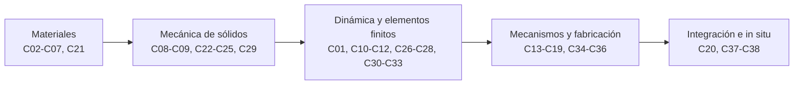

# B84 — Estructuras, materiales y fabricación espacial

> **Bloque ampliado.** Sus 20 clases de la línea base y sus 18 clases programadas (`B84-C21` a `B84-C38`) están redactadas. Ver el [programa completo](../../PROGRAMA_ACADEMICO_COMPLETO.md).

**Programa:** Programa Integral de Astronomía, Astrofísica, Ciencias Espaciales e Ingeniería Aeroespacial
**Área:** A07 — Ingeniería y construcción de sistemas espaciales
**Nivel:** N3 (fundamentos disciplinares) · **Clases:** 38 · **Carga:** por calibrar con el uso
**Estado:** guía pedagógica del bloque (resumen de qué se aprende en cada clase). Las 38 clases enlazadas en las tablas ya están redactadas; todas conservan el estado E0 en el catálogo hasta registrar revisión disciplinar.

## 🎯 Propósito del bloque

Enseña **cómo una estructura espacial sobrevive a su lanzamiento y a su vida en órbita, y cómo se decide con números que una pieza es suficientemente buena**. Recorre los materiales (aleaciones, compuestos, cerámicos, polímeros) y su comportamiento en vacío; la mecánica de sólidos (tensión, vigas, pandeo, fatiga, concentraciones, no linealidad); la dinámica (modos, resonancia, vibración aleatoria, respuesta armónica) y los elementos finitos (mallas, elementos, condiciones de contorno, correlación con el ensayo y revisión); y la fabricación (manufactura aditiva, tolerancias, uniones, control dimensional, inspección no destructiva, control de procesos). Cierra con el diseño de una plataforma y con la producción de piezas con material de la Luna. Cada clase termina con un laboratorio en Python (solo biblioteca estándar) con semilla fija, cuya salida real se copia en la clase.

## 📚 Al terminar el bloque podrás

1. Describir el entorno mecánico de un lanzamiento y convertir una densidad espectral en un valor eficaz que contrastas con el estándar GEVS.
2. Elegir un material con índices de mérito y justificar la elección con propiedades, vacío, desgasificación y compatibilidad galvánica.
3. Calcular tensiones, flechas, pandeo, vida a fatiga, concentraciones de tensión y márgenes estructurales con sus factores de seguridad.
4. Obtener modos y frecuencias por elementos finitos, verificar el modelo contra una solución exacta y demostrar la convergencia de la malla.
5. Predecir la respuesta a vibración armónica y aleatoria y correlacionar el modelo con un ensayo con los criterios del GEVS.
6. Dimensionar uniones, mecanismos y rodamientos, y decidir tolerancias, controles dimensionales y de proceso e inspección no destructiva.
7. Rotular qué es dato consultado, qué es ley estándar verificada por el laboratorio y qué es ilustrativo en cada resultado.

## 🧭 Secuencia del bloque

**Descripción textual.** Cinco grupos encadenados: los materiales y su respuesta al vacío (C02–C07, C21); la mecánica de sólidos que los carga (C08–C09, C22–C25, C29); la dinámica del lanzamiento y los elementos finitos que la modelan (C01, C10–C12, C26–C28, C30–C33); los mecanismos y la fabricación que materializan el diseño (C13–C19, C34–C36); y la integración en una plataforma y el uso de materiales in situ (C20, C37–C38). Se recomienda leer por tramos, no solo por número, porque las clases de la ampliación (C21–C38) rellenan huecos de las 20 clases originales.

## 🗂️ Las 38 clases en resumen

**Navegación:** cada clase enlaza a la anterior, a la siguiente y a este bloque.

La columna «Evidencia» indica el producto que demostrará el aprendizaje. Los laboratorios usan datos **sintéticos** o **ilustrativos** (rotulados) o valores publicados con fuente y fecha.

### Tramo 1 · Materiales y su comportamiento en el entorno espacial

| ID | Clase | Qué se aprende | Evidencia |
|---|---|---|---|
| [B84-C01](../clases/B84/B84-C01-entorno-mecanico-de-lanzamiento/CLASE.md) | Entorno mecánico de lanzamiento | Integra una densidad espectral de aceleración a tramos en escala log-log y la compara con los valores de aceleración eficaz publicados en el estándar GEVS. | Tabla de niveles de vibración aleatoria con su `g` rms |
| [B84-C02](../clases/B84/B84-C02-propiedades-de-aleaciones/CLASE.md) | Propiedades de aleaciones | Construye una curva tensión–deformación de Ramberg–Osgood, halla el límite elástico al 0,2 % y calcula índices específicos de rigidez y resistencia. | Ficha de propiedades de cuatro aleaciones |
| [B84-C03](../clases/B84/B84-C03-materiales-compuestos/CLASE.md) | Materiales compuestos | Aplica la teoría clásica de laminados para obtener la matriz de rigidez de un laminado y su módulo efectivo según el apilado. | Ficha de rigidez de tres apilados |
| [B84-C04](../clases/B84/B84-C04-ceramicos-y-polimeros-espaciales/CLASE.md) | Cerámicos y polímeros espaciales | Ajusta un módulo de Weibull a la resistencia de una cerámica y calcula el efecto de tamaño y un parámetro de choque térmico. | Ficha estadística de resistencia cerámica |
| [B84-C05](../clases/B84/B84-C05-seleccion-de-materiales/CLASE.md) | Selección de materiales | Ordena materiales con índices de mérito de Ashby y una matriz de decisión ponderada, y mide la sensibilidad del orden a los pesos. | Matriz de selección con análisis de sensibilidad |
| [B84-C06](../clases/B84/B84-C06-comportamiento-bajo-vacio/CLASE.md) | Comportamiento bajo vacío | Estima la pérdida de masa por sublimación en vacío con la ley de Langmuir y decide qué metales no sirven al aire libre en el espacio. | Tabla de pérdida de espesor por sublimación |
| [B84-C07](../clases/B84/B84-C07-desgasificacion-de-materiales/CLASE.md) | Desgasificación de materiales | Calcula TML, RML y CVCM a partir de pesadas de un ensayo tipo ASTM E595 y modela la difusión de un volátil desde una lámina. | Informe de cribado de desgasificación de un material |
| [B84-C21](../clases/B84/B84-C21-compatibilidad-quimica-y-galvanica-de-materiales/CLASE.md) | Compatibilidad química y galvánica de materiales | Calcula la corriente galvánica y la velocidad de corrosión de un par de metales según la relación de áreas y verifica una regla de contacto. | Matriz de compatibilidad galvánica de pares |

### Tramo 2 · Resistencia de materiales y diseño estructural

| ID | Clase | Qué se aprende | Evidencia |
|---|---|---|---|
| [B84-C08](../clases/B84/B84-C08-fatiga-y-fractura/CLASE.md) | Fatiga y fractura | Integra la ley de Paris para obtener los ciclos hasta la fractura, aplica Basquin y suma daño con la regla de Miner. | Ficha de vida a fatiga y tamaño crítico de grieta |
| [B84-C09](../clases/B84/B84-C09-analisis-de-cargas/CLASE.md) | Análisis de cargas | Convierte factores de carga cuasiestáticos en cargas límite y últimas en una interfaz y calcula márgenes con los factores de seguridad del GEVS. | Tabla de cargas y márgenes en la interfaz |
| [B84-C22](../clases/B84/B84-C22-tension-deformacion-y-elasticidad-lineal/CLASE.md) | Tensión, deformación y elasticidad lineal | Obtiene tensiones principales, tensión de von Mises y deformaciones de un estado 3D con la ley de Hooke, y verifica invariantes y energía. | Ficha de un estado de tensión en un punto |
| [B84-C23](../clases/B84/B84-C23-vigas-y-placas-flexion-y-pandeo/CLASE.md) | Vigas y placas: flexión y pandeo | Calcula flecha de vigas, carga crítica de pandeo de columnas y de placas, y verifica el pandeo con autovalores por elementos finitos. | Ficha de pandeo de columna y de placa |
| [B84-C24](../clases/B84/B84-C24-factores-de-seguridad-y-margenes-estructurales/CLASE.md) | Factores de seguridad y márgenes estructurales | Define factores de seguridad, cargas límite y últimas, calcula márgenes y estima la probabilidad de falla implícita en un factor dado. | Tabla de márgenes con su probabilidad implícita |
| [B84-C25](../clases/B84/B84-C25-comportamiento-estructural-no-lineal-plasticidad-y-contacto/CLASE.md) | Comportamiento estructural no lineal: plasticidad y contacto | Resuelve con Newton–Raphson una barra elastoplástica con endurecimiento y un contacto con holgura, y ve la deformación residual. | Ficha de respuesta no lineal con carga y descarga |
| [B84-C29](../clases/B84/B84-C29-concentraciones-de-tension-y-entallas/CLASE.md) | Concentraciones de tensión y entallas | Calcula el factor de concentración de tensión de un agujero con la solución de Kirsch y el factor de entalla a fatiga. | Ficha de concentración en un agujero |

### Tramo 3 · Dinámica, vibraciones y elementos finitos

| ID | Clase | Qué se aprende | Evidencia |
|---|---|---|---|
| [B84-C10](../clases/B84/B84-C10-analisis-modal/CLASE.md) | Análisis modal | Resuelve el problema de autovalores de una viga en voladizo por elementos finitos, calcula masas efectivas modales y las contrasta con la solución analítica. | Tabla de modos, frecuencias y masas efectivas |
| [B84-C11](../clases/B84/B84-C11-vibraciones-y-resonancias/CLASE.md) | Vibraciones y resonancias | Calcula la transmisibilidad de un sistema de un grado de libertad, el factor Q y la ecuación de Miles, y la contrasta con una integración numérica. | Ficha de respuesta a vibración de base |
| [B84-C12](../clases/B84/B84-C12-analisis-de-elementos-finitos/CLASE.md) | Análisis de elementos finitos | Ensambla un modelo de elementos finitos de barra, aplica restricciones y lo verifica con la solución exacta y la prueba del parche. | Informe de verificación de un modelo de barra |
| [B84-C26](../clases/B84/B84-C26-generacion-de-mallas-y-convergencia-en-elementos-finitos/CLASE.md) | Generación de mallas y convergencia en elementos finitos | Refina una malla, calcula el orden observado de convergencia, la extrapolación de Richardson y el índice de convergencia de malla. | Informe de convergencia de malla |
| [B84-C27](../clases/B84/B84-C27-tipos-de-elementos-finitos-viga-placa-y-solido/CLASE.md) | Tipos de elementos finitos: viga, placa y sólido | Compara el elemento viga de Euler, la viga con cortante de Timoshenko y la barra para ver cuándo falla cada hipótesis. | Tabla de validez de elementos por esbeltez |
| [B84-C28](../clases/B84/B84-C28-condiciones-de-contorno-y-cargas-en-modelos-de-elementos-finitos/CLASE.md) | Condiciones de contorno y cargas en modelos de elementos finitos | Detecta modos de sólido rígido en una matriz de rigidez, aplica restricciones y cargas equivalentes y verifica el equilibrio de reacciones. | Lista de verificación de apoyos y cargas |
| [B84-C30](../clases/B84/B84-C30-correlacion-modelo-ensayo-y-actualizacion-de-modelos/CLASE.md) | Correlación modelo-ensayo y actualización de modelos | Calcula el criterio de aseguramiento modal (MAC), la ortogonalidad cruzada y actualiza la rigidez para igualar las frecuencias de un ensayo. | Informe de correlación modelo-ensayo |
| [B84-C31](../clases/B84/B84-C31-documentacion-y-revision-de-analisis-de-elementos-finitos/CLASE.md) | Documentación y revisión de análisis de elementos finitos | Ejecuta una lista de verificación automática (masa, equilibrio, modos de sólido rígido, unidades) sobre un modelo y detecta un error de unidades. | Registro de revisión de un análisis |
| [B84-C32](../clases/B84/B84-C32-vibracion-aleatoria-y-densidad-espectral-de-potencia/CLASE.md) | Vibración aleatoria y densidad espectral de potencia | Sintetiza una señal aleatoria desde una densidad espectral, la estima con periodogramas promediados y calcula picos de 3σ y curtosis. | Informe de vibración aleatoria con `g` rms y picos |
| [B84-C33](../clases/B84/B84-C33-respuesta-armonica-y-funciones-de-transferencia-estructural/CLASE.md) | Respuesta armónica y funciones de transferencia estructural | Calcula la función de respuesta en frecuencia de dos grados de libertad, la contrasta con superposición modal y estima el amortiguamiento por potencia mitad. | Ficha de función de transferencia estructural |

### Tramo 4 · Mecanismos, fabricación y verificación de piezas

| ID | Clase | Qué se aprende | Evidencia |
|---|---|---|---|
| [B84-C13](../clases/B84/B84-C13-mecanismos-desplegables/CLASE.md) | Mecanismos desplegables | Integra el despliegue de una articulación con resorte, fricción y tope, y calcula el margen de par frente a los requisitos. | Ficha de despliegue y margen de par |
| [B84-C14](../clases/B84/B84-C14-rodamientos-y-lubricacion-espacial/CLASE.md) | Rodamientos y lubricación espacial | Calcula la presión de contacto de Hertz en un rodamiento, su vida L10 y la duración del lubricante frente a su evaporación en vacío. | Ficha de rodamiento y lubricante en vacío |
| [B84-C15](../clases/B84/B84-C15-manufactura-aditiva/CLASE.md) | Manufactura aditiva | Calcula la densidad de energía volumétrica de fusión en lecho de polvo, clasifica una ventana de proceso y estima rugosidad escalonada y tiempo de construcción. | Mapa de ventana de proceso de manufactura aditiva |
| [B84-C16](../clases/B84/B84-C16-tolerancias-de-fabricacion/CLASE.md) | Tolerancias de fabricación | Compara el apilamiento de tolerancias por peor caso, raíz de suma de cuadrados y Monte Carlo, y obtiene el índice de capacidad. | Ficha de apilamiento de tolerancias |
| [B84-C17](../clases/B84/B84-C17-soldadura-y-uniones/CLASE.md) | Soldadura y uniones | Dimensiona una unión atornillada con precarga, factor de carga y márgenes de separación, deslizamiento y rotura, y una garganta de soldadura. | Ficha de márgenes de una unión atornillada |
| [B84-C18](../clases/B84/B84-C18-control-dimensional/CLASE.md) | Control dimensional | Ajusta círculo y plano por mínimos cuadrados a puntos medidos y propaga la incertidumbre de medición con Monte Carlo. | Informe de control dimensional con incertidumbre |
| [B84-C19](../clases/B84/B84-C19-inspeccion-no-destructiva/CLASE.md) | Inspección no destructiva | Calcula el tamaño de defecto con probabilidad de detección 90/95, ajusta una curva POD logística y convierte tiempos de vuelo en profundidades. | Ficha de capacidad de detección de defectos |
| [B84-C34](../clases/B84/B84-C34-tratamientos-y-recubrimientos-superficiales-de-componentes-espaciales/CLASE.md) | Tratamientos y recubrimientos superficiales de componentes espaciales | Calcula la temperatura de equilibrio de una placa según absortividad y emisividad del recubrimiento y el espesor de anodizado por la ley de Faraday. | Tabla de recubrimientos y temperaturas de equilibrio |
| [B84-C35](../clases/B84/B84-C35-control-de-procesos-de-fabricacion-y-calidad/CLASE.md) | Control de procesos de fabricación y calidad | Construye cartas de control, calcula Cp y Cpk y mide con simulación cuánto tarda cada carta en detectar un desplazamiento del proceso. | Informe de control estadístico de un proceso |
| [B84-C36](../clases/B84/B84-C36-desgaste-abrasivo-por-regolito-en-mecanismos/CLASE.md) | Desgaste abrasivo por regolito en mecanismos | Aplica la ley de Archard con regla de dureza relativa para estimar el desgaste de un sello y un rodamiento bajo polvo lunar. | Ficha de desgaste abrasivo por regolito |

### Tramo 5 · Integración y materiales in situ

| ID | Clase | Qué se aprende | Evidencia |
|---|---|---|---|
| [B84-C20](../clases/B84/B84-C20-diseno-estructural-de-plataforma-satelital/CLASE.md) | Diseño estructural de plataforma satelital | Dimensiona una plataforma de microsatélite: panel sándwich, frecuencia fundamental, balance de masa y márgenes con los factores del GEVS. | Memoria de dimensionado de una plataforma |
| [B84-C37](../clases/B84/B84-C37-compuestos-y-aglomerantes-a-base-de-regolito/CLASE.md) | Compuestos y aglomerantes a base de regolito | Calcula la resistencia de un compuesto de regolito con regla de mezclas y la relación resistencia–porosidad de Ryshkewitch ajustada a datos sintéticos. | Ficha de un compuesto de regolito y su porosidad |
| [B84-C38](../clases/B84/B84-C38-produccion-de-piezas-y-repuestos-con-materia-prima-in-situ/CLASE.md) | Producción de piezas y repuestos con materia prima in situ | Calcula la masa de regolito, la energía y el tiempo para producir un repuesto in situ y lo compara con lanzarlo desde la Tierra. | Balance de masa y energía de un repuesto in situ |

## 🧵 Hilos que atraviesan el bloque

- **Margen = capacidad frente a carga con factor de seguridad:** C09, C22–C24, C29 y C20 lo calculan con los factores del GEVS.
- **Verificar antes de confiar:** el método se prueba con una solución exacta (C10, C12, C23, C26, C27), con equilibrio (C28, C31) y con el ensayo (C30).
- **Frecuencia como lenguaje común:** modos (C10), resonancia (C11), aleatoria (C32) y respuesta armónica (C33) usan los mismos `f` y `Q`.
- **Lo que se fabrica no es lo que se dibuja:** tolerancias, control dimensional, proceso e inspección (C15–C19, C35) separan el diseño nominal de la pieza real.
- **Observado frente a modelado:** todo número del bloque es un modelo con datos sintéticos o ilustrativos o un valor de estándar rotulado como tal; ninguno es una medición de un vuelo.

## 📝 Evaluación del bloque (propuesta, por calibrar)

- Fichas y ejercicios por clase, con retroalimentación y recuperación con evidencia distinta.
- Portafolio: la memoria de dimensionado de la plataforma (C20), con sus supuestos, sus márgenes y su verificación del modelo.
- Las condiciones críticas (rotular lo ilustrativo y sintético, no presentar un modelo como ensayo o como dato de vuelo y citar solo lo consultado) no se compensan con promedio.

## ⚠️ Seguridad y límites

El bloque es educativo y **no es una base de diseño de hardware de vuelo**: las propiedades de materiales son valores típicos e ilustrativos y no valores de diseño certificados, los modelos son simplificados y los estándares se citan solo en lo consultado. Un diseño real exige datos cualificados, los documentos vigentes de la agencia o del lanzador y revisión por personal competente. No se consultó ningún dato de lanzador específico ni de materiales de vuelo.

## 📖 Fuentes consultadas en el bloque (resumen)

Consultadas el 2026-11-10: el estándar GSFC-STD-7000 (GEVS) Versión B, Cambio 0, del 2021-04-28 (PDF leído con PyMuPDF: factores de seguridad de la Tabla 2.2-3, niveles de vibración aleatoria de las Tablas 2.4-3 y 2.4-4, criterios de la encuesta modal y de correlación, mención del cribado ASTM E595); las fichas de la NASA de NASA-STD-5019 (Rev. A con Cambio 4) y NASA-STD-5009 (Rev. C); la ficha de ECSS-E-ST-32-10C Rev. 1 (con aviso de que la sustituye la Rev. 2); la página de la base de datos de desgasificación del NASA/GSFC (sin los límites numéricos de E595); y el valor de la gravedad estándar `gₙ` del NIST. Las propiedades de materiales, las leyes de fatiga, desgaste, corrosión y fabricación, y los datos de regolito son valores típicos o relaciones estándar **no consultados** en una fuente concreta; cada laboratorio los rotula como ilustrativos y verifica lo que puede con una segunda vía. De los estándares citados solo se leyeron las partes indicadas; no se consultó el texto completo de NASA-STD-5019, NASA-STD-5009 ni ECSS-E-ST-32-10C.

## Fuentes de orientación preliminar

- **[NASA-SMALLSAT]** [NASA State-of-the-Art of Small Spacecraft Technology, edición 2026](https://www.nasa.gov/smallsat-institute/sst-soa/) — Referencia panorámica sobre plataformas y subsistemas de satélites pequeños.
- **[NASA-SYSTEMS]** [NASA Systems Engineering Handbook](https://www.nasa.gov/reference/systems-engineering-handbook/) — Ingeniería de sistemas, verificación, validación y gestión técnica.
- **[ECSS]** [European Cooperation for Space Standardization](https://ecss.nl/) — Estándares y buenas prácticas europeos aplicables a proyectos espaciales.
- **[CCSDS]** [Consultative Committee for Space Data Systems](https://ccsds.org/publications/) — Protocolos, recomendaciones y estándares de intercambio de datos espaciales.

> La asociación de estas fuentes es orientativa por bloque. Las fuentes realmente consultadas para cada afirmación se registran en la sección 11 de cada clase.

[🏠 Volver al programa](../../README.md) · [⬅️ B83 — Ingeniería de sistemas y diseño de misiones](./B83-ingenieria-de-sistemas-y-diseno-de-misiones.md) · [➡️ B85 — Gestión térmica y entorno espacial](./B85-gestion-termica-y-entorno-espacial.md)
