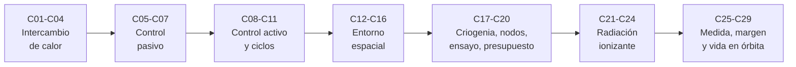

# B85 — Gestión térmica y entorno espacial

> **Bloque ampliado.** Además de las 20 clases de la línea base, el bloque tiene 9 clases programadas por la ampliación (`B85-C21` a `B85-C29`), redactadas y listadas en los tramos 6 y 7. Ver el [programa completo](../../PROGRAMA_ACADEMICO_COMPLETO.md).

**Programa:** Programa Integral de Astronomía, Astrofísica, Ciencias Espaciales e Ingeniería Aeroespacial
**Área:** A07 — Ingeniería y construcción de sistemas espaciales
**Nivel:** N3 (fundamentos disciplinares) · **Clases:** 20 + 9 de la ampliación · **Carga:** por calibrar con el uso
**Estado:** guía pedagógica del bloque (resumen de qué se aprende en cada clase). Las clases enlazadas en la tabla ya están redactadas; todas conservan el estado E0 en el catálogo hasta registrar revisión disciplinar. Las clases `B85-C21` a `B85-C29` (ampliación) también están redactadas y conservan el mismo estado.

## 🎯 Propósito del bloque

Enseña **cómo una nave mantiene sus temperaturas dentro de límites en el vacío y qué le hace el ambiente espacial a sus superficies y componentes**. Recorre el balance radiativo, la conducción, la ausencia de convección y la radiación entre superficies; los medios pasivos (recubrimientos, mantas multicapa, radiadores) y activos (calentadores, tubos de calor, lazos de control); los ciclos de temperatura; el vacío, el oxígeno atómico, la radiación ultravioleta, la electrificación y el polvo lunar; la criogenia, el modelado por nodos, el ensayo de vacío térmico y el presupuesto térmico de una carga útil. La ampliación añade los efectos de la radiación ionizante (eventos únicos, dosis, daño por desplazamiento), los modelos de exposición en órbita, los dosímetros, los sensores térmicos, el análisis transitorio, los márgenes y la correlación con ensayo, la protección pasiva y la degradación acumulada en órbita. Cada clase cierra con un laboratorio en Python (solo biblioteca estándar) con semilla fija, que contrasta cada resultado con una segunda vía de cálculo y rotula lo consultado, lo ilustrativo y lo sintético.

## 📚 Al terminar el bloque podrás

1. Plantear el balance de energía de un cuerpo en el espacio y hallar su temperatura de equilibrio en el caso caliente y en el frío.
2. Dimensionar conducción, aislamiento multicapa, radiadores, calentadores y tubos de calor con unidades y supuestos explícitos.
3. Sintonizar un lazo de control térmico y calcular ciclos de temperatura y su fatiga.
4. Estimar el efecto del vacío, del oxígeno atómico, de la radiación ultravioleta, de la electrificación y del polvo sobre superficies y recubrimientos.
5. Calcular cargas criogénicas, resolver una red térmica por nodos y planificar un ensayo de vacío térmico.
6. Cerrar un presupuesto térmico con margen y correlacionar un modelo con un ensayo.
7. Estimar tasas de eventos únicos, dosis por órbita y daño por radiación, y elegir un dosímetro y una protección pasiva.
8. Predecir la degradación de un material en órbita con su incertidumbre.
9. Rotular en cada resultado qué es observado, qué es consultado, qué es ilustrativo y qué es sintético.

## 🧭 Secuencia del bloque

**Descripción textual.** Siete tramos encadenados: cómo se intercambia el calor (C01–C04), cómo se controla sin energía (C05–C07) y con ella (C08–C11), qué hace el entorno con las superficies (C12–C16), cómo se modela, ensaya y cierra un presupuesto (C17–C20), qué hace la radiación ionizante (C21–C24) y cómo se mide, se margina y se predice la vida en órbita (C25–C29). El hilo común es la ley de Stefan–Boltzmann y el balance de energía.

## 🗂️ Las 29 clases en resumen

**Navegación:** cada clase enlaza a la anterior, a la siguiente y a este bloque.

La columna «Evidencia» indica el producto que demostrará el aprendizaje. Los laboratorios usan datos **sintéticos** o **ilustrativos** (rotulados) o valores publicados con fuente y fecha.

### Tramo 1 · Intercambio de calor

| ID | Clase | Qué se aprende | Evidencia |
|---|---|---|---|
| [B85-C01](../clases/B85/B85-C01-balance-radiativo-de-satelite/CLASE.md) | Balance radiativo de satélite | Temperatura de equilibrio de una esfera y de una placa con Sol, albedo, infrarrojo terrestre y disipación interna. | Ficha de balance radiativo en caso caliente y frío |
| [B85-C02](../clases/B85/B85-C02-conduccion-termica-en-estructuras/CLASE.md) | Conducción térmica en estructuras | Conducción estacionaria, resistencias en serie, contacto y aleta, con segunda vía por diferencias finitas. | Ficha de caminos de conducción de una estructura |
| [B85-C03](../clases/B85/B85-C03-conveccion-y-ausencia-de-conveccion-exterior/CLASE.md) | Convección y ausencia de convección exterior | Número de Rayleigh según presión y gravedad, y coeficiente radiativo frente al convectivo. | Tabla de convección frente a radiación |
| [B85-C04](../clases/B85/B85-C04-radiacion-termica-de-superficies/CLASE.md) | Radiación térmica de superficies | Ley de Planck, desplazamiento de Wien, intercambio entre superficies y factores de forma. | Ficha de intercambio radiativo entre superficies |

### Tramo 2 · Control pasivo

| ID | Clase | Qué se aprende | Evidencia |
|---|---|---|---|
| [B85-C05](../clases/B85/B85-C05-recubrimientos-opticos-termicos/CLASE.md) | Recubrimientos ópticos térmicos | Cociente α/ε, temperatura de equilibrio por recubrimiento y efecto del envejecimiento. | Tabla de selección de recubrimientos |
| [B85-C06](../clases/B85/B85-C06-aislamiento-multicapa/CLASE.md) | Aislamiento multicapa | Emisividad efectiva de N pantallas y flujo a través de una manta multicapa. | Ficha de dimensionado de una manta multicapa |
| [B85-C07](../clases/B85/B85-C07-radiadores-espaciales/CLASE.md) | Radiadores espaciales | Área de radiador según entorno, carga y eficiencia de aleta. | Ficha de dimensionado de un radiador |

### Tramo 3 · Control activo y ciclos

| ID | Clase | Qué se aprende | Evidencia |
|---|---|---|---|
| [B85-C08](../clases/B85/B85-C08-calentadores-y-termostatos/CLASE.md) | Calentadores y termostatos | Potencia de calentador, histéresis de un termostato y ciclo de trabajo. | Ficha de calentador de supervivencia |
| [B85-C09](../clases/B85/B85-C09-tubos-de-calor/CLASE.md) | Tubos de calor | Límite capilar de un tubo de calor y efecto de la inclinación en tierra. | Ficha de capacidad de un tubo de calor |
| [B85-C10](../clases/B85/B85-C10-control-termico-activo/CLASE.md) | Control térmico activo | Lazo PI con calentador: respuesta, error y saturación. | Ficha de sintonía de un lazo térmico |
| [B85-C11](../clases/B85/B85-C11-ciclos-termicos/CLASE.md) | Ciclos térmicos | Ciclo de temperatura por eclipse, solución analítica y fatiga de Coffin–Manson. | Ficha de ciclos y fatiga de una unión |

### Tramo 4 · Entorno espacial y su efecto en materiales

| ID | Clase | Qué se aprende | Evidencia |
|---|---|---|---|
| [B85-C12](../clases/B85/B85-C12-entorno-de-vacio/CLASE.md) | Entorno de vacío | Camino libre medio, número de Knudsen, tiempo de bombeo y suelo de desgasificación. | Ficha de la cámara y del entorno de vacío |
| [B85-C13](../clases/B85/B85-C13-efectos-de-oxigeno-atomico/CLASE.md) | Efectos de oxígeno atómico | Flujo, fluencia y espesor erosionado por oxígeno atómico en órbita baja. | Ficha de erosión por oxígeno atómico |
| [B85-C14](../clases/B85/B85-C14-degradacion-ultravioleta/CLASE.md) | Degradación ultravioleta | Crecimiento de la absortividad con horas de sol equivalente y su efecto en la temperatura. | Ficha de degradación ultravioleta de un recubrimiento |
| [B85-C15](../clases/B85/B85-C15-electrificacion-superficial/CLASE.md) | Electrificación superficial | Potencial flotante por balance de corrientes en LEO y en eclipse geoestacionario. | Ficha de potencial de una superficie |
| [B85-C16](../clases/B85/B85-C16-polvo-lunar-y-contaminacion/CLASE.md) | Polvo lunar y contaminación | Cobertura de polvo, absortividad efectiva y temperatura de un radiador lunar. | Ficha de contaminación de un radiador |

### Tramo 5 · Criogenia, modelado y ensayo

| ID | Clase | Qué se aprende | Evidencia |
|---|---|---|---|
| [B85-C17](../clases/B85/B85-C17-criogenia-de-instrumentos/CLASE.md) | Criogenia de instrumentos | Cargas parásitas, enfriamiento y potencia de un criorrefrigerador. | Ficha de carga térmica criogénica |
| [B85-C18](../clases/B85/B85-C18-modelado-termico-por-nodos/CLASE.md) | Modelado térmico por nodos | Red de nodos con conducción y radiación, resuelta por Newton y contrastada con un caso analítico. | Modelo térmico de cuatro nodos |
| [B85-C19](../clases/B85/B85-C19-ensayos-de-vacio-termico/CLASE.md) | Ensayos de vacío térmico | Perfil de ensayo de vacío térmico, tiempos y criterio de estabilización. | Plan de un ensayo de vacío térmico |
| [B85-C20](../clases/B85/B85-C20-presupuesto-termico-de-carga-util/CLASE.md) | Presupuesto térmico de carga útil | Balance de disipación, capacidad del radiador y margen por modo de operación. | Presupuesto térmico de una carga útil |

### Tramo 6 · Radiación y protección (ampliación)

| ID | Clase | Qué se aprende | Evidencia |
|---|---|---|---|
| [B85-C21](../clases/B85/B85-C21-efectos-de-particulas-energeticas-en-electronica-y-materiales/CLASE.md) | Efectos de partículas energéticas en electrónica y materiales | Tasa de eventos únicos desde una sección eficaz de Weibull y probabilidad de upset. | Ficha de tasa de eventos únicos |
| [B85-C22](../clases/B85/B85-C22-modelos-de-exposicion-a-radiacion-en-orbita/CLASE.md) | Modelos de exposición a radiación en órbita | Dosis anual por órbita con un mapa de flujo sintético y curva dosis-profundidad. | Ficha de dosis por órbita (sintética) |
| [B85-C23](../clases/B85/B85-C23-dosimetros-y-monitores-de-radiacion-a-bordo/CLASE.md) | Dosímetros y monitores de radiación a bordo | Calibración de un dosímetro, límite de detección y tiempo muerto. | Ficha de calibración de un monitor de radiación |
| [B85-C24](../clases/B85/B85-C24-efectos-de-la-radiacion-ionizante-en-materiales-y-electronica/CLASE.md) | Efectos de la radiación ionizante en materiales y electrónica | Daño por desplazamiento y pérdida de potencia de una celda solar con fluencia equivalente. | Ficha de daño por radiación en una celda |

### Tramo 7 · Medición, margen y vida en órbita (ampliación)

| ID | Clase | Qué se aprende | Evidencia |
|---|---|---|---|
| [B85-C25](../clases/B85/B85-C25-sensores-y-telemetria-termica/CLASE.md) | Sensores y telemetría térmica | Termistor NTC y sensor de platino: conversión, cuantización y autocalentamiento. | Presupuesto de error de una cadena de medida |
| [B85-C26](../clases/B85/B85-C26-analisis-termico-transitorio-y-casos-extremos/CLASE.md) | Análisis térmico transitorio y casos extremos | Régimen transitorio: constante de tiempo, estabilidad numérica y caso extremo de eclipse. | Ficha de análisis transitorio de un caso extremo |
| [B85-C27](../clases/B85/B85-C27-margenes-y-correlacion-termica/CLASE.md) | Márgenes y correlación térmica | Margen sobre los límites, correlación modelo–ensayo y ajuste de conductancias. | Informe de correlación y margen térmico |
| [B85-C28](../clases/B85/B85-C28-proteccion-pasiva-frente-al-ambiente-espacial/CLASE.md) | Protección pasiva frente al ambiente espacial | Espesor de blindaje, probabilidad de perforación y masa mínima. | Ficha de diseño de una protección pasiva |
| [B85-C29](../clases/B85/B85-C29-evaluacion-y-modelado-de-la-degradacion-en-orbita/CLASE.md) | Evaluación y modelado de la degradación en órbita | Degradación acumulada de α y de la temperatura de un radiador en una misión, con incertidumbre. | Ficha de vida de un material en órbita |

## 🧵 Hilos que atraviesan el bloque

- **Balance de energía y `σT⁴`:** C01, C04, C05, C07, C18 y C26 parten de la misma ley y del mismo balance.
- **Pasivo antes que activo:** C05–C07 fijan lo que se logra sin energía; C08–C10 cubren la diferencia.
- **El ambiente cambia las propiedades:** C13, C14, C16 y C29 muestran cómo `α`, `ε` y el espesor evolucionan en órbita.
- **Margen y verificación:** C19, C20, C26 y C27 convierten el modelo en una decisión con margen y correlación con ensayo.
- **Observado frente a modelado:** todo número del bloque es un modelo con datos sintéticos o ilustrativos; ninguno es una medición de una misión.
- **Verificación independiente:** cada laboratorio contrasta con un caso analítico o con otra vía de cálculo.

## 📝 Evaluación del bloque (propuesta, por calibrar)

- Fichas y ejercicios por clase, con retroalimentación y recuperación con evidencia distinta.
- Portafolio: el modelo de cuatro nodos (C18) y el presupuesto térmico (C20), con supuestos, márgenes y sensibilidad.
- Las condiciones críticas (rotular lo ilustrativo y sintético, no presentar un modelo como observación y citar solo lo consultado) no se compensan con promedio.

## ⚠️ Seguridad y límites

El bloque es educativo. Los modelos son simplificados (nodos isotermos, propiedades constantes, flujos de entorno ilustrativos) y no sustituyen a los estándares de proyecto ni al análisis con las herramientas y datos de una misión. Los valores de propiedades de materiales, flujos de partículas, secciones eficaces y coeficientes de erosión son ilustrativos y están rotulados; ningún límite de componente ni criterio de aceptación de este bloque es un requisito de ningún proyecto. Los estándares ECSS no se pudieron consultar y se rotulan como no consultados.

## 📖 Fuentes consultadas en el bloque (resumen)

Consultadas el 2026-11-10: la constante de Stefan–Boltzmann de NIST (CODATA 2022), la ficha de datos de la Tierra de NASA/NSSDC (irradiancia solar 1361,0 W/m², albedo de Bond 0,294, radio medio 6371 km, gravedad media 9,820 m/s², temperatura de cuerpo negro 254,0 K), la ficha del Sol de NASA/NSSDC (luminosidad y distancia media), el capítulo de control térmico del «State-of-the-Art of Small Spacecraft Technology» de NASA, la ficha de NASA-HDBK-4002B (alcance: efectos de carga en el espacio) y la página de presentación de SPENVIS de ESA/BIRA-IASB. De cada una solo se consultó lo que cita cada clase en su sección 11. Los estándares ECSS (por ejemplo ECSS-E-ST-31C), AE9/AP9, ASTM E595, IEC 60751 y la bibliografía clásica de control térmico no se consultaron: sus valores y fórmulas se rotulan como ilustrativos o como relaciones estándar verificadas por el laboratorio.

## Fuentes de orientación preliminar

- **[NASA-SMALLSAT]** [NASA State-of-the-Art of Small Spacecraft Technology, edición 2026](https://www.nasa.gov/smallsat-institute/sst-soa/) — Referencia panorámica sobre plataformas y subsistemas de satélites pequeños.
- **[NASA-SYSTEMS]** [NASA Systems Engineering Handbook](https://www.nasa.gov/reference/systems-engineering-handbook/) — Ingeniería de sistemas, verificación, validación y gestión técnica.
- **[ECSS]** [European Cooperation for Space Standardization](https://ecss.nl/) — Estándares y buenas prácticas europeos aplicables a proyectos espaciales.
- **[CCSDS]** [Consultative Committee for Space Data Systems](https://ccsds.org/publications/) — Protocolos, recomendaciones y estándares de intercambio de datos espaciales.

> La asociación de estas fuentes es orientativa por bloque. Las fuentes realmente consultadas para cada afirmación se registran en la sección 11 de cada clase.

[🏠 Volver al programa](../../README.md) · [⬅️ B84 — Estructuras, materiales y fabricación espacial](./B84-estructuras-materiales-y-fabricacion-espacial.md) · [➡️ B86 — Sistemas de potencia y energía espacial](./B86-sistemas-de-potencia-y-energia-espacial.md)
