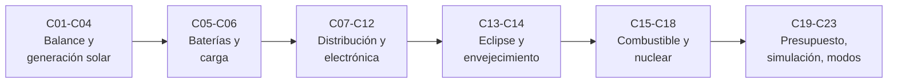

# B86 — Sistemas de potencia y energía espacial

> **Bloque ampliado.** Sus 20 clases de la línea base y las 3 clases programadas por la ampliación (`B86-C21` a `B86-C23`) están redactadas. Ver el [programa completo](../../PROGRAMA_ACADEMICO_COMPLETO.md).

**Programa:** Programa Integral de Astronomía, Astrofísica, Ciencias Espaciales e Ingeniería Aeroespacial
**Área:** A07 — Ingeniería y construcción de sistemas espaciales
**Nivel:** N3 (fundamentos disciplinares) · **Clases:** 23 · **Carga:** por calibrar con el uso
**Estado:** guía pedagógica del bloque (resumen de qué se aprende en cada clase). Las clases enlazadas en las tablas ya están redactadas; todas conservan el estado E0 en el catálogo hasta registrar revisión disciplinar.

## 🎯 Propósito del bloque

Enseña **cómo se genera, se almacena, se distribuye y se gasta la energía eléctrica en una nave**, y cómo se comprueba que alcanza durante toda la misión. Parte del balance de potencia, recorre la celda solar, el ala desplegable, el eclipse y la batería, sigue la energía por el bus (convertidores, electrónica, protecciones, redundancia y disipación), trata el envejecimiento, las alternativas con combustible y los generadores radioisotópicos y nucleares, y cierra con el presupuesto de misión, la simulación del ciclo orbital, los modos de bajo consumo, la noche lunar y el deslastre de cargas. Cada clase termina con un laboratorio en Python (solo biblioteca estándar) que calcula el caso con unidades y lo contrasta con una segunda vía.

## 📚 Al terminar el bloque podrás

1. Armar un balance de potencia por modo y calcular el margen de generación frente al consumo.
2. Dimensionar celdas, un ala desplegable, la duración del eclipse y la pérdida por orientación.
3. Dimensionar una batería para el eclipse y simular su carga y su vida en ciclos.
4. Estimar pérdidas de distribución, de conversión y de conmutación, y la temperatura que resulta.
5. Comprobar protecciones contra sobrecorriente, redundancia y disipación térmica.
6. Proyectar la degradación de paneles y de un generador radioisotópico hasta el fin de vida.
7. Comparar baterías, pila de combustible, generadores radioisotópicos y fisión conceptual, y ubicar su marco de seguridad.
8. Cerrar un presupuesto de potencia de misión y simularlo, con modos de bajo consumo y deslastre de cargas.
9. Rotular qué es consultado, qué es ilustrativo y qué es simulado en cada resultado.

## 🧭 Secuencia del bloque

**Descripción textual.** Seis tramos encadenados: el balance y la generación solar (C01–C04), el almacenamiento y la gestión de carga (C05–C06), la distribución y la electrónica de potencia (C07–C12), el eclipse y el envejecimiento (C13–C14), las alternativas con combustible y nucleares con su marco de seguridad (C15–C18) y el presupuesto, la simulación y la operación (C19–C23).

## 🗂️ Las 23 clases en resumen

**Navegación:** cada clase enlaza a la anterior, a la siguiente y a este bloque.

La columna «Evidencia» indica el producto que demostrará el aprendizaje. Los laboratorios usan datos **sintéticos** o **ilustrativos** (rotulados) o valores publicados con fuente y fecha.

### Tramo 1 · Balance y generación solar

| ID | Clase | Qué se aprende | Evidencia |
|---|---|---|---|
| [B86-C01](../clases/B86/B86-C01-balance-de-potencia-electrica/CLASE.md) | Balance de potencia eléctrica | Suma de cargas por modo, energía por órbita y margen frente a la generación. | Hoja de balance de potencia de un satélite sintético |
| [B86-C02](../clases/B86/B86-C02-celdas-solares/CLASE.md) | Celdas solares | Modelo de diodo único: `I_sc`, `V_oc`, punto de máxima potencia, factor de llenado y efecto de la temperatura. | Curva I-V y tabla de rendimiento de una celda sintética |
| [B86-C03](../clases/B86/B86-C03-arreglos-fotovoltaicos-desplegables/CLASE.md) | Arreglos fotovoltaicos desplegables | Potencia de un ala desplegable, pérdida por coseno, relación de empaquetado y primera frecuencia de una viga en voladizo. | Ficha de dimensionamiento de un ala de cuatro paneles |
| [B86-C04](../clases/B86/B86-C04-orientacion-solar-y-eclipses/CLASE.md) | Orientación solar y eclipses | Duración del eclipse, ángulo beta crítico y pérdida por coseno con y sin seguimiento solar. | Tabla de eclipse y pérdida geométrica frente al ángulo beta |

### Tramo 2 · Almacenamiento y gestión de carga

| ID | Clase | Qué se aprende | Evidencia |
|---|---|---|---|
| [B86-C05](../clases/B86/B86-C05-baterias-de-ion-litio/CLASE.md) | Baterías de ion-litio | Capacidad, profundidad de descarga, vida en ciclos y masa de una batería para un eclipse de órbita baja. | Ficha de dimensionamiento de la batería |
| [B86-C06](../clases/B86/B86-C06-gestion-de-carga/CLASE.md) | Gestión de carga | Perfil de carga corriente constante-tensión constante, tiempo de carga y balance de energía. | Curva de carga simulada y tiempos por corriente |

### Tramo 3 · Distribución y electrónica de potencia

| ID | Clase | Qué se aprende | Evidencia |
|---|---|---|---|
| [B86-C07](../clases/B86/B86-C07-distribucion-de-potencia/CLASE.md) | Distribución de potencia | Caída de tensión y pérdidas óhmicas del arnés; efecto de la tensión de bus. | Tabla de pérdidas de distribución a 12, 28 y 50 V |
| [B86-C08](../clases/B86/B86-C08-convertidores-dc-dc/CLASE.md) | Convertidores DC-DC | Convertidor reductor ideal, rizado de corriente y tensión, y eficiencia con pérdidas. | Ficha de diseño de un convertidor reductor |
| [B86-C09](../clases/B86/B86-C09-electronica-de-potencia/CLASE.md) | Electrónica de potencia | Pérdidas por conducción y conmutación de un transistor, temperatura de unión y frecuencia óptima. | Presupuesto de pérdidas y temperatura de unión |
| [B86-C10](../clases/B86/B86-C10-proteccion-contra-sobrecorriente/CLASE.md) | Protección contra sobrecorriente | Integral `I²t` de un fusible, corriente de cortocircuito y coordinación entre protecciones. | Verificación de coordinación de dos fusibles |
| [B86-C11](../clases/B86/B86-C11-redundancia-electrica/CLASE.md) | Redundancia eléctrica | Confiabilidad de configuraciones en serie, en paralelo y `k` de `n`, frente a una simulación Monte Carlo. | Tabla de confiabilidad de cuatro arquitecturas |
| [B86-C12](../clases/B86/B86-C12-eficiencia-y-disipacion/CLASE.md) | Eficiencia y disipación | Cadena de eficiencias, calor a disipar y área de radiador con la ley de Stefan–Boltzmann. | Presupuesto de disipación con área de radiador |

### Tramo 4 · Eclipse y envejecimiento

| ID | Clase | Qué se aprende | Evidencia |
|---|---|---|---|
| [B86-C13](../clases/B86/B86-C13-energia-durante-eclipse/CLASE.md) | Energía durante eclipse | Energía de eclipse, recarga en la parte iluminada y cierre del ciclo de carga órbita a órbita. | Verificación de cierre del ciclo energético |
| [B86-C14](../clases/B86/B86-C14-envejecimiento-de-paneles/CLASE.md) | Envejecimiento de paneles | Degradación por radiación, ciclado térmico y contaminación; potencia de fin de vida y sobredimensionamiento inicial. | Curva de potencia de fin de vida con sensibilidad |

### Tramo 5 · Alternativas: combustible y energía nuclear

| ID | Clase | Qué se aprende | Evidencia |
|---|---|---|---|
| [B86-C15](../clases/B86/B86-C15-sistemas-de-combustible-como-alternativa/CLASE.md) | Sistemas de combustible como alternativa | Pila de combustible H₂/O₂: tensión ideal, consumo de reactivos y comparación de masa con baterías. | Comparación de masa pila de combustible frente a batería |
| [B86-C16](../clases/B86/B86-C16-generadores-radioisotopicos/CLASE.md) | Generadores radioisotópicos | Decaimiento del Pu-238, degradación del termopar y potencia de un generador radioisotópico a lo largo de los años. | Curva de potencia de un generador radioisotópico frente a las cifras de la NASA |
| [B86-C17](../clases/B86/B86-C17-energia-nuclear-espacial-conceptual/CLASE.md) | Energía nuclear espacial conceptual | Rendimiento de Carnot, fracción de Carnot y área de radiador de un sistema nuclear conceptual. | Dimensionamiento conceptual de un sistema de fisión superficial |
| [B86-C18](../clases/B86/B86-C18-seguridad-y-licenciamiento-energetico/CLASE.md) | Seguridad y licenciamiento energético | Actividad de una fuente de Pu-238 y clasificación por niveles de autorización según un umbral parametrizado. | Hoja de clasificación de autorización con análisis de sensibilidad |

### Tramo 6 · Presupuesto, simulación y operación

| ID | Clase | Qué se aprende | Evidencia |
|---|---|---|---|
| [B86-C19](../clases/B86/B86-C19-presupuesto-de-potencia-de-mision/CLASE.md) | Presupuesto de potencia de misión | Presupuesto de potencia por fases con reservas de crecimiento según madurez y margen resultante. | Presupuesto de potencia de misión con reservas |
| [B86-C20](../clases/B86/B86-C20-simulacion-de-ciclo-energetico-orbital/CLASE.md) | Simulación de ciclo energético orbital | Simulación acoplada de órbita, eclipse, paneles, batería y cargas durante semanas. | Informe de ciclo energético con carga mínima y cierre de energía |
| [B86-C21](../clases/B86/B86-C21-modos-de-operacion-y-estados-de-bajo-consumo/CLASE.md) | Modos de operación y estados de bajo consumo | Máquina de estados de modos de operación, umbrales con histéresis y consumo medio por modo. | Tabla de modos y simulación de transiciones por carga de batería |
| [B86-C22](../clases/B86/B86-C22-suministro-de-energia-durante-la-noche-lunar/CLASE.md) | Suministro de energía durante la noche lunar | Energía de una noche lunar de unos 14 días, masa de baterías, pila de combustible y generador radioisotópico. | Comparación de estrategias para la noche lunar |
| [B86-C23](../clases/B86/B86-C23-priorizacion-y-deslastre-de-cargas-electricas/CLASE.md) | Priorización y deslastre de cargas eléctricas | Deslastre de cargas por prioridad frente al óptimo combinatorio, con histéresis. | Plan de deslastre verificado contra fuerza bruta |

## 🧵 Hilos que atraviesan el bloque

- **Energía en vez de potencia instantánea:** el balance se cierra por órbita (C01, C13, C20), no por instante.
- **Eficiencia y calor:** toda pérdida eléctrica es calor que hay que evacuar (C07–C09, C12).
- **Fin de vida frente a inicio de vida:** C05, C14 y C16 dimensionan para el final, no para el comienzo.
- **Observado frente a modelado:** todo número del bloque es un modelo con datos sintéticos o ilustrativos o una cifra publicada con su fuente; ninguno es una telemetría.
- **Verificación independiente:** cada laboratorio contrasta con un caso analítico, una simulación distinta o un cálculo por fuerza bruta.

## 📝 Evaluación del bloque (propuesta, por calibrar)

- Fichas y ejercicios por clase, con retroalimentación y recuperación con evidencia distinta.
- Portafolio: el presupuesto de potencia de misión (C19) y el informe de ciclo energético (C20) con sus supuestos y su sensibilidad.
- Las condiciones críticas (rotular lo ilustrativo y sintético, no presentar un modelo como observación, citar solo lo consultado) no se compensan con promedio.

## ⚠️ Seguridad y límites

El bloque es educativo. Los modelos son simplificados (diodo único, convertidores ideales con pérdidas parametrizadas, órbita circular con sombra cilíndrica, degradación exponencial) y no sustituyen a la ingeniería de una misión, a una norma ECSS aplicada ni a una revisión de seguridad. Los parámetros de celdas, baterías, convertidores y confiabilidad son ilustrativos salvo los rotulados como consultados. Las clases C16–C18 tratan material radiactivo solo como concepto y cálculo de orden de magnitud: no describen cómo manipular, fabricar ni obtener fuentes, y el marco de autorización lo establecen las autoridades competentes.

## 📖 Fuentes consultadas en el bloque (resumen)

Consultadas el 2026-11-10: la ficha de la Tierra y la de la Luna de la NASA/NSSDC (irradiancia solar, `GM`, radio, periodo sinódico lunar); el capítulo de subsistemas de potencia del estado del arte de naves pequeñas de la NASA (eficiencias de celdas, energía específica de baterías; edición 2026, solo se leyeron los primeros 100.000 caracteres y el resumen final); la hoja técnica del MMRTG de la NASA y el *Radioisotope Power Systems Reference Book for Mission Designers and Planners* (JPL Publication 15-6, 2015); las constantes del NIST (CODATA 2022); la página del estándar ECSS-E-ST-20C Rev.2 (solo la ficha, no el PDF del estándar); la memoria presidencial NSPM-20 (texto del Registro de Documentos Presidenciales en govinfo.gov) y la página de preguntas frecuentes de sistemas de energía radioisotópica de la NASA. Las relaciones estándar (modelo de diodo, balance de energía, Stefan–Boltzmann, Carnot, Faraday, confiabilidad) las verifica cada laboratorio con una segunda vía y no se consultaron en un texto concreto. Los parámetros de fisión conceptual, de pila de combustible, de degradación de paneles y la vida media del Pu-238 no se consultaron en una fuente y se rotulan como ilustrativos. No se abrió el texto de los estándares ECSS ni de NASA-STD aplicables.

## Fuentes de orientación preliminar

- **[NASA-SMALLSAT]** [NASA State-of-the-Art of Small Spacecraft Technology, edición 2026](https://www.nasa.gov/smallsat-institute/sst-soa/) — Referencia panorámica sobre plataformas y subsistemas de satélites pequeños.
- **[NASA-SYSTEMS]** [NASA Systems Engineering Handbook](https://www.nasa.gov/reference/systems-engineering-handbook/) — Ingeniería de sistemas, verificación, validación y gestión técnica.
- **[ECSS]** [European Cooperation for Space Standardization](https://ecss.nl/) — Estándares y buenas prácticas europeos aplicables a proyectos espaciales.
- **[CCSDS]** [Consultative Committee for Space Data Systems](https://ccsds.org/publications/) — Protocolos, recomendaciones y estándares de intercambio de datos espaciales.

> La asociación de estas fuentes es orientativa por bloque. Las fuentes realmente consultadas para cada afirmación se registran en la sección 11 de cada clase.

[🏠 Volver al programa](../../README.md) · [➡️ B87 — Sensores y control de actitud](./B87-sensores-y-control-de-actitud.md)
