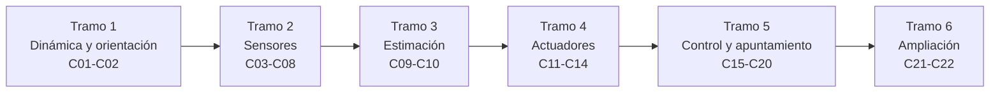

# B87 — Sensores y control de actitud

> **Bloque ampliado (`0.2.0`).** Sus 20 clases de la línea base y las 2 clases programadas (`B87-C21` a `B87-C22`) están redactadas. Ver el [programa completo](../../PROGRAMA_ACADEMICO_COMPLETO.md).

**Programa:** Programa Integral de Astronomía, Astrofísica, Ciencias Espaciales e Ingeniería Aeroespacial
**Área:** A07 — Ingeniería y construcción de sistemas espaciales
**Nivel:** N3 (fundamentos disciplinares) · **Clases:** 22 · **Carga:** por calibrar con el uso
**Estado:** guía pedagógica del bloque (resumen de qué se aprende en cada clase). Las clases enlazadas en la tabla ya están redactadas; todas conservan el estado E0 en el catálogo hasta registrar revisión disciplinar.

## 🎯 Propósito del bloque

Enseña **cómo un satélite sabe hacia dónde apunta y cómo se hace apuntar**: de la dinámica del cuerpo rígido y las formas de representar la orientación, pasando por los sensores (solares, de horizonte, magnetómetros, giroscopios MEMS y rastreadores estelares) y su calibración, hasta los estimadores (problema de Wahba, filtro multiplicativo), los actuadores (ruedas, magnetopares, propulsores), el control de tres ejes, las perturbaciones, la verificación y el presupuesto de error de apuntamiento. Cada clase cierra con un laboratorio en Python con semilla fija, con datos **sintéticos** rotulados, que comprueba el resultado con una segunda vía (conservación de momento, comparación entre métodos, simulación o Monte Carlo).

## 📚 Al terminar el bloque podrás

1. Integrar la dinámica y la cinemática de un cuerpo rígido con ruedas y comprobar la conservación de momento angular y de energía.
2. Convertir entre matriz de actitud, ángulos de Euler y cuaterniones, y reconocer singularidades.
3. Modelar un sensor (ruido, sesgo, factor de escala, campo de visión) y estimar la precisión de la actitud que entrega.
4. Calibrar un magnetómetro y un giroscopio y medir el efecto sobre el error.
5. Estimar la actitud con TRIAD, SVD, método q y un filtro multiplicativo gyro + vectores.
6. Dimensionar ruedas, magnetopares y propulsores, y gestionar la saturación de momento.
7. Diseñar y verificar un control de tres ejes (PD en cuaterniones y control predictivo con restricciones) y presupuestar el error de apuntamiento.

## 🧭 Secuencia del bloque

**Descripción textual.** Seis tramos encadenados: el modelo del cuerpo y su orientación (C01–C02), los sensores y su calibración (C03–C08), la estimación (C09–C10), los actuadores y su saturación (C11–C14), el control, las perturbaciones, la verificación y la simulación integral (C15–C20), y el control predictivo y el presupuesto de apuntamiento (C21–C22).

## 🗂️ Las 22 clases en resumen

**Navegación:** cada clase enlaza a la anterior, a la siguiente y a este bloque.

La columna «Evidencia» indica el producto que demostrará el aprendizaje. Los laboratorios usan datos **sintéticos** (un microsatélite de ejemplo, una órbita circular de ejemplo y un campo magnético dipolar de ejemplo, todos rotulados).

### Tramo 1 · Dinámica y orientación

| ID | Clase | Qué se aprende | Evidencia |
|---|---|---|---|
| [B87-C01](../clases/B87/B87-C01-dinamica-de-cuerpo-rigido/CLASE.md) | Dinámica de cuerpo rígido | Ecuaciones de Euler, tensor de inercia, momento angular y energía, inestabilidad del eje intermedio. | Ficha de conservación y crecimiento de la inestabilidad |
| [B87-C02](../clases/B87/B87-C02-representaciones-de-orientacion/CLASE.md) | Representaciones de orientación | Matriz, Euler 3-2-1, cuaternión, eje-ángulo; bloqueo de cardán y doble cobertura. | Tabla de conversiones con error de ida y vuelta |

### Tramo 2 · Sensores

| ID | Clase | Qué se aprende | Evidencia |
|---|---|---|---|
| [B87-C03](../clases/B87/B87-C03-sensores-solares/CLASE.md) | Sensores solares | Ley del coseno, vector solar con seis fotodiodos, ruido y campo de visión. | Curva de error angular frente a ruido |
| [B87-C04](../clases/B87/B87-C04-sensores-terrestres/CLASE.md) | Sensores terrestres | Radio angular de la Tierra, cruces de horizonte y nadir. | Error de nadir frente a la altitud |
| [B87-C05](../clases/B87/B87-C05-magnetometros/CLASE.md) | Magnetómetros | Campo dipolar a lo largo de la órbita, sesgo, escala y ruido. | Intensidad del campo en una órbita y error de dirección |
| [B87-C06](../clases/B87/B87-C06-giroscopios-mems/CLASE.md) | Giroscopios MEMS | Ruido de paseo angular, inestabilidad de sesgo, varianza de Allan. | Curva de Allan con coeficientes identificados |
| [B87-C07](../clases/B87/B87-C07-rastreadores-estelares/CLASE.md) | Rastreadores estelares | Proyección, centroide, actitud por SVD y error de balanceo. | Error de actitud frente al número de estrellas |
| [B87-C08](../clases/B87/B87-C08-calibracion-de-sensores/CLASE.md) | Calibración de sensores | Ajuste por mínimos cuadrados de sesgo y escala del magnetómetro y sesgo del giroscopio. | Informe de residuos antes y después |

### Tramo 3 · Estimación

| ID | Clase | Qué se aprende | Evidencia |
|---|---|---|---|
| [B87-C09](../clases/B87/B87-C09-estimacion-de-actitud/CLASE.md) | Estimación de actitud | Problema de Wahba, TRIAD, SVD y método q. | Comparación de métodos con pérdida de Wahba |
| [B87-C10](../clases/B87/B87-C10-filtro-de-actitud/CLASE.md) | Filtro de actitud | Filtro multiplicativo (MEKF) con giroscopio, vector solar y magnético, estimación de sesgo. | Error del filtro frente a solo giroscopio |

### Tramo 4 · Actuadores

| ID | Clase | Qué se aprende | Evidencia |
|---|---|---|---|
| [B87-C11](../clases/B87/B87-C11-ruedas-de-reaccion/CLASE.md) | Ruedas de reacción | Intercambio de momento, límites de par y velocidad, conservación del momento total. | Maniobra de un eje con histórico de la rueda |
| [B87-C12](../clases/B87/B87-C12-magnetopares/CLASE.md) | Magnetopares | Par `m × B`, subactuación instantánea y controlabilidad a lo largo de la órbita. | Mapa de par disponible en una órbita |
| [B87-C13](../clases/B87/B87-C13-propulsores-de-control-de-actitud/CLASE.md) | Propulsores de control de actitud | Par `r × F`, impulso mínimo, consumo por `Isp` y ciclo límite. | Consumo y ciclo límite de una maniobra |
| [B87-C14](../clases/B87/B87-C14-saturacion-y-descarga-de-momento/CLASE.md) | Saturación y descarga de momento | Acumulación secular, tiempo a saturación, descarga con magnetopares. | Histórico de momento con descarga |

### Tramo 5 · Control, perturbaciones y simulación

| ID | Clase | Qué se aprende | Evidencia |
|---|---|---|---|
| [B87-C15](../clases/B87/B87-C15-apuntamiento-de-alta-precision/CLASE.md) | Apuntamiento de alta precisión | Índices de error (APE, RPE), ruido del sensor y ancho de banda. | Estadísticos de apuntamiento de una serie temporal |
| [B87-C16](../clases/B87/B87-C16-detumbling-despues-del-despliegue/CLASE.md) | Detumbling después del despliegue | Ley B-dot, disipación de energía y tiempo de captura. | Curva de la velocidad angular frente al tiempo |
| [B87-C17](../clases/B87/B87-C17-control-de-tres-ejes/CLASE.md) | Control de tres ejes | Realimentación PD en cuaterniones, ganancias por `ωn` y `ζ`. | Maniobra de 60° con tiempo de asentamiento |
| [B87-C18](../clases/B87/B87-C18-estabilidad-ante-perturbaciones/CLASE.md) | Estabilidad ante perturbaciones | Gradiente de gravedad, resistencia y residuo magnético, error en régimen permanente, Lyapunov. | Tabla de pares perturbadores y error permanente |
| [B87-C19](../clases/B87/B87-C19-verificacion-de-ley-de-control/CLASE.md) | Verificación de ley de control | Márgenes de ganancia y fase, retardo, Monte Carlo. | Matriz de verificación con tasa de cumplimiento |
| [B87-C20](../clases/B87/B87-C20-simulacion-adcs-integral/CLASE.md) | Simulación ADCS integral | Lazo completo sensores–estimador–control–actuadores–dinámica. | Informe de una simulación integral |

### Tramo 6 · Ampliación (clases programadas en la `0.2.0`)

| ID | Clase | Qué se aprende | Evidencia |
|---|---|---|---|
| [B87-C21](../clases/B87/B87-C21-control-predictivo-basado-en-modelo-mpc-para-vehiculos-espaciales/CLASE.md) | Control predictivo basado en modelo (MPC) para vehículos espaciales | Horizonte, costo cuadrático y restricciones de par y velocidad. | Comparación MPC frente a PD saturado |
| [B87-C22](../clases/B87/B87-C22-presupuesto-de-error-de-apuntamiento/CLASE.md) | Presupuesto de error de apuntamiento | Combinación de contribuyentes, suma cuadrática y verificación por Monte Carlo. | Presupuesto de apuntamiento con margen |

## 🧵 Hilos que atraviesan el bloque

- **Convenciones explícitas:** cuaternión con la parte escalar al final, `v_B = A(q) v_I`, producto tal que `A(q⊗p) = A(q) A(p)`; todo laboratorio lo declara y lo comprueba.
- **Conservación como prueba:** momento angular total, energía y norma del cuaternión se verifican en cada integración.
- **Sintético frente a observado:** el microsatélite, la órbita, el campo dipolar y las estrellas son de ejemplo; ningún resultado procede de una misión.
- **Medida frente a modelo:** cada sensor se describe por lo que mide y por su error; el estimador no mejora lo que el sensor no ve.

## 📝 Evaluación del bloque (propuesta, por calibrar)

- Fichas y ejercicios por clase, con retroalimentación y recuperación con evidencia distinta.
- Portafolio: la simulación integral (C20) y el presupuesto de apuntamiento (C22) con sus supuestos y límites.
- Las condiciones críticas (rotular lo sintético, verificar con una segunda vía y citar solo lo consultado) no se compensan con promedio.

## ⚠️ Seguridad y límites

El bloque es educativo. Los modelos son simplificados (cuerpo rígido, órbita circular, dipolo inclinado fijo, sensores idealizados) y no sirven para dimensionar un subsistema de actitud real sin herramientas validadas, ensayos y revisión de especialistas. No se reproducen estándares protegidos.

## 📖 Fuentes consultadas en el bloque (resumen)

Consultadas el 2026-11-10: la página del IGRF del NOAA/NCEI (generación vigente y alcance), el resumen de IAU 2015 Resolución B3 (arXiv:1510.07674; sin los valores numéricos), el resumen de B. Graf, «Quaternions and dynamics» (arXiv:0811.2889), y resultados de búsqueda sobre ECSS-E-ST-60-30C y sobre la cita de M. D. Shuster (1993); el PDF de ECSS-E-ST-60-30C y el artículo de Shuster no se abrieron. Las relaciones de dinámica, estimación, control y los modelos de sensores que usan las clases son estándar y cada laboratorio las verifica con una segunda vía; no se consultaron en una fuente concreta. Los valores de radio y `μ` terrestres, el campo dipolar y los parámetros de sensores son valores de ejemplo adoptados, no consultados.

## Fuentes de orientación preliminar

- **[NASA-SMALLSAT]** [NASA State-of-the-Art of Small Spacecraft Technology, edición 2026](https://www.nasa.gov/smallsat-institute/sst-soa/) — Referencia panorámica sobre plataformas y subsistemas de satélites pequeños.
- **[NASA-SYSTEMS]** [NASA Systems Engineering Handbook](https://www.nasa.gov/reference/systems-engineering-handbook/) — Ingeniería de sistemas, verificación, validación y gestión técnica.
- **[ECSS]** [European Cooperation for Space Standardization](https://ecss.nl/) — Estándares y buenas prácticas europeos aplicables a proyectos espaciales.
- **[CCSDS]** [Consultative Committee for Space Data Systems](https://ccsds.org/publications/) — Protocolos, recomendaciones y estándares de intercambio de datos espaciales.

> La asociación de estas fuentes es orientativa por bloque. Las fuentes realmente consultadas para cada afirmación se registran en la sección 11 de cada clase.

[🏠 Volver al programa](../../README.md)
