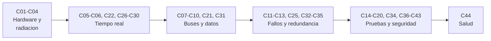

# B88 — Aviónica y software crítico espacial

> **Bloque ampliado.** Sus 44 clases (20 de la línea base y 24 programadas por la ampliación) están redactadas. Todas conservan el estado E0 en el catálogo hasta registrar revisión disciplinar. Ver el [programa completo](../../PROGRAMA_ACADEMICO_COMPLETO.md).

**Programa:** Programa Integral de Astronomía, Astrofísica, Ciencias Espaciales e Ingeniería Aeroespacial
**Área:** A07 — Ingeniería y construcción de sistemas espaciales
**Nivel:** N3 (fundamentos disciplinares) · **Clases:** 44 · **Carga:** por calibrar con el uso
**Estado:** guía pedagógica del bloque (resumen de qué se aprende en cada clase). Las clases enlazadas en las tablas ya están redactadas; ninguna está impartida ni verificada.

## 🎯 Propósito del bloque

Enseña **cómo se piensa, se construye y se comprueba el computador y el software de una nave cuando no hay nadie cerca para reiniciarlo**. Parte de la arquitectura de hardware (procesadores, memorias, radiación), pasa por el tiempo real (planificación, interrupciones, concurrencia, peor caso), los buses, la telemetría y los telecomandos, y llega al tratamiento de fallos (watchdogs, detección, aislamiento y recuperación, redundancia y votación), la actualización segura, las pruebas (unitarias, inyección de fallos, fuzzing en banco, SIL/PIL/HIL), el análisis estático, la seguridad funcional, la ciberseguridad defensiva, las normas de aseguramiento y el pronóstico de salud. Cada clase cierra con un laboratorio en Python con semilla fija: un modelo pequeño y verificable, no un código de vuelo.

## 📚 Al terminar el bloque podrás

1. Elaborar un presupuesto de CPU, memoria y fiabilidad de un computador de vuelo y razonar sobre su redundancia.
2. Estimar la tasa de inversiones de bit por radiación y dimensionar la corrección de errores y el barrido de memoria.
3. Analizar un conjunto de tareas con RM/EDF, tiempo de respuesta, WCET, latencia de interrupciones, inversión de prioridad y bloqueos.
4. Definir paquetes de telemetría y telecomandos con modos, CRC, contadores y control de interfaz.
5. Diseñar watchdogs, FDIR, redundancia fría/caliente y votación TMR con su fiabilidad.
6. Planificar y ejecutar pruebas (unitarias, mutación, inyección de fallos, fuzzing en banco, SIL/PIL/HIL) y reconocer su cobertura.
7. Aplicar criterios de código defensivo, análisis estático, configuración, claves, auditoría y aseguramiento.
8. Rotular qué es dato sintético, qué es norma consultada y qué no se consultó.

## 🧭 Secuencia del bloque

**Descripción textual.** Del hardware y la radiación se pasa al tiempo real y la concurrencia; de ahí a los buses, los datos y los comandos; luego a los fallos y la redundancia; después a las pruebas, el análisis y la seguridad; y se cierra con el pronóstico de salud. El hilo común es que **cada afirmación de robustez se comprueba con un número**.

## 🗂️ Las 44 clases en resumen

**Navegación:** cada clase enlaza a la anterior, a la siguiente y a este bloque.

La columna «Evidencia» indica el producto que demostrará el aprendizaje. Los laboratorios usan datos **sintéticos** (rotulados); las normas y documentos citados se registran con fecha en la sección 11 de cada clase.

### Tramo 1 · Computador de vuelo y tolerancia a la radiación

| ID | Clase | Qué se aprende | Evidencia |
|---|---|---|---|
| [B88-C01](../clases/B88/B88-C01-arquitectura-de-computador-de-vuelo/CLASE.md) | Arquitectura de computador de vuelo | Presupuesto de memoria, CPU y masa de un computador de vuelo y fiabilidad de configuraciones redundantes. | Ficha de arquitectura con márgenes y fiabilidad |
| [B88-C02](../clases/B88/B88-C02-microcontroladores-embarcados/CLASE.md) | Microcontroladores embarcados | Temporizadores, baudios, cuantización del ADC y consumo con ciclo de trabajo en un microcontrolador. | Hoja de configuración de un microcontrolador |
| [B88-C03](../clases/B88/B88-C03-procesadores-tolerantes-a-radiacion/CLASE.md) | Procesadores tolerantes a radiación | Tasa de inversiones de bit (SEU) a partir de sección eficaz y flujo, margen de dosis y Monte Carlo. | Ficha de tasa de SEU y margen de dosis |
| [B88-C04](../clases/B88/B88-C04-memorias-y-correccion-de-errores/CLASE.md) | Memorias y corrección de errores | Código Hamming SECDED, inyección de errores y efecto del barrido (scrubbing). | Tabla de corrección/detección y de barrido |

### Tramo 2 · Tiempo real y concurrencia

| ID | Clase | Qué se aprende | Evidencia |
|---|---|---|---|
| [B88-C05](../clases/B88/B88-C05-sistemas-de-tiempo-real/CLASE.md) | Sistemas de tiempo real | Plazos duros y blandos, utilización y tiempo de respuesta en prioridades fijas. | Análisis de tiempo de respuesta de un conjunto de tareas |
| [B88-C06](../clases/B88/B88-C06-planificacion-de-tareas-rtos/CLASE.md) | Planificación de tareas RTOS | Simulación de planificación RM y EDF sobre la hiperperiodo y cota de Liu–Layland. | Cronograma y veredicto de planificabilidad |

### Tramo 3 · Buses, telemetría y comandos

| ID | Clase | Qué se aprende | Evidencia |
|---|---|---|---|
| [B88-C07](../clases/B88/B88-C07-buses-i2c-spi-can-y-spacewire/CLASE.md) | Buses I2C SPI CAN y SpaceWire | Tiempos de trama, sobrecarga y relleno de bits en I2C, SPI, CAN y SpaceWire. | Comparativa de caudal útil de cuatro buses |
| [B88-C08](../clases/B88/B88-C08-telemetria-interna/CLASE.md) | Telemetría interna | Empaquetado de telemetría con CRC, muestreo y presupuesto de volumen frente al enlace. | Definición de paquete y presupuesto de telemetría |
| [B88-C09](../clases/B88/B88-C09-telecomandos-y-estados-de-mision/CLASE.md) | Telecomandos y estados de misión | Modos de misión, matriz estado–comando, contador de secuencia y rechazo por CRC. | Matriz de aceptación de telecomandos |
| [B88-C10](../clases/B88/B88-C10-gestion-de-eventos/CLASE.md) | Gestión de eventos | Cola de eventos con severidad, supresión de tormentas y limitación de tasa. | Política de eventos con prueba de tormenta |

### Tramo 4 · Fallos, recuperación y actualización

| ID | Clase | Qué se aprende | Evidencia |
|---|---|---|---|
| [B88-C11](../clases/B88/B88-C11-watchdogs-y-recuperacion/CLASE.md) | Watchdogs y recuperación | Watchdog simple y de ventana, tiempo límite y escalera de recuperación. | Diseño de watchdog con casos de prueba |
| [B88-C12](../clases/B88/B88-C12-deteccion-aislamiento-y-recuperacion-de-fallos/CLASE.md) | Detección aislamiento y recuperación de fallos | Monitores con persistencia, árbol de respuestas y latencia de detección. | Tabla FDIR con latencias medidas |
| [B88-C13](../clases/B88/B88-C13-actualizacion-segura-de-software/CLASE.md) | Actualización segura de software | Imágenes A/B, verificación de hash y firma, y reversión ante fallo. | Procedimiento de actualización con casos de fallo |

### Tramo 5 · Pruebas, análisis y seguridad

| ID | Clase | Qué se aprende | Evidencia |
|---|---|---|---|
| [B88-C14](../clases/B88/B88-C14-pruebas-de-software-embarcado/CLASE.md) | Pruebas de software embarcado | Pruebas unitarias, cobertura y puntuación de mutación de una función de vuelo. | Informe de pruebas con puntuación de mutación |
| [B88-C15](../clases/B88/B88-C15-analisis-estatico-de-codigo/CLASE.md) | Análisis estático de código | Reglas de código verificadas por análisis del árbol sintáctico. | Informe de análisis estático con reglas y hallazgos |
| [B88-C16](../clases/B88/B88-C16-ingenieria-de-seguridad-funcional/CLASE.md) | Ingeniería de seguridad funcional | Árbol de fallos, conjuntos mínimos de corte y criticidad severidad–probabilidad. | Análisis de fallos con conjuntos de corte |
| [B88-C17](../clases/B88/B88-C17-ciberseguridad-de-avionica/CLASE.md) | Ciberseguridad de aviónica | Autenticación de telecomandos con HMAC, ventana anti-repetición y modelo de amenazas. | Modelo de amenazas y prueba de rechazo |
| [B88-C18](../clases/B88/B88-C18-control-de-configuracion-de-firmware/CLASE.md) | Control de configuración de firmware | Línea base con hashes, diferencias entre versiones y reproducibilidad de compilación. | Registro de línea base y diferencias |
| [B88-C19](../clases/B88/B88-C19-simulacion-hardware-in-the-loop/CLASE.md) | Simulación hardware-in-the-loop | Bucle planta–controlador con latencia y fluctuación de temporización. | Informe de efecto de la latencia en lazo cerrado |
| [B88-C20](../clases/B88/B88-C20-plan-de-verificacion-de-computador-de-vuelo/CLASE.md) | Plan de verificación de computador de vuelo | Matriz de verificación, cobertura de requisitos y detección de huérfanos. | Matriz de verificación con cobertura |

### Tramo 6 · Arquitectura de software y tiempo de ejecución

| ID | Clase | Qué se aprende | Evidencia |
|---|---|---|---|
| [B88-C21](../clases/B88/B88-C21-interfaces-y-documentos-de-control-de-software-de-vuelo/CLASE.md) | Interfaces y documentos de control de software de vuelo | Tabla de interfaz de mensajes, solapes de bits, endianidad y consistencia productor–consumidor. | ICD de mensajes con verificación de consistencia |
| [B88-C22](../clases/B88/B88-C22-interrupciones-y-manejo-de-excepciones-en-el-computador-de-vuelo/CLASE.md) | Interrupciones y manejo de excepciones en el computador de vuelo | Interrupciones anidadas, prioridades, enmascaramiento y pila. | Simulación de interrupciones con presupuesto de pila |
| [B88-C23](../clases/B88/B88-C23-arquitectura-de-software-de-vuelo-capas-y-ejecutivo/CLASE.md) | Arquitectura de software de vuelo: capas y ejecutivo | Dependencias entre capas, orden topológico y ejecutivo cíclico. | Mapa de capas y cronograma de trama |
| [B88-C24](../clases/B88/B88-C24-capa-de-abstraccion-de-hardware-hal-y-controladores/CLASE.md) | Capa de abstracción de hardware (HAL) y controladores | Capa HAL con dos implementaciones del mismo dispositivo y pruebas con dobles. | HAL con pruebas intercambiables |
| [B88-C25](../clases/B88/B88-C25-redundancia-de-procesamiento-y-ejecucion-en-paralelo-lockstep/CLASE.md) | Redundancia de procesamiento y ejecución en paralelo (lockstep) | Núcleos en paso cerrado, inyección de fallos y latencia de detección. | Informe de cobertura de lockstep |
| [B88-C26](../clases/B88/B88-C26-latencia-de-interrupciones-y-jitter/CLASE.md) | Latencia de interrupciones y jitter | Distribución de latencias, fluctuación y cota de peor caso. | Histograma de latencia con cota analítica |
| [B88-C27](../clases/B88/B88-C27-exclusion-mutua-y-semaforos/CLASE.md) | Exclusión mutua y semáforos | Condición de carrera, exclusión mutua y semáforo contador. | Demostración de carrera y su corrección |
| [B88-C28](../clases/B88/B88-C28-inversion-de-prioridad-y-deadlocks/CLASE.md) | Inversión de prioridad y deadlocks | Inversión de prioridad, herencia y grafo de espera para bloqueos. | Reconstrucción de inversión y detección de bloqueo |
| [B88-C29](../clases/B88/B88-C29-gestion-de-memoria-determinista-en-software-de-vuelo/CLASE.md) | Gestión de memoria determinista en software de vuelo | Reserva estática frente a montón, fragmentación y profundidad de pila. | Comparativa de asignación determinista |
| [B88-C30](../clases/B88/B88-C30-analisis-de-peor-caso-de-tiempo-de-ejecucion-wcet/CLASE.md) | Análisis de peor caso de tiempo de ejecución (WCET) | Camino más largo con cotas de bucle y comparación con el máximo medido. | Cota WCET frente a medición |

### Tramo 7 · Redes y redundancia

| ID | Clase | Qué se aprende | Evidencia |
|---|---|---|---|
| [B88-C31](../clases/B88/B88-C31-topologias-de-red-de-datos-a-bordo/CLASE.md) | Topologías de red de datos a bordo | Topologías: diámetro, saltos y tolerancia a fallo de enlace. | Tabla de topologías con puentes y diámetros |
| [B88-C32](../clases/B88/B88-C32-redundancia-fria-y-caliente-estrategias-y-conmutacion/CLASE.md) | Redundancia fría y caliente: estrategias y conmutación | Fiabilidad de redundancia fría y caliente con cobertura de conmutación. | Comparativa de fiabilidad con Monte Carlo |
| [B88-C33](../clases/B88/B88-C33-votacion-y-redundancia-modular-triple-tmr/CLASE.md) | Votación y redundancia modular triple (TMR) | Votación 2 de 3, fiabilidad TMR y efecto del votador. | Curva de fiabilidad TMR |
| [B88-C34](../clases/B88/B88-C34-pruebas-de-inyeccion-de-fallos/CLASE.md) | Pruebas de inyección de fallos | Campaña de inyección de fallos y cobertura con intervalo de Wilson. | Informe de campaña de inyección |
| [B88-C35](../clases/B88/B88-C35-reinicio-en-caliente-y-persistencia-de-estado/CLASE.md) | Reinicio en caliente y persistencia de estado | Estado persistente con doble búfer y CRC ante corte en cualquier byte. | Prueba exhaustiva de corte de energía |

### Tramo 8 · Código seguro, claves y aseguramiento

| ID | Clase | Qué se aprende | Evidencia |
|---|---|---|---|
| [B88-C36](../clases/B88/B88-C36-codificacion-defensiva-y-estandares-de-codigo-seguro/CLASE.md) | Codificación defensiva y estándares de código seguro | Enteros de ancho fijo, saturación y pruebas de propiedades. | Biblioteca defensiva con pruebas |
| [B88-C37](../clases/B88/B88-C37-fuzzing-autorizado-de-software-embarcado-en-banco-de-pruebas/CLASE.md) | Fuzzing autorizado de software embarcado en banco de pruebas | Fuzzing en banco de un analizador sintético con errores sembrados. | Informe de campaña de fuzzing |
| [B88-C38](../clases/B88/B88-C38-gestion-de-claves-y-secretos-en-avionica/CLASE.md) | Gestión de claves y secretos en aviónica | Jerarquía de claves, derivación HKDF y límites de uso por contador. | Plan de claves con rotación |
| [B88-C39](../clases/B88/B88-C39-normas-de-aseguramiento-de-software-ecss-do-178c/CLASE.md) | Normas de aseguramiento de software (ECSS, DO-178C) | Cobertura de sentencia, decisión y MC/DC por nivel de criticidad. | Matriz de cobertura exigible |
| [B88-C40](../clases/B88/B88-C40-auditoria-de-software-espacial/CLASE.md) | Auditoría de software espacial | Muestreo de evidencia, tamaño de muestra y cadena de hashes de registros. | Plan de auditoría con muestreo |

### Tramo 9 · Simulación y salud de sistemas

| ID | Clase | Qué se aprende | Evidencia |
|---|---|---|---|
| [B88-C41](../clases/B88/B88-C41-pruebas-sil-y-pil-del-software-de-vuelo/CLASE.md) | Pruebas SIL y PIL del software de vuelo | Ley de control en doble y simple precisión y en punto fijo; error acumulado. | Presupuesto de error numérico SIL/PIL |
| [B88-C42](../clases/B88/B88-C42-simuladores-y-mocks-de-sensores-para-pruebas/CLASE.md) | Simuladores y mocks de sensores para pruebas | Modelos de sensor con ruido, sesgo, cuantización y fallos; varianza de Allan. | Biblioteca de dobles de sensor |
| [B88-C43](../clases/B88/B88-C43-pruebas-de-carga-y-estres-del-software-de-vuelo/CLASE.md) | Pruebas de carga y estrés del software de vuelo | Cola con llegadas crecientes, saturación y descarte. | Curva de carga frente a latencia |
| [B88-C44](../clases/B88/B88-C44-mantenimiento-predictivo-y-pronostico-de-salud-de-sistemas/CLASE.md) | Mantenimiento predictivo y pronóstico de salud de sistemas | Ajuste de degradación, vida útil restante e intervalo por remuestreo. | Estimación de vida útil con intervalo |

## 🧵 Hilos que atraviesan el bloque

- **Determinismo:** tiempo acotado (C05, C06, C22, C26, C30), memoria acotada (C29) y comportamiento reproducible (C35).
- **Redundancia y votación:** C01, C25, C32, C33 y C34 comparan fiabilidad por cálculo y por simulación.
- **Fallos esperados:** C03, C04, C11, C12 y C35 diseñan para el fallo y no solo para el caso nominal.
- **Evidencia de verificación:** C14, C19, C20, C34, C39, C40, C41 y C43 convierten una promesa en un resultado medido.
- **Seguridad defensiva:** C13, C17, C36, C37 y C38 se mantienen en banco y en defensa; ninguna ofrece técnicas contra sistemas reales.

## 📝 Evaluación del bloque (propuesta, por calibrar)

- Fichas y ejercicios por clase, con retroalimentación y recuperación con evidencia distinta.
- Portafolio: la ficha de arquitectura (C01), la tabla FDIR (C12) y la matriz de verificación (C20), con sus supuestos y su sensibilidad.
- Las condiciones críticas (rotular lo sintético, no presentar una simulación como dato de vuelo, no afirmar conformidad normativa y citar solo lo consultado) no se compensan con promedio.

## ⚠️ Seguridad y límites

El bloque es educativo. Los modelos son simplificados (tasas constantes, tareas independientes, dispositivos virtuales) y no sustituyen a las normas, a la caracterización de componentes ni a la revisión de especialistas. Las clases no certifican conformidad con ECSS, NASA, DO-178C ni ninguna norma. Los laboratorios de seguridad (C17, C37, C38) operan solo sobre objetivos sintéticos propios del banco. Las normas se consultaron únicamente en sus páginas de resumen o en su texto accesible; el resto se rotula «no consultado».

## 📖 Fuentes consultadas en el bloque (resumen)

Consultadas el 2026-11-10: la página de ECSS-E-ST-40C (Software), la de ECSS-E-ST-50-12C Rev.1 (SpaceWire), la de ECSS-E-ST-70-41C (utilización de paquetes de telemetría y telecomando), el Manual de Ingeniería y Aseguramiento de Software de la NASA (NASA-HDBK-2203), la página de NASA-STD-8739.8B, las páginas de resumen de NIST SP 800-193 y NIST SP 800-57 Parte 1 Rev. 5, el relato de Mike Jones sobre la inversión de prioridad en Mars Pathfinder (1997), el texto de «The Power of Ten» de G. Holzmann (JPL) y la página del programa NEPP de la NASA. De las normas solo se consultó el resumen de la página; no el texto de los requisitos. Las relaciones de fiabilidad, planificación y codificación que usan los laboratorios son estándar y las verifica cada laboratorio; no se consultaron en una fuente concreta. DO-178C, ISO 26262/IEC 61508, CCSDS 133.0-B y Liu–Layland (1973) no se consultaron (la página de la ACM respondió 403 y la de CCSDS 404).

## Fuentes de orientación preliminar

- **[NASA-SMALLSAT]** [NASA State-of-the-Art of Small Spacecraft Technology, edición 2026](https://www.nasa.gov/smallsat-institute/sst-soa/) — Referencia panorámica sobre plataformas y subsistemas de satélites pequeños.
- **[NASA-SYSTEMS]** [NASA Systems Engineering Handbook](https://www.nasa.gov/reference/systems-engineering-handbook/) — Ingeniería de sistemas, verificación, validación y gestión técnica.
- **[ECSS]** [European Cooperation for Space Standardization](https://ecss.nl/) — Estándares y buenas prácticas europeos aplicables a proyectos espaciales.
- **[CCSDS]** [Consultative Committee for Space Data Systems](https://ccsds.org/publications/) — Protocolos, recomendaciones y estándares de intercambio de datos espaciales.

> La asociación de estas fuentes es orientativa por bloque. Las fuentes realmente consultadas para cada afirmación se registran en la sección 11 de cada clase.

[🏠 Volver al programa](../../README.md)
