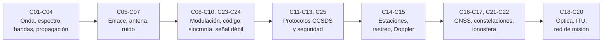

# B89 — Comunicaciones y navegación satelital

> **Bloque ampliado (`0.2.0`).** Además de las 20 clases de la línea base, el bloque tiene 5 clases que estaban programadas (`B89-C21` a `B89-C25`) y ahora están redactadas. Ver el [programa completo](../../PROGRAMA_ACADEMICO_COMPLETO.md).

**Programa:** Programa Integral de Astronomía, Astrofísica, Ciencias Espaciales e Ingeniería Aeroespacial
**Área:** A07 — Ingeniería y construcción de sistemas espaciales
**Nivel:** N3 (fundamentos disciplinares) · **Clases:** 25 · **Carga:** por calibrar con el uso
**Estado:** guía pedagógica del bloque (resumen de qué se aprende en cada clase). Las clases enlazadas en la tabla ya están redactadas; todas conservan el estado E0 en el catálogo hasta registrar revisión disciplinar.

## 🎯 Propósito del bloque

Enseña **cómo se cierra un enlace entre una nave y la Tierra y cómo se usa una señal para saber dónde está algo**. Parte de la onda electromagnética y del espectro, recorre la propagación, el presupuesto de enlace, las antenas y el ruido del receptor, sigue con la modulación, la codificación y la sincronización de portadora, pasa por los protocolos de la CCSDS (telemetría, telecomandos, espacio profundo), las estaciones terrestres, el rastreo y el Doppler, y llega a la navegación por GNSS, las constelaciones, las comunicaciones ópticas, la coordinación del espectro y el diseño de una red de misión. Las cinco clases añadidas cubren los efectos ionosféricos sobre GNSS y HF, las relaciones entre C/N0, Eb/N0 y la tasa de error, la recepción de telemetría débil y la protección criptográfica del enlace. Cada clase cierra con un laboratorio en Python con semilla fija que calcula con datos **sintéticos** o **ilustrativos** (rotulados) y comprueba el resultado con una segunda vía.

## 📚 Al terminar el bloque podrás

1. Calcular longitudes de onda, pérdidas de espacio libre, retardos de propagación y ganancias de antena en las bandas VHF, UHF, S, X y Ka.
2. Cerrar un presupuesto de enlace en decibelios con su margen, su `G/T` y su relación `Eb/N0` requerida.
3. Comparar modulaciones y códigos por su tasa de error, su eficiencia espectral y su ganancia de codificación.
4. Describir cómo una trama de telemetría o de telecomando se sincroniza, se codifica y se protege, con los valores de la CCSDS efectivamente consultados.
5. Calcular pasadas, Doppler y cobertura para una estación terrestre y una constelación.
6. Resolver una posición GNSS por mínimos cuadrados y medir su dilución de precisión, con y sin ionosfera.
7. Dimensionar una red de comunicaciones de misión y rotular qué es consultado, qué es ilustrativo y qué es sintético.

## 🧭 Secuencia del bloque

**Descripción textual.** La secuencia va de la señal al sistema: primero la onda y su propagación (C01–C04); luego el enlace, la antena y el ruido (C05–C07); después cómo se transporta la información, con modulación, codificación y sincronización (C08–C10); luego los protocolos de datos (C11–C13); las estaciones y el rastreo (C14–C15); la navegación y la cobertura (C16–C17); y finalmente óptica, regulación y diseño de red (C18–C20). Las clases C21–C25 profundizan temas que se enlazan donde corresponde: C21 y C22 con la propagación y GNSS, C23 y C24 con el enlace y la sincronización, C25 con los protocolos.

## 🗂️ Las 25 clases en resumen

**Navegación:** cada clase enlaza a la anterior, a la siguiente y a este bloque.

La columna «Evidencia» indica el producto que demostrará el aprendizaje. Los laboratorios usan datos **sintéticos** o **ilustrativos** (rotulados) o valores publicados con fuente y fecha.

### Tramo 1 · La señal y su propagación

| ID | Clase | Qué se aprende | Evidencia |
|---|---|---|---|
| [B89-C01](../clases/B89/B89-C01-electromagnetismo-aplicado-a-enlaces/CLASE.md) | Electromagnetismo aplicado a enlaces | `λ = c/f`, densidad de flujo `P·G/(4πr²)` y pérdida por polarización. | Ficha de flujo y polarización de un enlace sintético |
| [B89-C02](../clases/B89/B89-C02-frecuencia-y-espectro-espacial/CLASE.md) | Frecuencia y espectro espacial | Ancho de banda ocupado, plan de canales y desplazamiento Doppler dentro de la banda. | Plan de canales sintético en una banda |
| [B89-C03](../clases/B89/B89-C03-bandas-vhf-uhf-s-x-ka/CLASE.md) | Bandas VHF UHF S X Ka | Longitud de onda, diámetro de antena para una ganancia y ancho de haz por banda. | Tabla comparativa de bandas |
| [B89-C04](../clases/B89/B89-C04-propagacion-y-perdidas-de-espacio-libre/CLASE.md) | Propagación y pérdidas de espacio libre | Pérdida de espacio libre, retardo de luz y pérdidas atmosféricas ilustrativas. | Tabla de pérdidas y retardos por distancia |

### Tramo 2 · El enlace y el receptor

| ID | Clase | Qué se aprende | Evidencia |
|---|---|---|---|
| [B89-C05](../clases/B89/B89-C05-presupuesto-de-enlace/CLASE.md) | Presupuesto de enlace | Balance en dB de un enlace de bajada: PIRE, pérdidas, `G/T`, `C/N0` y margen. | Presupuesto de enlace con margen |
| [B89-C06](../clases/B89/B89-C06-ganancias-y-perdidas-de-antena/CLASE.md) | Ganancias y pérdidas de antena | Ganancia de apertura, ancho de haz, pérdida por apuntamiento y por error de superficie. | Ficha de una antena de parábola |
| [B89-C07](../clases/B89/B89-C07-figura-de-ruido-de-receptor/CLASE.md) | Figura de ruido de receptor | Fórmula de Friis para el ruido, temperatura de sistema y `G/T`. | Ficha de ruido y `G/T` de una cadena receptora |

### Tramo 3 · Cómo viaja la información

| ID | Clase | Qué se aprende | Evidencia |
|---|---|---|---|
| [B89-C08](../clases/B89/B89-C08-modulacion-digital/CLASE.md) | Modulación digital | BER de BPSK, QPSK, 8PSK y 16QAM, contrastada con una simulación de Monte Carlo. | Tabla de BER teórica y simulada |
| [B89-C09](../clases/B89/B89-C09-codificacion-correctora-de-errores/CLASE.md) | Codificación correctora de errores | Hamming y Reed–Solomon: capacidad de corrección y ganancia de codificación. | Curva de decodificación de un código de bloque |
| [B89-C10](../clases/B89/B89-C10-sincronizacion-de-portadora/CLASE.md) | Sincronización de portadora | Lazo de enganche de fase de segundo orden y seguimiento de un Doppler. | Ficha del lazo de seguimiento |

### Tramo 4 · Protocolos de datos

| ID | Clase | Qué se aprende | Evidencia |
|---|---|---|---|
| [B89-C11](../clases/B89/B89-C11-telemetria-ccsds/CLASE.md) | Telemetría CCSDS | Marcador ASM, bloques Reed–Solomon con entrelazado y rendimiento de una trama. | Ficha de una trama de telemetría |
| [B89-C12](../clases/B89/B89-C12-telecomandos-ccsds/CLASE.md) | Telecomandos CCSDS | Control de errores por CRC y ventana deslizante de aceptación de comandos. | Ficha de la aceptación de un comando |
| [B89-C13](../clases/B89/B89-C13-protocolos-para-espacio-profundo/CLASE.md) | Protocolos para espacio profundo | Almacenamiento y reenvío con tolerancia a interrupciones sobre un plan de contactos. | Plan de contactos DTN y latencia extremo a extremo |

### Tramo 5 · Estaciones y rastreo

| ID | Clase | Qué se aprende | Evidencia |
|---|---|---|---|
| [B89-C14](../clases/B89/B89-C14-estaciones-terrestres/CLASE.md) | Estaciones terrestres | Geometría de una pasada, duración, máscara de elevación y volumen de datos. | Tabla de pasadas de una estación |
| [B89-C15](../clases/B89/B89-C15-rastreo-y-doppler/CLASE.md) | Rastreo y Doppler | Curva Doppler de una pasada, tasa de Doppler y razón de transpondedor. | Curva Doppler de una pasada |

### Tramo 6 · Navegación y cobertura

| ID | Clase | Qué se aprende | Evidencia |
|---|---|---|---|
| [B89-C16](../clases/B89/B89-C16-gnss-como-navegacion-de-satelites/CLASE.md) | GNSS como navegación de satélites | Posición por pseudodistancias con mínimos cuadrados y dilución de precisión. | Ficha de posición y DOP |
| [B89-C17](../clases/B89/B89-C17-constelaciones-y-cobertura/CLASE.md) | Constelaciones y cobertura | Constelación Walker, fracción de cobertura y número de satélites visibles. | Mapa tabular de cobertura |

### Tramo 7 · Óptica, regulación y red

| ID | Clase | Qué se aprende | Evidencia |
|---|---|---|---|
| [B89-C18](../clases/B89/B89-C18-comunicaciones-opticas-espaciales/CLASE.md) | Comunicaciones ópticas espaciales | Banda óptica de la CCSDS, fotones por bit y error de modulación por posición de pulso. | Presupuesto de un enlace óptico sintético |
| [B89-C19](../clases/B89/B89-C19-coordinacion-del-espectro-ante-itu/CLASE.md) | Coordinación del espectro ante ITU | Relación interferencia/ruido y criterio de separación orbital para una coordinación. | Ficha de coordinación sintética |
| [B89-C20](../clases/B89/B89-C20-diseno-de-red-de-comunicaciones-de-mision/CLASE.md) | Diseño de red de comunicaciones de misión | Volumen de datos por pasada, relevo, margen por fase y verificación de requisitos. | Arquitectura de red de una misión sintética |

### Tramo 8 · Ampliación de la estructura `0.2.0`

| ID | Clase | Qué se aprende | Evidencia |
|---|---|---|---|
| [B89-C21](../clases/B89/B89-C21-efectos-ionosfericos-y-centelleo-en-senales-gnss/CLASE.md) | Efectos ionosféricos y centelleo en señales GNSS | Retardo por TEC, combinación libre de ionosfera y pérdida por centelleo. | Ficha de error ionosférico de una señal GNSS |
| [B89-C22](../clases/B89/B89-C22-propagacion-ionosferica-y-comunicaciones-hf/CLASE.md) | Propagación ionosférica y comunicaciones HF | Frecuencia crítica, frecuencia máxima utilizable y efecto de una tormenta. | Tabla de frecuencias utilizables en HF |
| [B89-C23](../clases/B89/B89-C23-relacion-c-n0-eb-n0-y-tasa-de-error-de-bit/CLASE.md) | Relación C/N0, Eb/N0 y tasa de error de bit | Conversión entre `C/N0`, `Eb/N0` y BER para fijar la tasa máxima de datos. | Tabla de tasas de datos por margen |
| [B89-C24](../clases/B89/B89-C24-recepcion-de-telemetria-debil/CLASE.md) | Recepción de telemetría débil | Umbral de seguimiento, ancho de banda de lazo e integración coherente. | Ficha de detección de una portadora débil |
| [B89-C25](../clases/B89/B89-C25-proteccion-criptografica-de-enlaces-espaciales/CLASE.md) | Protección criptográfica de enlaces espaciales | Asociaciones de seguridad, autenticación, ventana anti-repetición y sobrecarga. | Ficha de una asociación de seguridad |

## 🧵 Hilos que atraviesan el bloque

- **Decibelios y márgenes:** C01, C04, C05, C06, C07 y C23 comparten el mismo balance en dB.
- **Del fotón al bit:** C08, C09, C10, C23 y C24 convierten la potencia recibida en una tasa de error.
- **Valores normativos frente a ilustrativos:** C11, C12, C13, C18 y C25 usan parámetros de la CCSDS solo donde se consultaron; el resto se rotula.
- **Señal como instrumento de medida:** C15, C16, C17, C21 y C22 usan el Doppler, el retardo y la ionosfera para medir y no solo para comunicar.
- **Simulado frente a observado:** todo número del bloque es un cálculo con datos sintéticos o ilustrativos; ninguno es una medición de una misión.

## 📝 Evaluación del bloque (propuesta, por calibrar)

- Fichas y ejercicios por clase, con retroalimentación y recuperación con evidencia distinta.
- Portafolio: el presupuesto de enlace (C05) y la arquitectura de red de misión (C20), con sus supuestos y su sensibilidad.
- Las condiciones críticas (rotular lo sintético e ilustrativo, no presentar un cálculo como una medición y citar solo lo consultado) no se compensan con promedio.

## ⚠️ Seguridad y límites

El bloque es educativo. Los modelos son simplificados (espacio libre, ruido blanco gaussiano, órbitas circulares, Tierra esférica) y no sustituyen a los manuales de enlace de una agencia, a los estándares completos ni a la coordinación regulatoria con la UIT. La clase C25 usa funciones hash de la biblioteca estándar para ilustrar la autenticación y **no** implementa el cifrado AES-GCM del protocolo; no debe usarse como criptografía de producción. Ninguna cifra describe un enlace ni una misión reales.

## 📖 Fuentes consultadas en el bloque (resumen)

Consultadas el 2026-11-10: las constantes `c` y `k` de NIST (CODATA 2022); los documentos de la CCSDS 131.0-B-5 (sincronización y codificación de telemetría, septiembre de 2023), 355.0-B-2 (seguridad del enlace de datos, julio de 2022), 141.0-B-1 y 142.0-B-1 (comunicaciones ópticas, capa física y codificación, agosto de 2019), 734.2-B-1 (Bundle Protocol, septiembre de 2015) y 230.2-G-1 (enlace de subida de nueva generación, julio de 2014), leídos con PyMuPDF; la página del Reglamento de Radiocomunicaciones de la UIT (edición 2024); la página de SCaN de la NASA y la página de índice del manual DSN 810-005 del JPL. Las relaciones estándar de ingeniería (Friis, Shannon, Q-function, CRC, DOP, etc.) se verifican en cada laboratorio con una segunda vía y no se consultaron en una fuente concreta. **No se consultaron:** el estándar de telecomandos CCSDS 232.0-B ni 231.0-B (la descarga de su PDF falló), el estándar IEEE 521 de bandas, las ICD de GPS y Galileo, las recomendaciones UIT-R de propagación, ni Navipedia (la conexión falló); los valores que de ellos dependen se rotulan como ilustrativos o no consultados.

## Fuentes de orientación preliminar

- **[NASA-SMALLSAT]** [NASA State-of-the-Art of Small Spacecraft Technology, edición 2026](https://www.nasa.gov/smallsat-institute/sst-soa/) — Referencia panorámica sobre plataformas y subsistemas de satélites pequeños.
- **[NASA-SYSTEMS]** [NASA Systems Engineering Handbook](https://www.nasa.gov/reference/systems-engineering-handbook/) — Ingeniería de sistemas, verificación, validación y gestión técnica.
- **[ECSS]** [European Cooperation for Space Standardization](https://ecss.nl/) — Estándares y buenas prácticas europeos aplicables a proyectos espaciales.
- **[CCSDS]** [Consultative Committee for Space Data Systems](https://ccsds.org/publications/) — Protocolos, recomendaciones y estándares de intercambio de datos espaciales.

> La asociación de estas fuentes es orientativa por bloque. Las fuentes realmente consultadas para cada afirmación se registran en la sección 11 de cada clase.

[🏠 Volver al programa](../../README.md) · [➡️ B90 — Integración, ensayos y calificación espacial](./B90-integracion-ensayos-y-calificacion-espacial.md)
