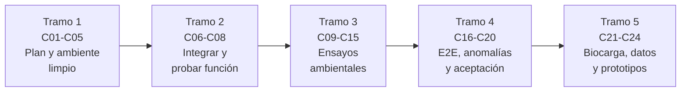

# B90 — Integración, ensayos y calificación espacial

> **Bloque ampliado (`0.2.0`).** Sus 20 clases de la línea base y las 4 clases programadas por la ampliación (`B90-C21` a `B90-C24`) están redactadas. Ver el [programa completo](../../PROGRAMA_ACADEMICO_COMPLETO.md).

**Programa:** Programa Integral de Astronomía, Astrofísica, Ciencias Espaciales e Ingeniería Aeroespacial
**Área:** A07 — Ingeniería y construcción de sistemas espaciales
**Nivel:** N3 (fundamentos disciplinares) · **Clases:** 20 + 4 de la ampliación · **Carga:** por calibrar con el uso
**Estado:** guía pedagógica del bloque (resumen de qué se aprende en cada clase). Las clases enlazadas en la tabla ya están redactadas; todas conservan el estado E0 en el catálogo hasta registrar revisión disciplinar.

## 🎯 Propósito del bloque

Enseña cómo un conjunto de piezas se convierte en una nave **demostrada**: se planifica el ensamblaje, se trabaja en un ambiente controlado (sala limpia, ESD, contaminación), se integran las interfaces mecánicas y eléctricas, se prueba que funciona y se la somete a los ambientes de lanzamiento y de órbita (vibración, choque, térmico, vacío, EMC), se gestionan las anomalías y se guarda la evidencia que permite aceptar la unidad de vuelo. Cierra con una campaña conceptual de calificación de un CubeSat y con cuatro clases de la ampliación: biocarga y su validación, instrumentación de ensayos y prototipos de ingeniería. Cada clase termina con un laboratorio en Python que calcula la magnitud central con datos **sintéticos** rotulados y con comprobaciones automáticas.

## 📚 Al terminar el bloque podrás

1. Armar un plan de ensamblaje, integración y prueba con su ruta crítica y sus holguras.
2. Calcular y justificar los controles de un ambiente limpio: clase de partículas, descarga electrostática y depósito molecular.
3. Documentar interfaces y comprobar su compatibilidad mecánica y eléctrica antes de unir hardware.
4. Diseñar y evaluar una prueba funcional con regla de decisión y margen de incertidumbre.
5. Calcular el contenido de un ensayo de vibración, choque, térmico, de vacío con ciclos, de EMC/EMI y de despliegue, y relacionarlo con su criterio de éxito.
6. Probar de extremo a extremo, gestionar anomalías y mantener evidencia trazable con integridad verificable.
7. Distinguir calificación, protovuelo y aceptación, y componer una campaña de calificación de un CubeSat.
8. Verificar biocarga y la validación de su reducción, instrumentar un ensayo y elegir una filosofía de modelos.

## 🧭 Secuencia del bloque

**Descripción textual.** Cinco tramos encadenados: planificar y trabajar en un ambiente limpio (C01–C05), unir el hardware y comprobar que funciona (C06–C08), someterlo a los ambientes (C09–C15), cerrar la verificación con pruebas de extremo a extremo, anomalías, evidencia y aceptación (C16–C20) y las cuatro clases de la ampliación (C21–C24).

## 🗂️ Las 24 clases en resumen

**Navegación:** cada clase enlaza a la anterior, a la siguiente y a este bloque.

La columna «Evidencia» indica el producto que demostrará el aprendizaje. Los laboratorios usan datos **sintéticos** (unidades de ejemplo, no un proyecto real) y los niveles, límites y criterios son valores de ejemplo, no valores de un documento ni de un lanzador.

### Tramo 1 · Plan y ambiente limpio

| ID | Clase | Qué se aprende | Evidencia |
|---|---|---|---|
| [B90-C01](../clases/B90/B90-C01-plan-de-ensamblaje-e-integracion/CLASE.md) | Plan de ensamblaje e integración | Red de tareas, ruta crítica, holgura y reintegración tras una falla. | Plan con ruta crítica y holguras |
| [B90-C02](../clases/B90/B90-C02-buenas-practicas-de-sala-limpia/CLASE.md) | Buenas prácticas de sala limpia | Límites de partículas por clase ISO, renovaciones de aire y recuperación. | Ficha de una sala con su tiempo de recuperación |
| [B90-C03](../clases/B90/B90-C03-proteccion-frente-a-esd/CLASE.md) | Protección frente a ESD | Modelo de cuerpo humano, energía, corriente pico y limitación por resistencia. | Análisis de una descarga y su control |
| [B90-C04](../clases/B90/B90-C04-control-de-contaminacion/CLASE.md) | Control de contaminación | Pérdida de masa, volátiles condensables y espesor depositado. | Presupuesto de depósito molecular |
| [B90-C05](../clases/B90/B90-C05-documentacion-de-interfaces/CLASE.md) | Documentación de interfaces | Documento de control de interfaces, apilamiento de tolerancias y compatibilidad. | ICD verificado con su matriz de compatibilidad |

### Tramo 2 · Integrar y probar la función

| ID | Clase | Qué se aprende | Evidencia |
|---|---|---|---|
| [B90-C06](../clases/B90/B90-C06-integracion-mecanica-de-subsistemas/CLASE.md) | Integración mecánica de subsistemas | Precarga por par de apriete, centro de masa e inercias del conjunto. | Balance de masa y precarga del ensamble |
| [B90-C07](../clases/B90/B90-C07-integracion-electrica-de-buses/CLASE.md) | Integración eléctrica de buses | Caída en el arnés, presupuesto de potencia y corriente de arranque. | Hoja de integración de un bus de potencia |
| [B90-C08](../clases/B90/B90-C08-procedimientos-de-prueba-funcional/CLASE.md) | Procedimientos de prueba funcional | Pasos, límites, incertidumbre y regla de decisión con banda de guarda. | Procedimiento funcional con regla de decisión |

### Tramo 3 · Ensayos ambientales

| ID | Clase | Qué se aprende | Evidencia |
|---|---|---|---|
| [B90-C09](../clases/B90/B90-C09-ensayos-de-vibracion/CLASE.md) | Ensayos de vibración | Espectro aleatorio, Grms, ecuación de Miles y respuesta de un resonador. | Ficha de un espectro de vibración y su respuesta |
| [B90-C10](../clases/B90/B90-C10-ensayos-de-choque/CLASE.md) | Ensayos de choque | Espectro de respuesta al choque de un pulso semisenoidal. | Espectro de choque de un pulso |
| [B90-C11](../clases/B90/B90-C11-ensayos-termicos/CLASE.md) | Ensayos térmicos | Constante de tiempo, estabilización y márgenes de temperatura de ensayo. | Perfil térmico con tiempos de estabilización |
| [B90-C12](../clases/B90/B90-C12-vacio-termico-y-ciclos/CLASE.md) | Vacío térmico y ciclos | Evacuación, presión final y equivalencia de ciclos por fatiga. | Plan de ciclos con su equivalencia de vida |
| [B90-C13](../clases/B90/B90-C13-compatibilidad-electromagnetica-emc/CLASE.md) | Compatibilidad electromagnética EMC | Márgenes de emisión en dB, suma de fuentes e incertidumbre. | Tabla de márgenes de emisión |
| [B90-C14](../clases/B90/B90-C14-interferencias-electromagneticas-emi/CLASE.md) | Interferencias electromagnéticas EMI | Piso de ruido térmico, relación interferencia/ruido y degradación del receptor. | Análisis de desensibilización de un receptor |
| [B90-C15](../clases/B90/B90-C15-pruebas-de-despliegue/CLASE.md) | Pruebas de despliegue | Dinámica de un panel articulado, margen de par y cronología de inhibidores. | Informe de una prueba de despliegue |

### Tramo 4 · Extremo a extremo, anomalías y aceptación

| ID | Clase | Qué se aprende | Evidencia |
|---|---|---|---|
| [B90-C16](../clases/B90/B90-C16-pruebas-de-extremo-a-extremo/CLASE.md) | Pruebas de extremo a extremo | Cadena de telecomando y telemetría, CRC y tasa de error de trama. | Informe de una prueba de extremo a extremo |
| [B90-C17](../clases/B90/B90-C17-gestion-de-anomalias-de-prueba/CLASE.md) | Gestión de anomalías de prueba | Registro, clasificación, cota de confianza y regla de disposición. | Informe de no conformidad con su disposición |
| [B90-C18](../clases/B90/B90-C18-trazabilidad-de-evidencias/CLASE.md) | Trazabilidad de evidencias | Matriz requisito-verificación y cadena de resúmenes SHA-256. | Matriz de trazabilidad con integridad comprobable |
| [B90-C19](../clases/B90/B90-C19-aceptacion-de-unidades-de-vuelo/CLASE.md) | Aceptación de unidades de vuelo | Calificación frente a aceptación, daño acumulado y paquete de datos. | Decisión de aceptación de una unidad |
| [B90-C20](../clases/B90/B90-C20-campana-conceptual-de-calificacion-de-cubesat/CLASE.md) | Campaña conceptual de calificación de CubeSat | Flujo de ensayos, matriz y probabilidad de cumplir el calendario. | Plan conceptual de calificación de un CubeSat |

### Tramo 5 · Ampliación: biocarga, datos de ensayo y prototipos

| ID | Clase | Qué se aprende | Evidencia |
|---|---|---|---|
| [B90-C21](../clases/B90/B90-C21-biocarga-de-naves-espaciales-verificacion-y-requisitos-normativos/CLASE.md) | Biocarga de naves espaciales: verificación y requisitos normativos | Densidad de esporas por muestreo, eficiencia de recuperación y cota superior de Poisson. | Verificación de biocarga frente a un límite de ejemplo |
| [B90-C22](../clases/B90/B90-C22-validacion-de-procesos-de-reduccion-de-biocarga/CLASE.md) | Validación de procesos de reducción de biocarga | Valor D, valor z, reducción logarítmica y probabilidad de sobrevivientes. | Plan de validación de una reducción |
| [B90-C23](../clases/B90/B90-C23-instrumentacion-y-adquisicion-de-datos-en-ensayos/CLASE.md) | Instrumentación y adquisición de datos en ensayos | Muestreo, aliasing, cuantización y sensibilidad del acelerómetro. | Especificación de una cadena de adquisición |
| [B90-C24](../clases/B90/B90-C24-prototipado-y-modelos-de-ingenieria-de-subconjuntos/CLASE.md) | Prototipado y modelos de ingeniería de subconjuntos | Filosofías de modelos, riesgo residual y costo esperado. | Comparación de filosofías de modelos |

## 🧵 Hilos que atraviesan el bloque

- **Probar como se vuela:** cada ensayo se justifica por el ambiente que representa y por el requisito que verifica.
- **Calificación, protovuelo y aceptación:** el mismo ensayo tiene objetivos distintos según el modelo y el nivel; la unidad de vuelo no se desmonta después de su prueba final.
- **Evidencia antes que opinión:** nada se declara cumplido sin un registro con fecha, versión y tolerancia.
- **Sintético frente a consultado:** los niveles, límites y parámetros de los laboratorios son de ejemplo; solo lo consultado se cita como fuente.

## 📝 Evaluación del bloque (propuesta, por calibrar)

- Fichas y ejercicios por clase, con retroalimentación y recuperación con evidencia distinta.
- Portafolio: el plan conceptual de calificación (C20) con su matriz de ensayos, su calendario probabilístico y sus límites.
- Las condiciones críticas (rotular lo sintético, verificar con una comprobación independiente y citar solo lo consultado) no se compensan con promedio.

## ⚠️ Seguridad y límites

El bloque es educativo. Los niveles de ensayo, límites de contaminación, valores de ESD, EMC y biocarga de las clases son de ejemplo y no equivalen a los de ningún lanzador, norma o misión; los vigentes los fija el documento de requisitos del proyecto y del proveedor de lanzamiento. Ninguna clase sustituye un plan de calificación, un procedimiento aprobado ni la revisión de especialistas. Las normas ECSS, la serie MIL-STD y las normas ISO de sala limpia no se consultaron en su texto; de las páginas de normas solo se leyeron título, fecha y alcance.

## 📖 Fuentes consultadas en el bloque (resumen)

Consultadas el 2026-11-10: NASA Systems Engineering Handbook (secciones 5.2 y 5.3), GSFC-STD-7000 (página de la norma), NASA-STD-7001C (página), NASA-STD-8719.27 (página), página de protección planetaria de NASA, CubeSat Design Specification Rev. 14.1 (Cal Poly, 2022; PDF), NASA CubeSat 101 (octubre de 2017; PDF), listado de normas activas de ECSS (solo títulos y fechas), página de la base de datos de desgasificación de NASA, página de normas de la ESD Association, valor de `k` del NIST y la página de la edición 2026 de NASA State-of-the-Art of Small Spacecraft Technology. No se consultó el texto de ninguna norma ECSS, MIL-STD, ISO ni de GEVS completo.

## Fuentes de orientación preliminar

- **[NASA-SMALLSAT]** [NASA State-of-the-Art of Small Spacecraft Technology, edición 2026](https://www.nasa.gov/smallsat-institute/sst-soa/) — Referencia panorámica sobre plataformas y subsistemas de satélites pequeños.
- **[NASA-SYSTEMS]** [NASA Systems Engineering Handbook](https://www.nasa.gov/reference/systems-engineering-handbook/) — Ingeniería de sistemas, verificación, validación y gestión técnica.
- **[ECSS]** [European Cooperation for Space Standardization](https://ecss.nl/) — Estándares y buenas prácticas europeos aplicables a proyectos espaciales.
- **[CCSDS]** [Consultative Committee for Space Data Systems](https://ccsds.org/publications/) — Protocolos, recomendaciones y estándares de intercambio de datos espaciales.

> La asociación de estas fuentes es orientativa por bloque. Las fuentes realmente consultadas para cada afirmación se registran en la sección 11 de cada clase.

[🏠 Volver al programa](../../README.md)
