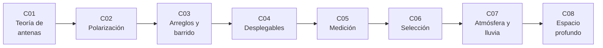

# B91 — Antenas y propagación para enlaces espaciales

> **Bloque nuevo de la estructura `0.2.0`.** Sus 8 clases estaban programadas por la ampliación y ahora están redactadas. Ver el [programa completo](../../PROGRAMA_ACADEMICO_COMPLETO.md).

**Programa:** Programa Integral de Astronomía, Astrofísica, Ciencias Espaciales e Ingeniería Aeroespacial
**Área:** A07 — Ingeniería y construcción de sistemas espaciales
**Nivel:** N4 (aplicación en ingeniería) · **Clases:** 8 · **Carga:** por calibrar con el uso
**Estado:** guía pedagógica del bloque (resumen de qué se aprende en cada clase). Las clases enlazadas en la tabla ya están redactadas; todas conservan el estado E0 en el catálogo hasta registrar revisión disciplinar.

## 🎯 Propósito del bloque

Enseña **cómo una antena convierte potencia en un haz dirigido y cómo la atmósfera lo debilita**, hasta poder elegir y justificar una antena para un enlace espacial. Parte de la teoría (ganancia, directividad, abertura efectiva), pasa por la polarización, los arreglos de barrido electrónico y los reflectores desplegables, sigue con la medición y la selección de una antena, y cierra con la atenuación atmosférica y las grandes antenas de espacio profundo. Cada clase termina con un laboratorio en Python (biblioteca estándar, semilla fija) que contrasta cada resultado con una segunda vía de cálculo y contra valores publicados por la NASA/JPL (DSN) o por la UIT-R cuando fueron consultados.

## 📚 Al terminar el bloque podrás

1. Calcular directividad, ganancia, abertura efectiva y ancho de haz de un dipolo y de una apertura circular, y reproducir la ganancia de una antena de 70 m.
2. Cuantificar la pérdida por desadaptación de polarización con vectores de Jones, razón axial y ángulo de inclinación.
3. Calcular el factor de arreglo, el barrido, los lóbulos de rejilla y la pérdida por cuantización de fase de un arreglo lineal.
4. Estimar con la fórmula de Ruze el límite de frecuencia de un reflector desplegable según su error de superficie.
5. Planificar una medición de antena: distancia de campo lejano, error de fase por distancia finita e incertidumbre de ganancia por sustitución.
6. Comparar tipos de antena con una matriz de decisión, un frente de Pareto y un análisis de sensibilidad a los pesos.
7. Calcular la atenuación por lluvia con las recomendaciones UIT-R P.838 y P.618 y la temperatura de ruido que añade la atmósfera.
8. Calcular G/T, pérdida por apuntamiento y presupuesto de enlace de una estación de espacio profundo.
9. Rotular qué es consultado, qué es calculado y qué es sintético en cada resultado.

## 🧭 Secuencia del bloque

**Descripción textual.** Ocho clases encadenadas: la teoría que fija ganancia y haz (C01), la polarización que decide cuánta potencia se acopla (C02), los arreglos que orientan el haz sin mover la antena (C03), los reflectores que se pliegan y su límite de precisión (C04), cómo se mide lo diseñado (C05), cómo se elige (C06), el medio de propagación que lo degrada (C07) y las antenas más grandes que existen, vistas con datos reales de la DSN (C08).

## 🗂️ Las 8 clases en resumen

**Navegación:** cada clase enlaza a la anterior, a la siguiente y a este bloque.

La columna «Evidencia» indica el producto que demostrará el aprendizaje. Los laboratorios usan datos **sintéticos** o **ilustrativos** (rotulados) o valores publicados con fuente y fecha.

### Tramo 1 · Teoría y tipos de antena

| ID | Clase | Qué se aprende | Evidencia |
|---|---|---|---|
| [B91-C01](../clases/B91/B91-C01-fundamentos-de-teoria-de-antenas/CLASE.md) | Fundamentos de teoría de antenas | Directividad, ganancia, abertura efectiva y ancho de haz; contraste con la antena de 70 m de la DSN. | Ficha de parámetros de una antena |
| [B91-C02](../clases/B91/B91-C02-polarizacion-de-antenas-y-perdidas-por-desadaptacion/CLASE.md) | Polarización de antenas y pérdidas por desadaptación | Vectores de Jones, razón axial y factor de pérdida de polarización. | Tabla de pérdidas por desadaptación |
| [B91-C03](../clases/B91/B91-C03-arreglos-de-antenas-y-antenas-de-barrido-electronico/CLASE.md) | Arreglos de antenas y antenas de barrido electrónico | Factor de arreglo, barrido, lóbulos de rejilla y cuantización de fase. | Ficha de un arreglo lineal con barrido |
| [B91-C04](../clases/B91/B91-C04-antenas-desplegables-y-estructuras-de-gran-apertura/CLASE.md) | Antenas desplegables y estructuras de gran apertura | Fórmula de Ruze, frecuencia óptima y razón de empaquetado. | Ficha de un reflector desplegable |

### Tramo 2 · Medir, elegir y propagar

| ID | Clase | Qué se aprende | Evidencia |
|---|---|---|---|
| [B91-C05](../clases/B91/B91-C05-medicion-y-calibracion-de-antenas/CLASE.md) | Medición y calibración de antenas | Campo lejano, error de distancia finita e incertidumbre por sustitución. | Plan de medición con presupuesto de incertidumbre |
| [B91-C06](../clases/B91/B91-C06-seleccion-y-compromiso-de-diseno-de-antenas/CLASE.md) | Selección y compromiso de diseño de antenas | Matriz de decisión, frente de Pareto y sensibilidad a los pesos. | Memoria de selección de antena |
| [B91-C07](../clases/B91/B91-C07-atenuacion-atmosferica-y-efectos-de-la-lluvia-en-enlaces/CLASE.md) | Atenuación atmosférica y efectos de la lluvia en enlaces | UIT-R P.838 y P.618, ruido de cielo y disponibilidad. | Ficha de margen por lluvia de un enlace |
| [B91-C08](../clases/B91/B91-C08-antenas-de-gran-apertura-y-estaciones-de-espacio-profundo/CLASE.md) | Antenas de gran apertura y estaciones de espacio profundo | G/T, pérdida por apuntamiento y presupuesto de enlace con datos de la DSN. | Ficha de enlace de espacio profundo |

## 🧵 Hilos que atraviesan el bloque

- **Ganancia = abertura / longitud de onda al cuadrado:** `G = η(πD/λ)²` aparece en C01, C04, C06 y C08.
- **Todo pierde un poco:** polarización (C02), error de superficie (C04), apuntamiento (C08) y atmósfera (C07) se expresan en dB y se suman.
- **Consultado frente a calculado:** la ganancia de 70 m y los coeficientes UIT-R son valores publicados; lo demás es cálculo con datos sintéticos rotulados.
- **Verificación independiente:** cada laboratorio contrasta con una forma cerrada, una suma directa o un valor publicado.

## 📝 Evaluación del bloque (propuesta, por calibrar)

- Fichas y ejercicios por clase, con retroalimentación y recuperación con evidencia distinta.
- Portafolio: la memoria de selección de antena (C06) con su sensibilidad y la ficha de enlace de espacio profundo (C08).
- Las condiciones críticas (rotular lo sintético, no presentar un cálculo como medición y citar solo lo consultado) no se compensan con promedio.

## ⚠️ Seguridad y límites

El bloque es educativo. Los modelos son idealizados (aperturas uniformes, arreglos de elementos isótropos, atmósfera de capa simple) y no sustituyen a la norma del operador, a la medición en cámara ni al diseño certificado. Las cifras de la DSN proceden del módulo 101 del manual 810-005 (rev. D, 2011) y los coeficientes de lluvia de la Rec. UIT-R P.838-3; los datos de antenas candidatas, errores de superficie y lluvia local son sintéticos. No se consultó la normativa CCSDS, el estándar IEEE 145 ni libros de texto de antenas.

## 📖 Fuentes consultadas en el bloque (resumen)

Consultadas el 2026-11-10: NASA/JPL, *DSN Telecommunications Link Design Handbook*, 810-005, módulo 101 rev. D, «70-m Subnet Telecommunications Interfaces» (documento completo leído con PyMuPDF); UIT-R, Recomendación P.838-3 (2005) sobre atenuación específica por lluvia (texto y tablas de constantes) y Recomendación P.618-14 (2023) en el procedimiento de predicción de atenuación por lluvia en trayectos oblicuos. La tabla 5 de P.838-3 (valores numéricos por frecuencia), la Rec. UIT-R P.837 (mapas de lluvia), P.839 (altura de lluvia) y P.676 (gases) no se consultaron. Las relaciones estándar de la teoría de antenas (directividad, Friis, factor de arreglo, Ruze, Jones) las verifica cada laboratorio con una segunda vía y no se consultaron en una fuente concreta.

## Fuentes de orientación preliminar

- **[CCSDS]** [Consultative Committee for Space Data Systems](https://public.ccsds.org/) — Estándares de comunicaciones espaciales.
- **[NASA-DSN]** [NASA Deep Space Network](https://www.nasa.gov/communicating-with-missions/dsn/) — Red de espacio profundo.
- **[ITU-R]** [Recomendaciones UIT-R de la serie P](https://www.itu.int/rec/R-REC-P/en) — Propagación radioeléctrica.
- **[ECSS]** [European Cooperation for Space Standardization](https://ecss.nl/) — Normas de ingeniería espacial.

> La asociación de estas fuentes es orientativa por bloque. Las fuentes realmente consultadas para cada afirmación se registran en la sección 11 de cada clase.

## Roles que lo usan

- [Telecomunicaciones y estaciones terrestres espaciales](../../rutas/telecomunicaciones-y-estaciones-terrestres-espaciales.md)

[🏠 Volver al programa](../../README.md) · [⬅️ B90 — Integración, ensayos y calificación espacial](./B90-integracion-ensayos-y-calificacion-espacial.md) · [➡️ B92 — Comunicaciones ópticas espaciales (profundización)](./B92-comunicaciones-opticas-espaciales-profundizacion.md)
