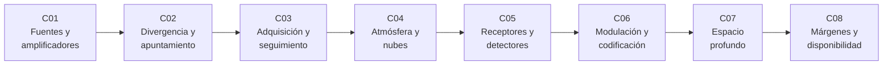

# B92 — Comunicaciones ópticas espaciales (profundización)

> **Bloque nuevo de la estructura `0.2.0`.** Sus 8 clases estaban programadas por la ampliación y ahora están redactadas. Ver el [programa completo](../../PROGRAMA_ACADEMICO_COMPLETO.md).

**Programa:** Programa Integral de Astronomía, Astrofísica, Ciencias Espaciales e Ingeniería Aeroespacial
**Área:** A07 — Ingeniería y construcción de sistemas espaciales
**Nivel:** N3 (fundamentos disciplinares) · **Clases:** 8 · **Carga:** por calibrar con el uso
**Estado:** guía pedagógica del bloque (resumen de qué se aprende en cada clase). Las clases enlazadas en las tablas ya están redactadas; todas conservan el estado E0 en el catálogo hasta registrar revisión disciplinar.

## 🎯 Propósito del bloque

Enseña **cómo se diseña y se cuantifica un enlace óptico espacial, eslabón por eslabón**: la fuente láser y su amplificador, el haz estrecho y lo que cuesta apuntarlo, la adquisición y el seguimiento a microrradianes, la atmósfera y las nubes que cierran el trayecto hacia la Tierra, el receptor de conteo de fotones, la modulación por posición de pulso con su código, el caso del espacio profundo y, al final, el margen y la disponibilidad que se le prometen al usuario. El bloque profundiza lo que [B89](./B89-comunicaciones-y-navegacion-satelital.md) presenta de las comunicaciones ópticas y se apoya en los estándares CCSDS 141.0-B-1 y 142.0-B-1 y en las mediciones publicadas del experimento LCRD. Cada clase cierra con un laboratorio en Python con semilla fija y una segunda vía de verificación.

## 📚 Al terminar el bloque podrás

1. Relacionar la potencia media, la potencia de pico, la energía por pulso y la tasa de fotones de un transmisor óptico con modulación PPM.
2. Calcular la ganancia de un haz gaussiano y la pérdida media por un error de apuntamiento aleatorio.
3. Dimensionar el tiempo de adquisición de un enlace y la jitter residual de un lazo de seguimiento.
4. Estimar el parámetro de Fried, el desvanecimiento y la disponibilidad por nubes con diversidad de estaciones.
5. Calcular la tasa de error de símbolo de un receptor de conteo de fotones y el efecto del tiempo muerto.
6. Obtener la tasa de información de un enlace PPM con los parámetros del CCSDS 142.0-B-1.
7. Escalar un enlace de espacio profundo con la distancia y calcular el ángulo de anticipación.
8. Construir un presupuesto de margen y decidir cuántas estaciones exige una disponibilidad objetivo.
9. Rotular qué es consultado, qué es calculado y qué es ilustrativo en cada número.

## 🧭 Secuencia del bloque

**Descripción textual.** Ocho clases encadenadas: el transmisor (C01), el haz y su apuntamiento (C02), el control que lo mantiene (C03), el medio atmosférico (C04), el receptor (C05), la señal y su código (C06), el caso extremo de distancia (C07) y el balance final de margen y disponibilidad (C08).

## 🗂️ Las 8 clases en resumen

**Navegación:** cada clase enlaza a la anterior, a la siguiente y a este bloque.

La columna «Evidencia» indica el producto que demostrará el aprendizaje. Los laboratorios usan datos **sintéticos** o **ilustrativos** (rotulados) o valores publicados con fuente y fecha.

### Tramo 1 · El terminal óptico

| ID | Clase | Qué se aprende | Evidencia |
|---|---|---|---|
| [B92-C01](../clases/B92/B92-C01-fuentes-laser-y-amplificadores-para-enlaces-espaciales/CLASE.md) | Fuentes láser y amplificadores para enlaces espaciales | Rejilla de frecuencias, potencia de pico en PPM y ganancia de un amplificador saturable. | Ficha de transmisor óptico con su balance de potencia |
| [B92-C02](../clases/B92/B92-C02-divergencia-del-haz-y-perdidas-por-apuntamiento-optico/CLASE.md) | Divergencia del haz y pérdidas por apuntamiento óptico | Ganancia gaussiana y pérdida media por error de apuntamiento. | Tabla de pérdida frente a error de apuntamiento |
| [B92-C03](../clases/B92/B92-C03-adquisicion-apuntamiento-y-seguimiento-opticos/CLASE.md) | Adquisición, apuntamiento y seguimiento ópticos | Tiempo de barrido y rechazo de perturbaciones de un lazo de seguimiento. | Ficha de adquisición y seguimiento |

### Tramo 2 · El medio y el receptor

| ID | Clase | Qué se aprende | Evidencia |
|---|---|---|---|
| [B92-C04](../clases/B92/B92-C04-atmosfera-y-nubes-en-enlaces-opticos-con-la-tierra/CLASE.md) | Atmósfera y nubes en enlaces ópticos con la Tierra | Parámetro de Fried, índice de centelleo y diversidad de estaciones. | Ficha atmosférica de un enlace descendente |
| [B92-C05](../clases/B92/B92-C05-receptores-y-detectores-para-comunicaciones-opticas/CLASE.md) | Receptores y detectores para comunicaciones ópticas | Error de símbolo PPM con conteo de fotones y tiempo muerto. | Curva de error frente a fotones por símbolo |
| [B92-C06](../clases/B92/B92-C06-modulacion-y-codificacion-en-enlaces-opticos/CLASE.md) | Modulación y codificación en enlaces ópticos | Tasa de información PPM con las tablas del CCSDS 142.0-B-1 y eficiencia fotónica. | Tabla de tasas por orden PPM y tasa de código |

### Tramo 3 · Del espacio profundo al compromiso de servicio

| ID | Clase | Qué se aprende | Evidencia |
|---|---|---|---|
| [B92-C07](../clases/B92/B92-C07-enlaces-opticos-de-espacio-profundo/CLASE.md) | Enlaces ópticos de espacio profundo | Escalado `1/d²`, tiempo de luz y ángulo de anticipación. | Ficha de espacio profundo con los datos publicados de DSOC |
| [B92-C08](../clases/B92/B92-C08-margenes-y-disponibilidad-de-enlaces-opticos/CLASE.md) | Márgenes y disponibilidad de enlaces ópticos | Presupuesto de margen, desvanecimiento y disponibilidad con varias estaciones. | Presupuesto de margen y disponibilidad de un enlace |

## 🧵 Hilos que atraviesan el bloque

- **Fotones como moneda:** de la energía `hν` (C01) a los fotones por bit (C05, C06, C07).
- **Un haz estrecho cuesta apuntamiento:** C02 lo cuantifica, C03 lo controla y C07 lo lleva al límite con el ángulo de anticipación.
- **El medio decide la disponibilidad:** C04 y C08 conectan nubes, turbulencia y diversidad de estaciones.
- **Observado frente a modelado:** las cifras de LCRD y DSOC son publicadas; todo lo demás es modelo con datos sintéticos o ilustrativos y nunca se presenta como medición.
- **Verificación independiente:** cada laboratorio contrasta con una expresión analítica, una integral numérica o una simulación con semilla fija.

## 📝 Evaluación del bloque (propuesta, por calibrar)

- Fichas y ejercicios por clase, con retroalimentación y recuperación con evidencia distinta.
- Portafolio: el presupuesto de margen y disponibilidad (C08) con sus supuestos y su sensibilidad.
- Las condiciones críticas (rotular lo ilustrativo y sintético, no presentar un modelo como observación y citar solo lo consultado) no se compensan con promedio.

## ⚠️ Seguridad y límites

El bloque es educativo. Los láseres de comunicaciones pueden ser peligrosos para la vista y para la aviación: la operación real exige las coordinaciones y evaluaciones de seguridad que fijan las autoridades; esta guía no las reemplaza. Los modelos son simplificados (haz gaussiano ideal, turbulencia débil, detectores ideales con parámetros ilustrativos) y no sustituyen a las normas ni a la ingeniería de un terminal real. Las cifras de LCRD y DSOC son las publicadas por NASA; potencias, aperturas y longitudes de onda de DSOC no figuraban en las páginas consultadas y no se citan.

## 📖 Fuentes consultadas en el bloque (resumen)

Consultadas el 2026-11-10: CCSDS 141.0-B-1 (capa física de comunicaciones ópticas, agosto de 2019) y CCSDS 142.0-B-1 (codificación y sincronización, agosto de 2019), ambas leídas con PyMuPDF; Israel et al., «NASA's LCRD experiment program: characterization and initial operations» (SPIE, 2024, NTRS 20230018608), leído con PyMuPDF; las constantes `h` y `c` de NIST (CODATA 2022); y las páginas de NASA y JPL sobre DSOC y LCRD (WebFetch). La página de NASA sobre DSOC no entrega potencia ni aperturas, y la de NASA/LCRD de la dirección original dio un error 404; se usó la página de visión general de LCRD. Los modelos de turbulencia de Hufnagel–Valley, la estadística de Poisson y las leyes de lazos de control son relaciones estándar que verifica cada laboratorio y no se consultaron en una fuente concreta.

## Fuentes de orientación preliminar

- **[CCSDS]** [Consultative Committee for Space Data Systems](https://ccsds.org/) — Estándares de datos espaciales, incluida la serie de comunicaciones ópticas.
- **[NASA-SCAN]** [NASA Space Communications and Navigation](https://www.nasa.gov/communicating-with-missions/) — Comunicaciones espaciales y láser.
- **[ESA-TEC]** [ESA Technology](https://www.esa.int/Enabling_Support/Space_Engineering_Technology) — Ingeniería y tecnología espacial.
- **[ECSS]** [European Cooperation for Space Standardization](https://ecss.nl/) — Normas de ingeniería de sistemas espaciales.

> La asociación de estas fuentes es orientativa por bloque. Las fuentes realmente consultadas para cada afirmación se registran en la sección 11 de cada clase.

## Roles que lo usan

- [Telecomunicaciones y estaciones terrestres espaciales](../../rutas/telecomunicaciones-y-estaciones-terrestres-espaciales.md)

[🏠 Volver al programa](../../README.md) · [➡️ B93 — Electrónica embarcada y compatibilidad electromagnética](./B93-electronica-embarcada-y-compatibilidad-electromagnetica.md)
