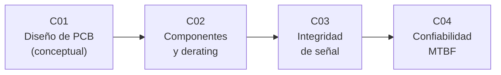

# B93 — Electrónica embarcada y compatibilidad electromagnética

> **Bloque nuevo de la estructura vigente.** Sus 4 clases estaban programadas y ahora están redactadas. Ver el [programa completo](../../PROGRAMA_ACADEMICO_COMPLETO.md).

**Programa:** Programa Integral de Astronomía, Astrofísica, Ciencias Espaciales e Ingeniería Aeroespacial
**Área:** A07 — Ingeniería y construcción de sistemas espaciales
**Nivel:** N3 (fundamentos disciplinares) · **Clases:** 4 · **Carga:** por calibrar con el uso
**Estado:** guía pedagógica del bloque (resumen de qué se aprende en cada clase). Las clases enlazadas en la tabla ya están redactadas; todas conservan el estado E0 en el catálogo hasta registrar revisión disciplinar.

## 🎯 Propósito del bloque

Enseña a **dimensionar y verificar con números la electrónica de una unidad de vuelo**: qué corriente y qué impedancia soporta una pista de la placa, cuánto hay que bajar la carga de cada componente (derating) para que llegue al fin de vida, cómo se deforma una señal rápida por reflexiones y acoplamiento entre pistas, y cuántas fallas por unidad de tiempo cabe esperar de la suma de todas las piezas. Cada clase cierra con un laboratorio en Python que contrasta el cálculo con una segunda vía (un valor publicado, una simulación temporal o una simulación de Monte Carlo con semilla fija) y rotula lo consultado, lo ilustrativo y lo no consultado.

El nombre del bloque incluye la compatibilidad electromagnética. En esta versión solo la toca la clase de integridad de señal (acoplamiento entre pistas); los requisitos y ensayos de EMC a nivel de equipo y de sistema no se desarrollan y quedan como ampliación futura.

## 📚 Al terminar el bloque podrás

1. Dimensionar el ancho de una pista por corriente y calcular la impedancia y el retardo de una microtira, y contrastarlos con un valor publicado.
2. Aplicar factores de derating a una lista de materiales sintética y detectar qué componentes incumplen y con qué margen.
3. Calcular coeficientes de reflexión, la respuesta escalonada de una línea mal terminada y el acoplamiento entre pistas, y traducirlos a un margen de temporización.
4. Estimar la tasa de fallas y el MTBF de una unidad con el método de conteo de partes y el factor de temperatura de Arrhenius, y calcular la confiabilidad con y sin redundancia.
5. Distinguir en cada resultado lo consultado, lo ilustrativo y lo no consultado, y no presentar un modelo como una medición.

## 🧭 Secuencia del bloque

**Descripción textual.** Cuatro clases encadenadas: la placa y sus pistas (C01), los componentes y cuánto se los alivia de carga (C02), las señales que viajan por esas pistas (C03) y la confiabilidad del conjunto, donde el derating de C02 entra como reducción de la tasa de fallas (C04). Las clases comparten la idea de **margen verificable**: todo límite se compara con un valor calculado y se rotula su origen.

## 🗂️ Las 4 clases en resumen

**Navegación:** cada clase enlaza a la anterior, a la siguiente y a este bloque.

La columna «Evidencia» indica el producto que demostrará el aprendizaje. Los laboratorios usan datos **sintéticos** o **ilustrativos** (rotulados) o valores publicados con fuente y fecha.

### Tramo 1 · Diseñar y proteger la electrónica

| ID | Clase | Qué se aprende | Evidencia |
|---|---|---|---|
| [B93-C01](../clases/B93/B93-C01-diseno-de-pcb-espacial-conceptual/CLASE.md) | Diseño de PCB espacial (conceptual) | Ancho de pista por corriente, caída de tensión, impedancia y retardo de una microtira. | Ficha de pista y microtira de una placa sintética |
| [B93-C02](../clases/B93/B93-C02-seleccion-de-componentes-y-derating/CLASE.md) | Selección de componentes y derating | Factores de derating de capacitores, resistores y microcircuitos y temperatura de unión. | Tabla de cumplimiento de derating de una lista de materiales sintética |

### Tramo 2 · Señales y confiabilidad

| ID | Clase | Qué se aprende | Evidencia |
|---|---|---|---|
| [B93-C03](../clases/B93/B93-C03-integridad-de-senal-en-electronica-embarcada/CLASE.md) | Integridad de señal en electrónica embarcada | Reflexiones, respuesta escalonada, acoplamiento entre pistas y margen de temporización. | Ficha de integridad de señal de un enlace sintético |
| [B93-C04](../clases/B93/B93-C04-analisis-de-confiabilidad-de-electronica-mtbf-y-derating/CLASE.md) | Análisis de confiabilidad de electrónica (MTBF y derating) | Conteo de partes, factor de Arrhenius, MTBF y confiabilidad con redundancia. | Informe de confiabilidad de una unidad sintética |

## 🧵 Hilos que atraviesan el bloque

- **Temperatura como variable común:** eleva la resistencia de la pista (C01), fija la temperatura de unión admisible (C02) y multiplica la tasa de fallas (C04).
- **Margen frente a límite:** corriente frente a ancho, tensión frente a valor nominal, flanco frente a ventana de temporización, `λ` frente a presupuesto.
- **Observado frente a modelado:** todo número del bloque es un cálculo sobre datos sintéticos o ilustrativos; ninguno es una medición de hardware de vuelo.
- **Verificación independiente:** cada laboratorio compara con un valor publicado, con una simulación temporal o con Monte Carlo.

## 📝 Evaluación del bloque (propuesta, por calibrar)

- Fichas y ejercicios por clase, con retroalimentación y recuperación con evidencia distinta.
- Portafolio: el informe de confiabilidad (C04) con sus supuestos y su sensibilidad a la temperatura.
- Las condiciones críticas (rotular lo ilustrativo y sintético, no presentar un modelo como medición y citar solo lo consultado) no se compensan con promedio.

## ⚠️ Seguridad y límites

El bloque es educativo. Las relaciones son simplificadas (pista uniforme, línea sin pérdidas, modelo de conteo de partes) y no sustituyen a las normas aplicables a un proyecto ni a la calificación de hardware de vuelo. Los factores de derating son los de un documento de 2003 y pueden estar superados; el proyecto real aplica la norma que su cliente exija. Los valores de la norma ECSS de derating y de la IPC-2221 no se leyeron: solo se consultó la página de resumen de la primera y resultados de búsqueda sobre la segunda.

## 📖 Fuentes consultadas en el bloque (resumen)

Consultadas el 2026-11-10: la tabla 4 de derating (capacitores, resistores y microcircuitos) del documento NASA/TP-2003-212242, EEE-INST-002 (PDF completo leído con PyMuPDF); la ficha de la norma ECSS-Q-ST-30-11C Rev.2 y la de ECSS-E-ST-20-07C Rev.1 (solo la página de resumen, no el PDF); el manual MIL-HDBK-217F de 1991 (copia universitaria; la tabla del §6.11 y el Apéndice A); las notas de curso de líneas de transmisión de la Universidad de California, Santa Bárbara (2007); y resultados de búsqueda que reproducen la fórmula empírica de corriente de la IPC-2221 (la norma no se consultó). Las leyes de Ohm, la ecuación de la línea de transmisión, el modelo de acoplamiento de pistas, la ley de Arrhenius y la confiabilidad exponencial son relaciones estándar que verifica cada laboratorio y no se consultaron en una fuente concreta.

## Fuentes de orientación preliminar

- **[ECSS]** [European Cooperation for Space Standardization](https://ecss.nl/) — Normas de ingeniería, calidad y gestión para sistemas espaciales.
- **[NASA-NEPP]** [NASA Electronic Parts and Packaging Program](https://nepp.nasa.gov/) — Guías y documentos sobre componentes electrónicos para vuelo.
- **[IEEE-EMC]** [IEEE EMC Society](https://www.emcs.org/) — Material sobre compatibilidad electromagnética.
- **[NIST]** [NIST](https://www.nist.gov/) — Constantes y metrología.

> La asociación de estas fuentes es orientativa por bloque. Las fuentes realmente consultadas para cada afirmación se registran en la sección 11 de cada clase.

## Roles que lo usan

- [Aviónica y software espacial de alta fiabilidad](../../rutas/avionica-y-software-espacial-de-alta-fiabilidad.md)

[🏠 Volver al programa](../../README.md)
