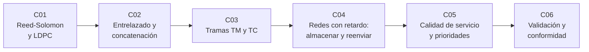

# B94 — Modulación, codificación y protocolos de enlace

> **Bloque nuevo de la estructura `0.2.0`.** Sus 6 clases estaban programadas por la ampliación y ahora están redactadas. Ver el [programa completo](../../PROGRAMA_ACADEMICO_COMPLETO.md).

**Programa:** Programa Integral de Astronomía, Astrofísica, Ciencias Espaciales e Ingeniería Aeroespacial
**Área:** A07 — Ingeniería y construcción de sistemas espaciales
**Nivel:** N3 (fundamentos disciplinares) · **Clases:** 6 · **Carga:** por calibrar con el uso
**Estado:** guía pedagógica del bloque (resumen de qué se aprende en cada clase). Las clases enlazadas en la tabla ya están redactadas; todas conservan el estado E0 en el catálogo hasta registrar revisión disciplinar.

## 🎯 Propósito del bloque

Enseña **cómo un enlace espacial convierte un canal ruidoso, con ráfagas de errores y con retardos de minutos u horas, en un servicio de datos fiable**. Recorre la capa de codificación (Reed-Solomon y LDPC), cómo se combinan y se entrelazan los códigos para resistir ráfagas, la estructura de las tramas de transferencia de telemetría y telecomando, el almacenamiento y reenvío de las redes tolerantes a retardo, el reparto de un enlace escaso por prioridades y, al final, cómo se prueba que una implementación cumple el protocolo. Cada clase cierra con un laboratorio en Python de biblioteca estándar, con semilla fija, que implementa el mecanismo y lo contrasta con una segunda vía.

## 📚 Al terminar el bloque podrás

1. Codificar y decodificar con un código Reed-Solomon sobre GF(2⁸) (con los parámetros del estándar CCSDS) y medir el efecto de superar su capacidad de corrección.
2. Explicar por qué un decodificador convolucional produce ráfagas y cómo el entrelazado y la concatenación las reparten entre palabras de código.
3. Armar y leer una trama de telemetría con su cabecera de 6 octetos, su puntero de primera cabecera y su CRC de 16 bits.
4. Calcular con un plan de contactos la llegada más temprana de un paquete en una red con retardo y desconexión, y la ocupación de almacenamiento que exige.
5. Repartir una capacidad de enlace escasa entre tres clases de servicio y detectar la inanición.
6. Diseñar y ejecutar pruebas de conformidad de un codificador de tramas, con vectores de prueba, casos negativos y mutantes, y trazarlas a requisitos.

## 🧭 Secuencia del bloque

**Descripción textual.** Seis clases encadenadas: el código que corrige errores (C01), su combinación contra ráfagas (C02), la trama que lleva los datos protegidos (C03), la red que los reenvía con retardo (C04), el reparto del enlace entre tráficos (C05) y la verificación de que todo lo anterior cumple el estándar (C06).

## 🗂️ Las 6 clases en resumen

**Navegación:** cada clase enlaza a la anterior, a la siguiente y a este bloque.

La columna «Evidencia» indica el producto que demostrará el aprendizaje. Los laboratorios usan datos **sintéticos** (rotulados) y constantes con fuente y fecha.

### Tramo 1 · Codificación y trama

| ID | Clase | Qué se aprende | Evidencia |
|---|---|---|---|
| [B94-C01](../clases/B94/B94-C01-codigos-reed-solomon-y-ldpc/CLASE.md) | Códigos Reed-Solomon y LDPC | RS(255,223) sobre GF(2⁸): síndromes, Berlekamp-Massey, capacidad `E = 16`; un LDPC de juguete con decodificador por inversión de bits. | Ficha de capacidad de corrección de un código de bloque |
| [B94-C02](../clases/B94/B94-C02-entrelazado-y-concatenacion-de-codigos/CLASE.md) | Entrelazado y concatenación de códigos | Entrelazado de profundidad `I`, ráfagas y código convolucional K=7 con Viterbi más RS. | Tabla de resistencia a ráfagas por profundidad |
| [B94-C03](../clases/B94/B94-C03-tramas-de-transferencia-de-telemetria-y-telecomando/CLASE.md) | Tramas de transferencia de telemetría y telecomando | Cabecera TM de 6 octetos, contadores de canal, puntero de primera cabecera y CRC-16. | Trama TM armada y leída con su informe de contadores |

### Tramo 2 · Redes y conformidad

| ID | Clase | Qué se aprende | Evidencia |
|---|---|---|---|
| [B94-C04](../clases/B94/B94-C04-redes-con-retardo-y-desconexion-enrutamiento-y-almacenamiento/CLASE.md) | Redes con retardo y desconexión: enrutamiento y almacenamiento | Llegada más temprana con un plan de contactos, vida útil del paquete y almacenamiento. | Ficha de ruta y almacenamiento en una red Tierra–relevo–Marte sintética |
| [B94-C05](../clases/B94/B94-C05-calidad-de-servicio-y-prioridades-en-redes-espaciales/CLASE.md) | Calidad de servicio y prioridades en redes espaciales | Prioridad estricta frente a reparto ponderado; inanición y latencia por clase. | Tabla de latencia por clase de servicio |
| [B94-C06](../clases/B94/B94-C06-validacion-y-conformidad-de-protocolos-de-enlace/CLASE.md) | Validación y conformidad de protocolos de enlace | Vectores de prueba, casos negativos, mutantes y matriz de trazabilidad. | Matriz de trazabilidad requisito–prueba con puntuación de mutantes |

## 🧵 Hilos que atraviesan el bloque

- **Capacidad frente a ráfaga:** cada mecanismo tiene un umbral explícito (`E = 16` símbolos, profundidad `I`, vida útil, capacidad por contacto) y el aprendizaje está en saber qué pasa al superarlo.
- **Del bit a la red:** C01–C02 protegen bits, C03 los empaqueta, C04–C05 los mueven y C06 los verifica.
- **Observado frente a simulado:** todo canal, error, plan de contactos y tráfico del bloque es **sintético**; ninguna cifra es una medición de una misión.
- **Verificación independiente:** cada laboratorio contrasta con otra vía (síndromes nulos, cota teórica, valor de comprobación del CRC, fuerza bruta de rutas, conservación de bytes).

## 📝 Evaluación del bloque (propuesta, por calibrar)

- Fichas y ejercicios por clase, con retroalimentación y recuperación con evidencia distinta.
- Portafolio: la matriz de trazabilidad y mutantes (C06) con las pruebas del codificador de tramas de C03.
- Las condiciones críticas (rotular lo sintético, no presentar una simulación como observación y citar solo lo consultado) no se compensan con promedio.

## ⚠️ Seguridad y límites

El bloque es educativo. Los códigos se implementan en base convencional y sin los aspectos de radiofrecuencia, de modo que **no son una implementación conforme ni certificable** de los estándares; los resultados no sustituyen las pruebas de conformidad de un laboratorio acreditado. El LDPC de C01 es un código de juguete, no el código del estándar. El telecomando (TC) se trata solo en lo que comparte con la trama de telemetría porque su documento no se consultó. Las cifras de distancias y retardos son ilustrativas.

## 📖 Fuentes consultadas en el bloque (resumen)

Consultadas el 2026-11-10, con texto completo extraído con PyMuPDF: CCSDS 131.0-B-5 (*TM Synchronization and Channel Coding*, septiembre de 2023), CCSDS 132.0-B-3 (*TM Space Data Link Protocol*, octubre de 2021) y CCSDS 734.2-B-1 (*CCSDS Bundle Protocol Specification*, septiembre de 2015). El libro blanco de telecomando CCSDS 232.0-B no se pudo descargar (error 404 en las rutas probadas) y **no se consultó**. Los algoritmos (Berlekamp-Massey, Viterbi, enrutamiento por contactos, colas con prioridad) son técnicas estándar que cada laboratorio verifica y no se consultaron en una fuente concreta.

## Fuentes de orientación preliminar

- **[CCSDS]** [Consultative Committee for Space Data Systems](https://ccsds.org/) — Estándares de enlace y de datos espaciales.
- **[ESA-ESTEC]** [ECSS Standards](https://ecss.nl/) — Normas europeas de ingeniería espacial.
- **[NASA-STD]** [NASA Technical Standards](https://standards.nasa.gov/) — Normas técnicas de la NASA.
- **[NIST]** [NIST](https://www.nist.gov/) — Constantes y métricas de referencia.

> La asociación de estas fuentes es orientativa por bloque. Las fuentes realmente consultadas para cada afirmación se registran en la sección 11 de cada clase.

## Roles que lo usan

- [Telecomunicaciones y estaciones terrestres espaciales](../../rutas/telecomunicaciones-y-estaciones-terrestres-espaciales.md)

[🏠 Volver al programa](../../README.md) · [➡️ B95 — Plataformas de satélites pequeños y CubeSat](./B95-plataformas-de-satelites-pequenos-y-cubesat.md)
