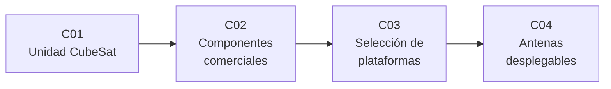

# B95 — Plataformas de satélites pequeños y CubeSat

> **Bloque nuevo de la estructura `0.2.0`.** Sus 4 clases estaban programadas por la ampliación y ahora están redactadas. Ver el [programa completo](../../PROGRAMA_ACADEMICO_COMPLETO.md).

**Programa:** Programa Integral de Astronomía, Astrofísica, Ciencias Espaciales e Ingeniería Aeroespacial
**Área:** A07 — Ingeniería y construcción de sistemas espaciales
**Nivel:** N4 (aplicación de ingeniería) · **Clases:** 4 · **Carga:** por calibrar con el uso
**Estado:** guía pedagógica del bloque (resumen de qué se aprende en cada clase). Las clases enlazadas en la tabla ya están redactadas; todas conservan el estado E0 en el catálogo hasta registrar revisión disciplinar.

## 🎯 Propósito del bloque

Enseña **cómo se define, se equipa y se elige una plataforma de satélite pequeño**. Parte del formato por unidades «U» del CubeSat (volumen, masa y centro de gravedad admitidos y secuencias de seguridad del despliegue), sigue con el uso de componentes comerciales en vuelo y su riesgo de radiación y fiabilidad, pasa a la comparación trazable de plataformas candidatas y cierra con las antenas que se despliegan tras el lanzamiento dentro de un volumen mínimo. Cada clase termina con un laboratorio en Python con datos **sintéticos o ilustrativos rotulados** y, cuando existe, el valor publicado con fuente y fecha.

## 📚 Al terminar el bloque podrás

1. Verificar que una configuración de 1U a 3U cumple volumen, masa, centro de gravedad y tiempos de despliegue del CubeSat Design Specification Rev. 14.1.
2. Contrastar la tolerancia a dosis ionizante de un componente comercial con la dosis de una misión y estimar la supervivencia de un sistema en serie.
3. Comparar plataformas candidatas con restricciones duras, puntajes ponderados y análisis de sensibilidad a los pesos.
4. Dimensionar una antena monopolo de cuarto de onda y su rollo de cinta elástica para que quepa en una cara de 1U.
5. Rotular qué es especificación consultada, qué es dato del fabricante y qué es ilustrativo.

## 🧭 Secuencia del bloque

**Descripción textual.** Cuatro clases encadenadas: el estándar de la plataforma (C01), la elección y el riesgo de sus componentes (C02), la decisión entre plataformas con criterios trazables (C03) y un subsistema crítico que debe plegarse en el volumen disponible (C04).

## 🗂️ Las 4 clases en resumen

**Navegación:** cada clase enlaza a la anterior, a la siguiente y a este bloque.

La columna «Evidencia» indica el producto que demostrará el aprendizaje. Los laboratorios usan datos **sintéticos** o **ilustrativos** (rotulados) o valores publicados con fuente y fecha.

### Tramo 1 · La plataforma y sus componentes

| ID | Clase | Qué se aprende | Evidencia |
|---|---|---|---|
| [B95-C01](../clases/B95/B95-C01-unidad-cubesat-dimensiones-y-formatos/CLASE.md) | Unidad CubeSat, dimensiones y formatos | Masa máxima, centro de gravedad y tiempos de despliegue según el CDS Rev. 14.1. | Ficha de cumplimiento de una configuración de 3U |
| [B95-C02](../clases/B95/B95-C02-componentes-comerciales-en-vuelo-seleccion-y-riesgo/CLASE.md) | Componentes comerciales en vuelo: selección y riesgo | Margen de dosis ionizante y supervivencia de un sistema en serie con y sin redundancia. | Matriz de riesgo de componentes comerciales |

### Tramo 2 · Decidir y desplegar

| ID | Clase | Qué se aprende | Evidencia |
|---|---|---|---|
| [B95-C03](../clases/B95/B95-C03-seleccion-y-comparacion-de-plataformas/CLASE.md) | Selección y comparación de plataformas | Restricciones duras, puntaje ponderado y estabilidad del orden frente a los pesos. | Registro de decisión trazable entre plataformas |
| [B95-C04](../clases/B95/B95-C04-antenas-desplegables-para-satelites-pequenos/CLASE.md) | Antenas desplegables para satélites pequeños | Longitud de un monopolo, rollo de cinta elástica y deformación al plegar. | Ficha de diseño de una antena de cinta para 1U |

## 🧵 Hilos que atraviesan el bloque

- **Restricciones antes que optimización:** cada decisión empieza por lo que el estándar o el lanzador exigen (C01, C03, C04).
- **Observado frente a modelado:** todo número de los laboratorios es un modelo con datos sintéticos o ilustrativos; ninguno es una medición en vuelo.
- **Datos del fabricante no son verificación:** las cifras de dosis y de ganancia de fichas comerciales se citan como declaradas (C02, C04).
- **Verificación independiente:** cada laboratorio contrasta con otra vía de cálculo.

## 📝 Evaluación del bloque (propuesta, por calibrar)

- Fichas y ejercicios por clase, con retroalimentación y recuperación con evidencia distinta.
- Portafolio: el registro de decisión (C03) con sus restricciones, pesos y sensibilidad.
- Las condiciones críticas (rotular lo ilustrativo y sintético, no presentar un modelo como observación y citar solo lo consultado) no se compensan con promedio.

## ⚠️ Seguridad y límites

El bloque es educativo. No sustituye la verificación formal con el proveedor del lanzador o del despliegue, ni los análisis de radiación, estructurales y de licencias de frecuencias que exige una misión real. Las dimensiones de 6U y 12U no se consultaron en los dibujos del CDS y no se usan en los laboratorios.

## 📖 Fuentes consultadas en el bloque (resumen)

Consultadas el 2026-11-10: el CubeSat Design Specification (1U–12U) Rev. 14.1 (Cal Poly, copia alojada por la NASA; leído completo el texto, no los dibujos del Apéndice B) y los capítulos 6 (estructuras y mecanismos), 8 (aviónica) y 9 (comunicaciones) del informe NASA State-of-the-Art of Small Spacecraft Technology (edición 2026) mediante lectura asistida de la página web. Las cifras de fabricantes de esos capítulos son declaradas por ellos y no verificadas por la NASA. El capítulo de plataformas completas no se pudo recuperar y no se consultó. Las relaciones de fiabilidad, decisión multicriterio y antenas son estándar y las verifica cada laboratorio.

## Fuentes de orientación preliminar

- **[NASA-SST]** [NASA Small Spacecraft Systems Virtual Institute — State of the Art](https://www.nasa.gov/smallsat-institute/sst-soa/) — Informe anual de tecnología de naves pequeñas.
- **[CAL-POLY-CDS]** [CubeSat Design Specification Rev. 14.1](https://www.nasa.gov/wp-content/uploads/2018/01/cubesatdesignspecificationrev14_12022-02-09.pdf) — Estándar de la plataforma CubeSat.
- **[ECSS]** [European Cooperation for Space Standardization](https://ecss.nl/) — Normas de ingeniería espacial.
- **[ESA-SCIENCE]** [European Space Agency Science](https://www.esa.int/Science_Exploration/Space_Science) — Misiones y material institucional.

> La asociación de estas fuentes es orientativa por bloque. Las fuentes realmente consultadas para cada afirmación se registran en la sección 11 de cada clase.

## Roles que lo usan

- [Ingeniería y construcción de satélites y CubeSats](../../rutas/ingenieria-y-construccion-de-satelites-y-cubesats.md)

[🏠 Volver al programa](../../README.md) · [➡️ B96 — Control y operación de misiones espaciales](./B96-control-y-operacion-de-misiones-espaciales.md)
