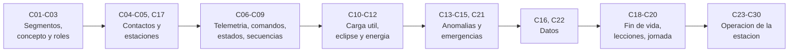

# B96 — Control y operación de misiones espaciales

> **Bloque ampliado.** Sus 30 clases (20 de la línea base y 10 programadas por la ampliación, `B96-C21` a `B96-C30`) están redactadas. Todas conservan el estado E0 en el catálogo hasta registrar revisión disciplinar. Ver el [programa completo](../../PROGRAMA_ACADEMICO_COMPLETO.md).

**Programa:** Programa Integral de Astronomía, Astrofísica, Ciencias Espaciales e Ingeniería Aeroespacial
**Área:** A08 — Astronáutica humana, operaciones, sociedad y futuro espacial
**Nivel:** N3 (fundamentos disciplinares) · **Clases:** 30 · **Carga:** por calibrar con el uso
**Estado:** guía pedagógica del bloque (resumen de qué se aprende en cada clase). Las clases enlazadas en las tablas ya están redactadas; ninguna está impartida ni verificada.

## 🎯 Propósito del bloque

Enseña **cómo se opera una nave y su estación terrestre día a día**: qué hace cada segmento, cómo se escribe un concepto de operaciones, quién ocupa cada posición de la sala de control, cuándo y desde dónde se puede hablar con el satélite, qué se lee en la telemetría y qué comandos se autorizan, cómo se gestionan los modos, las secuencias, la carga útil, el eclipse y la energía, cómo se detecta, se explica y se recupera una anomalía, cómo llegan los datos al centro de procesamiento, cómo se reparten las estaciones, cómo se retira un satélite al final de su vida y qué enseñan los errores pasados. La segunda mitad se ocupa de la **estación terrestre** como sistema operado: continuidad, automatización, seguridad física, incidentes, radiofrecuencia, antena, diagnóstico de enlace y bitácora. Cada clase cierra con un laboratorio en Python con semilla fija: un modelo pequeño y verificable, no un sistema de control de misión.

## 📚 Al terminar el bloque podrás

1. Calcular retardos, ventanas de contacto, Doppler y presupuesto de datos de una pasada y comprobar si un concepto de operaciones cierra.
2. Dimensionar turnos y posiciones, definir parámetros de telemetría con límites y una política de autorización de comandos.
3. Modelar los estados del satélite, las secuencias de pasada, la carga útil, el eclipse y el balance de energía.
4. Detectar, explicar y recuperar anomalías, y razonar con el tiempo disponible en una emergencia.
5. Planificar la transferencia de datos y la asignación de varias estaciones con verificación de integridad.
6. Estimar la disposición al final de la vida y extraer lecciones aprendidas de un caso de error.
7. Analizar la continuidad, la automatización, la seguridad física, los incidentes, la radiofrecuencia, la antena, los fallos de enlace y el registro de una estación.
8. Rotular qué es dato sintético, qué es norma consultada y qué no se consultó.

## 🧭 Secuencia del bloque

**Descripción textual.** Se parte de los segmentos y del concepto de operaciones; se calculan los contactos; se leen telemetría y comandos y se gestionan estados y secuencias; se planifican carga útil, eclipse y energía; se tratan las anomalías y los datos; se cierra la vida de la nave y se simula una jornada; y se termina con la operación de la estación terrestre. El hilo común es que **cada decisión operativa se respalda con un número verificado por otra vía**.

## 🗂️ Las 30 clases en resumen

**Navegación:** cada clase enlaza a la anterior, a la siguiente y a este bloque.

La columna «Evidencia» indica el producto que demostrará el aprendizaje. Los laboratorios usan datos **sintéticos** (rotulados); las normas y documentos citados se registran con fecha en la sección 11 de cada clase.

### Tramo 1 · Segmentos, concepto y organización

| ID | Clase | Qué se aprende | Evidencia |
|---|---|---|---|
| [B96-C01](../clases/B96/B96-C01-segmento-espacial-y-segmento-terrestre/CLASE.md) | Segmento espacial y segmento terrestre | Retardo de propagación, ciclo comando–respuesta y volumen enlazable para LEO, GEO, Luna y Marte. | Ficha de latencias y geometría de los segmentos |
| [B96-C02](../clases/B96/B96-C02-concepto-de-operaciones-de-mision/CLASE.md) | Concepto de operaciones de misión | Presupuesto de contactos y de datos por día de una órbita baja: ¿cierra el concepto de operaciones? | Cuadro de cierre de un concepto de operaciones |
| [B96-C03](../clases/B96/B96-C03-roles-de-control-de-mision/CLASE.md) | Roles de control de misión | Dotación de turnos 24/7 por posición, ausencias y cobertura verificada contra un cronograma. | Plan de dotación con verificación de cobertura |

### Tramo 2 · Contactos y estaciones

| ID | Clase | Qué se aprende | Evidencia |
|---|---|---|---|
| [B96-C04](../clases/B96/B96-C04-planificacion-de-contactos/CLASE.md) | Planificación de contactos | Ventanas de visibilidad de una estación con elevación mínima, por propagación circular y fórmula analítica. | Tabla de contactos de un día |
| [B96-C05](../clases/B96/B96-C05-estaciones-de-seguimiento/CLASE.md) | Estaciones de seguimiento | Azimut, elevación, distancia y Doppler de una pasada; máximos y variación del corrimiento. | Hoja de pasada con Doppler |

### Tramo 3 · Telemetría, comandos y estados

| ID | Clase | Qué se aprende | Evidencia |
|---|---|---|---|
| [B96-C06](../clases/B96/B96-C06-telemetria-operativa/CLASE.md) | Telemetría operativa | Conversión de cuentas a unidades, límites con histéresis y vigilancia de telemetría. | Definición de parámetros y límites de telemetría |
| [B96-C07](../clases/B96/B96-C07-telecomandos-y-autorizaciones/CLASE.md) | Telecomandos y autorizaciones | Matriz rol × criticidad de comandos, regla de dos personas y pruebas exhaustivas de la política. | Política de autorización con prueba exhaustiva |
| [B96-C08](../clases/B96/B96-C08-gestion-de-estados-de-satelite/CLASE.md) | Gestión de estados de satélite | Máquina de estados del satélite, transiciones permitidas y alcanzabilidad de los modos. | Diagrama y tabla de estados con alcanzabilidad |

### Tramo 4 · Secuencias, carga útil, eclipse y energía

| ID | Clase | Qué se aprende | Evidencia |
|---|---|---|---|
| [B96-C09](../clases/B96/B96-C09-secuencias-de-mision/CLASE.md) | Secuencias de misión | Secuencia de pasada con dependencias, camino crítico y holgura frente a la duración del contacto. | Cronograma de secuencia con camino crítico |
| [B96-C10](../clases/B96/B96-C10-planificacion-de-cargas-utiles/CLASE.md) | Planificación de cargas útiles | Selección de observaciones con presupuesto de energía y datos: voraz frente a programación dinámica óptima. | Plan de carga útil con comparación de óptimos |
| [B96-C11](../clases/B96/B96-C11-operacion-durante-eclipse/CLASE.md) | Operación durante eclipse | Fracción y duración de eclipse según altitud y ángulo beta, con comprobación numérica. | Tabla de eclipses por ángulo beta |
| [B96-C12](../clases/B96/B96-C12-gestion-de-energia-en-operaciones/CLASE.md) | Gestión de energía en operaciones | Balance de energía por órbita, estado de carga y profundidad de descarga con carga de operaciones. | Balance de energía operativo |

### Tramo 5 · Anomalías, recuperación y emergencia

| ID | Clase | Qué se aprende | Evidencia |
|---|---|---|---|
| [B96-C13](../clases/B96/B96-C13-deteccion-de-anomalias/CLASE.md) | Detección de anomalías | Detección de anomalías en telemetría con límites, puntuación robusta y CUSUM; aciertos, falsas alarmas y latencia. | Informe de detección con matriz de confusión |
| [B96-C14](../clases/B96/B96-C14-procedimientos-de-recuperacion/CLASE.md) | Procedimientos de recuperación | Procedimiento de recuperación ejecutado paso a paso con verificación, tiempos y ventanas de contacto. | Procedimiento de recuperación con tiempos |
| [B96-C15](../clases/B96/B96-C15-operaciones-de-emergencia/CLASE.md) | Operaciones de emergencia | Tiempo hasta el límite crítico frente a tiempo de respuesta tras pérdida de contacto. | Árbol de decisión de emergencia con tiempos |

### Tramo 6 · Datos y coordinación de estaciones

| ID | Clase | Qué se aprende | Evidencia |
|---|---|---|---|
| [B96-C16](../clases/B96/B96-C16-gestion-de-datos-cientificos/CLASE.md) | Gestión de datos científicos | Reensamblado de paquetes con huecos, completitud, retransmisión y niveles de procesamiento. | Informe de completitud de un conjunto de datos |
| [B96-C17](../clases/B96/B96-C17-coordinacion-de-multiples-estaciones/CLASE.md) | Coordinación de múltiples estaciones | Asignación de pasadas a varias estaciones: intervalos ponderados, voraz frente a óptimo. | Plan de asignación de estaciones |

### Tramo 7 · Fin de vida, lecciones y simulación de una jornada

| ID | Clase | Qué se aprende | Evidencia |
|---|---|---|---|
| [B96-C18](../clases/B96/B96-C18-fin-de-vida-y-disposicion-orbital/CLASE.md) | Fin de vida y disposición orbital | Δv de retiro, decaimiento por arrastre con atmósfera sintética y verificación por dos pasos de integración. | Plan de disposición con tiempo de decaimiento |
| [B96-C19](../clases/B96/B96-C19-lecciones-aprendidas-operativas/CLASE.md) | Lecciones aprendidas operativas | Error de unidades (lbf·s frente a N·s) acumulado en una maniobra y la defensa con magnitudes etiquetadas. | Caso de lección aprendida con su defensa |
| [B96-C20](../clases/B96/B96-C20-simulacion-de-jornada-de-control-de-mision/CLASE.md) | Simulación de jornada de control de misión | Simulación de eventos discretos de una jornada: pasadas, comandos, telemetría y anomalías, con indicadores. | Informe de jornada simulada |

### Tramo 8 · Diagnóstico, transferencia y continuidad

| ID | Clase | Qué se aprende | Evidencia |
|---|---|---|---|
| [B96-C21](../clases/B96/B96-C21-diagnostico-explicable-de-anomalias/CLASE.md) | Diagnóstico explicable de anomalías | Diagnóstico bayesiano con explicación: aporte de cada síntoma a la conclusión y verificación de la suma. | Informe de diagnóstico con explicación |
| [B96-C22](../clases/B96/B96-C22-transferencia-de-datos-entre-estacion-y-centro-de-datos/CLASE.md) | Transferencia de datos entre estación y centro de datos | Transferencia por trozos con pérdida, verificación con hash SHA-256 y plazo esperado frente a simulado. | Plan de transferencia con plazo y verificación |
| [B96-C23](../clases/B96/B96-C23-continuidad-y-redundancia-de-las-operaciones-terrestres/CLASE.md) | Continuidad y redundancia de las operaciones terrestres | Disponibilidad de estaciones en serie y paralelo, y probabilidad de perder un contacto, con Monte Carlo. | Cálculo de continuidad con verificación |
| [B96-C24](../clases/B96/B96-C24-operacion-remota-y-automatizada-de-estaciones/CLASE.md) | Operación remota y automatizada de estaciones | Ejecutor automático de pasada con tiempos límite, reintentos y cancelación manual, probado con fallos inyectados. | Ejecutor de pasada con casos de fallo |

### Tramo 9 · Seguridad, incidentes y radiofrecuencia

| ID | Clase | Qué se aprende | Evidencia |
|---|---|---|---|
| [B96-C25](../clases/B96/B96-C25-seguridad-fisica-y-control-de-acceso-de-estaciones-terrestres/CLASE.md) | Seguridad física y control de acceso de estaciones terrestres | Capas de protección física: probabilidad de interrupción y comparación entre retardo y tiempo de respuesta. | Evaluación de capas con margen de tiempo |
| [B96-C26](../clases/B96/B96-C26-gestion-de-incidentes-en-la-operacion-de-estaciones/CLASE.md) | Gestión de incidentes en la operación de estaciones | Cola de incidentes con prioridades, tiempos de detección y resolución, contrastada con la teoría M/M/1. | Indicadores de gestión de incidentes |
| [B96-C27](../clases/B96/B96-C27-operacion-de-equipos-de-radiofrecuencia-en-la-estacion/CLASE.md) | Operación de equipos de radiofrecuencia en la estación | PIRE, pérdida en espacio libre, relación Eb/N0 y margen de enlace; límite de potencia y conversión de decibelios. | Hoja de operación de RF con margen |

### Tramo 10 · Antena, enlace y registro

| ID | Clase | Qué se aprende | Evidencia |
|---|---|---|---|
| [B96-C28](../clases/B96/B96-C28-control-y-seguimiento-de-la-antena-de-estacion/CLASE.md) | Control y seguimiento de la antena de estación | Velocidades de azimut y elevación de una pasada, paso por el cénit y pérdida por error de apuntamiento. | Informe de seguimiento de antena |
| [B96-C29](../clases/B96/B96-C29-diagnostico-de-fallas-de-enlace/CLASE.md) | Diagnóstico de fallas de enlace | Diccionario de firmas de falla de enlace y clasificación por mínima distancia con ruido, evaluada por Monte Carlo. | Árbol de diagnóstico de enlace con exactitud medida |
| [B96-C30](../clases/B96/B96-C30-registro-y-auditoria-de-operaciones/CLASE.md) | Registro y auditoría de operaciones | Registro con cadena de hashes, detección de manipulación y consulta de auditoría. | Bitácora verificable con prueba de manipulación |

## 🧵 Hilos que atraviesan el bloque

- **Tiempo y ventanas:** C01, C04, C05, C09, C14, C15 y C17 dependen de cuánto dura el contacto y de cuándo ocurre.
- **Márgenes y recursos:** C10, C11, C12, C15 y C27 llevan energía, datos y enlace a una tabla de margen.
- **Detección, diagnóstico y recuperación:** C13, C14, C21 y C29 separan síntoma, causa y acción.
- **Integridad y trazabilidad:** C07, C16, C22 y C30 usan verificaciones (autorización, hash, registro) para poder confiar en un dato o un comando.
- **Continuidad de la estación:** C17, C23, C24, C25 y C26 tratan la estación como un sistema que también falla.
- **Defensa:** C07, C25 y C30 se mantienen en la defensa y el control de acceso; ninguna ofrece técnicas contra sistemas reales.

## 📝 Evaluación del bloque (propuesta, por calibrar)

- Fichas y ejercicios por clase, con retroalimentación y recuperación con evidencia distinta.
- Portafolio: la tabla de contactos (C04), el balance de energía (C12) y el informe de jornada simulada (C20), con sus supuestos y su sensibilidad.
- Las condiciones críticas (rotular lo sintético, no presentar una simulación como dato de vuelo, no afirmar conformidad normativa y citar solo lo consultado) no se compensan con promedio.

## ⚠️ Seguridad y límites

El bloque es educativo. Las órbitas son circulares y keplerianas, la Tierra es esférica o con un modelo simple, las atmósferas, las potencias, las tasas de fallo y las tarifas son sintéticas, y no sustituyen a las normas, a las efemérides reales ni a la revisión de especialistas. Las clases no certifican conformidad con ECSS, NASA ni CCSDS, y no sirven para operar un satélite ni una estación reales. Los casos de seguridad (C07, C25, C30) se limitan a la defensa y a objetos sintéticos. Las normas se consultaron únicamente en su página de resumen; el resto se rotula «no consultado».

## 📖 Fuentes consultadas en el bloque (resumen)

Consultadas el 2026-11-10: las páginas de ECSS-E-ST-70-11C (operabilidad del segmento espacial), ECSS-E-ST-70-31C (datos de vigilancia y control), ECSS-E-ST-70-32C (lenguaje de procedimientos PLUTO), ECSS-E-ST-70-01C (procedimientos de control a bordo) y ECSS-E-ST-70-41C (paquetes de telemetría y telecomando); los capítulos «Ground Data Systems and Mission Operations» y «Power» del informe *State-of-the-Art of Small Spacecraft Technology* de la NASA; la página de mitigación de desechos orbitales del Programa de Desechos Orbitales de la NASA; y la página de la misión Mars Climate Orbiter. De las normas solo se consultó el resumen de la página, no el texto de los requisitos. Las relaciones de geometría orbital, enlace, eclipse, colas, fiabilidad y criptografía que usan los laboratorios son estándar y las verifica cada laboratorio; no se consultaron en una fuente concreta. No se consultaron los documentos del CCSDS (la dirección probada redirigió y no se siguió), las directrices del IADC (respondió 403), la norma ISO 24113 (la dirección probada respondió 404) ni el sistema de lecciones aprendidas de la NASA (la página no devolvió contenido).

## Fuentes de orientación preliminar

- **[NASA-HUMAN]** [NASA Human Research Program](https://www.nasa.gov/hrp/) — Factores humanos, medicina y riesgos de exploración tripulada.
- **[UNOOSA]** [United Nations Office for Outer Space Affairs](https://www.unoosa.org/) — Tratados, regulación e iniciativas de cooperación internacional.
- **[ITU]** [International Telecommunication Union](https://www.itu.int/) — Telecomunicaciones y coordinación del espectro internacional.
- **[NASA-SYSTEMS]** [NASA Systems Engineering Handbook](https://www.nasa.gov/reference/systems-engineering-handbook/) — Ingeniería de sistemas, verificación, validación y gestión técnica.

> La asociación de estas fuentes es orientativa por bloque. Las fuentes realmente consultadas para cada afirmación se registran en la sección 11 de cada clase.

[🏠 Volver al programa](../../README.md)
