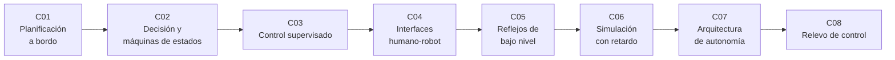

# B98 — Autonomía y teleoperación espacial

> **Bloque nuevo de la estructura vigente.** Sus 8 clases estaban programadas por la ampliación y ahora están redactadas. Ver el [programa completo](../../PROGRAMA_ACADEMICO_COMPLETO.md).

**Programa:** Programa Integral de Astronomía, Astrofísica, Ciencias Espaciales e Ingeniería Aeroespacial
**Área:** A08 — Operaciones de misión y robótica espacial
**Nivel:** N3 (fundamentos disciplinares) · **Clases:** 8 · **Carga:** por calibrar con el uso
**Estado:** guía pedagógica del bloque (resumen de qué se aprende en cada clase). Las clases enlazadas en la tabla ya están redactadas; todas conservan el estado E0 en el catálogo hasta registrar revisión disciplinar.

## 🎯 Propósito del bloque

Enseña **cómo decidir qué hace un vehículo espacial cuando la Tierra no puede responder a tiempo** y cómo repartir el control entre el vehículo y las personas que lo operan. Recorre la planificación por objetivos a bordo, las máquinas de estados y los árboles de comportamiento, el control supervisado, el diseño de interfaces para operar a distancia, los reflejos de bajo nivel que sostienen la operación con retardo, la simulación de teleoperación con retardo y pérdida de paquetes, la arquitectura de software de autonomía y los protocolos de relevo de control entre operadores. Cada clase cierra con un laboratorio en Python (solo biblioteca estándar, semilla fija) cuyos datos son sintéticos o ilustrativos y están rotulados.

## 📚 Al terminar el bloque podrás

1. Seleccionar y secuenciar objetivos bajo presupuestos de energía y tiempo, y replanificar tras un fallo.
2. Modelar un comportamiento como máquina de estados o árbol de comportamiento y comprobar sus invariantes de seguridad.
3. Comparar el tiempo de una tarea con teleoperación «mover y esperar» frente a control supervisado, con el retardo de luz calculado.
4. Evaluar una interfaz de operación remota por la antigüedad del dato que muestra y por su carga de alarmas.
5. Dimensionar un reflejo a bordo a partir del ciclo de control, la distancia de frenado y el alcance del sensor.
6. Simular una operación con retardo y pérdida de paquetes y reportar la distribución de tiempos.
7. Verificar que una arquitectura de tres capas cumple sus presupuestos de tiempo.
8. Diseñar un relevo de control con autoridad única y comprobar sus invariantes.
9. Rotular qué es dato consultado, qué es modelo y qué es sintético en cada resultado.

## 🧭 Secuencia del bloque

**Descripción textual.** Ocho clases encadenadas: qué decide el vehículo (C01, C02), cómo se reparte el control con el operador (C03, C04), qué lo protege mientras la Tierra no puede actuar (C05), cómo se prueba todo con retardo (C06), cómo se organiza el software (C07) y cómo se traspasa el control entre personas (C08). El hilo común es el retardo de luz y el reparto de la autoridad.

## 🗂️ Las 8 clases en resumen

**Navegación:** cada clase enlaza a la anterior, a la siguiente y a este bloque.

La columna «Evidencia» indica el producto que demostrará el aprendizaje. Los laboratorios usan datos **sintéticos** o **ilustrativos** (rotulados) o valores publicados con fuente y fecha.

### Tramo 1 · Qué decide el vehículo

| ID | Clase | Qué se aprende | Evidencia |
|---|---|---|---|
| [B98-C01](../clases/B98/B98-C01-planificacion-por-objetivos-a-bordo/CLASE.md) | Planificación por objetivos a bordo | Selección de objetivos con presupuesto de energía y tiempo, y replanificación tras un fallo. | Ficha de plan a bordo con su plan de contingencia |
| [B98-C02](../clases/B98/B98-C02-sistemas-de-decision-autonomos-y-maquinas-de-estados-de-comportamiento/CLASE.md) | Sistemas de decisión autónomos y máquinas de estados de comportamiento | Reglas, máquinas de estados y árboles de comportamiento con invariantes de seguridad. | Diagrama de estados verificado de un comportamiento |

### Tramo 2 · Repartir el control con las personas

| ID | Clase | Qué se aprende | Evidencia |
|---|---|---|---|
| [B98-C03](../clases/B98/B98-C03-control-supervisado-y-autonomia-compartida/CLASE.md) | Control supervisado y autonomía compartida | Retardo de luz, «mover y esperar» frente a metas supervisadas y niveles de automatización. | Comparación de tiempos de una tarea con retardo |
| [B98-C04](../clases/B98/B98-C04-interfaces-humano-robot-para-operacion-remota/CLASE.md) | Interfaces humano-robot para operación remota | Antigüedad del dato mostrado, visualización predictiva y priorización de alarmas. | Evaluación de una interfaz por antigüedad y carga de alarmas |
| [B98-C05](../clases/B98/B98-C05-autonomia-de-bajo-nivel-y-comportamientos-reactivos/CLASE.md) | Autonomía de bajo nivel y comportamientos reactivos | Distancia de frenado, ciclo de control, histéresis y reflejo frente a intervención desde Tierra. | Dimensionamiento de un reflejo de parada |

### Tramo 3 · Probar, estructurar y traspasar

| ID | Clase | Qué se aprende | Evidencia |
|---|---|---|---|
| [B98-C06](../clases/B98/B98-C06-simulacion-de-teleoperacion-con-retardo/CLASE.md) | Simulación de teleoperación con retardo | Simulación con retardo y pérdida de paquetes, y distribución de tiempos de finalización. | Informe de una campaña simulada con su incertidumbre |
| [B98-C07](../clases/B98/B98-C07-arquitectura-de-autonomia-a-bordo-percepcion-decision-accion/CLASE.md) | Arquitectura de autonomía a bordo (percepción-decisión-acción) | Capas deliberativa, ejecutiva y reactiva con sus ritmos y presupuestos de tiempo. | Presupuesto de tiempos de una arquitectura de tres capas |
| [B98-C08](../clases/B98/B98-C08-protocolos-de-relevo-de-control-entre-operadores/CLASE.md) | Protocolos de relevo de control entre operadores | Autoridad única, traspaso con confirmación y pérdida de información en el relevo. | Protocolo de relevo con sus invariantes |

## 🧵 Hilos que atraviesan el bloque

- **Retardo de luz:** `t = d/c` con las distancias de la ficha de Marte en C03, C05 y C06.
- **Reparto de la autoridad:** quién decide en cada instante (C01–C03, C08).
- **Lo reactivo protege lo deliberativo:** C05 y C07.
- **Observado frente a modelado:** todo número de las simulaciones es un modelo con datos sintéticos; ninguno procede de una misión.
- **Verificación independiente:** cada laboratorio contrasta con un caso analítico o con otra vía de cálculo.

## 📝 Evaluación del bloque (propuesta, por calibrar)

- Fichas y ejercicios por clase, con retroalimentación y recuperación con evidencia distinta.
- Portafolio: el protocolo de relevo (C08) con sus invariantes y la campaña simulada (C06) con su incertidumbre.
- Las condiciones críticas (rotular lo sintético, no presentar una simulación como operación real y citar solo lo consultado) no se compensan con promedio.

## ⚠️ Seguridad y límites

El bloque es educativo. Los modelos son simplificados (rovers y enlaces genéricos, probabilidades sintéticas) y no sustituyen a las normas de operaciones ni a los procedimientos de una misión real. Ningún laboratorio describe una misión concreta. Los estándares ECSS y los trabajos citados se consultaron solo a nivel de ficha o resumen.

## 📖 Fuentes consultadas en el bloque (resumen)

Consultadas el 2026-11-10: la ficha de Marte de NASA/NSSDC (distancias mínima y máxima a la Tierra; el tiempo de luz no figura y se calcula), el valor exacto de `c` de CODATA 2022 (NIST), el resumen de Muscettola et al. (1998) sobre el Remote Agent, el resumen de Colledanchise y Ögren sobre árboles de comportamiento (arXiv), resúmenes de Parasuraman, Sheridan y Wickens (2000) y de Goodrich y Schultz (2007) obtenidos por búsqueda web, y la ficha pública de ECSS-E-ST-70-11C Rev.1 (2025). De ninguno se leyó el texto completo. No se consultaron el PUS (ECSS-E-ST-70-41C), los procedimientos de relevo de ninguna agencia, ni la arquitectura de tres capas de Gat ni CLARAty.

## Fuentes de orientación preliminar

- **[ECSS]** [ECSS — European Cooperation for Space Standardization](https://ecss.nl/) — Normas de ingeniería y operaciones espaciales.
- **[NASA-NTRS]** [NASA Technical Reports Server](https://ntrs.nasa.gov/) — Informes técnicos de la NASA.
- **[CCSDS]** [Consultative Committee for Space Data Systems](https://public.ccsds.org/) — Estándares de datos y enlaces espaciales.
- **[ESA-OPS]** [ESA — Operaciones](https://www.esa.int/Enabling_Support/Operations) — Operaciones de misión.

> La asociación de estas fuentes es orientativa por bloque. Las fuentes realmente consultadas para cada afirmación se registran en la sección 11 de cada clase.

## Roles que lo usan

- [Navegación guiado y autonomía espacial](../../rutas/navegacion-guiado-y-autonomia-espacial.md)
- [Robótica espacial y sistemas autónomos](../../rutas/robotica-espacial-y-sistemas-autonomos.md)
- [Astronáutica tripulada y entrenamiento de astronautas](../../rutas/astronautica-tripulada-y-entrenamiento-de-astronautas.md)

[🏠 Volver al programa](../../README.md) · [➡️ B99 — Localización y mapeo robótico](./B99-localizacion-y-mapeo-robotico.md)
