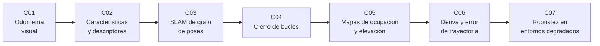

# B99 — Localización y mapeo robótico

> **Bloque nuevo de la estructura `0.2.0`.** Sus 7 clases estaban programadas por la ampliación y ahora están redactadas. Ver el [programa completo](../../PROGRAMA_ACADEMICO_COMPLETO.md).

**Programa:** Programa Integral de Astronomía, Astrofísica, Ciencias Espaciales e Ingeniería Aeroespacial
**Área:** A08 — Operaciones de misión y robótica espacial
**Nivel:** N3 (fundamentos disciplinares) · **Clases:** 7 · **Carga:** por calibrar con el uso
**Estado:** guía pedagógica del bloque (resumen de qué se aprende en cada clase). Las clases enlazadas en la tabla ya están redactadas; todas conservan el estado E0 en el catálogo hasta registrar revisión disciplinar.

## 🎯 Propósito del bloque

Enseña **cómo un robot sabe dónde está y qué lo rodea cuando no hay GPS**, como en la superficie de la Luna o de Marte. Parte de la estimación del movimiento a partir de observaciones consecutivas (odometría visual) y de las características locales que permiten emparejarlas, sigue con el SLAM como problema de optimización sobre un grafo de poses y con el cierre de bucles que corrige la deriva, pasa a los mapas que usa la navegación (rejillas de ocupación y de elevación), y termina con dos preguntas de ingeniería: cómo se mide el error de una trayectoria (ATE y RPE) y qué le pasa al mapeo cuando el entorno se degrada (texturas pobres, polvo, cambios de luz). Cada clase cierra con un laboratorio en Python con semilla fija, datos **sintéticos** rotulados y una comprobación independiente.

## 📚 Al terminar el bloque podrás

1. Estimar el movimiento relativo entre dos observaciones con un ajuste de cuerpo rígido, rechazar correspondencias erróneas con RANSAC y medir cómo se acumula la deriva.
2. Detectar esquinas, describirlas y emparejarlas con la prueba de razón de distancias, y medir precisión y exhaustividad contra una verdad sintética.
3. Plantear un SLAM de grafo de poses y resolverlo con Gauss–Newton, comprobando el Jacobiano y la caída del error.
4. Decidir cuándo aceptar un cierre de bucle y ver qué le hace un cierre falso al mapa global.
5. Construir una rejilla de ocupación con log-odds y una rejilla de elevación con pendiente y rugosidad.
6. Calcular ATE y RPE con alineación previa y distinguir qué error mide cada uno.
7. Comparar estimadores (mínimos cuadrados, Huber, RANSAC) con valores atípicos y detectar la degeneración de un pasillo sin rasgos.
8. Rotular qué es sintético, qué es método consultado y qué no se consultó en cada resultado.

## 🧭 Secuencia del bloque

**Descripción textual.** Siete clases encadenadas: estimar movimiento (C01), obtener las correspondencias que lo hacen posible (C02), fusionar las estimaciones en un grafo (C03), corregir la deriva con cierres de bucle (C04), representar el entorno para navegar (C05), medir qué tan bien se hizo (C06) y qué pasa cuando las condiciones empeoran (C07).

## 🗂️ Las 7 clases en resumen

**Navegación:** cada clase enlaza a la anterior, a la siguiente y a este bloque.

La columna «Evidencia» indica el producto que demostrará el aprendizaje. Los laboratorios usan datos **sintéticos** (rotulados); ninguno es una medición de un rover real.

### Tramo 1 · Estimar el movimiento

| ID | Clase | Qué se aprende | Evidencia |
|---|---|---|---|
| [B99-C01](../clases/B99/B99-C01-odometria-visual/CLASE.md) | Odometría visual | Ajuste de cuerpo rígido entre observaciones, RANSAC y acumulación de deriva. | Ficha de deriva de una trayectoria estimada |
| [B99-C02](../clases/B99/B99-C02-deteccion-y-descriptores-de-caracteristicas/CLASE.md) | Detección y descriptores de características | Esquinas de Harris, descriptor de parche y prueba de razón de distancias. | Curva de precisión y exhaustividad de emparejamiento |

### Tramo 2 · Mapa globalmente consistente

| ID | Clase | Qué se aprende | Evidencia |
|---|---|---|---|
| [B99-C03](../clases/B99/B99-C03-slam-basado-en-grafos-de-poses/CLASE.md) | SLAM basado en grafos de poses | Aristas, error e información; Gauss–Newton y verificación del Jacobiano. | Grafo de poses optimizado con su ATE |
| [B99-C04](../clases/B99/B99-C04-cierre-de-bucles-y-consistencia-global/CLASE.md) | Cierre de bucles y consistencia global | Reconocimiento de lugares, verificación geométrica y daño de un cierre falso. | Tabla de decisión de cierres de bucle |
| [B99-C05](../clases/B99/B99-C05-mapas-de-ocupacion-y-rejillas-de-elevacion/CLASE.md) | Mapas de ocupación y rejillas de elevación | Log-odds, trazado de rayos, pendiente y rugosidad del terreno. | Mapa de ocupación y de traversabilidad sintéticos |

### Tramo 3 · Evaluar y endurecer

| ID | Clase | Qué se aprende | Evidencia |
|---|---|---|---|
| [B99-C06](../clases/B99/B99-C06-evaluacion-de-deriva-y-error-de-trayectoria/CLASE.md) | Evaluación de deriva y error de trayectoria | Alineación, ATE, RPE y deriva por distancia recorrida. | Informe ATE/RPE de dos estimadores |
| [B99-C07](../clases/B99/B99-C07-robustez-del-mapeo-ante-entornos-degradados/CLASE.md) | Robustez del mapeo ante entornos degradados | Huber y RANSAC frente a atípicos, degeneración de pasillo e invariancia a la luz. | Tabla de robustez frente a atípicos y degeneración |

## 🧵 Hilos que atraviesan el bloque

- **La deriva se acumula y el cierre de bucle la corrige:** C01 la mide, C03 y C04 la corrigen, C06 la cuantifica.
- **Correspondencias:** de ellas depende todo; C02 las produce y C07 estudia qué hacer cuando fallan.
- **Observado frente a modelado:** todo dato del bloque es sintético; ningún número es una medición de un robot real.
- **Verificación independiente:** cada laboratorio contrasta con un caso analítico, un Jacobiano numérico o otra vía de cálculo.

## 📝 Evaluación del bloque (propuesta, por calibrar)

- Fichas y ejercicios por clase, con retroalimentación y recuperación con evidencia distinta.
- Portafolio: el informe ATE/RPE (C06) comparando odometría sola y grafo optimizado, con sus supuestos.
- Las condiciones críticas (rotular lo sintético, verificar con una comprobación independiente y citar solo lo consultado) no se compensan con promedio.

## ⚠️ Seguridad y límites

El bloque es educativo. Los laboratorios son 2D, con ruido gaussiano y entornos sintéticos; usan versiones simplificadas de los métodos (descriptor de parche en lugar de SIFT u ORB, ajuste de cuerpo rígido en lugar de la geometría epipolar completa) y no reproducen el rendimiento de sistemas reales. Nada sustituye la literatura primaria, la validación con datos de misión ni la revisión de especialistas antes de usar un método en un vehículo.

## 📖 Fuentes consultadas en el bloque (resumen)

Consultadas el 2026-11-10: Cadena et al. (2016), revisión del SLAM (resumen en arXiv); la página de herramientas de evaluación del conjunto TUM RGB-D (definición de ATE y RPE); Lowe (2004), SIFT (PDF, con PyMuPDF); Grisetti et al., tutorial de SLAM basado en grafos (PDF); Hornung et al. (2013), OctoMap (PDF); Scaramuzza y Fraundorfer, Visual Odometry Part I (PDF); y Mur-Artal et al. (2015), ORB-SLAM (PDF de arXiv). No se consultó el artículo de ORB de Rublee et al. ni los trabajos de odometría visual de los rovers de Marte, ni Umeyama (1991) ni Horn (1987): sus métodos aparecen como relaciones estándar que verifica cada laboratorio.

## Fuentes de orientación preliminar

- **[NASA-PDS]** [NASA Planetary Data System](https://pds.nasa.gov/) — Archivo de datos de misiones planetarias.
- **[ESA-SCIENCE]** [European Space Agency Science](https://www.esa.int/Science_Exploration/Space_Science) — Misiones, descubrimientos y material científico institucional.
- **[CCSDS]** [Consultative Committee for Space Data Systems](https://ccsds.org/publications/) — Protocolos, recomendaciones y estándares de intercambio de datos espaciales.

> La asociación de estas fuentes es orientativa por bloque. Las fuentes realmente consultadas para cada afirmación se registran en la sección 11 de cada clase.

## Roles que lo usan

- [Robótica espacial y sistemas autónomos](../../rutas/robotica-espacial-y-sistemas-autonomos.md)

[🏠 Volver al programa](../../README.md) · [➡️ B100 — Logística y cadena de suministro extraterrestre](./B100-logistica-y-cadena-de-suministro-extraterrestre.md)
