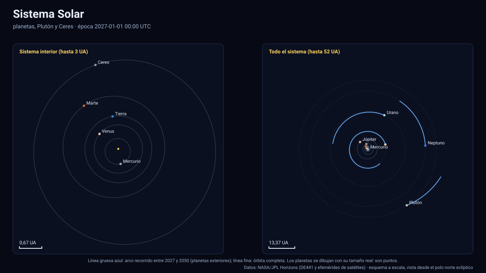

# 🪐 Simuladores del Sistema Solar 2027–2050

Siete simuladores interactivos en **JavaScript puro** (sin dependencias ni servidores) que funcionan en **GitHub Pages**. Dibujan posiciones **oficiales** de NASA/JPL Horizons entre el **1 de enero de 2027** y el **31 de diciembre de 2050**, con **tamaños y distancias reales**, y cada número está validado de forma automática.

[🌐 Abrir los simuladores](https://vladimiracunadev-create.github.io/astronomy-astrophysics-space-sciences-aerospace-engineering-learning-program/simuladores/index.html) · [📖 Documentación](documentacion/README.md) · [📏 Estándar](../documentacion/ESTANDAR_DE_SIMULADORES.md)

| Simulador | Qué muestra | Documentación |
|---|---|---|
| [**Sistema Solar**](https://vladimiracunadev-create.github.io/astronomy-astrophysics-space-sciences-aerospace-engineering-learning-program/simuladores/sistema-solar.html) | Sol, ocho planetas, Plutón, Ceres y la Luna; oposiciones; distancia, elongación y fase desde la Tierra | [sistema-solar.md](documentacion/sistema-solar.md) |
| [**Tierra · Sol · Luna**](https://vladimiracunadev-create.github.io/astronomy-astrophysics-space-sciences-aerospace-engineering-learning-program/simuladores/tierra-sol-luna.html) | Fases, eclipses, estaciones, perihelio y afelio; validados con la NASA y el U.S. Naval Observatory | [tierra-sol-luna.md](documentacion/tierra-sol-luna.md) |
| [**Marte y sus dos lunas**](https://vladimiracunadev-create.github.io/astronomy-astrophysics-space-sciences-aerospace-engineering-learning-program/simuladores/marte.html) | Fobos y Deimos, longitud solar Ls y estaciones marcianas | [marte.md](documentacion/marte.md) |
| [**Júpiter y sus lunas**](https://vladimiracunadev-create.github.io/astronomy-astrophysics-space-sciences-aerospace-engineering-learning-program/simuladores/jupiter.html) | 115 lunas, anillos y eclipses por la sombra del planeta | [jupiter.md](documentacion/jupiter.md) |
| [**Saturno y sus lunas**](https://vladimiracunadev-create.github.io/astronomy-astrophysics-space-sciences-aerospace-engineering-learning-program/simuladores/saturno.html) | 291 lunas y los anillos D a E; el Sol cruza el plano de los anillos en 2039 | [saturno.md](documentacion/saturno.md) |
| [**Urano y sus lunas**](https://vladimiracunadev-create.github.io/astronomy-astrophysics-space-sciences-aerospace-engineering-learning-program/simuladores/urano.html) | 28 lunas, diez anillos y el eje a 97,8°; solsticio hacia 2030 | [urano.md](documentacion/urano.md) |
| [**Neptuno y sus lunas**](https://vladimiracunadev-create.github.io/astronomy-astrophysics-space-sciences-aerospace-engineering-learning-program/simuladores/neptuno.html) | 16 lunas: Tritón retrógrada, Nereida excéntrica, anillos | [neptuno.md](documentacion/neptuno.md) |



## Qué los hace distintos

- **Datos oficiales, medidos.** Las posiciones salen de JPL Horizons (DE441 y efemérides de satélites), se interpolan con Lagrange de 10 puntos y cada cuerpo lleva su error medido contra JPL en épocas que no son nodos: [tabla de precisión de 463 cuerpos](documentacion/TABLA_DE_PRECISION.md).
- **Validados con fuentes independientes**: 109 eclipses de 2027–2050 contra el catálogo de la NASA (hora ≤ 0,8 min), 1 187 fases de la Luna, 96 equinoccios y solsticios y 48 ápsides contra el U.S. Naval Observatory (≤ 1,6 min), perihelios de Marte con Ls = 251°, y oposiciones de Marte.
- **Realistas.** Tamaños y distancias reales; los factores de ampliación son opciones visibles y siempre rotuladas. Las texturas, los anillos y el fondo son ilustrativos y así se declara.
- **Honestos con los huecos.** Las lunas sin efemérides hasta 2050 se ocultan tras su fecha final (10 de Saturno) y Dafne se excluye: nunca se inventa una posición.
- **Autónomos.** Sin dependencias, sin CDN, sin servidor: GitHub Pages sirve archivos estáticos.

## Estructura

| Carpeta | Contenido |
|---|---|
| `datos/` | Efemérides de JPL empaquetadas (`.json` + `.bin`, 40 MB en total) y el archivo de verificación |
| `motor/` | Motor común: tiempo, interpolación, cámara 3D, esferas iluminadas, eclipses, astronomía |
| `paginas/` | Configuración de cada simulador |
| `pruebas/` | Pruebas en Node (sin red) contra JPL, la NASA y el USNO |
| `img/` | Figuras SVG a escala generadas desde los datos |
| `documentacion/` | Documentación completa |

## Ejecutar y validar

```bash
cd simuladores && python -m http.server 8000   # abrir http://localhost:8000/
```

```bash
python herramientas/validar_simuladores.py     # desde la raíz: datos, motor, páginas, enlaces y figuras
```

Código Apache-2.0; documentación CC BY-NC-SA 4.0; datos de NASA/JPL y Natural Earth en dominio público (véase [DATA_LICENSES.md](../DATA_LICENSES.md)). Los simuladores son material de apoyo: no sirven para planificar misiones ni habilitan decisiones de vuelo.
