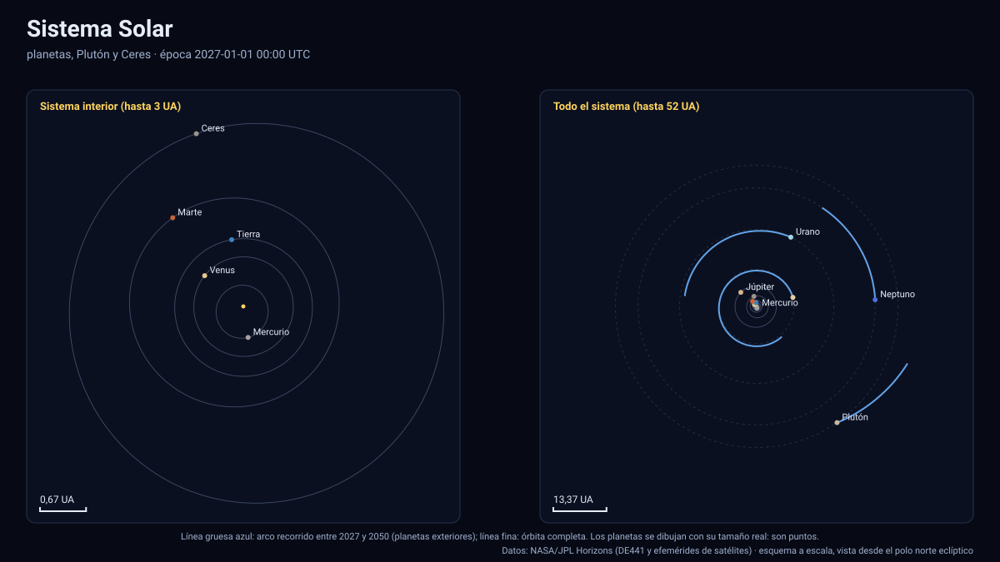
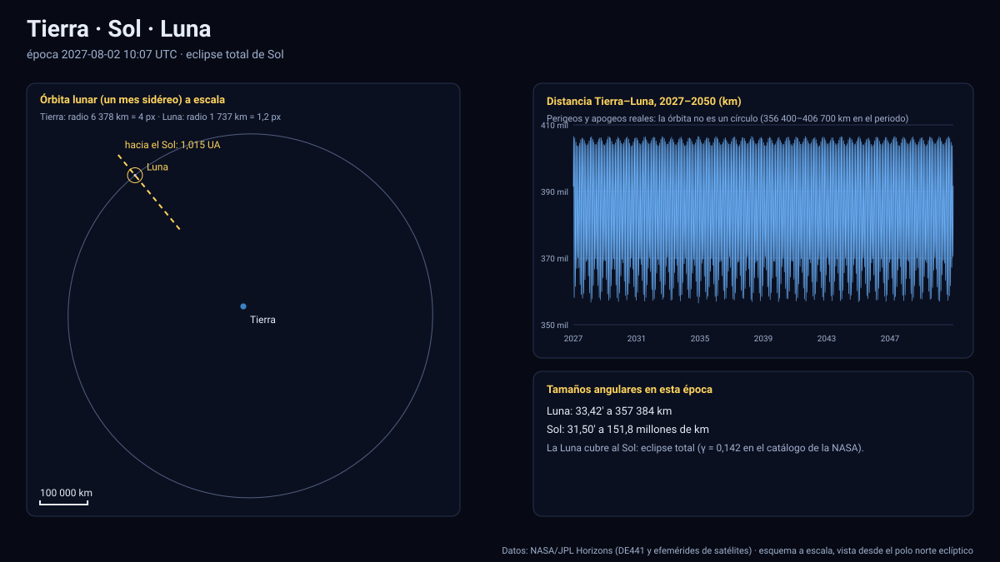
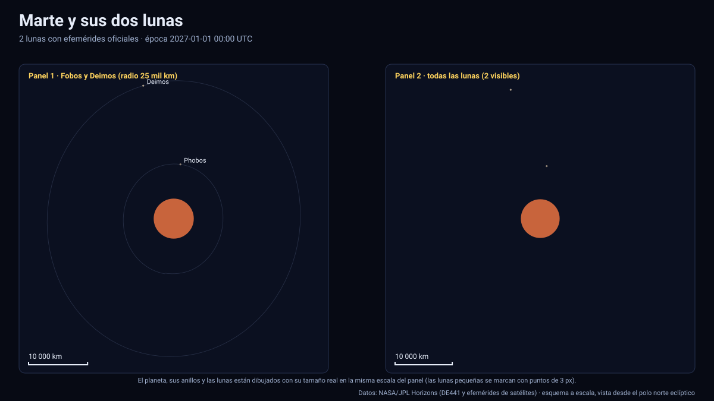
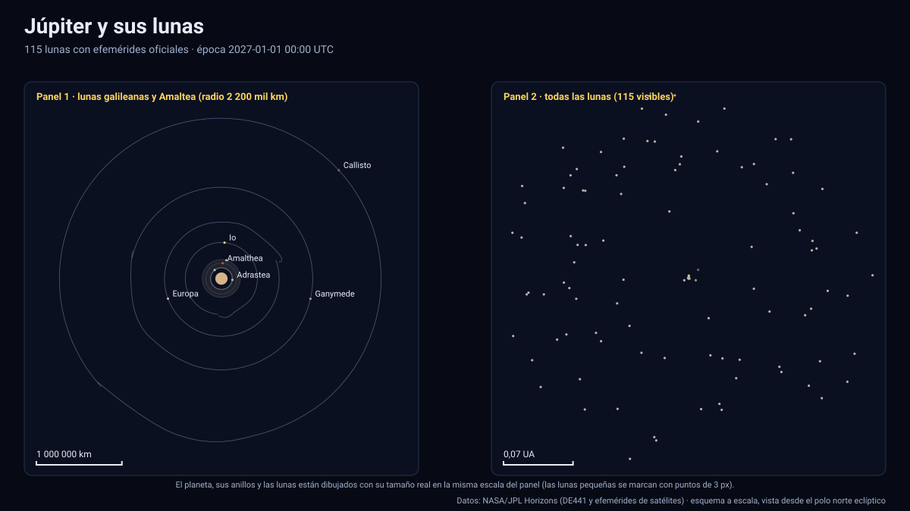
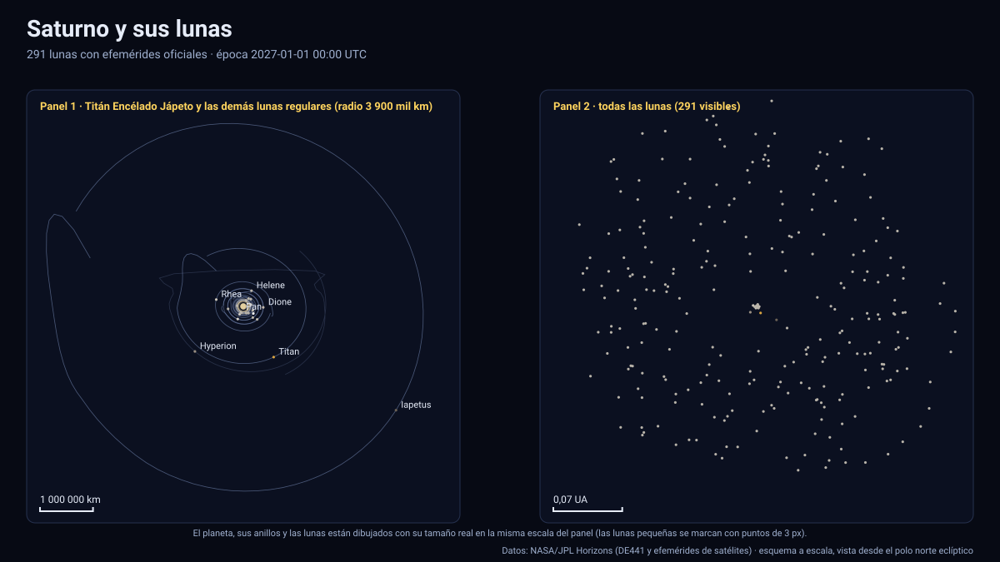
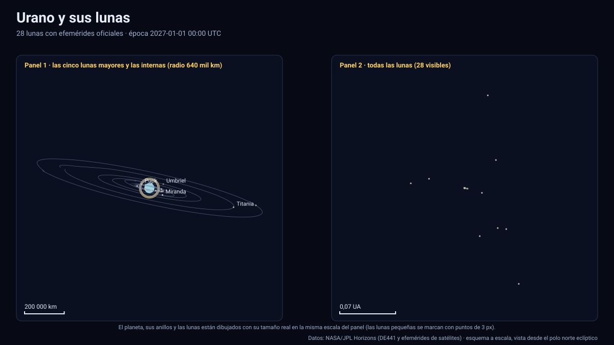
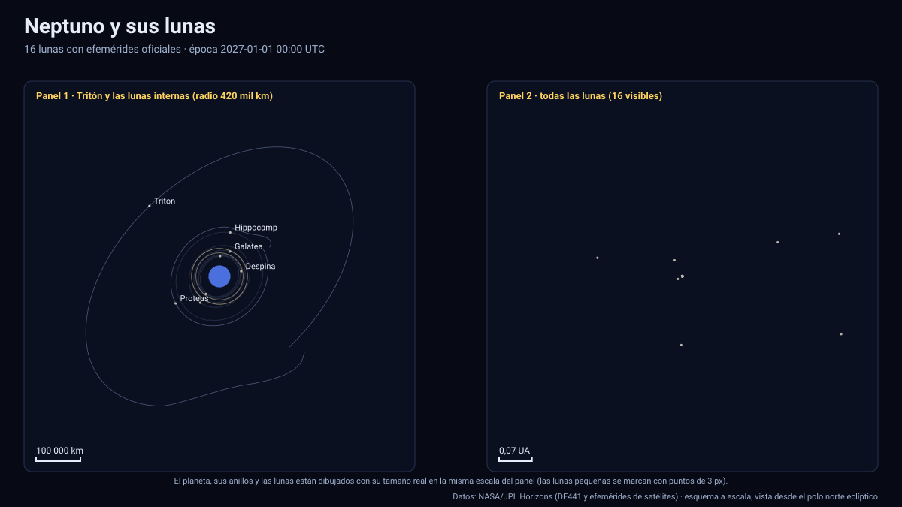
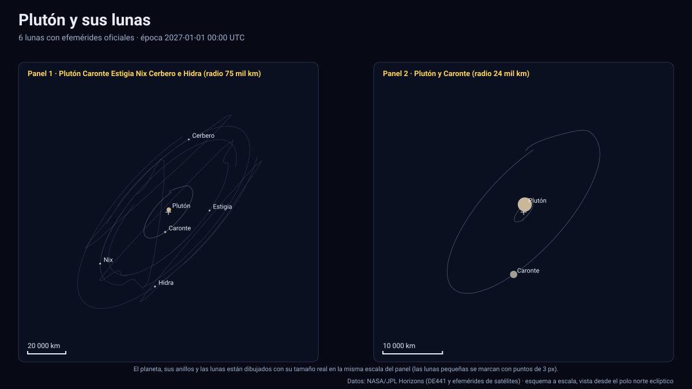
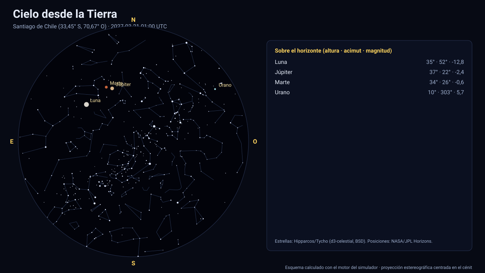
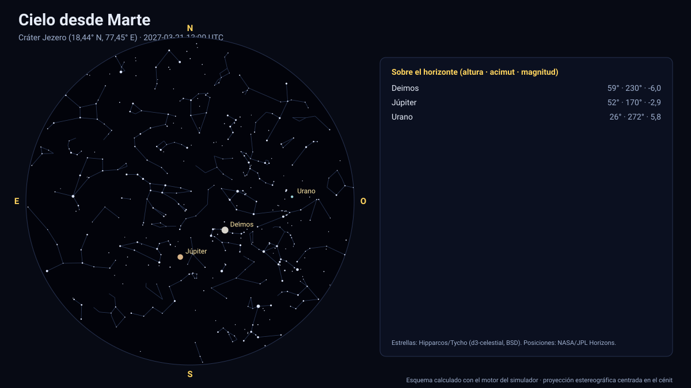

# Documentación de los simuladores

Los simuladores del Sistema Solar (2027–2050) están pensados para que cualquiera pueda **ver, comprobar y reproducir** cada número: los datos son oficiales (NASA/JPL Horizons), los tamaños y distancias son reales, y cada tolerancia está medida y validada de forma automática.

[🌐 Concentrador de simuladores](https://vladimiracunadev-create.github.io/astronomy-astrophysics-space-sciences-aerospace-engineering-learning-program/simuladores/index.html) · [Resumen](../README.md) · [Estándar de los simuladores](../../documentacion/ESTANDAR_DE_SIMULADORES.md)

## Primero lo esencial

1. [Guía de uso](GUIA_DE_USO.md): tiempo, cámara, escala, enlaces compartibles y accesibilidad.
2. [Datos y efemérides](DATOS_Y_EFEMERIDES.md): fuentes, formato, interpolación, sistema de referencia, tiempo y errores.
3. [Fuentes, modelos y límites](FUENTES_Y_MODELOS.md): constantes, orientación de los cuerpos y qué es dato frente a ilustración.
4. [Tabla de precisión](TABLA_DE_PRECISION.md): error medido de **cada uno** de los 463 cuerpos contra JPL Horizons.

## Los simuladores

| Esquema | Simulador | Documento | Estado |
|---|---|---|---|
|  | **Sistema Solar** | [sistema-solar.md](sistema-solar.md) | Publicado |
|  | **Tierra · Sol · Luna** | [tierra-sol-luna.md](tierra-sol-luna.md) | Publicado |
|  | **Marte y sus dos lunas** | [marte.md](marte.md) | Publicado |
|  | **Júpiter y sus lunas** | [jupiter.md](jupiter.md) | Publicado |
|  | **Saturno y sus lunas** | [saturno.md](saturno.md) | Publicado |
|  | **Urano y sus lunas** | [urano.md](urano.md) | Publicado |
|  | **Neptuno y sus lunas** | [neptuno.md](neptuno.md) | Publicado |
|  | **Plutón y sus lunas** | [pluton.md](pluton.md) | Publicado |
|  | **Cielo desde la Tierra** | [cielo-tierra.md](cielo-tierra.md) | Publicado |
|  | **Cielo desde Marte** | [cielo-marte.md](cielo-marte.md) | Publicado |

## Qué se valida y contra qué

| Qué | Contra qué | Resultado |
|---|---|---|
| Posición de cada planeta y luna (463 cuerpos) | JPL Horizons, 120 épocas aleatorias no nodales por cuerpo | Peor error relativo 3,2×10⁻⁴ del radio orbital; planetas interiores < 0,01 km |
| Eclipses de Sol y de Luna 2027–2050 | Catálogo de la NASA (Espenak y Meeus) | 109 de 109; hora ≤ 0,8 min; γ ≤ 0,0007 |
| Fases de la Luna | U.S. Naval Observatory | 1 187 de 1 187; ≤ 1,6 min |
| Equinoccios y solsticios; perihelio y afelio | U.S. Naval Observatory | 96 de 96 y 48 de 48; ≤ 1 min |
| Longitud solar de Marte (Ls) | Convención de Clancy et al. (perihelio en Ls = 251°) | 13 perihelios; desvío ≤ 2,02° |
| Oposiciones de Marte | Fechas publicadas (2027-02-19, 2029-03-25, 2031-05-04) | Coinciden |
| Estaciones de Urano y de Saturno | Geometría de la órbita y del eje | Solsticio de Urano ≈ 2030; el Sol cruza el plano de los anillos de Saturno ≈ 2039-01-22 |

Se ejecuta con `python herramientas/validar_simuladores.py` y en la integración continua en cada cambio.

## Cobertura declarada

- **Dafne (Saturno XXXV)** se excluye: Horizons no tiene efemérides posteriores al 17 de enero de 2018.
- **10 lunas de Saturno** (Jano, Epimeteo, Atlas, Prometeo, Pandora, Pan, Anthe, Egéon, Palene y S/2009 S 2) tienen efemérides hasta 2050-01-08 como máximo; el simulador las **oculta** después.
- Urano tiene hoy 29 satélites conocidos y Horizons publica 28: el más reciente no tiene efemérides y **no se muestra**.
- Sólo una parte de las lunas tiene radio publicado en Horizons (16 de Júpiter, 17 de Saturno, 15 de Urano, 8 de Neptuno): el resto se dibuja como punto y se indica «no publicado».
