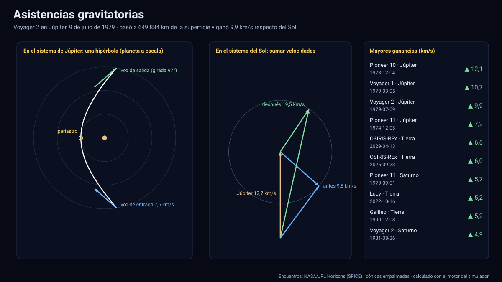

# Simulador de asistencias gravitatorias

[▶ Abrir el simulador](https://vladimiracunadev-create.github.io/astronomy-astrophysics-space-sciences-aerospace-engineering-learning-program/simuladores/asistencias.html) · [Guía de uso](GUIA_DE_USO.md) · [Datos y efemérides](DATOS_Y_EFEMERIDES.md) · [Simulador de misiones](misiones.md)

## Qué muestra

Una **calculadora interactiva** de cómo un planeta cambia la velocidad de una nave:

- **En el sistema del planeta** (arriba): la nave describe una **hipérbola** con el planeta a escala, el periastro (la mayor cercanía), la velocidad en el infinito de entrada y la de salida —del mismo módulo, pero **girada**— y la nave recorriendo la curva con la ley de Kepler.
- **En el sistema del Sol** (abajo): la velocidad de la nave es la del planeta más v∞; el giro de v∞ cambia el módulo de esa suma. El diagrama muestra la velocidad antes y después y la circunferencia de todas las salidas posibles.
- **Parámetros**: planeta (Mercurio a Neptuno), v∞, altura del paso, ángulo de llegada θ, hacia dónde gira (γ: en el plano o fuera de él) y la fecha, que fija la velocidad real del planeta. Los botones «Máxima ganancia» y «Máximo frenado» buscan los ángulos óptimos.
- **69 casos reales** de las misiones del [simulador de misiones](misiones.md) (Pioneer, Voyager, Galileo, Cassini, New Horizons, Juno, Parker, Rosetta, BepiColombo, Solar Orbiter, Lucy…): al elegir uno se cargan sus parámetros reales y el resultado coincide con la ganancia medida por JPL.

## Modelo

Método de las **cónicas empalmadas**: dentro de la esfera de influencia sólo actúa el planeta (dos cuerpos); la hipérbola tiene excentricidad e = 1 + rp·v∞²/μ, la velocidad en el periastro es √(v∞² + 2μ/rp) y v∞ gira un ángulo δ = 2·asin(1/e) sin cambiar de módulo. En el sistema del Sol: Vsal = Vplaneta + v∞sal. El cambio máximo posible de velocidad es 2·v∞·sin(δ/2) y se logra con el periastro más bajo; pasar por detrás del planeta (respecto de su movimiento) acelera y por delante frena. Los ángulos θ y γ describen la geometría en 3D: γ = 0° o 180° gira dentro del plano de la órbita del planeta; γ = ±90° saca la nave del plano (así Solar Orbiter y Ulysses cambian su inclinación).

## Datos y validación

- **Encuentros** de [`datos/encuentros.json`](../datos/encuentros.json) (JPL Horizons, ver el [simulador de misiones](misiones.md)); μ y radios planetarios en el mismo archivo; velocidad del planeta de [`datos/planetas_hist.json`](../datos/planetas_hist.json).
- La excentricidad y la distancia mínima de cada encuentro salen de la **hipérbola del estado de Horizons** (no del ajuste de una malla temporal), por lo que el giro 2·asin(1/e) coincide con el medido a ≤ 0,05° y el modelo reproduce la velocidad de salida real de los **69 encuentros con error < 0,001 km/s** (el parámetro γ se ajusta para cada uno).
- **Invariantes comprobados** en todos los casos: |Δv| ≤ 2·v∞·sin(δ/2); la velocidad de entrada se reproduce con 0,01 km/s; e = 1 + rp·v∞²/μ; la velocidad en el periastro. Referencias publicadas: Galileo–Tierra (1990) v∞ = 8,95 km/s con ganancia de 5,2 km/s; Cassini–Tierra (1999) a 1 171 km; Voyager 1–Júpiter a 349 000 km del centro.

## Límites

- Modelo de **dos cuerpos con velocidades asintóticas**: no incluye la gravedad del Sol durante el encuentro, el aplanamiento del planeta ni su atmósfera, ni las maniobras de la nave; la ganancia medida en vuelo difiere en décimas de km/s.
- La asistencia no crea energía: lo que gana la nave lo pierde el planeta, en una cantidad imperceptible.
- El diagrama en el sistema del Sol proyecta en el plano de la órbita del planeta; la componente fuera del plano se informa en el texto.
- No cubre asistencias a Plutón ni a la Luna (en las misiones del simulador no hay casos relevantes).

Sistema de referencia: eclíptica y equinoccio J2000; unidades km, km/s, km³/s²; tiempo TDB mostrado en UTC.

## Archivos

[`asistencias.html`](https://vladimiracunadev-create.github.io/astronomy-astrophysics-space-sciences-aerospace-engineering-learning-program/simuladores/asistencias.html) · [`paginas/asistencias.js`](../paginas/asistencias.js) · [`motor/asistencia.js`](../motor/asistencia.js) · [`motor/app-asistencias.js`](../motor/app-asistencias.js) · [`datos/encuentros.json`](../datos/encuentros.json)
