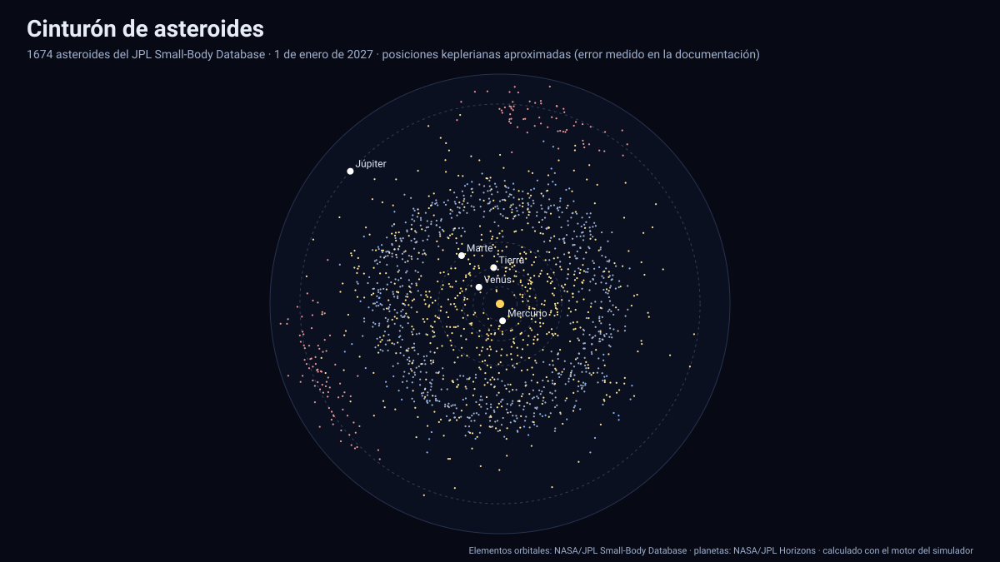

# Simulador del cinturón de asteroides

[▶ Abrir el simulador](https://vladimiracunadev-create.github.io/astronomy-astrophysics-space-sciences-aerospace-engineering-learning-program/simuladores/asteroides.html) · [Guía de uso](GUIA_DE_USO.md) · [Datos y efemérides](DATOS_Y_EFEMERIDES.md) · [Fuentes y modelos](FUENTES_Y_MODELOS.md)

## Qué muestra

**1 674 asteroides** del *Small-Body Database* de JPL moviéndose entre 2027 y 2050 junto a las órbitas de Mercurio, Venus, la Tierra, Marte y Júpiter (posiciones oficiales): el **cinturón principal** con su estructura (clases interior, principal y exterior), los **troyanos de Júpiter** en los puntos de Lagrange L4 y L5, las **Hildas** y los **asteroides cercanos a la Tierra** (Atira, Atón, Apolo y Amor). Se puede buscar uno por nombre (Ceres, Vesta, Apophis…), ver su órbita y sus datos (clase, magnitud absoluta H, diámetro si se conoce, a·e·i, perihelio y afelio, periodo, distancia al Sol y a la Tierra), activar o desactivar familias y recorrer el tiempo con ▶.

Selección: cinturón principal con H ≤ 10,3; troyanos con H ≤ 10,6; Hildas con H ≤ 12; cercanos a la Tierra con H ≤ 17,5 (≈ 1 km o más). Generador: [`herramientas/efemerides/generar_asteroides.py`](../../herramientas/efemerides/generar_asteroides.py).

## Precisión: una aproximación medida

**Las posiciones de los asteroides NO son una efemérides oficial.** Se calculan por propagación kepleriana de dos cuerpos desde los elementos osculadores de JPL (época de 2026), sin las perturbaciones de los planetas, sobre todo de Júpiter. El error crece con el tiempo desde la época. Se midió contra JPL Horizons en una muestra con semilla fija de **24 asteroides** (guardada en [`pruebas/verificacion_asteroides.json`](../pruebas/verificacion_asteroides.json)):

| Fecha | Error mediano | Observación |
|---|---:|---|
| 2030 | ≈ 1,5 millones de km | ≈ 0,01 UA |
| 2039 | ≈ 5,6 millones de km | |
| 2050 | ≈ 7,7 millones de km (0,05 UA) | p95 ≈ 63 millones de km, en asteroides cercanos a la Tierra |

A la escala del cinturón (≈ 2–5 UA) basta para ver su estructura y las familias; **no sirve** para predecir encuentros, ocultaciones ni acercamientos a la Tierra. Para eso hay que usar las efemérides de JPL. Los planetas sí salen de las efemérides oficiales.

## Tolerancias y límites

- Sin movimiento no kepleriano: perturbaciones planetarias, efecto Yarkovsky y encuentros cercanos se ignoran.
- Los asteroides cercanos a la Tierra son los menos fiables (órbitas caóticas y encuentros con los planetas).
- Clases: Hildas con H ≤ 12 son pocas (3) en la muestra; no hay asteroides del cinturón interior (IMB) con esa magnitud límite.
- No incluye cometas ni objetos transneptunianos.

Sistema de referencia: eclíptica y equinoccio J2000, heliocéntrico; tiempo: TDB mostrado en UTC; datos: NASA/JPL Small-Body Database (elementos) y Horizons (verificación), descargados el 13 de noviembre de 2026.

## Archivos

[`asteroides.html`](https://vladimiracunadev-create.github.io/astronomy-astrophysics-space-sciences-aerospace-engineering-learning-program/simuladores/asteroides.html) · [`paginas/asteroides.js`](../paginas/asteroides.js) · [`motor/asteroides.js`](../motor/asteroides.js) · [`motor/app-asteroides.js`](../motor/app-asteroides.js) · [`datos/asteroides.json`](../datos/asteroides.json)
