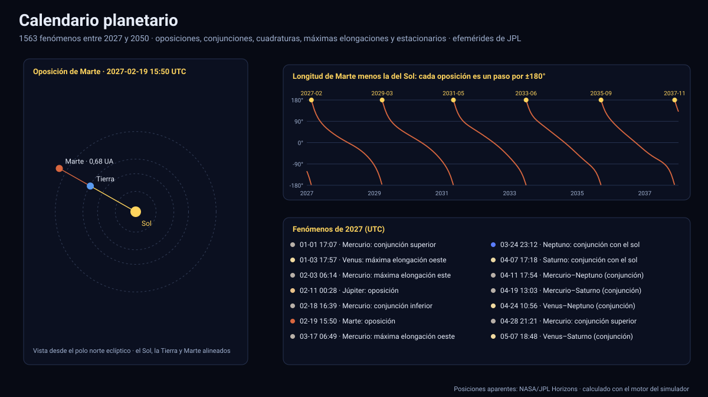

# Calendario planetario

[▶ Abrir el simulador](https://vladimiracunadev-create.github.io/astronomy-astrophysics-space-sciences-aerospace-engineering-learning-program/simuladores/calendario.html) · [Guía de uso](GUIA_DE_USO.md) · [Datos y efemérides](DATOS_Y_EFEMERIDES.md) · [Fuentes y modelos](FUENTES_Y_MODELOS.md)

## Qué muestra

Los **1 563 fenómenos planetarios de 2027 a 2050**, calculados con las efemérides oficiales de JPL, con la geometría Sol–Tierra–planeta de cada uno:

| Fenómeno | Qué es | Planetas |
|---|---|---|
| **Oposición** | La Tierra queda entre el Sol y el planeta (longitud relativa 180°): visible toda la noche y en su mayor brillo | Marte a Neptuno |
| **Conjunción con el Sol** | El planeta queda detrás del Sol (superior) o, en Mercurio y Venus, entre la Tierra y el Sol (inferior) | todos |
| **Cuadratura** | El planeta a 90° al este u oeste del Sol | Marte a Neptuno |
| **Máxima elongación** | Mayor separación aparente del Sol (este = tarde, oeste = mañana) | Mercurio y Venus |
| **Estacionario** | La longitud aparente deja de crecer o de decrecer: empieza o termina el movimiento retrógrado | todos |
| **Conjunción entre planetas** | Dos planetas con la misma longitud eclíptica vista desde la Tierra (con su separación) | 21 pares |

El diagrama muestra el Sistema Solar desde el polo norte eclíptico en la fecha elegida, con las líneas de visión de la Tierra al Sol y al planeta y la **elongación** (ángulo entre ambos); el gráfico inferior muestra la longitud del planeta menos la del Sol en 24 años, con los fenómenos marcados (clic o arrastre para ir a esa fecha). ▶ recorre el tiempo, ⏪ y ⏩ saltan al fenómeno anterior y siguiente de la lista filtrada. Se filtra por año, planeta y tipo, y la lista se puede descargar en CSV.

## Cómo se calcula

1. **Posiciones geocéntricas aparentes**: del Sol y de cada planeta respecto del centro de la Tierra, con **tiempo luz** (tres iteraciones) y **aberración anual** (constante de 20,4955″).
2. **Búsqueda de cada fenómeno por bisección** (50 pasos) sobre una función continua: la longitud del planeta menos la del Sol igual a 180°, 0° o ±90°; el máximo de la separación angular al Sol (sección áurea); la velocidad nula de la longitud aparente; y la igualdad de longitudes entre dos planetas. Nada se escribe a mano.
3. **Tiempo**: TDB mostrado en UTC (UTC = TDB − 69,184 s).

## Validación

| Comprobación | Referencia | Resultado |
|---|---|---|
| Elongación y longitud relativa al Sol de los 7 planetas en 168 épocas (24 por planeta, semilla fija) | JPL Horizons (OBSERVER, geocéntrico, posiciones aparentes), [`pruebas/referencia_calendario.json`](../pruebas/referencia_calendario.json) | ≤ 0,0003° en la elongación y ≤ 0,0006° en la longitud: menos de un minuto de tiempo en el instante de un fenómeno |
| Cada oposición, conjunción y cuadratura cumple su definición | Longitud relativa de 180°, 0° o 90° | ≤ 0,001° en los 1 563 fenómenos que la tienen |
| Cada máxima elongación es un máximo y cada estacionario tiene velocidad nula | Comprobación local | Cumple |
| Fechas publicadas | Oposición de Marte 2027-02-19, de Saturno 2027-10-18 y de Neptuno 2027-09-28; gran conjunción Júpiter–Saturno del 31-10-2040 a 1,1° | Coinciden (±0,75 d y 0,1°) |
| Número de oposiciones 2027–2050 | Marte 12 (un periodo sinódico de 26 meses), Júpiter ≥ 21, Saturno ≥ 22 | Cumple |

## Tolerancias y límites

- Es un calendario **geométrico**: no considera el brillo, la altura sobre el horizonte del observador ni la luz del crepúsculo. «No visible» se refiere a la posición respecto del Sol.
- La separación de una conjunción entre planetas es la del instante de igual longitud eclíptica (aprox. la diferencia de latitud), que difiere de la separación mínima; para las conjunciones muy próximas al Sol el simulador avisa.
- Las horas son las de las efemérides de JPL (UTC con ΔT predicho): para los planetas lentos un minuto de error en el tiempo equivale a ≈ 0,0003° en la longitud.
- Plutón, Ceres, la Luna y los cometas no se incluyen; las fases de la Luna y los eclipses están en los simuladores de [Tierra · Sol · Luna](tierra-sol-luna.md) y de [eclipses solares](eclipses-solares.md).

Sistema de referencia: eclíptica y equinoccio J2000 (diferencias de longitud, independientes de la precesión); datos de NASA/JPL Horizons descargados el 13 de noviembre de 2026. Generador de la referencia: [`herramientas/efemerides/descargar_referencia_calendario.py`](../../herramientas/efemerides/descargar_referencia_calendario.py).

## Archivos

[`calendario.html`](https://vladimiracunadev-create.github.io/astronomy-astrophysics-space-sciences-aerospace-engineering-learning-program/simuladores/calendario.html) · [`paginas/calendario.js`](../paginas/calendario.js) · [`motor/calendario.js`](../motor/calendario.js) · [`motor/app-calendario.js`](../motor/app-calendario.js)
