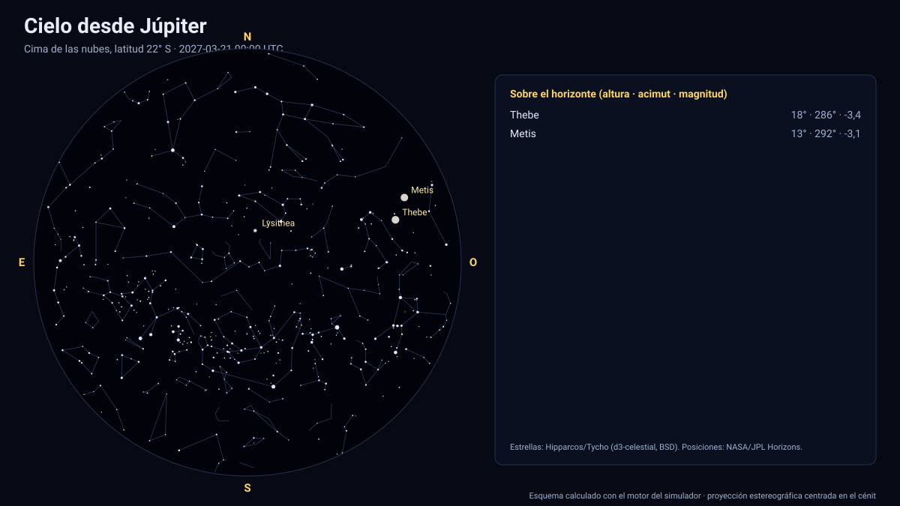

# Simulador del cielo desde Júpiter

[▶ Abrir el simulador](https://vladimiracunadev-create.github.io/astronomy-astrophysics-space-sciences-aerospace-engineering-learning-program/simuladores/cielo-jupiter.html) · [Guía de uso](GUIA_DE_USO.md) · [Datos y efemérides](DATOS_Y_EFEMERIDES.md) · [Fuentes y modelos](FUENTES_Y_MODELOS.md)

## Qué muestra

El cielo desde la **cima de las nubes** de Júpiter (1 bar de presión), porque el planeta no tiene superficie sólida: un lugar fijo en el sistema III de rotación (9 h 55,5 min), con 4 lugares predefinidos o cualquier latitud y longitud. Se ven el **Sol** (≈ 6′), las cuatro **lunas galileanas como discos** (Ío mide ≈ 0,3–0,5°, casi como la Luna desde la Tierra) con su fase, Amaltea y las demás lunas con radio publicado, la Tierra, Venus, Saturno y los demás planetas, las estrellas y el anillo principal. Como Júpiter gira en menos de 10 horas, el cielo da una vuelta cada 9,9 h; los eclipses de las lunas galileanas por la sombra de Júpiter se consultan en el [simulador de Júpiter](jupiter.md).

## Cómo funciona

1. **Observador:** latitud (planetográfica) y longitud este sobre el elipsoide IAU del planeta; el cénit es la normal al elipsoide (en Júpiter y Saturno, achatados 6,5 % y 9,8 %, difiere hasta ≈ 4° de la dirección al centro).
2. **Orientación:** el horizonte local sale del polo y del meridiano origen IAU del planeta en cada instante (para la Tierra, del ángulo de rotación terrestre ERA).
3. **Astros:** el Sol, los planetas (con corrección de tiempo luz, una iteración) y las lunas del propio sistema salen de las efemérides de JPL; cada uno se resta de la posición del observador y se pasa a altura y acimut. Se calculan su **tamaño angular**, su **fase** y su **magnitud** (Meeus/Almanaque para planetas vistos desde la Tierra; modelo de Lambert con albedo geométrico en los demás casos).
4. **Estrellas:** 5 044 estrellas hasta la magnitud 6 del catálogo Hipparcos/Tycho (vía d3-celestial, licencia BSD), con 493 nombres propios y las figuras de las 88 constelaciones; coordenadas ICRS J2000 sin movimiento propio (error típico < 1′).
5. **Proyección:** estereográfica sobre el eje de la vista (campo de 4° a 170°); arrastrar gira, la rueda cambia el campo.

## Validación

Las pruebas comprueban que Ío visto desde las nubes mide entre 0,25° y 0,6°. El cénit usa el elipsoide IAU (achatamiento 6,5 %), por lo que la vertical difiere hasta ≈ 4° de la dirección al centro. La geometría del observador es la misma validada con el U.S. Naval Observatory para la Tierra ([cielo desde la Tierra](cielo-tierra.md)).

## Tolerancias y límites

Sin atmósfera ni refracción (el cielo se dibuja negro, aunque a esa presión habría atmósfera por encima: simplificación declarada). De las 115 lunas sólo se dibujan las 16 con radio publicado en Horizons. Magnitudes de lunas con albedo medio de 0,25. Estrellas sin movimiento propio. La dinámica de la atmósfera no se modela.

## Archivos

[`cielo-jupiter.html`](https://vladimiracunadev-create.github.io/astronomy-astrophysics-space-sciences-aerospace-engineering-learning-program/simuladores/cielo-jupiter.html) · [`paginas/cielo-jupiter.js`](../paginas/cielo-jupiter.js) · [`motor/cielo.js`](../motor/cielo.js)
