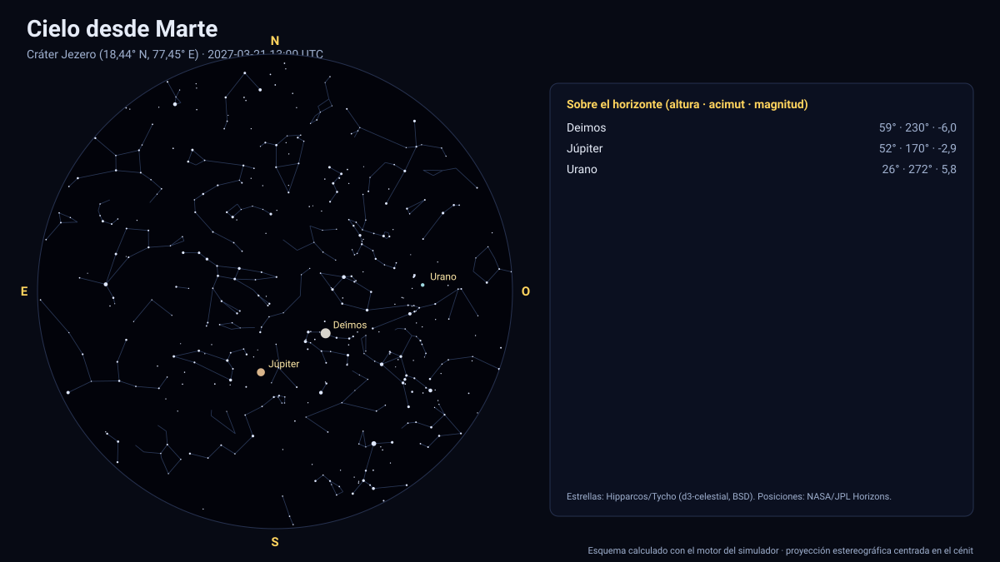

# Simulador del cielo desde Marte

[▶ Abrir el simulador](https://vladimiracunadev-create.github.io/astronomy-astrophysics-space-sciences-aerospace-engineering-learning-program/simuladores/cielo-marte.html) · [Guía de uso](GUIA_DE_USO.md) · [Datos y efemérides](DATOS_Y_EFEMERIDES.md) · [Fuentes y modelos](FUENTES_Y_MODELOS.md)

## Qué muestra

El cielo marciano en cualquier instante de 2027 a 2050 desde siete lugares (cráteres Jezero y Gale, Elysium, Valles Marineris, el monte Olimpo y los polos) o cualquier latitud y longitud: el **Sol** (≈ 19′ en enero de 2027, dos tercios de su tamaño visto desde la Tierra), **Fobos y Deimos** con su tamaño angular real y su fase, la **Tierra y Venus** como estrellas brillantes, los demás planetas y 5 044 estrellas. Fobos da ≈ 3,2 vueltas por día marciano: sale por el oeste y se pone por el este varias veces al día. Cada día marciano dura 24 h 39 min, de modo que las salidas y puestas del Sol se desplazan respecto del reloj UTC.

## Cómo funciona

1. **Observador:** latitud (planetográfica) y longitud este sobre el elipsoide IAU del planeta; el cénit es la normal al elipsoide (en Júpiter y Saturno, achatados 6,5 % y 9,8 %, difiere hasta ≈ 4° de la dirección al centro).
2. **Orientación:** el horizonte local sale del polo y del meridiano origen IAU del planeta en cada instante (para la Tierra, del ángulo de rotación terrestre ERA).
3. **Astros:** el Sol, los planetas (con corrección de tiempo luz, una iteración) y las lunas del propio sistema salen de las efemérides de JPL; cada uno se resta de la posición del observador y se pasa a altura y acimut. Se calculan su **tamaño angular**, su **fase** y su **magnitud** (Meeus/Almanaque para planetas vistos desde la Tierra; modelo de Lambert con albedo geométrico en los demás casos).
4. **Estrellas:** 5 044 estrellas hasta la magnitud 6 del catálogo Hipparcos/Tycho (vía d3-celestial, licencia BSD), con 493 nombres propios y las figuras de las 88 constelaciones; coordenadas ICRS J2000 con el **movimiento propio** de Hipparcos aplicado hasta la fecha mostrada.
5. **Proyección:** estereográfica sobre el eje de la vista (campo de 4° a 170°); arrastrar gira, la rueda cambia el campo.

## Validación

- Las pruebas comprueban el diámetro angular del Sol visto desde Marte (≈ 19,4′ en 2027-01-01), que Fobos aparece con un tamaño angular de entre 3′ y 15′ y que la Tierra figura en el cielo marciano. La orientación de Marte (polo, meridiano origen y longitud solar Ls) se valida en el [simulador de Marte](marte.md).
- La geometría del observador se comparte con el simulador del cielo terrestre, validado con 188 salidas y puestas del U.S. Naval Observatory ([cielo desde la Tierra](cielo-tierra.md)).

## Tolerancias y límites

Sin refracción atmosférica ni polvo; el color ocre del día y el azul del crepúsculo son **ilustrativos**. Las magnitudes de las lunas usan un albedo medio de 0,25 (Fobos y Deimos reales: ≈ 0,07), así que su brillo está sobreestimado. Posiciones de las lunas: efemérides de JPL con error de interpolación de 2,4 km como máximo. Estrellas con movimiento propio lineal. Los lugares se dan en latitud planetográfica y longitud este del marco IAU.

## Archivos

[`cielo-marte.html`](https://vladimiracunadev-create.github.io/astronomy-astrophysics-space-sciences-aerospace-engineering-learning-program/simuladores/cielo-marte.html) · [`paginas/cielo-marte.js`](../paginas/cielo-marte.js) · [`motor/cielo.js`](../motor/cielo.js)
