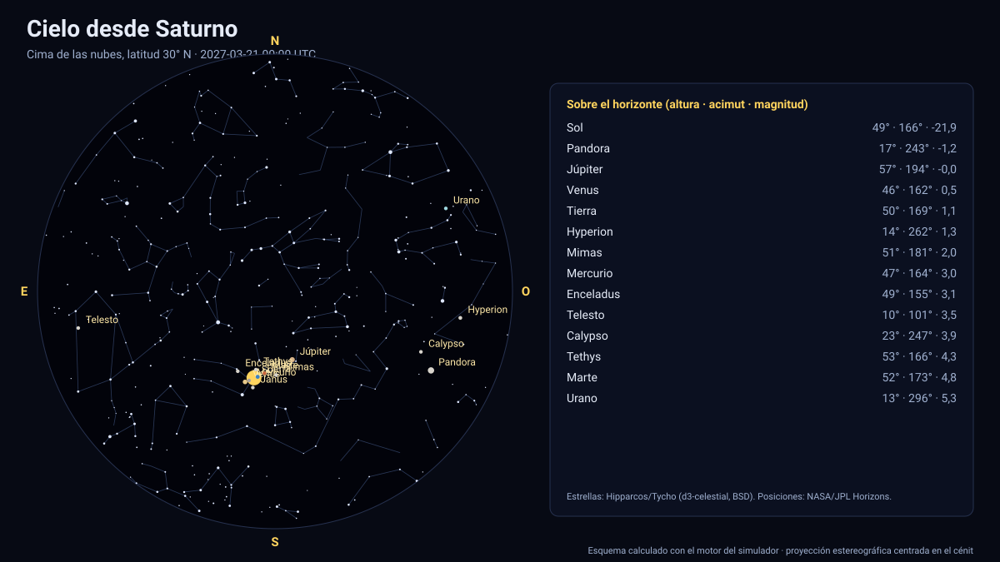

# Simulador del cielo desde Saturno

[▶ Abrir el simulador](https://vladimiracunadev-create.github.io/astronomy-astrophysics-space-sciences-aerospace-engineering-learning-program/simuladores/cielo-saturno.html) · [Guía de uso](GUIA_DE_USO.md) · [Datos y efemérides](DATOS_Y_EFEMERIDES.md) · [Fuentes y modelos](FUENTES_Y_MODELOS.md)

## Qué muestra

El cielo desde la **cima de las nubes** de Saturno (1 bar) en cualquier lugar (5 predefinidos, del ecuador al polo): el **Sol** (≈ 3,4′), los **anillos como un arco inmenso** (anillos C, B, A y F con sus radios publicados; desde el ecuador se ven **de canto**, como una línea que pasa por el cénit), **Titán** y las demás lunas con radio publicado (17), con su fase, la Tierra, Júpiter y los demás planetas, y las estrellas. A latitudes medias los anillos forman una banda que cruza el cielo; el Sol cruza el plano de los anillos hacia 2039-01-22, cuando los anillos pasan por el Sol.

## Cómo funciona

1. **Observador:** latitud (planetográfica) y longitud este sobre el elipsoide IAU del planeta; el cénit es la normal al elipsoide (en Júpiter y Saturno, achatados 6,5 % y 9,8 %, difiere hasta ≈ 4° de la dirección al centro).
2. **Orientación:** el horizonte local sale del polo y del meridiano origen IAU del planeta en cada instante (para la Tierra, del ángulo de rotación terrestre ERA).
3. **Astros:** el Sol, los planetas (con corrección de tiempo luz, una iteración) y las lunas del propio sistema salen de las efemérides de JPL; cada uno se resta de la posición del observador y se pasa a altura y acimut. Se calculan su **tamaño angular**, su **fase** y su **magnitud** (Meeus/Almanaque para planetas vistos desde la Tierra; modelo de Lambert con albedo geométrico en los demás casos).
4. **Estrellas:** 5 044 estrellas hasta la magnitud 6 del catálogo Hipparcos/Tycho (vía d3-celestial, licencia BSD), con 493 nombres propios y las figuras de las 88 constelaciones; coordenadas ICRS J2000 sin movimiento propio (error típico < 1′).
5. **Proyección:** estereográfica sobre el eje de la vista (campo de 4° a 170°); arrastrar gira, la rueda cambia el campo.

## Validación

La geometría del observador sobre un elipsoide IAU (achatamiento 9,8 %, el mayor del Sistema Solar) usa la misma matemática validada contra el U.S. Naval Observatory en la Tierra ([cielo desde la Tierra](cielo-tierra.md)); el cruce del Sol por el plano de los anillos se contrasta en el [simulador de Saturno](saturno.md).

## Tolerancias y límites

Sin atmósfera ni refracción; anillos con radios orientativos y opacidad ilustrativa, sin sombras ni espesor; magnitud de Saturno vista desde la Tierra sin el efecto de los anillos. Magnitudes de lunas con albedo medio 0,25. Estrellas sin movimiento propio. El observador está sobre las nubes y rota con el sistema III.

## Archivos

[`cielo-saturno.html`](https://vladimiracunadev-create.github.io/astronomy-astrophysics-space-sciences-aerospace-engineering-learning-program/simuladores/cielo-saturno.html) · [`paginas/cielo-saturno.js`](../paginas/cielo-saturno.js) · [`motor/cielo.js`](../motor/cielo.js)
