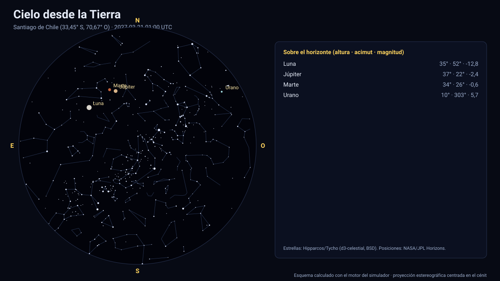

# Simulador del cielo desde la Tierra

[▶ Abrir el simulador](https://vladimiracunadev-create.github.io/astronomy-astrophysics-space-sciences-aerospace-engineering-learning-program/simuladores/cielo-tierra.html) · [Guía de uso](GUIA_DE_USO.md) · [Datos y efemérides](DATOS_Y_EFEMERIDES.md) · [Fuentes y modelos](FUENTES_Y_MODELOS.md)

## Qué muestra

El cielo visto desde cualquier lugar de la Tierra (latitud y longitud, o 11 lugares predefinidos entre los polos) en cualquier instante UTC de 2027 a 2050: el **Sol**, la **Luna con su fase real y su ángulo de posición**, los **siete planetas** con su magnitud, 5 044 **estrellas**, las **constelaciones**, la eclíptica, el ecuador celeste y una cuadrícula altazimutal. El panel indica la altura del Sol y la fase del día (día, crepúsculo civil, náutico, astronómico o noche), las **salidas y puestas del Sol** y la lista de astros sobre el horizonte con su altura y su magnitud. El color del cielo y el límite de magnitud visible dependen de la altura del Sol (ilustrativo).

## Cómo funciona

1. **Observador:** latitud (planetográfica) y longitud este sobre el elipsoide IAU del planeta; el cénit es la normal al elipsoide (en Júpiter y Saturno, achatados 6,5 % y 9,8 %, difiere hasta ≈ 4° de la dirección al centro).
2. **Orientación:** el horizonte local sale del polo y del meridiano origen IAU del planeta en cada instante (para la Tierra, del ángulo de rotación terrestre ERA).
3. **Astros:** el Sol, los planetas (con corrección de tiempo luz, una iteración) y las lunas del propio sistema salen de las efemérides de JPL; cada uno se resta de la posición del observador y se pasa a altura y acimut. Se calculan su **tamaño angular**, su **fase** y su **magnitud** (Meeus/Almanaque para planetas vistos desde la Tierra; modelo de Lambert con albedo geométrico en los demás casos).
4. **Estrellas:** 5 044 estrellas hasta la magnitud 6 del catálogo Hipparcos/Tycho (vía d3-celestial, licencia BSD), con 493 nombres propios y las figuras de las 88 constelaciones; coordenadas ICRS J2000 con el **movimiento propio** de Hipparcos aplicado hasta la fecha mostrada.
5. **Proyección:** estereográfica sobre el eje de la vista (campo de 4° a 170°); arrastrar gira, la rueda cambia el campo.

## Validación

| Comprobación | Contra qué | Resultado |
|---|---|---|
| Salidas y puestas del **Sol** (96 eventos: 6 lugares × 8 fechas entre 2027 y 2049) | U.S. Naval Observatory | ≤ 0,50 min |
| Salidas y puestas de la **Luna** (92 eventos) | U.S. Naval Observatory | ≤ 0,52 min |
| Polaris en el polo norte y en el ecuador | Declinación +89,26° | 89,3° y ≈ 0,7° |
| Diámetros angulares del Sol y la Luna | 32′ y 29–34′ | Dentro del rango |

Las salidas y puestas usan la convención de los almanaques: borde superior del astro con **34′ de refracción** y, para la Luna, **paralaje topocéntrico** (la posición del observador sobre el elipsoide se resta de la posición geocéntrica de la Luna). Los lugares (Santiago, Greenwich, Quito, Tokio, Reikiavik y Sídney) cubren latitudes de 64° N a 34° S. Referencia versionada en [`pruebas/referencia_usno_salidas.json`](../pruebas/referencia_usno_salidas.json).

## Tolerancias y límites

| Magnitud | Tolerancia |
|---|---|
| Posición de Sol, Luna y planetas | Efemérides de JPL (error de interpolación en la [tabla](TABLA_DE_PRECISION.md)); sin aberración |
| Posición de las estrellas | ICRS J2000 más movimiento propio lineal de Hipparcos (HYG): sin paralaje ni aceleración; error típico de segundos de arco |
| Refracción | Fórmula de Bennett (opcional); no modela la variación con la presión y la temperatura |
| Magnitudes de planetas | Fórmulas de Meeus: ≈ ± 0,3; la de Saturno omite el efecto de los anillos |
| Orientación de la Tierra | ERA con UT1 ≈ UTC (≤ 0,9 s); precesión-nutación omitidas (≈ 0,7°) |
| Color del cielo, suelo | Ilustrativos |

Sistema de referencia: eclíptica y equinoccio J2000 (ICRF); tiempo: TDB mostrado en UTC; versiones: Horizons API 1.2, DE441; estrellas: d3-celestial (Olaf Frohn, BSD-3-Clause).

## Archivos

[`cielo-tierra.html`](https://vladimiracunadev-create.github.io/astronomy-astrophysics-space-sciences-aerospace-engineering-learning-program/simuladores/cielo-tierra.html) · [`paginas/cielo-tierra.js`](../paginas/cielo-tierra.js) · [`motor/cielo.js`](../motor/cielo.js) · [`motor/app-cielo.js`](../motor/app-cielo.js) · [`datos/cielo.json`](../datos/cielo.json)
