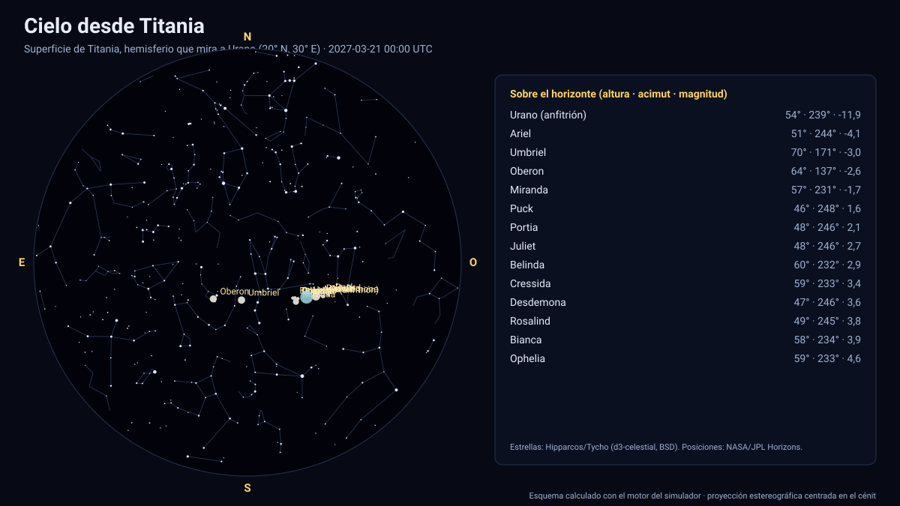

# Simulador del cielo desde Titania

[▶ Abrir el simulador](https://vladimiracunadev-create.github.io/astronomy-astrophysics-space-sciences-aerospace-engineering-learning-program/simuladores/cielo-titania.html) · [Guía de uso](GUIA_DE_USO.md) · [Datos y efemérides](DATOS_Y_EFEMERIDES.md) · [Fuentes y modelos](FUENTES_Y_MODELOS.md)

## Qué muestra

El cielo desde la **superficie de Titania**, la luna mayor de Urano, en cualquier lugar (7 predefinidos). Titania gira en 8,71 días y siempre muestra la misma cara a Urano: desde el hemisferio que lo mira, **Urano queda casi fijo en el cielo**, con un diámetro angular de ≈ 7° (unas 13 veces la Luna llena vista desde la Tierra) y con **fases** como las de la Luna. El Sol sale y se pone cada 8,71 días, y las otras lunas mayores (Umbriel, Ariel, Oberón y Miranda) cruzan el cielo; el resto de planetas y las estrellas completan la vista. En el hemisferio opuesto Urano nunca sale.

## Cómo funciona

1. **Observador sobre una luna:** el sistema de referencia de la luna tiene el eje x hacia el planeta y el eje z en la normal a su órbita (producto de la posición y la velocidad relativas, de las efemérides de JPL); la rotación es síncrona. Latitud y longitud se miden sobre una esfera del radio publicado de la luna.
2. **Astros:** el Sol, los planetas, las demás lunas del sistema y **el planeta anfitrión** salen de las efemérides de JPL con la misma geometría que los simuladores de cielo desde un planeta ([cielo desde Saturno](cielo-saturno.md)); se calculan tamaño angular, fase y magnitud.
3. **Estrellas y proyección:** igual que en los demás simuladores de cielo (Hipparcos/Tycho, movimiento propio, proyección estereográfica).

## Validación

Las pruebas automáticas comprueban que el diámetro angular de Urano visto desde Titania es de 6,7° ± 0,5°, que el planeta está en el cénit del punto subplanetario y que, tras 3,3 días, sigue casi en el mismo lugar del cielo (la libración debida a la excentricidad de la órbita es de pocos grados).

## Tolerancias y límites

- Rotación síncrona **idealizada**: se ignoran la libración física y la leve rotación no síncrona; el punto subplanetario se toma sobre la dirección media al planeta.
- Sin atmósfera apreciable ni refracción. Magnitudes de planetas y lunas con el modelo de Lambert y albedos medios; la luz reflejada por Urano sobre la superficie no se modela.
- Radio de Titania: 788,9 km (valor publicado, esfera).

Sistema de referencia: eclíptica J2000 (ICRF); tiempo: TDB mostrado en UTC; datos: NASA/JPL Horizons (DE441 y kernels de satélites).

## Archivos

[`cielo-titania.html`](https://vladimiracunadev-create.github.io/astronomy-astrophysics-space-sciences-aerospace-engineering-learning-program/simuladores/cielo-titania.html) · [`paginas/cielo-titania.js`](../paginas/cielo-titania.js) · [`motor/cielo.js`](../motor/cielo.js)
