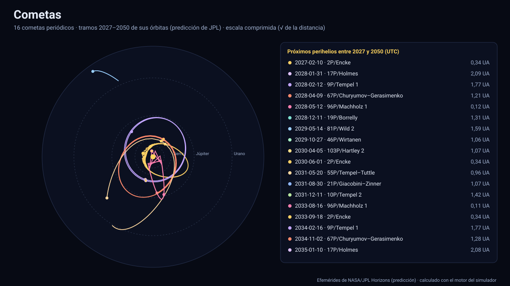

# Simulador de cometas

[▶ Abrir el simulador](https://vladimiracunadev-create.github.io/astronomy-astrophysics-space-sciences-aerospace-engineering-learning-program/simuladores/cometas.html) · [Guía de uso](GUIA_DE_USO.md) · [Datos y efemérides](DATOS_Y_EFEMERIDES.md) · [Fuentes y modelos](FUENTES_Y_MODELOS.md)

## Qué muestra

**16 cometas periódicos** entre 2027 y 2050: 1P/Halley, 2P/Encke, 8P/Tuttle, 9P/Tempel 1, 10P/Tempel 2, 12P/Pons–Brooks, 17P/Holmes, 19P/Borrelly, 21P/Giacobini–Zinner, 46P/Wirtanen, 55P/Tempel–Tuttle, 67P/Churyumov–Gerasimenko, 81P/Wild 2, 96P/Machholz 1, 103P/Hartley 2 y 109P/Swift–Tuttle. Se elige uno en la lista, se pulsa ▶ y se ve su órbita entre los planetas, vista desde el polo norte eclíptico o **de canto** (para ver la inclinación, p. ej. la órbita retrógrada de Halley), con una cola esquemática que apunta lejos del Sol cuando está cerca de él.

- **Estado**: distancia al Sol y a la Tierra, velocidad, tiempo que tarda la luz y altura sobre la eclíptica.
- **Elementos osculadores** del instante (semieje mayor, excentricidad, inclinación, perihelio, afelio y periodo), calculados del vector de estado.
- **Hitos** hallados en los datos: perihelio, afelio y mínimos de la distancia a la Tierra (menos de 1,5 UA) y a Júpiter (menos de 1 UA); un clic salta a esa fecha. El gráfico inferior muestra la distancia al Sol y a la Tierra en los 24 años.
- Escala comprimida (raíz cuadrada de la distancia, para ver los planetas interiores y los exteriores a la vez) o lineal.

## Datos

Posiciones heliocéntricas (eclíptica y equinoccio J2000) del centro de cada cometa según la **solución orbital vigente de JPL Horizons** (con fuerzas no gravitatorias), descargadas el 13 de noviembre de 2026, con paso de 1 a 2 días y la misma interpolación de Lagrange de 10 puntos que el resto de los simuladores ([`datos/cometas.json`](../datos/cometas.json)). El error de la interpolación medido contra Horizons en 120 épocas por cometa es de **0,03 km** como máximo ([tabla de precisión](TABLA_DE_PRECISION.md)). Los planetas salen de las efemérides oficiales ([`datos/sol.json`](../datos/sol.json)). Generador: [`generar_cometas.py`](../../herramientas/efemerides/generar_cometas.py).

## Validación

| Comprobación | Referencia | Resultado |
|---|---|---|
| Perihelio de 55P/Tempel–Tuttle | 20 de mayo de 2031, a ≈ 0,98 UA | Coincide (±5 d; 0,96 UA) |
| Perihelio de 67P/Churyumov–Gerasimenko | Abril de 2028 | Coincide (±5 d) |
| Distancia del perihelio de 96P/Machholz 1 | ≈ 0,12 UA | Coincide (±0,02 UA) |
| Periodo de 2P/Encke | ≈ 3,3 años | Coincide (3,31 ± 0,05 años) |
| 1P/Halley en 2027–2050 | Cerca del afelio (35 UA) en 2027 y sin perihelio hasta 2061 | Cumple (r(2027) entre 33 y 36 UA, sin perihelio) |
| Todas las órbitas | Elípticas en 2027 (e < 1) | Cumple |

## Tolerancias y límites

- **Es una predicción.** La órbita de un cometa se ajusta a sus observaciones: la incertidumbre en la posición crece con el tiempo y tras acercamientos a Júpiter (por ejemplo, 21P en 2029 y 10P en 2050), y los cometas con actividad irregular tienen fuerzas no gravitatorias poco predecibles. Los datos reflejan el ajuste de la fecha de descarga; para fechas de observación hay que usar las efemérides vigentes de JPL.
- Los elementos osculadores son los de dos cuerpos con el Sol en el instante: varían de un día a otro por las perturbaciones de los planetas.
- La **cola es un esquema**; no se modelan el brillo, la actividad ni el tamaño del coma.
- Faltan 73P/Schwassmann–Wachmann 3 (sin efemérides en Horizons) y los cometas de larga periodicidad o no periódicos; por su naturaleza imprevisible no se incluyen cometas recién descubiertos.

Sistema de referencia: eclíptica y equinoccio J2000 (ICRF), centro el Sol; tiempo: TDB mostrado en UTC; unidades km, UA, km/s y días.

## Archivos

[`cometas.html`](https://vladimiracunadev-create.github.io/astronomy-astrophysics-space-sciences-aerospace-engineering-learning-program/simuladores/cometas.html) · [`paginas/cometas.js`](../paginas/cometas.js) · [`motor/cometas.js`](../motor/cometas.js) · [`motor/app-cometas.js`](../motor/app-cometas.js) · [`datos/cometas.json`](../datos/cometas.json)
