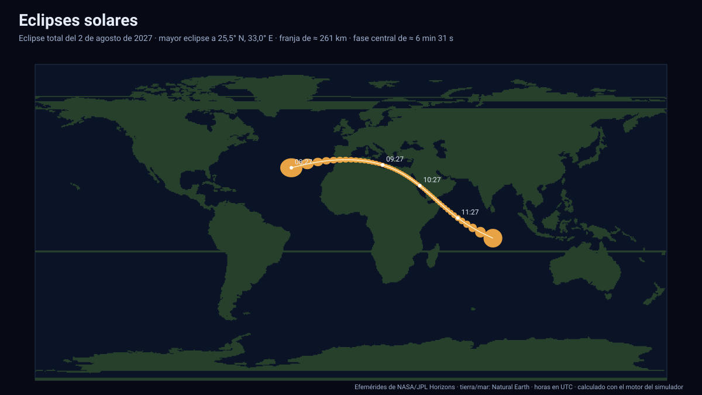

# Simulador de eclipses solares

[▶ Abrir el simulador](https://vladimiracunadev-create.github.io/astronomy-astrophysics-space-sciences-aerospace-engineering-learning-program/simuladores/eclipses-solares.html) · [Guía de uso](GUIA_DE_USO.md) · [Datos y efemérides](DATOS_Y_EFEMERIDES.md) · [Tierra · Sol · Luna](tierra-sol-luna.md)

## Qué hace

Muestra los **54 eclipses solares de 2027 a 2050** y, para los **34 centrales** (totales, anulares e híbridos), dibuja sobre un mapamundi la **franja de totalidad o de anularidad** con la anchura real de la sombra y marcas cada 30 minutos (UTC). Para cada eclipse indica la fecha y hora del máximo, γ, el lugar del **mayor eclipse**, la altura del Sol allí, la **anchura** de la franja y la **duración** de la fase central. Con un clic en el mapa (o con latitud y longitud) calcula las **circunstancias locales**: magnitud máxima, obscuración, instante del máximo, altura del Sol y si el eclipse se ve desde ese lugar.

Para ver el de 2027: [eclipse total del 2 de agosto de 2027](https://vladimiracunadev-create.github.io/astronomy-astrophysics-space-sciences-aerospace-engineering-learning-program/simuladores/eclipses-solares.html#f=2027-08-02): cruza el estrecho de Gibraltar, Egipto, Arabia Saudita y Somalia, con una anchura de ≈ 261 km y ≈ 6 min 31 s de fase central.

## Método

1. En cada instante se toma el **eje de la sombra**, la recta que pasa por el centro del Sol y el de la Luna (efemérides de JPL).
2. Su intersección con el elipsoide terrestre WGS 84 —en ejes fijos a la Tierra, con el ángulo de rotación terrestre— da la **línea central**; se calcula cada 2 minutos.
3. La **anchura** sale del radio de la umbra (o de la antiumbra en los anulares) a la distancia del suelo: `r = |R_Luna/cos f₂ − s·tan f₂|`, dividido por el coseno de la inclinación del rayo.
4. La **duración** de la fase central es la anchura dividida por la velocidad del punto de impacto respecto del suelo.
5. En un lugar, se minimiza la separación Sol–Luna topocéntrica para hallar la magnitud (cociente de diámetros en los centrales, fracción del diámetro cubierta en los parciales) y la obscuración (área de la lente de intersección de ambos discos).

## Validación contra el catálogo de la NASA

Se compararon los 34 eclipses centrales con el *Five Millennium Catalog of Solar Eclipses* (Espenak y Meeus), guardado en [`pruebas/referencia_nasa_franjas.json`](../pruebas/referencia_nasa_franjas.json):

| Magnitud | Resultado |
|---|---|
| Lugar del mayor eclipse | A ≤ 0,69° del catálogo en los 34 (el catálogo redondea a 1°) |
| Magnitud en el mayor eclipse | Diferencia ≤ 0,001 en los 34 |
| Anchura de la franja | Dentro de ±12 % (o 12 km en las estrechas) en los 34 |
| Duración de la fase central | Dentro de ±10 % en 17 de 34; el resto difiere más (eclipses de latitud alta y de franjas muy oblicuas) |

## Límites

- **No es una predicción oficial.** No incluye el relieve del limbo lunar (valles y montañas que cambian la duración y los bordes de la franja), la refracción atmosférica ni la altitud del terreno. La duración de la fase central es la menos fiable de las magnitudes; la de los eclipses cercanos a los polos puede diferir mucho de la del catálogo.
- La franja se muestra sobre una máscara tierra/mar de baja resolución (0,5°): la línea no sigue las costas con detalle.
- La obscuración local de eclipses parciales usa discos ideales (sin oscurecimiento del limbo solar).

Sistema de referencia: efemérides de JPL (eclíptica J2000) y elipsoide WGS 84; tiempo: TDB mostrado en UTC; datos: ver [Datos y efemérides](DATOS_Y_EFEMERIDES.md).

## Archivos

[`eclipses-solares.html`](https://vladimiracunadev-create.github.io/astronomy-astrophysics-space-sciences-aerospace-engineering-learning-program/simuladores/eclipses-solares.html) · [`paginas/eclipses-solares.js`](../paginas/eclipses-solares.js) · [`motor/franja.js`](../motor/franja.js) · [`motor/app-franja.js`](../motor/app-franja.js)
