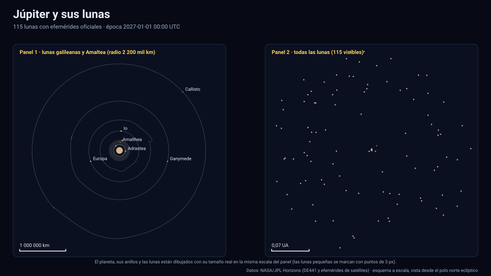

# Simulador de Júpiter y sus lunas

[▶ Abrir el simulador](https://vladimiracunadev-create.github.io/astronomy-astrophysics-space-sciences-aerospace-engineering-learning-program/simuladores/jupiter.html) · [Guía de uso](GUIA_DE_USO.md) · [Datos y efemérides](DATOS_Y_EFEMERIDES.md) · [Tabla de precisión](TABLA_DE_PRECISION.md)

## Qué muestra

Júpiter y los **115 satélites** para los que JPL Horizons publica efemérides (los numerados y las designaciones provisionales `S/20xx J n`), entre 2027 y 2050:

- **Lunas galileanas** (Ío, Europa, Ganimedes, Calisto) con tamaño real, órbita real (con su resonancia de Laplace 4 : 2 : 1), iluminación y **eclipses por la sombra de Júpiter**; el panel indica cuándo es el **próximo eclipse** de la luna seleccionada y cuánto dura.
- **Lunas internas** (Metis, Adrástea, Amaltea, Tebe) y los **anillos** (halo, anillo principal y anillos de gasa de Amaltea y Tebe) con los radios publicados por la NASA.
- **Lunas irregulares** (grupos de Himalia, Carme, Ananke, Pasífae y las más recientes) a escala: sus órbitas llegan a ~ 3×10⁷ km, más de 400 veces el radio de Júpiter. Use «Toda la familia de lunas».
- Júpiter con su orientación IAU, su achatamiento (6,5 %: se aprecia), bandas ilustrativas y la línea día/noche calculada con el Sol real.

Sólo 16 de los 115 satélites tienen radio publicado en Horizons; el resto se dibuja como punto y el panel indica «no publicado». No se estiman radios.

## Datos que se calculan en pantalla

Distancia a Júpiter (km y radios jovianos), velocidad, elementos osculadores a·e·i y periodo osculador, longitud y latitud eclípticas, iluminación vista desde Júpiter, estado de eclipse, próximo eclipse (búsqueda hacia adelante con paso de 1/300 del periodo y refinamiento por bisección) y el error de interpolación medido de ese cuerpo.

## Precisión

| Cuerpo | Periodo | Paso de la tabla | Error máx. medido contra JPL |
|---|---|---|---|
| Ío | 1,771 d | 3,6 h (`f32`) | 0,5 km |
| Europa | 3,553 d | 7,2 h | 1,5 km |
| Ganimedes | 7,157 d | 14,7 h | 4,1 km |
| Calisto | 16,704 d | 33,9 h | 46 km |
| Amaltea | 0,502 d | 102 min (`i16`) | 23 km |
| Metis · Adrástea | ≈ 0,3 d | 60 min (`i16`) | ≈ 10 km |
| Himalia | 248 d | 6,4 d | 225 km |

El peor caso de las 115 lunas es de **431 km** (Megaclite, a ≈ 2,4×10⁷ km del planeta: 2×10⁻⁵ de su radio orbital). Los satélites irregulares reciben nodos más densos (≈ 25 por órbita) porque la marea solar añade términos de alta frecuencia. Todas las lunas, con su error, están en la [tabla de precisión](TABLA_DE_PRECISION.md). Los 115 satélites tienen cobertura completa 2027–2050.

La posición de **Júpiter** (centro del planeta, heliocéntrico) tiene un error máximo de 165 km con un paso de 4 días: Horizons entrega el centro del planeta, que oscila ~ 10² km en torno al baricentro por la acción de las lunas galileanas. No afecta a las posiciones de las lunas, que son relativas al planeta.

## Tolerancias

| Magnitud | Tolerancia |
|---|---|
| Posición de las lunas respecto de Júpiter | ≤ 6×10⁻⁴ del radio orbital (medido: ≤ 3×10⁻⁴ en el peor caso, ≤ 3×10⁻⁵ en las galileanas) |
| Instantes de eclipse por la sombra de Júpiter | Cono de umbra con radio 71 492 km y Sol extenso; sin penumbra ni atmósfera: del orden de segundos a minutos |
| Orientación de Júpiter | Polo y rotación IAU sin términos periódicos |
| Anillos | Radios orientativos de NASA; opacidad ilustrativa |
| Texturas | Ilustrativas |

Sistema de referencia: eclíptica y equinoccio J2000 (ICRF); unidades: km y días julianos; tiempo: TDB mostrado en UTC; versiones: Horizons API 1.2, kernels `jup365`, `jup347`, `jup348`, `jup349` con DE442; datos descargados el 13 de noviembre de 2026.

## Archivos

[`jupiter.html`](https://vladimiracunadev-create.github.io/astronomy-astrophysics-space-sciences-aerospace-engineering-learning-program/simuladores/jupiter.html) · [`paginas/jupiter.js`](../paginas/jupiter.js) · [`datos/jupiter.json`](../datos/jupiter.json) · [`datos/jupiter.bin`](../datos/jupiter.bin)
