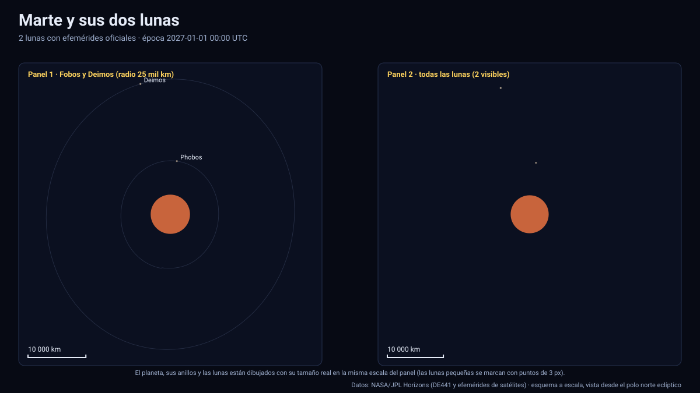

# Simulador de Marte y sus dos lunas

[▶ Abrir el simulador](../marte.html) · [Guía de uso](GUIA_DE_USO.md) · [Datos y efemérides](DATOS_Y_EFEMERIDES.md) · [Tabla de precisión](TABLA_DE_PRECISION.md)

## Qué muestra

Marte con **Fobos** y **Deimos** entre 2027 y 2050, con posiciones oficiales de JPL Horizons (kernel `mar099`), tamaños reales y órbitas reales (no elipses ideales):

- **Fobos**: radio medio 11,1 km, órbita a unos 9 400 km del centro de Marte (2,8 radios marcianos), periodo ≈ 7 h 39 min. Da **≈ 3,2 vueltas por día marciano**, por eso, visto desde Marte, sale por el oeste y se pone por el este.
- **Deimos**: radio medio 6,2 km, órbita a unos 23 500 km, periodo ≈ 30 h 18 min.
- **Marte**: orientación (polo y meridiano origen IAU), achatamiento, la línea día/noche calculada con el Sol real, la **longitud solar areocéntrica Ls** y la declinación del Sol (latitud subsolar).
- La **sombra de Marte** sobre sus lunas (se ven «eclipsadas», con el estado en el panel) y la iluminación vista desde Marte.

Con tamaños reales Fobos y Deimos son puntos de pocos píxeles; para verlos, use «Tamaño de los cuerpos» (×10 … ×1000) —sólo amplía los cuerpos, no las distancias— o los botones «Fobos» y «Deimos», que acercan la cámara a decenas de kilómetros.

## Datos que se calculan en pantalla

| Dato | Cómo se obtiene |
|---|---|
| Distancia a Marte, velocidad, a·e·i osculadores, periodo osculador | Estado instantáneo de la tabla de JPL respecto de Marte (eclíptica J2000); son **osculadores** (varían con el aplanamiento de Marte y la perturbación solar) |
| Vueltas por día marciano | Día solar medio de Marte (1,02749 d) / periodo osculador |
| Diámetro angular visto desde Marte | 2·asin(R/d) de la luna y del Sol con radios reales |
| Longitud solar Ls | Ángulo, medido en el plano orbital de Marte, entre la dirección Marte→Sol y la dirección del equinoccio de primavera boreal (donde el Sol cruza el ecuador marciano hacia el norte) |
| Estación | Ls: 0–90° primavera boreal, 90–180° verano, 180–270° otoño, 270–360° invierno |
| En la sombra | Cono de umbra de Marte (radio 3 396 km y Sol extenso) a la posición de la luna |

## Validación específica

- Las **pruebas** (`pruebas/ejecutar.mjs`) comprueban que, entre 2027 y 2050, **cada perihelio de Marte** (13 en total) ocurre con Ls = 251° ± 3°, como establece la convención de Clancy et al. (2000), lo que valida a la vez la orientación del polo, la posición heliocéntrica y la fórmula de Ls. El peor desvío es de ≈ 2°, que corresponde a la perturbación real de los planetas sobre el perihelio osculador.
- Error de interpolación contra Horizons en 120 épocas no nodales: **Fobos 2,35 km** y **Deimos 1,9 km** como máximo (véase la [tabla de precisión](TABLA_DE_PRECISION.md)). Para Fobos el paso es de 63 min (≈ 6 nodos por órbita) con formato `i16`: el error incluye la cuantización.

## Tolerancias

| Magnitud | Tolerancia |
|---|---|
| Posición de Fobos y Deimos | ≤ 2,4 km (≈ 2,5×10⁻⁴ del radio orbital) |
| Posición de Marte (heliocéntrica) | < 0,001 km |
| Orientación de Marte (línea día/noche, Ls) | Polo y rotación IAU sin términos periódicos; Ls ± 2° (validada con el perihelio) |
| Superficie, casquetes polares | Ilustrativos (no son imágenes de misión) |

Sistema de referencia: eclíptica y equinoccio J2000 (ICRF); unidades: km y días julianos; tiempo: TDB mostrado en UTC; versiones: Horizons API 1.2, `mar099`, DE441; datos descargados el 13 de noviembre de 2026.

## Archivos

[`marte.html`](../marte.html) · [`paginas/marte.js`](../paginas/marte.js) · [`datos/marte.json`](../datos/marte.json) · [`datos/marte.bin`](../datos/marte.bin)
