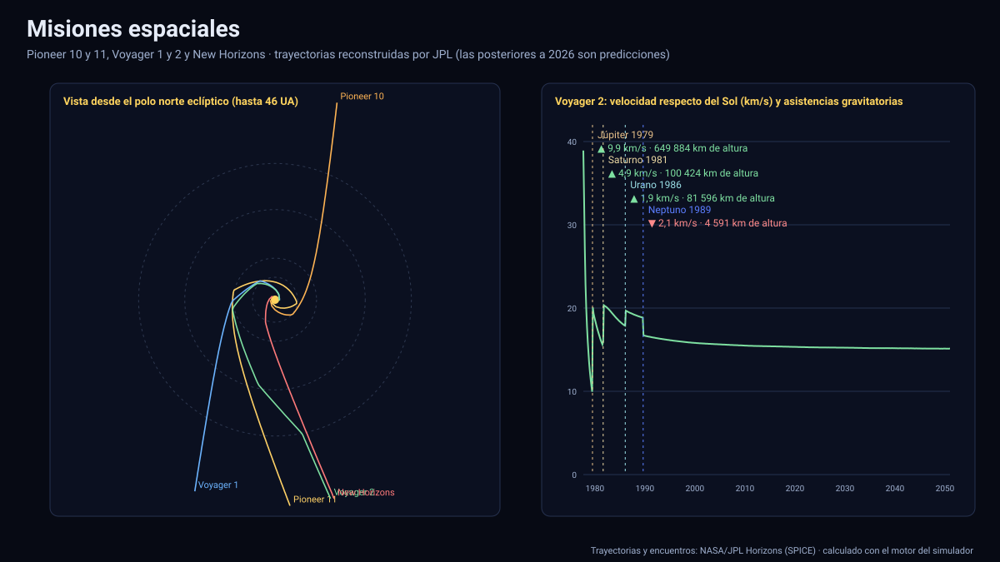

# Simulador de misiones espaciales

[▶ Abrir el simulador](https://vladimiracunadev-create.github.io/astronomy-astrophysics-space-sciences-aerospace-engineering-learning-program/simuladores/misiones.html) · [Guía de uso](GUIA_DE_USO.md) · [Datos y efemérides](DATOS_Y_EFEMERIDES.md) · [Talleres de misión](../../talleres/README.md)

## Qué hace

Se **elige una misión en una lista**, se pulsa ▶ y se ve su trayectoria real moverse entre los planetas. La pantalla tiene tres vistas coordinadas:

1. **Mapa del Sistema Solar** visto desde el polo norte eclíptico, con las órbitas planetarias, los planetas en la fecha actual, la trayectoria recorrida (intensa) y la que falta (tenue) y **cada encuentro con un planeta** marcado con un anillo del color del planeta (vacío si aún no ocurrió, lleno si ya ocurrió), su fecha y la ganancia o pérdida de velocidad (▲ / ▼ km/s). El encuadre crece con la nave; la escala puede ser comprimida (raíz cuadrada de la distancia, para ver a la vez los planetas interiores y los exteriores) o lineal (proporciones reales).
2. **Velocidad respecto del Sol** en toda la misión, con la velocidad de escape del Sol (línea de trazos) y los encuentros como marcas verticales: **cada asistencia gravitatoria se ve como un salto**. Un clic o arrastre en el gráfico lleva a esa fecha.
3. **Detalle del encuentro** (barra lateral): la trayectoria de la nave respecto del planeta, con **el planeta a escala**, la dirección al Sol y el movimiento del planeta, que son los que determinan si la nave gana o pierde velocidad. Debajo, los números: altura mínima, velocidad relativa, velocidad en el infinito, ángulo de desvío, excentricidad y la velocidad heliocéntrica antes y después.

Los botones ⏪ y ⏩ saltan al encuentro anterior y siguiente; la **cámara lenta en los encuentros** frena el tiempo al acercarse a cada planeta (de entrar en su esfera de influencia hasta el mayor acercamiento) para ver el sobrevuelo; se puede desactivar.

## Misiones

| Grupo | Misiones |
|---|---|
| Planetas exteriores | Pioneer 10 y 11, Voyager 1 y 2, Galileo, Ulysses, Cassini, New Horizons, Juno, Europa Clipper |
| Mercurio, Venus y el Sol | MESSENGER, BepiColombo, Parker Solar Probe, Solar Orbiter |
| Marte, asteroides y cometas | Rosetta, Dawn, OSIRIS-REx, Hayabusa2, Lucy, Psyche, MAVEN |
| Telescopios | James Webb (en L2) |

## Datos

- **Trayectorias**: reconstruidas por JPL con datos de seguimiento (SPICE), descargadas de Horizons como posiciones heliocéntricas (eclíptica y equinoccio J2000) con paso de 1 a 3 días e interpolación de Lagrange. Las posteriores al 13 de noviembre de 2026 son **predicciones**; las de Pioneer 10 y 11 posteriores a su último contacto se rotulan como extrapolación.
- **Encuentros** ([`datos/encuentros.json`](../datos/encuentros.json), 77 sobrevuelos e inserciones en órbita): se **detectan** como mínimos de la distancia nave–planeta dentro de la esfera de influencia del planeta (a·(m/M☉)^0,4), y para cada uno Horizons entrega el estado planetocéntrico con paso de 5 a 20 minutos (para encontrar el instante y la distancia exactos) y 73 épocas con espaciado geométrico, muy denso cerca del acercamiento (en el simulador se interpolan con Hermite cúbico). Dentro de cada encuentro la nave sigue esa trayectoria de alta resolución, por lo que pasa por el planeta a la altura real y no a la que daría la tabla de 1 a 3 días.
- **Ganancia de velocidad**: método de las cónicas empalmadas. Con el estado en el mayor acercamiento se calcula la hipérbola (excentricidad, asíntotas de entrada y de salida), se suma la velocidad del planeta y se comparan los módulos de la velocidad heliocéntrica de salida y de entrada. Los encuentros en que la nave queda capturada (inserciones en órbita, p. ej. Cassini en Saturno) no son asistencias y se rotulan así.
- **Planetas**: efemérides oficiales de 1970 a 2050 (Mercurio a Neptuno y el baricentro de Plutón).

Generadores: [`generar_misiones.py`](../../herramientas/efemerides/generar_misiones.py) (trayectorias) y [`generar_encuentros.py`](../../herramientas/efemerides/generar_encuentros.py) (encuentros).

## Validación

| Comprobación | Referencia | Resultado |
|---|---|---|
| Instante de 60 encuentros | Fechas históricas publicadas (Pioneer, Voyager, Galileo, Cassini, New Horizons, Juno, Europa Clipper, Parker, Ulysses, MESSENGER, Rosetta, Dawn, BepiColombo, Solar Orbiter, Lucy, Hayabusa2, OSIRIS-REx) | Coinciden en el mismo día (±0,75 d) en los 60 |
| Distancia del mayor acercamiento | Voyager 1–Júpiter 348 890 km al centro; New Horizons–Plutón 12 500 km de altura; Rosetta–Tierra (2005) 1 954 km; Cassini–Tierra (1999) 1 171 km; Cassini–Venus 284 y 600 km; Dawn–Marte 549 km | Dentro de 1,5 km a 150 km según el dato publicado (ver [`pruebas/ejecutar.mjs`](../pruebas/ejecutar.mjs)) |
| Asistencia gravitatoria | Galileo–Tierra (1990): v∞ 8,95 km/s y ganancia ≈ 5,2 km/s | Coincide (8,95 y 5,19 km/s) |
| Coherencia de cada hipérbola | Desvío = 2·asin(1/e) | Idéntico en todos los encuentros que no son órbitas |
| Interpolación de Hermite | Omitir una época y recuperarla con sus vecinas | Error relativo máximo bajo el 3 % con la mitad de la densidad |
| Distancia al cruzar la heliopausa | Voyager 1 (25-08-2012) ≈ 121 UA, Voyager 2 (05-11-2018) ≈ 119 UA | Dentro de ±1,5 UA |
| James Webb | En L2: 1,0–1,9 millones de km de la Tierra y más lejos del Sol que ella | Cumple |
| Interpolación de las tablas contra Horizons | 120 épocas no nodales por cuerpo | Planetas y Plutón ≤ 165 km; naves: del orden de 10³ km y hasta ≈ 10⁶ km en las que hacen maniobras o sobrevuelos (Psyche, Cassini, Juno); **esos casos se corrigen con la trayectoria planetocéntrica de cada encuentro** |

## Límites

- **Es una visualización de trayectorias heliocéntricas con el detalle de los encuentros, no un simulador de sobrevuelos completo**: no muestra ocultaciones, la orientación de la nave ni las maniobras de corrección.
- La **ganancia de velocidad** es la del modelo de cónicas empalmadas (dos cuerpos y velocidades asintóticas); la que se mide en vuelo difiere en décimas de km/s por la gravedad del Sol y las maniobras.
- El **detalle del encuentro** proyecta la trayectoria en el plano de la hipérbola (la real se aparta unos pocos grados de un plano exacto); Plutón se trata como baricentro del sistema (diferencia de ≈ 2 000 km). Tras una inserción en órbita sólo se muestra la llegada.
- Los tamaños de los puntos son simbólicos; las distancias, reales. Las trayectorias de naves cuyo ciclo de operaciones terminó (Dawn, 2018) se cortan en esa fecha.
- Faltan misiones relevantes como las sondas a Marte (Viking, MER, MSL, Perseverance), Magellan o Stardust; podrían añadirse con los mismos generadores. Mariner 10 se excluyó: su efeméride de Horizons no reproduce sus sobrevuelos.

Sistema de referencia: eclíptica y equinoccio J2000 (ICRF), centro el Sol (mapa) o el planeta (detalle); unidades: km, UA, km/s y días; tiempo: TDB mostrado en UTC; datos descargados el 13 de noviembre de 2026.

## Archivos

[`misiones.html`](https://vladimiracunadev-create.github.io/astronomy-astrophysics-space-sciences-aerospace-engineering-learning-program/simuladores/misiones.html) · [`paginas/misiones.js`](../paginas/misiones.js) · [`motor/misiones.js`](../motor/misiones.js) · [`motor/app-misiones.js`](../motor/app-misiones.js) · [`datos/misiones.json`](../datos/misiones.json) · [`datos/planetas_hist.json`](../datos/planetas_hist.json) · [`datos/encuentros.json`](../datos/encuentros.json)
