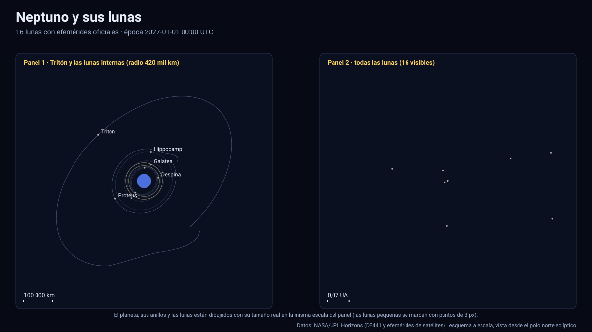

# Simulador de Neptuno y sus lunas

[▶ Abrir el simulador](https://vladimiracunadev-create.github.io/astronomy-astrophysics-space-sciences-aerospace-engineering-learning-program/simuladores/neptuno.html) · [Guía de uso](GUIA_DE_USO.md) · [Datos y efemérides](DATOS_Y_EFEMERIDES.md) · [Tabla de precisión](TABLA_DE_PRECISION.md)

## Qué muestra

Neptuno, sus anillos y los **16 satélites** para los que JPL Horizons publica efemérides, entre 2027 y 2050:

- **Tritón** (radio 1 352,6 km): órbita **retrógrada** (gira al revés que Neptuno) e inclinada ≈ 157° respecto del ecuador del planeta, a ≈ 355 000 km, con un periodo de ≈ 5,88 días. Es una órbita casi circular; el panel muestra «Sentido de la órbita: retrógrado».
- **Nereida** (radio 170 km): una de las órbitas más excéntricas conocidas (e ≈ 0,75): su distancia al planeta varía entre ≈ 1,4 y ≈ 9,7 millones de km a lo largo de ≈ 360 días.
- **Lunas internas**: Náyade, Talasa, Despina, Galatea, Larisa, **Proteo** (radio 208 km) e Hipocampo.
- **Lunas irregulares lejanas**: Halimede, Sao, Laomedea, Psámate, Neso y dos designaciones provisionales (S/2002 N 5, S/2021 N 1), a entre 1,7×10⁷ y 5,2×10⁷ km del planeta (hasta 2 000 radios de Neptuno).
- **Anillos** de Galle, Le Verrier, Arago y Adams con los radios publicados por la NASA (opacidad ilustrativa).
- Neptuno con orientación IAU (incluye el término periódico principal), achatamiento de 1,7 %, línea día/noche con el Sol real y latitud subsolar.

Con tamaños reales las lunas internas son puntos: use «Anillos y lunas internas» o amplíe los tamaños.

## Datos que se calculan en pantalla

Distancia a Neptuno, velocidad, elementos osculadores, **sentido de la órbita** (directo o retrógrado respecto de la rotación del planeta), longitud y latitud eclípticas, iluminación vista desde Neptuno, eclipses por la sombra del planeta (con el próximo y su duración) y el error de interpolación medido de cada cuerpo.

## Precisión

| Cuerpo | Periodo | Paso de la tabla | Error máx. medido contra JPL |
|---|---|---|---|
| Tritón | 5,88 d | 12,1 h (`f32`) | 0,20 km |
| Nereida | 361 d | 30 h | 0,78 km |
| Proteo | 1,12 d | 2,3 h | 0,06 km |
| Náyade … Larisa, Hipocampo | 0,30–0,95 d | 60–195 min (`i16`) | 3–9 km |
| Lunas irregulares | 1 887–10 300 d | 28–30 d | ≈ 148 km |

Las lunas irregulares comparten un error de ≈ 148 km (≈ 10⁻⁵ de su radio orbital). Tiene una causa física conocida y no es un defecto de los datos: sus efemérides están referidas al baricentro del sistema, mientras que la tabla está centrada en **el centro de Neptuno**, que oscila ≈ 75 km alrededor del baricentro con el periodo de 5,88 d de Tritón; con un paso de 30 días esa oscilación no se resuelve. Todas las lunas, con su error, están en la [tabla de precisión](TABLA_DE_PRECISION.md). Las 16 lunas tienen cobertura completa 2027–2050.

La posición de **Neptuno** (centro del planeta, heliocéntrica) tiene un error máximo de 143 km con un paso de 4 días, por la misma razón.

## Tolerancias

| Magnitud | Tolerancia |
|---|---|
| Posición de las lunas respecto de Neptuno | ≤ 6×10⁻⁴ del radio orbital (validación automática; medido ≤ 9×10⁻⁵) |
| Anillos | Radios orientativos de NASA, opacidad ilustrativa |
| Eclipses por la sombra de Neptuno | Cono de umbra de radio 24 764 km y Sol extenso; sin penumbra |
| Orientación de Neptuno | Polo y rotación IAU con el término principal de nutación |
| Textura | Ilustrativa |

Sistema de referencia: eclíptica y equinoccio J2000 (ICRF); unidades: km y días julianos; tiempo: TDB mostrado en UTC; versiones: Horizons API 1.2, kernels `nep098` y `nep104`; datos descargados el 13 de noviembre de 2026.

## Archivos

[`neptuno.html`](https://vladimiracunadev-create.github.io/astronomy-astrophysics-space-sciences-aerospace-engineering-learning-program/simuladores/neptuno.html) · [`paginas/neptuno.js`](../paginas/neptuno.js) · [`datos/neptuno.json`](../datos/neptuno.json) · [`datos/neptuno.bin`](../datos/neptuno.bin)
