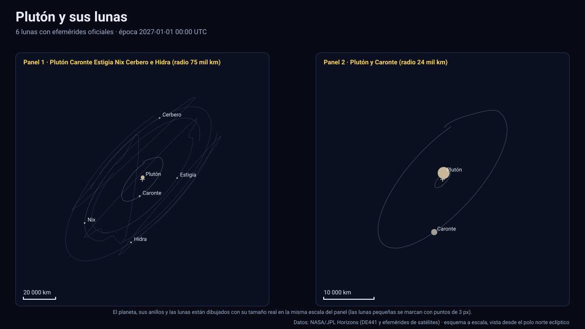

# Simulador de Plutón y sus lunas

[▶ Abrir el simulador](https://vladimiracunadev-create.github.io/astronomy-astrophysics-space-sciences-aerospace-engineering-learning-program/simuladores/pluton.html) · [Guía de uso](GUIA_DE_USO.md) · [Datos y efemérides](DATOS_Y_EFEMERIDES.md) · [Tabla de precisión](TABLA_DE_PRECISION.md)

## Qué muestra

El sistema de Plutón entre 2027 y 2050, con posiciones oficiales de JPL Horizons (kernel `plu060`) y tamaños y distancias reales:

- **Plutón** (radio 1 188,3 km) y **Caronte** (radio 606 km) no giran uno en torno al otro: ambos giran alrededor de su **baricentro**, que queda **fuera de Plutón**. Con los datos oficiales, Plutón está a ≈ 2 132 km del baricentro y Caronte a ≈ 17 464 km; la separación entre sus centros es de ≈ 19 596 km y el periodo orbital de 6,387 días.
- Cuatro lunas pequeñas e irregulares: **Estigia** (radio ≈ 5 km), **Nix** (18 km), **Cerbero** (6 km) e **Hidra** (18,5 km), en órbitas casi circulares y coplanares alrededor del baricentro, a entre ≈ 43 500 y ≈ 64 900 km.
- Plutón y Caronte están en **rotación síncrona**: se miran siempre la misma cara; el simulador lo reproduce. Plutón se dibuja con una textura ilustrativa (llanuras claras y terreno oscuro), no con imágenes de New Horizons.

El sistema entero cabe en una ventana de 130 000 km (la distancia Tierra–Luna es de 384 000 km). Con tamaños reales las lunas pequeñas son puntos: use «Tamaño de los cuerpos» o los botones de acceso rápido.

## Cómo se contrasta

| Comprobación | Resultado |
|---|---|
| Interpolación contra Horizons (120 épocas aleatorias por cuerpo) | Plutón 0,001 km · Caronte 0,009 km · Estigia 0,8 km · Nix 1,5 km · Cerbero 2,9 km · Hidra 3,6 km |
| Cociente de masas Caronte/Plutón = (distancia de Plutón al baricentro)/(distancia de Caronte) | 0,1221 con los datos; el publicado es ≈ 0,122 |
| Separación Plutón–Caronte | 19 593–19 599 km (casi circular) |

Plutón, Caronte y el baricentro están en un único archivo (`datos/pluton.*`) con centro en el **baricentro del sistema** (`500@9` en Horizons). El periodo y la excentricidad de Plutón y Caronte se fijan a los valores publicados (6,3872 d) para elegir el paso de la tabla, porque su periodo osculador respecto de la GM total del sistema no es el real. Los elementos osculadores de Caronte se muestran respecto de **Plutón** (órbita relativa); los de las lunas pequeñas, respecto del baricentro con la GM total.

## Tolerancias

| Magnitud | Tolerancia |
|---|---|
| Posición de los cuerpos respecto del baricentro | ≤ 3,6 km (≤ 6×10⁻⁴ del radio orbital, validación automática) |
| Orientación de Plutón | Polo y rotación IAU sin términos periódicos |
| Superficie | Ilustrativa |
| Eclipses mutuos | No se calculan: no hay temporada de eclipses mutuos entre 2027 y 2050 |

Sistema de referencia: eclíptica y equinoccio J2000 (ICRF); unidades: km y días julianos; tiempo: TDB mostrado en UTC; versiones: Horizons API 1.2, kernel `plu060`; datos descargados el 13 de noviembre de 2026.

## Archivos

[`pluton.html`](https://vladimiracunadev-create.github.io/astronomy-astrophysics-space-sciences-aerospace-engineering-learning-program/simuladores/pluton.html) · [`paginas/pluton.js`](../paginas/pluton.js) · [`datos/pluton.json`](../datos/pluton.json) · [`datos/pluton.bin`](../datos/pluton.bin)
