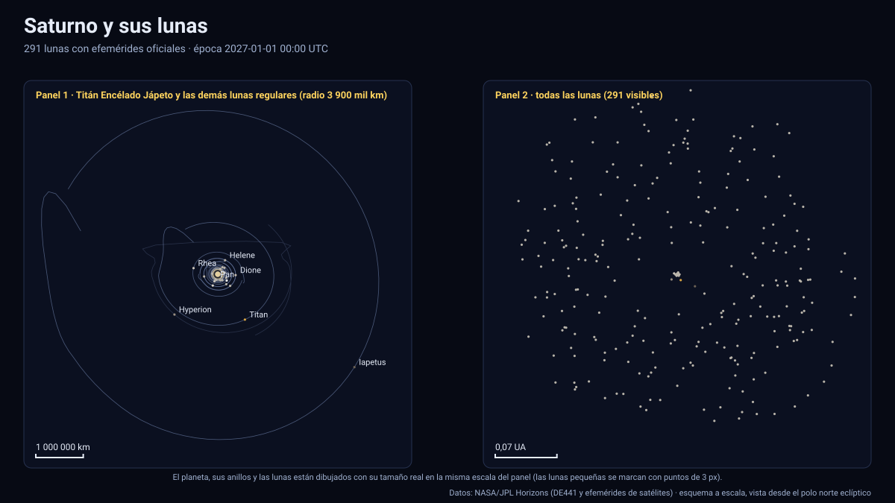

# Simulador de Saturno y sus lunas

[▶ Abrir el simulador](../saturno.html) · [Guía de uso](GUIA_DE_USO.md) · [Datos y efemérides](DATOS_Y_EFEMERIDES.md) · [Tabla de precisión](TABLA_DE_PRECISION.md)

## Qué muestra

Saturno, sus anillos y los **291 satélites** para los que JPL Horizons publica efemérides (numerados y designaciones provisionales `S/20xx S n`), entre 2027 y 2050:

- **Lunas mayores**: Mimas, Encélado, Tetis, Dione, Rea, **Titán** (radio 2 575,5 km, a 1,22 millones de km, 16 días por vuelta), Hiperión, **Jápeto** (79,5 días) y Febe (retrógrada, ≈ 549 días).
- **Lunas internas y pastoras**: Pan, Atlas, Prometeo, Pandora, Jano y Epimeteo (con su intercambio de órbitas), y las troyanas de Tetis y Dione.
- **Anillos** D, C, B, A, F, G y E con los radios publicados por la NASA, dibujados con tamaño real (el sistema de anillos principal mide ≈ 137 000 km desde el centro; el anillo E se extiende hasta ≈ 480 000 km), con la división de Cassini.
- **Lunas irregulares** (grupos nórdico, gala e inuit): más de 200 satélites a hasta ≈ 3×10⁷ km del planeta. Use «Toda la familia de lunas».
- Saturno con su orientación IAU, achatamiento (9,8 %: el más aplanado del Sistema Solar), bandas ilustrativas y línea día/noche calculada con el Sol real, y la **elevación del Sol sobre el plano de los anillos**.

Sólo 17 de los 291 satélites tienen radio publicado en Horizons; el resto se dibuja como punto y el panel indica «no publicado».

## Cobertura incompleta (declarada)

Horizons no publica efemérides para el 100 % del periodo en 10 satélites, y el simulador **los oculta** tras su fecha final en vez de inventar su posición:

| Satélite | Última fecha con efemérides |
|---|---|
| Jano, Epimeteo, Atlas, Prometeo, Pandora, Pan, Anthe, Egéon | 2050-01-08 |
| Palene | 2050-01-07 |
| S/2009 S 2 | 2049-12-30 |

Además, **Dafne** (Saturno XXXV) se excluye: Horizons no tiene efemérides posteriores al 17 de enero de 2018.

## Estaciones de Saturno (calculadas)

La elevación del Sol sobre el plano de los anillos sale de la posición heliocéntrica de Saturno (JPL) y del polo IAU. Entre 2027 y 2050 el Sol cruza el plano de los anillos **una vez**, hacia el **22 de enero de 2039** (equinoccio de Saturno: los anillos se ven «de canto» desde el Sol). Es un resultado calculado aquí; la prueba automática exige que caiga entre 2038,5 y 2040,0, el intervalo que fija la geometría de la órbita y del eje.

## Precisión

| Cuerpo | Periodo | Paso de la tabla | Error máx. medido contra JPL |
|---|---|---|---|
| Mimas | 0,947 d | 1,9 h (`f32`) | 0,9 km |
| Encélado | 1,375 d | 2,8 h | 0,3 km |
| Tetis · Dione · Rea | 1,9 · 2,7 · 4,5 d | 3,9 · 5,6 · 9,3 h | 0,15 · 0,32 · 0,37 km |
| Titán | 15,96 d | 31 h | 8,2 km |
| Hiperión | 21,4 d | 15,2 h | 0,09 km |
| Jápeto | 79,5 d | 6,4 d | 122 km |
| Febe | 549 d | 13,8 d | 584 km |
| Jano · Epimeteo | 0,70 d | 142 min (`i16`) | 26 · 32 km |
| Pan · Atlas · Prometeo · Pandora | ≈ 0,6 d | 118–130 min | 10–20 km |

El peor error absoluto de las 291 lunas es de ≈ 1 000 km (una luna irregular lejana, S/2020 S 9); el peor error relativo es de 3,2×10⁻⁴ del radio orbital (Polidéuces, troyana de Dione). Todas las lunas están en la [tabla de precisión](TABLA_DE_PRECISION.md). Las lunas pequeñas y rápidas usan `i16` y sus errores incluyen la cuantización.

## Tolerancias

| Magnitud | Tolerancia |
|---|---|
| Posición de las lunas respecto de Saturno | ≤ 6×10⁻⁴ del radio orbital (validación automática; medido ≤ 3,3×10⁻⁴) |
| Posición de Saturno (heliocéntrica) | ≤ 11 km (paso de 4 días; oscilación real del centro del planeta) |
| Anillos | Radios orientativos de NASA, opacidad ilustrativa; sin sombras entre anillo y planeta |
| Eclipses por la sombra de Saturno | Cono de umbra de radio 60 268 km y Sol extenso; sin penumbra |
| Orientación de Saturno | Polo y rotación IAU sin términos periódicos |
| Texturas | Ilustrativas |

Sistema de referencia: eclíptica y equinoccio J2000 (ICRF); unidades: km y días julianos; tiempo: TDB mostrado en UTC; versiones: Horizons API 1.2, kernels `sat415`, `sat441`, `sat455`, `sat456`, `sat457`, `sat459`, `sat480`; datos descargados el 13 de noviembre de 2026.

## Archivos

[`saturno.html`](../saturno.html) · [`paginas/saturno.js`](../paginas/saturno.js) · [`datos/saturno.json`](../datos/saturno.json) · [`datos/saturno.bin`](../datos/saturno.bin)
