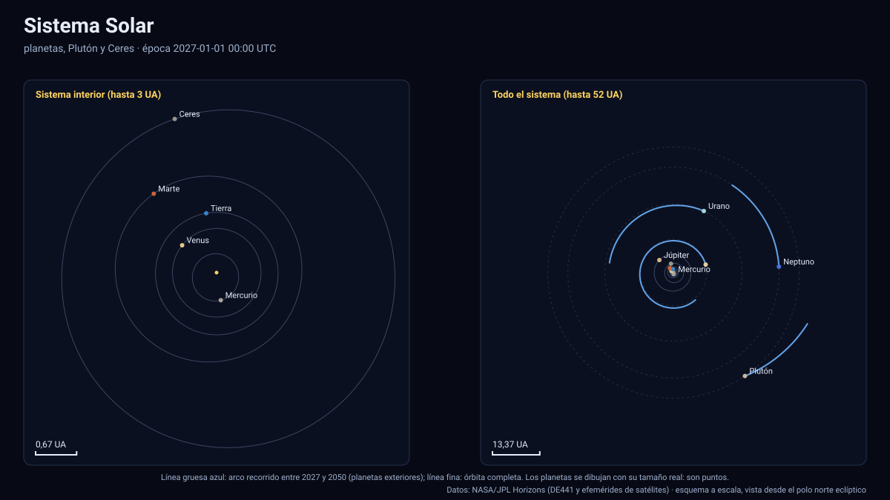

# Simulador del Sistema Solar

[▶ Abrir el simulador](../sistema-solar.html) · [Guía de uso](GUIA_DE_USO.md) · [Datos y efemérides](DATOS_Y_EFEMERIDES.md) · [Tabla de precisión](TABLA_DE_PRECISION.md)

## Qué muestra

El Sol, los **ocho planetas**, **Plutón** (baricentro del sistema Plutón–Caronte), el planeta enano **Ceres** y la **Luna** entre 2027 y 2050, con posiciones heliocéntricas oficiales de JPL Horizons (DE441) y **distancias y tamaños reales**:

- **Órbitas** como elipses osculadoras calculadas del estado instantáneo (posición y velocidad) de cada cuerpo con el parámetro gravitatorio del Sol; para los planetas exteriores se ve la órbita completa aunque solo 24 años de ella estén en la tabla.
- **Orientación y forma**: cada planeta con su polo y meridiano IAU, achatamiento (Júpiter y Saturno visiblemente aplastados) y anillos de Saturno, Júpiter, Urano y Neptuno al acercarse.
- **Datos por cuerpo**: distancia al Sol (UA y minutos luz), velocidad, elementos osculadores a·e·i y periodo, y —desde la Tierra— **distancia, elongación y fase** (iluminación) de cada planeta.
- **Oposiciones** de Marte, Júpiter, Saturno, Urano y Neptuno con su distancia a la Tierra (tablas en el panel; clic para ir al instante).
- **Accesos rápidos**: planetas interiores, hasta Júpiter, todo el sistema, vista lateral (se ve que los planetas están casi en un plano), y vistas cercanas de la Tierra, Júpiter y Saturno.

A escala real los planetas son puntos: el Sol mide 695 700 km y la distancia a Neptuno es de 30 UA (4 500 millones de km), 6 500 veces el radio solar. «Tamaño de los cuerpos» (×100 … ×10 000) amplía **sólo planetas y Luna** (el Sol permanece real); el aviso del panel lo indica siempre.

## Cómo se contrasta

| Comprobación | Resultado |
|---|---|
| Interpolación contra Horizons (120 épocas aleatorias por cuerpo) | Mercurio, Venus, Tierra, Marte, Plutón y Ceres ≤ 0,002 km; Saturno 10,8 km; Urano 20,4 km; Neptuno 142,9 km; Júpiter 165 km |
| Distancias al Sol el 2027-01-01 (UA) | 0,459 · 0,719 · 0,983 · 1,647 · 5,336 · 9,407 · 19,425 · 29,876 · 35,674 (Mercurio a Plutón) |
| Elementos osculadores de la Tierra | a = 1,000 UA, e = 0,0167, i ≈ 0° (la eclíptica J2000 es su plano) |
| Perihelio y afelio de la Tierra 2027–2050 (48) | ≤ 0,83 min respecto del U.S. Naval Observatory |
| Oposiciones de Marte | 2027-02-19 (0,678 UA), 2029-03-25 (0,649 UA), 2031-05-04 (0,559 UA); 12 oposiciones en el periodo |
| Perihelios de Marte | Los 13 ocurren con Ls = 251° ± 3° |
| Continuidad | Sin saltos a lo largo de 24 años para ningún cuerpo |

El error de Júpiter, Saturno, Urano y Neptuno (decenas a ≈ 165 km, menos de 0,25 % de un radio planetario) corresponde a la oscilación real del **centro del planeta** alrededor del baricentro del sistema por el efecto de sus lunas, que el paso de 4 días no resuelve. Es invisible a cualquier escala del simulador; véase [Datos y efemérides](DATOS_Y_EFEMERIDES.md).

Plutón se representa por el **baricentro del sistema Plutón–Caronte**: el centro del cuerpo oscila ≈ ± 2 100 km alrededor de él con el periodo de 6,39 días de Caronte.

## Tolerancias

| Magnitud | Tolerancia |
|---|---|
| Posición heliocéntrica de los planetas | ≤ 0,002 km (interiores) · ≤ 165 km (gigantes, por el centro del planeta) |
| Elipses osculadoras | Aproximación de dos cuerpos: sirven para ver la forma de la órbita, no para predecir posiciones (éstas salen de la tabla) |
| Instante de las oposiciones | Longitud geocéntrica geométrica; del orden de horas respecto de los almanaques |
| Tamaños | Reales (radios IAU), ampliables y siempre indicados |
| Orientación | Polo y rotación IAU sin términos periódicos |
| Texturas, anillos | Ilustrativos |

Sistema de referencia: eclíptica y equinoccio J2000 (ICRF); centro: el Sol; unidades: km y días julianos; tiempo: TDB mostrado en UTC; versiones: Horizons API 1.2, DE441; datos descargados el 13 de noviembre de 2026.

## Archivos

[`sistema-solar.html`](../sistema-solar.html) · [`paginas/sistema-solar.js`](../paginas/sistema-solar.js) · [`datos/sol.json`](../datos/sol.json) · [`datos/sol.bin`](../datos/sol.bin) · [`motor/astronomia.js`](../motor/astronomia.js)
