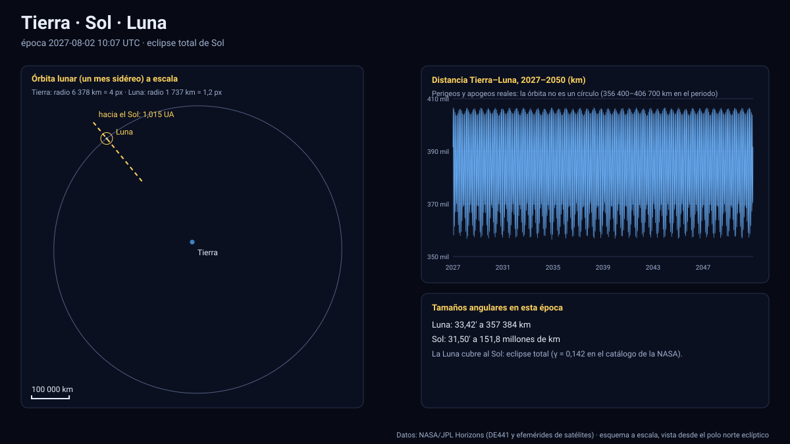

# Simulador Tierra · Sol · Luna

[▶ Abrir el simulador](../tierra-sol-luna.html) · [Guía de uso](GUIA_DE_USO.md) · [Datos y efemérides](DATOS_Y_EFEMERIDES.md) · [Fuentes y modelos](FUENTES_Y_MODELOS.md)

## Qué muestra

La Tierra, la Luna y el Sol entre el 1 de enero de 2027 y el 31 de diciembre de 2050, con **tamaños y distancias reales**:

- la **Luna** con su posición geocéntrica oficial de JPL Horizons (kernel DE441), su órbita real de un mes sidéreo (no una elipse ideal: se ve la perturbación solar) y su fase vista desde donde esté la cámara;
- la **Tierra** con su orientación (polo IAU y ángulo de rotación terrestre ERA), la línea día/noche calculada con la posición real del Sol, el **punto subsolar** y su achatamiento;
- el **Sol** como una dirección y una distancia en UA (a 1 UA no cabe en pantalla a escala), con su diámetro angular;
- los **eclipses** de Sol y de Luna de todo el periodo.

A escala real, en la vista inicial la Tierra mide pocos píxeles y la Luna aún menos: la Luna está a unos 60 radios terrestres. Eso **es** la escala del sistema. La opción «Tamaño de los cuerpos» amplía **sólo la Luna** (×5 o ×20) para verla; las distancias siempre son las reales.

## Datos que se calculan en pantalla (Luna seleccionada)

| Dato | Cómo se obtiene |
|---|---|
| Distancia a la Tierra y velocidad | Posición de la tabla de JPL; velocidad por derivada de la propia interpolación |
| Elementos osculadores a, e, i | Estado instantáneo respecto de la Tierra (marco eclíptico J2000); **osculadores**, por eso oscilan con la perturbación solar |
| Fase (Δλ) | Diferencia de longitud eclíptica Luna − Sol vista desde la Tierra |
| Elongación e iluminación | Ángulo Sol–Tierra–Luna e iluminación (1 − cos ε)/2 |
| Diámetros angulares | 2·asin(R/d) de la Luna y del Sol con sus radios reales |
| Punto subsolar | Dirección del Sol en el sistema fijo a la Tierra |

## Eclipses: cómo se calculan y cómo se validaron

El simulador busca, con la propia efemérides, todas las lunaciones donde Sol y Luna están alineados (conjunción y oposición en longitud eclíptica) y minimiza la distancia entre el **eje de sombra** y el centro de la Tierra (eclipses solares) o entre el centro de la Luna y el eje de la sombra terrestre (eclipses lunares), con conos de penumbra y umbra reales (radios solar, terrestre y lunar; agrandamiento atmosférico de la sombra de 1 %). Clasifica en total, anular, parcial o penumbral y entrega el instante del máximo, γ (solar) y las magnitudes (lunar).

**Validación:** cada ejecución de las pruebas compara los resultados con el *Five Millennium Catalog of Solar and Lunar Eclipses* de NASA GSFC (Espenak y Meeus), que se guarda como [referencia](../pruebas/referencia_nasa_eclipses.json) para poder repetir la prueba sin red:

| Resultado | Valor |
|---|---|
| Eclipses solares 2027–2050 | 54 encontrados · 54 en el catálogo |
| Eclipses lunares 2027–2050 | 55 encontrados · 55 en el catálogo |
| Coinciden en clase (total, anular, parcial, penumbral) | 109 de 109 |
| Peor diferencia en la hora del máximo | 0,8 minutos |
| Peor diferencia en γ (solar) | 0,0007 |
| Peor diferencia en magnitud umbral (lunar) | 0,002 |

Por ejemplo, el eclipse total del **2 de agosto de 2027** (máximo ≈ 10:07 UTC, γ = 0,142; el catálogo de la NASA da 6 min 23 s de totalidad en el punto de mayor duración), el del **22 de julio de 2028** y el lunar total del **31 de diciembre de 2028**. Atajo para verlos: seleccione una fila de la tabla «Eclipses 2027–2050» del panel.

**Límites:** el cálculo es geocéntrico (no traza la franja de totalidad sobre un mapa) y no incluye la refracción atmosférica ni el relieve lunar. La clase «híbrida» del catálogo (anular-total) se muestra como «total» o «anular» según el signo de la antumbra en el máximo.

## Tolerancias de este simulador

| Magnitud | Tolerancia |
|---|---|
| Posición de la Luna (interpolación vs. Horizons) | ≤ 0,02 km (máximo medido en 120 épocas) |
| Posición del Sol visto desde la Tierra | < 0,001 km |
| Hora del máximo de un eclipse | ≤ 1 minuto respecto del catálogo de NASA |
| Tiempo UTC ↔ TDB | 69,184 s constantes (véase [datos](DATOS_Y_EFEMERIDES.md)) |
| Orientación de la Tierra (línea día/noche, punto subsolar) | ≈ 0,7° (precesión-nutación omitidas) |
| Superficie de la Tierra y la Luna | Ilustrativa (máscara tierra/mar de Natural Earth; mares lunares aproximados) |

Sistema de referencia: eclíptica y equinoccio J2000 (ICRF); unidades: km y días julianos; tiempo: TDB mostrado en UTC; versiones: Horizons API 1.2, DE441, datos descargados el 13 de noviembre de 2026.

## Archivos

- Página: [`tierra-sol-luna.html`](../tierra-sol-luna.html) · lógica específica: [`paginas/tierra-sol-luna.js`](../paginas/tierra-sol-luna.js)
- Motor común: [`motor/`](../motor/) · datos: [`datos/sol.*`](../datos/) y [`datos/tierra.*`](../datos/)
- Pruebas: [`pruebas/ejecutar.mjs`](../pruebas/ejecutar.mjs)
