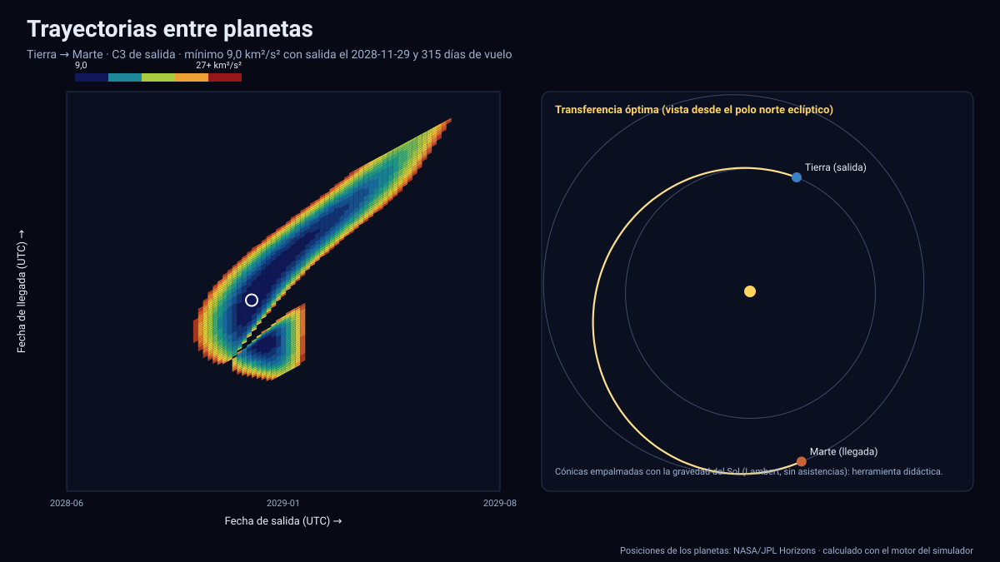

# Simulador de trayectorias entre planetas

[▶ Abrir el simulador](https://vladimiracunadev-create.github.io/astronomy-astrophysics-space-sciences-aerospace-engineering-learning-program/simuladores/trayectorias.html) · [Guía de uso](GUIA_DE_USO.md) · [Datos y efemérides](DATOS_Y_EFEMERIDES.md) · [Fuentes y modelos](FUENTES_Y_MODELOS.md)

## Qué hace

Dado un planeta de salida, un planeta de llegada y una **ventana de fechas** entre 2027 y 2050, calcula —con las posiciones y velocidades **oficiales de JPL**— todas las transferencias posibles y las ordena por costo:

- el **gráfico porkchop**: fecha de salida (horizontal) frente a fecha de llegada (vertical); el color es el **C3** de salida, el **Δv total**, la **v∞ de llegada** o el Δv de salida o de llegada, a elección. Un círculo blanco marca el mínimo;
- al hacer clic en cualquier punto, la **transferencia** elegida: fechas, tiempo de vuelo, C3, v∞ de salida y de llegada, Δv de salida (desde una órbita en torno al planeta de partida) y de llegada (captura en una órbita en torno al planeta de destino), perihelio y afelio, excentricidad, inclinación y ángulo de transferencia, comparados con la transferencia de Hohmann ideal;
- una **vista 3D** de la nave y de los planetas desde el polo norte eclíptico, con un control para recorrer el viaje.

Cuerpos: Mercurio, Venus, Tierra, Marte, Júpiter, Saturno, Urano, Neptuno, el baricentro de Plutón y Ceres. Hay siete ejemplos preparados (Tierra → Marte en 2028–2029 y 2031, Tierra → Venus, Tierra → Júpiter, Tierra → Saturno, Marte → Tierra y Tierra → Mercurio).

## Método

1. **Problema de Lambert** por variables universales (Bate–Mueller–White), sin vueltas completas y en sentido directo: dadas la posición de salida, la de llegada y el tiempo de vuelo, resuelve la órbita heliocéntrica de dos cuerpos que une ambos puntos.
2. **v∞**: se resta la velocidad del planeta (efemérides de JPL) de la velocidad de la nave al salir y al llegar. **C3 = v∞²** de salida.
3. **Δv**: desde una órbita de periapsis `rp` y apoapsis `ra` en torno al planeta, `Δv = √(v∞² + 2μ/rp) − √(μ(1+e)/rp)` con `e = (ra − rp)/(ra + rp)` (circular si `ra = rp`). Por omisión: órbita circular de 300 km de altitud en Venus, la Tierra y Marte; de 400 km en Mercurio; elipses de periapsis 4, 2, 2,5 y 2,5 radios y apoapsis 100, 50, 50 y 50 radios en Júpiter, Saturno, Urano y Neptuno. Las altitudes se pueden editar.
4. **Propagación** de la trayectoria por variables universales para dibujarla.

## Validación

| Comprobación | Referencia | Resultado |
|---|---|---|
| Problema de Lambert | Ejemplo 5.2 de Curtis, *Orbital Mechanics for Engineering Students* (v₁ = (−5,9925; 1,9254; 3,2456), v₂ = (−3,3125; −4,1966; −0,38529) km/s) | Coincide a ≤ 5×10⁻⁴ km/s |
| Propagación | Llega a r₂ tras el tiempo de vuelo | ≤ 0,05 km |
| Hohmann Tierra–Marte (órbitas circulares y coplanares) | Δv de salida analítico y 258,8 d | Coincide a 0,02 km/s y 0,3 d |
| Ventana Tierra → Marte 2028–2029 | La salida óptima cae entre noviembre de 2028 y febrero de 2029, unos 3–4 meses antes de la oposición del 25 de marzo de 2029 | Salida del 29 de noviembre de 2028, **C3 mínimo 9,0 km²/s²** |
| Tierra → Venus 2027–2028 | C3 mínimo bajo, vuelo de 3–6 meses | **C3 9,2 km²/s²**, salida el 25 de marzo de 2028, 171 d |
| Tierra → Júpiter 2027–2028 | Hohmann: v∞ = 8,8 km/s (C3 ≈ 77) | **C3 80,6 km²/s²** |
| La nave llega al planeta | Posición de JPL en la fecha de llegada | < 1 km |

La referencia de Curtis y las fórmulas de Hohmann son independientes de las efemérides; las ventanas se comprueban contra la geometría de las oposiciones (calculadas con las mismas efemérides y validadas con fechas publicadas, véase el [simulador del Sistema Solar](sistema-solar.md)).

## Límites (importante)

- **Es una herramienta didáctica, no de diseño de misiones.** Cónicas empalmadas: la nave sólo siente la gravedad del Sol y los planetas son esferas de influencia puntuales; sin perturbaciones, **asistencias gravitatorias**, empuje continuo, maniobras de corrección, restricciones de lanzador, ángulos de aproximación ni márgenes.
- Sin vueltas completas y sólo en sentido directo (como los planetas).
- Los C3 y Δv resultantes son comparables con los de misiones reales sólo en orden de magnitud y tendencia; una misión real los optimiza con integración numérica completa.
- El Δv de captura supone una única maniobra en el periapsis.

Sistema de referencia: eclíptica y equinoccio J2000 (ICRF) heliocéntrico; unidades: km, km/s y días; tiempo: TDB mostrado en UTC; datos: [efemérides de JPL](DATOS_Y_EFEMERIDES.md) de los planetas (error de interpolación en la [tabla](TABLA_DE_PRECISION.md)).

## Archivos

[`trayectorias.html`](https://vladimiracunadev-create.github.io/astronomy-astrophysics-space-sciences-aerospace-engineering-learning-program/simuladores/trayectorias.html) · [`paginas/trayectorias.js`](../paginas/trayectorias.js) · [`motor/trayectoria.js`](../motor/trayectoria.js) · [`motor/app-trayectoria.js`](../motor/app-trayectoria.js)
