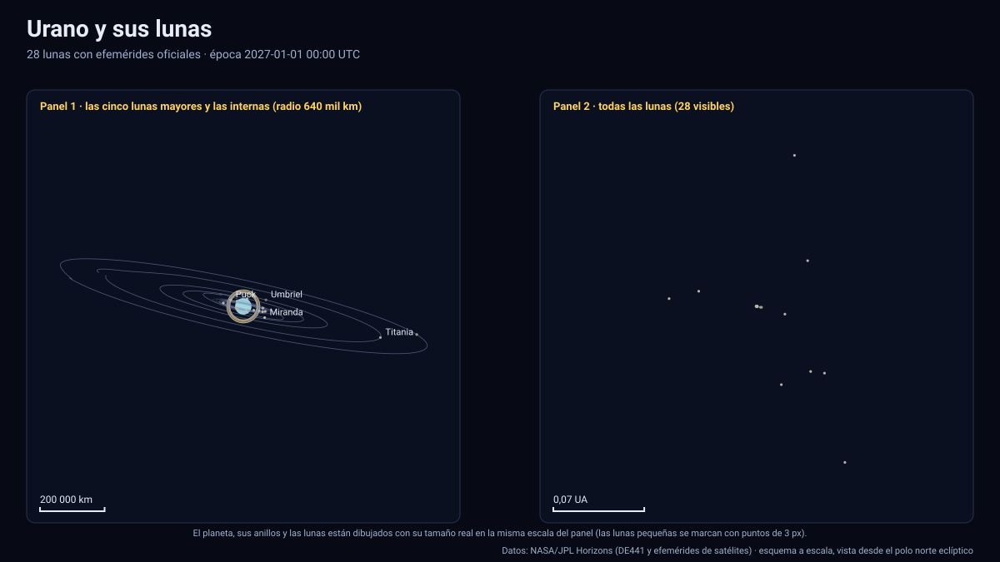

# Simulador de Urano y sus lunas

[▶ Abrir el simulador](https://vladimiracunadev-create.github.io/astronomy-astrophysics-space-sciences-aerospace-engineering-learning-program/simuladores/urano.html) · [Guía de uso](GUIA_DE_USO.md) · [Datos y efemérides](DATOS_Y_EFEMERIDES.md) · [Tabla de precisión](TABLA_DE_PRECISION.md)

## Qué muestra

Urano, sus anillos y los **28 satélites** para los que JPL Horizons publica efemérides, entre 2027 y 2050:

- **Cinco lunas mayores**: Miranda, Ariel, Umbriel, Titania (radio 788,9 km) y Oberón, con tamaño y órbita reales.
- **Trece lunas internas**: Cordelia, Ofelia, Bianca, Crésida, Desdémona, Julieta, Porcia, Rosalinda, Cupido, Belinda, Perdita, Puck y Mab. Están muy apretadas entre los anillos y Miranda; sus periodos son de 0,34 a 0,92 días.
- **Diez lunas irregulares**: Calibán, Síctorax, Próspero, Setebos, Estéfano, Trínculo, Francisco, Margarita, Fernando y S/2023 U1, a entre 4×10⁶ y 2×10⁷ km del planeta.
- **Anillos**: los diez anillos estrechos principales (6, 5, 4, α, β, η, γ, δ, λ y ε) con los radios publicados por la NASA. Urano tiene 13 anillos conocidos; los más tenues no se dibujan.
- Urano con su orientación IAU: un eje inclinado **97,8°** respecto de su órbita (rota «de lado» y en sentido retrógrado), achatamiento de 2,3 % y la **latitud subsolar**, que recorre casi todo el planeta en un año de 84 años terrestres.

Sólo 15 de los 28 satélites tienen radio publicado en Horizons (las cinco lunas mayores y las internas hasta Puck); el resto se dibuja como punto. Urano tiene hoy 29 satélites conocidos: Horizons aún no incluye el más reciente (S/2025 U1, informado en 2025), así que **no se muestra**.

## Estaciones de Urano (calculadas)

La latitud subsolar sale de la posición heliocéntrica de Urano (JPL) y del polo IAU. Su valor máximo entre 2027 y 2050 es de **82,2°** (= 180° − 97,8°) y se alcanza hacia **2030**: el polo norte IAU casi apunta al Sol. Esto es consistente con un equinoccio en diciembre de 2007: desde el afelio, donde el planeta va más lento, el Sol tarda ≈ 22,8 años en alcanzar el solsticio. La prueba automática exige que el máximo sea de 82,2° ± 0,7° y ocurra entre 2029,5 y 2031,0. El 1 de enero de 2027 la latitud subsolar es de 74,2°: el Sol ilumina casi de frente el hemisferio norte IAU y los anillos y las órbitas de las lunas se ven casi circulares desde el Sol.

## Precisión

| Cuerpo | Periodo | Paso de la tabla | Error máx. medido contra JPL |
|---|---|---|---|
| Miranda | 1,41 d | 2,9 h (`f32`) | 0,08 km |
| Ariel · Umbriel | 2,5 · 4,1 d | 5,2 · 8,5 h | 0,15 · 0,30 km |
| Titania · Oberón | 8,7 · 13,5 d | 17,9 · 27,7 h | 0,5 · 2,6 km |
| Lunas internas (Cordelia … Puck, Perdita, Mab, Cupido) | 0,34–0,92 d | 69–188 min (`i16`) | 4–16 km |
| Lunas irregulares | 267–2 839 d | 7–30 d | 9–74 km |

El peor error relativo de las 28 lunas es de 2,2×10⁻⁴ del radio orbital (Ofelia, 11,7 km sobre 53 800 km). Todas las lunas están en la [tabla de precisión](TABLA_DE_PRECISION.md); las internas usan `i16`, de modo que su error incluye la cuantización. Las 28 lunas tienen cobertura completa 2027–2050.

La posición de **Urano** (centro del planeta, heliocéntrica) tiene un error máximo de 20 km con un paso de 4 días.

## Tolerancias

| Magnitud | Tolerancia |
|---|---|
| Posición de las lunas respecto de Urano | ≤ 6×10⁻⁴ del radio orbital (validación automática; medido ≤ 2,2×10⁻⁴) |
| Anillos | Radios orientativos de NASA, opacidad ilustrativa |
| Eclipses por la sombra de Urano | Cono de umbra de radio 25 559 km y Sol extenso; sin penumbra |
| Orientación de Urano | Polo y rotación IAU sin términos periódicos |
| Textura | Ilustrativa (la atmósfera real es casi lisa: no hay bandas visibles en luz visible) |

Sistema de referencia: eclíptica y equinoccio J2000 (ICRF); unidades: km y días julianos; tiempo: TDB mostrado en UTC; versiones: Horizons API 1.2, kernel `ura184`; datos descargados el 13 de noviembre de 2026.

## Archivos

[`urano.html`](https://vladimiracunadev-create.github.io/astronomy-astrophysics-space-sciences-aerospace-engineering-learning-program/simuladores/urano.html) · [`paginas/urano.js`](../paginas/urano.js) · [`datos/urano.json`](../datos/urano.json) · [`datos/urano.bin`](../datos/urano.bin)
