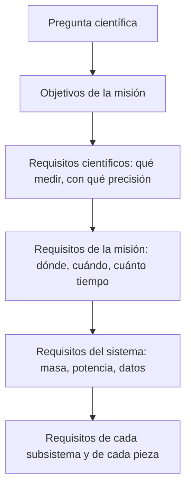

# Capítulo 1 · Objetivo y requisitos de la misión

## Por qué existe este capítulo

Una misión espacial no empieza con un cohete: empieza con una **pregunta**. Todo lo demás (trayectoria, masa, costo, riesgo) se decide para poder responderla. Si la pregunta es vaga, cada decisión posterior queda sin criterio y la misión se encarece sin mejorar.

## La pregunta de Mars 2020

La NASA formuló cuatro objetivos para la misión (redactados aquí con palabras propias):

1. **Habitabilidad.** Averiguar si el cráter Jezero, que fue un lago hace unos 3.500 millones de años, pudo sostener vida microbiana.
2. **Biofirmas.** Buscar señales de vida antigua en rocas que preservan bien las huellas del pasado.
3. **Muestras.** Reunir y dejar en un lugar seguro muestras de roca y suelo para que otra misión las traiga a la Tierra.
4. **Preparar el futuro.** Probar tecnología para la exploración humana, como producir oxígeno a partir de la atmósfera marciana.

**Observa la estructura.** Hay un objetivo científico (1 y 2), un objetivo de *legado* (3) y uno de *tecnología* (4). Las misiones reales casi siempre mezclan las tres cosas, y cada una tira del diseño en una dirección distinta.

## Del objetivo al requisito

Un **requisito** es una frase que se puede comprobar. «Buscar vida» no lo es; «detectar compuestos orgánicos con una sensibilidad de x en rocas de y» sí. La cadena es:

*Descripción textual del diagrama:* la pregunta se baja por niveles hasta llegar a cada pieza; si un requisito de abajo no sirve a uno de arriba, sobra, y si uno de arriba no tiene requisitos abajo, nadie lo está cumpliendo.

### Ejemplos reales de decisiones que nacen del objetivo

| Objetivo | Decisión de diseño que provoca |
|---|---|
| Buscar vida antigua en un delta fluvial | Elegir Jezero (un antiguo delta), no un sitio llano y seguro |
| Llegar a un sitio con relieve | Incorporar navegación relativa al terreno para esquivar peligros al descender |
| Dejar muestras para el futuro | Llevar 43 tubos (38 para muestras y 5 de control) y un sistema para sellarlos y depositarlos |
| Probar producción de oxígeno | Embarcar un instrumento (MOXIE) que no aporta a la ciencia principal pero sí al legado |
| Operar durante un año marciano (≈ 687 días terrestres) o más | Fuente de energía que no dependa del Sol: un generador termoeléctrico de radioisótopos |

## Restricciones: lo que no se negocia

Además de los objetivos hay restricciones que vienen de fuera:

- **La física.** La ventana de lanzamiento aparece cada ≈ 26 meses (capítulo 2). Si te la pierdes, esperas dos años.
- **El presupuesto.** Un tope de costo y un calendario atados a decisiones políticas.
- **La capacidad del lanzador.** Cuánta masa llega a Marte (capítulo 3).
- **La protección planetaria.** Reglas internacionales para no contaminar (capítulo 8).
- **La herencia.** Mars 2020 reutilizó mucho del diseño del rover *Curiosity* (2012): chasis, sistema de aterrizaje con grúa aérea y muchas piezas. Reutilizar reduce riesgo y costo, pero limita lo nuevo.

## Criterios de éxito

Un error clásico es medir el éxito solo como «llegó». Define tres niveles **antes** de partir:

- **Éxito mínimo:** aterrizar con vida útil y cumplir la parte esencial de los objetivos.
- **Éxito completo:** cumplir todos los objetivos durante la misión primaria.
- **Éxito extendido:** seguir funcionando y aportando después (Mars 2020 sigue operando más allá de su misión primaria; ⚠ verifica el estado actual).

## Ejercicio del capítulo

Elige **tu versión** de la misión a Marte (puedes cambiar el sitio, el tipo de vehículo o el objetivo) y redacta:

1. Una pregunta científica en una frase.
2. Tres objetivos (ciencia, legado, tecnología).
3. Diez requisitos comprobables, cada uno con su **unidad** y su **forma de verificación** (prueba, análisis, inspección o demostración).
4. Los tres niveles de éxito.

Guárdalo: es la sección 1 de tu dossier.

## Lo que viene

El capítulo 2 calcula **cuándo y cómo** salir de la Tierra para llegar a Marte con la menor energía posible, y por qué la misión real no eligió exactamente ese camino.

Siguiente: [capítulo 2 · Ventana y trayectoria](02-ventana-y-trayectoria.md) · [índice del taller](README.md)
