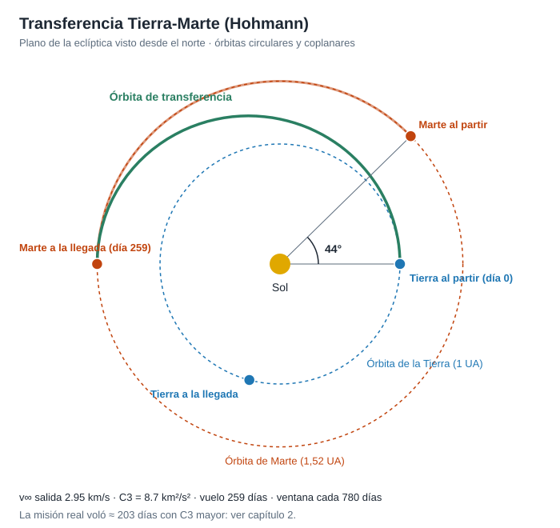

# Capítulo 2 · Ventana de lanzamiento y trayectoria

## Por qué existe este capítulo

La Tierra y Marte se mueven. Si lanzas cuando no toca, gastas muchísimo más combustible o simplemente no llegas. Elegir **cuándo** y **por dónde** es la primera decisión cara de la misión.

## El camino de menor energía: la transferencia de Hohmann

La órbita más económica entre dos órbitas circulares y coplanares es una elipse que toca ambas: la **transferencia de Hohmann**. La nave sale de la Tierra tangente a su órbita y llega a Marte tangente a la suya.

Con el laboratorio ([`laboratorio_T01.py`](laboratorio_T01.py), capítulo 1 del programa) obtienes, con órbitas circulares y coplanares:

| Magnitud | Valor | Unidad |
|---|---|---|
| Velocidad hiperbólica de salida (v∞) | 2,95 | km/s |
| C3 = v∞² | 8,7 | km²/s² |
| Delta-v desde una órbita baja de 200 km | 3,6 | km/s |
| Velocidad hiperbólica de llegada | 2,65 | km/s |
| Tiempo de vuelo | ≈ 259 | días |
| Ángulo de fase al partir | ≈ 44° | grados (Marte adelantado) |
| Período sinódico (entre ventanas) | ≈ 780 | días ≈ 25,6 meses |

*Figura 2.1.* La elipse verde toca la órbita de la Tierra al partir y la de Marte al llegar. Marte tiene que estar 44° por delante en el momento de la salida: por eso hay una ventana cada ≈ 26 meses. Se genera con [`figuras_T01.py`](figuras_T01.py).

**Cómo se lee.** El **C3** es la energía por unidad de masa que el lanzador debe dar a la nave para que escape de la Tierra: cuanto mayor, menos masa puede llevar el cohete. La **ventana** es el período en que la geometría Tierra-Marte permite llegar con un C3 razonable. Se repite cada ≈ 26 meses, y la de 2020 se abrió en julio.

## Por qué la misión real no usó Hohmann

Mars 2020 voló ≈ **203 días** (no 259) y usó un C3 más alto (⚠ del orden de 14 a 15 km²/s²; verifica en la hoja de datos). Las razones son de diseño, no de error:

- **Tiempo de vuelo menor** reduce la exposición a la radiación y el tiempo en que algo puede fallar, y deja más tiempo de maniobra antes de la entrada.
- **Geometría de llegada.** La velocidad de entrada y el ángulo de llegada dependen de la trayectoria, y deben caer dentro de un corredor estrecho para que el escudo térmico y el paracaídas funcionen.
- **Las órbitas no son circulares ni coplanares.** Marte tiene una órbita bastante excéntrica (0,093) e inclinada 1,85°. Ese detalle cambia el delta-v de una ventana a otra: algunas ventanas son «fáciles» y otras «difíciles».
- **Margen del lanzador.** Con el cohete elegido (capítulo 3), subir el C3 reduce la masa que llega a Marte; se busca el equilibrio.

Moraleja: **el modelo simple te da el orden de magnitud y la intuición; el diseño real lo refina.**

## Cómo se diseña una ventana real

1. **Mapa «pork chop».** Se calcula, para cada fecha de salida y de llegada, el C3 necesario y la v∞ de llegada. El gráfico muestra islas de mínima energía; la ventana es esa isla.
2. **Restricciones de lanzamiento.** Hora del día, azimut permitido desde el sitio de lanzamiento, iluminación para el seguimiento.
3. **Restricciones de llegada.** Que la entrada ocurra con visibilidad de las antenas de la Red del Espacio Profundo y de los orbitadores que hacen de relevo.
4. **Duración de la ventana.** La de Mars 2020 duró unas tres semanas (⚠ verifica las fechas exactas); cada día hay que lanzar en un instante concreto que depende de la rotación de la Tierra.
5. **Plan B.** Si hay un retraso de un día, ¿sigue valiendo? Si se agota la ventana, ¿qué pasa con el calendario y el costo?

## Correcciones de trayectoria (TCM)

Ningún lanzamiento es perfecto. Tras la inyección, la nave se desvía un poco y se corrige con **maniobras de corrección de trayectoria (TCM)**. Son pocas y pequeñas (decenas de m/s en total), pero sin ellas errarías Marte por miles de kilómetros. Se planean con antelación: las primeras corrigen el error del lanzador y las últimas afinan el punto de entrada. En el laboratorio, una corrección de 20 m/s con hidrazina cuesta unos 38 kg de combustible sobre una nave de ≈ 4.050 kg.

## Sistema de referencia y unidades

- Heliocéntrico eclíptico para el crucero; areocéntrico para la llegada.
- Distancias en km o UA, velocidades en km/s, tiempos en días y en UTC.
- Fechas siempre en **UTC** y declarando la escala de tiempo: mezclar hora local con UTC es una fuente clásica de errores.

## Ejercicio del capítulo

1. Con el laboratorio, calcula para tu misión el C3, el delta-v desde LEO y el tiempo de vuelo de una transferencia de Hohmann.
2. Cambia el tiempo de vuelo a ≈ 200 días (usa el problema de Lambert, o el ajuste que indique tu profesor) y comprueba cuánto sube el C3.
3. Escribe en una tabla: ventana propuesta, razón de elegirla, plan B si se retrasa.
4. Si hoy es noviembre de 2026, ¿cuál es la siguiente ventana a Marte? (Pista: ≈ 26 meses después de la anterior; el estudiante verifica con una fuente actual.)

## Errores frecuentes

- **Creer que «más rápido» es «mejor».** Más rápido cuesta más C3 y reduce la masa útil.
- **Mezclar unidades** (km/s con m/s, UA con km). Ver el caso del Mars Climate Orbiter, en el capítulo 7.
- **Olvidar la ventana de llegada.** Una salida buena puede dar una llegada en mal momento.

Anterior: [capítulo 1](01-objetivo-y-requisitos.md) · Siguiente: [capítulo 3 · Lanzador, masas y vehículo](03-lanzador-masas-y-vehiculo.md)
