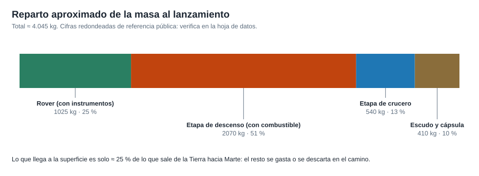

# Capítulo 3 · Lanzador, masas y vehículo

## Por qué existe este capítulo

La masa manda. Cada kilogramo extra exige más combustible, que a su vez pesa y exige más combustible: el efecto se multiplica. Este capítulo reparte la masa de una misión real y explica por qué un cohete grande deja en Marte solo una fracción de lo que sube.

## La ecuación del cohete

La ecuación de Tsiolkovski relaciona el cambio de velocidad con la masa:

**Δv = Isp · g₀ · ln(m₀ / m_f)**

Donde Isp es el impulso específico (s), g₀ = 9,80665 m/s², m₀ la masa inicial y m_f la final (kg). Quien la usa debe recordar que el logaritmo castiga: para duplicar el Δv hay que elevar la razón de masas al cuadrado. Por eso las naves no son «un cohete que sube»: son **etapas** que se sueltan para no cargar con estructura vacía.

## El lanzador de Mars 2020

La misión voló en un **Atlas V 541** de la United Launch Alliance, lanzado desde Cabo Cañaveral (pad SLC-41):

- **5** = cofia (cubierta de la carga) de 5 m de diámetro.
- **4** = cuatro propulsores de combustible sólido laterales.
- **1** = un motor en la etapa superior (Centaur).

El contrato de lanzamiento costó unos 243 millones de dólares (⚠ cifra pública redondeada). El Atlas V puso la nave en una trayectoria hacia Marte con un C3 del orden de 14 a 15 km²/s² (⚠ verificar). A mayor C3, menos masa: el fabricante publica una curva «masa frente a C3» para cada configuración, y **tu misión debe caer por debajo de esa curva con margen**.

> **Ejercicio de lectura.** Busca la curva de capacidad del Atlas V 541 (guía de usuario del lanzador, fuente pública). Marca el punto de Mars 2020 y calcula cuánto margen de masa queda. ¿Qué pasaría con una nave 10 % más pesada?

## Reparto de la masa

*Figura 3.1.* Reparto aproximado de ≈ 4.050 kg al lanzamiento (cifras redondeadas, ⚠ verificar). Solo el rover, ≈ 25 %, llega a la superficie. El resto es la **infraestructura para llegar**: guiar el viaje, frenar y posar con suavidad.

| Parte | Masa aprox. | Función |
|---|---|---|
| Rover Perseverance | ≈ 1.025 kg | La razón de la misión: ciencia y muestras |
| Etapa de descenso («grúa aérea») | ≈ 2.070 kg con combustible | Frena con motores y baja el rover con cables |
| Etapa de crucero | ≈ 540 kg | Energía, comunicaciones y correcciones en el viaje |
| Escudo térmico y cápsula trasera | ≈ 410 kg | Protegen en la entrada; albergan el paracaídas |

### Cómo se maneja la masa durante el diseño

Un proyecto serio trabaja con **tres números** para cada pieza, y los lleva en una hoja viva:

- **Masa actual estimada (CBE):** la mejor estimación hoy.
- **Reserva (contingencia):** un porcentaje según la madurez (una pieza nueva sin probar lleva más que una heredada).
- **Masa máxima esperada (MEV):** CBE más reserva; es la que se compara con la capacidad del lanzador.

Regla práctica: la contingencia baja al avanzar el diseño (por ejemplo ≈ 30 % al inicio, ≈ 10 % cerca del lanzamiento), pero **nunca llega a cero antes de pesar la nave real**. Se pesa de verdad antes del lanzamiento.

## Herencia: Curiosity como base

Mars 2020 reutilizó el diseño de Curiosity (aterrizó en 2012) para reducir riesgo y costo: la arquitectura de entrada y descenso, la grúa aérea y buena parte del chasis. Lo nuevo fue lo que respondía a los objetivos: instrumentos, brazo y torreta con sistema de muestreo, ruedas más resistentes y la navegación relativa al terreno. **Heredar no es copiar: cada cambio abre una pregunta de fiabilidad** (capítulo 7).

## Ejercicio del capítulo

1. Con el laboratorio (sección 4), calcula cuánto combustible gasta una corrección de 20 m/s en una nave de 4.050 kg con hidrazina (Isp ≈ 220 s).
2. Arma tu propia tabla de masas con CBE, reserva y MEV para una misión de 1 tonelada en superficie.
3. Calcula la razón masa-lanzamiento / masa-en-superficie de tu diseño y explica por qué es tan alta.
4. Elige un lanzador distinto y justifica con su curva de capacidad si tu masa cabe.

## Errores frecuentes

- **Olvidar la reserva.** Una nave que «cabe justo» en el cálculo no cabe en la realidad.
- **Sumar Δv de etapas distintas sin pasar por masas.** El Δv total no es la suma simple de potencias.
- **Comparar masas húmedas y secas.** Siempre declara cuál usas.

Anterior: [capítulo 2](02-ventana-y-trayectoria.md) · Siguiente: [capítulo 4 · Subsistemas](04-subsistemas.md)
